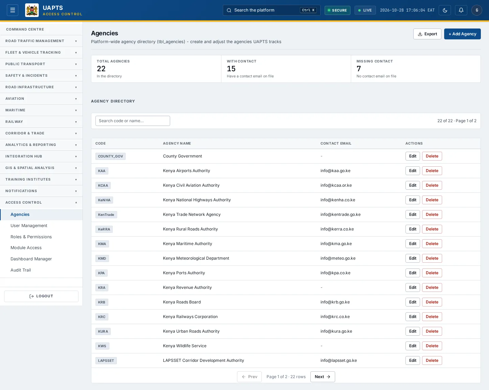

# Agencies

_Access Control › Agencies_ · Route `/agencies`

**Agencies** is the platform-wide directory of the organisations UAPTS tracks (KeNHA, NTSA, KPA, KRC and so on). Users, departments, feeds and Module Access are all attached to an agency, so this list is the starting point for everything else.

> 🎬 **Video tutorial:** _coming soon._  
> <!-- VIDEO-URL: access-control/agencies | paste the link here, e.g. [Watch the walkthrough](https://…) -->

## Highlights

- Summary tiles above a searchable, paged directory.
- Columns: **Code**, **Agency Name**, **Contact Email**.
- **+ Add Agency**, **Edit** and **Delete** — only for accounts allowed to write (super admin).
- Other admins see the directory read-only.

## Enabling and access

Open **Access Control → Agencies** (`/agencies`), module **M10**. The directory itself is platform data, so the route is limited to **Ministry Oversight** and **Super admin**, plus admin-tier accounts at SDT/SDR. **Writing** is narrowed to super admin.

## Add or change an agency

1. Click **+ Add Agency**.
2. Enter the **Agency code** (short unique code such as `KPA`), the **Agency name** and an optional **Contact email**.
3. Click **Add Agency**.
4. To change one, click **Edit** on its row, adjust the fields and click **Save Changes**.
5. **Delete** removes an agency after confirmation — do this only for agencies with no users or feeds.

## Data sources and feeds

| Data point | Endpoint | Ingested via |
|---|---|---|
| Agency directory | `GET /accounts/agencies/` | Platform reference data: created here (or bootstrapped by `seeds/bootstrap_agencies.py` on a new install). Not uploaded through the Integration Hub. |

## Permissions

Read: Ministry Oversight, Super admin and SDT/SDR admins. Create, edit and delete: **Super admin** only.

## Related topics

- [User Management](user-management.md)
- [Module Access](module-access.md)

## On this page

- [Highlights](#highlights)
- [Enabling and access](#enabling-and-access)
- [Add or change an agency](#add-or-change-an-agency)
- [Data sources and feeds](#data-sources-and-feeds)
- [Permissions](#permissions)
- [Related topics](#related-topics)

## Support

- **Your agency administrator** is the first contact for access, role and data-quality questions.
- **Data feeds, templates and API questions:** `api-support@uapts.go.ke` (include the `X-Request-ID` response header from a failing call).
- **Security concerns:** `security@uapts.go.ke`. Do not report suspected vulnerabilities publicly.
