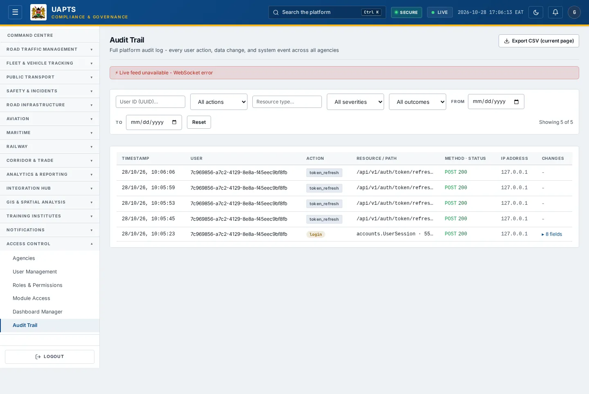
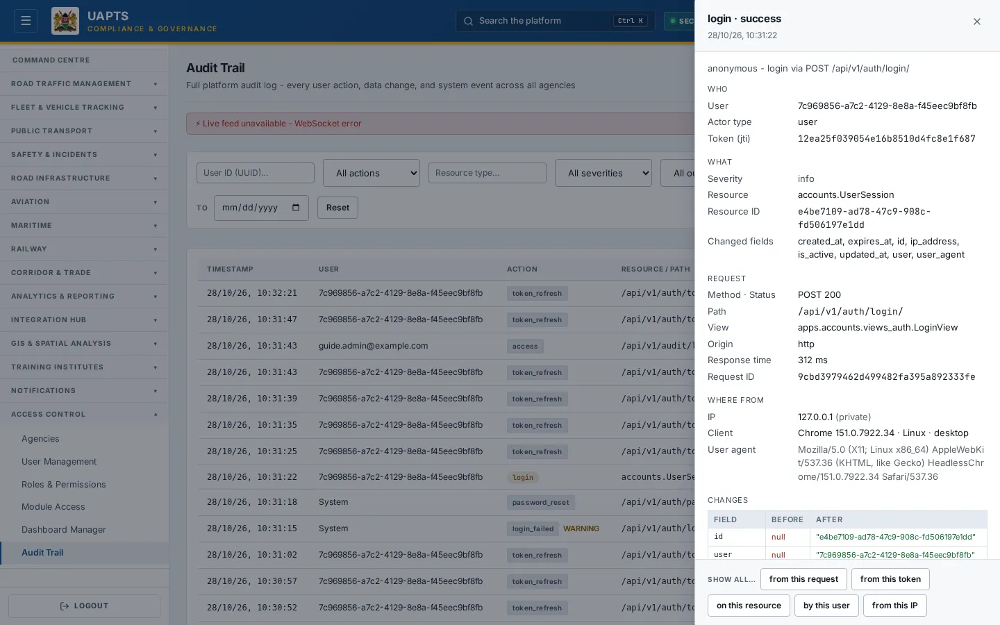

# Audit Trail

_Access Control › Audit Trail_ · Route `/audit`

The **Audit Trail** is the platform's permanent record: every user action, data change and system event across all modules, with what changed.

> 🎬 **Video tutorial:** _coming soon._  
> <!-- VIDEO-URL: access-control/audit-trail | paste the link here, e.g. [Watch the walkthrough](https://…) -->

## Highlights

- Live stream of new entries (a banner says _Live — connected_, or _paused while filtered/paginated_).
- **Verify log integrity** — checks the tamper-evident chain and reports _Chain intact — N entries verified_ or where it is broken.
- Filter by **action**, **severity**, **outcome**, **From** date, resource type and user ID.
- Click an entry to open its **detail panel**: Who, What, Request, Origin (where from, location, client) and the changes, with pivot links to everything from the same request, token, resource, user or IP.
- Expand any row to see **Before / After** values for the fields that changed.
- **Export CSV** for compliance reviews (Analyst and above).
- Includes Query Builder runs, role changes, uploads and configuration changes.

## Enabling and access

Open **Access Control → Audit Trail** (`/audit`), module **M10**. Needs the **Admin** tier, or the dedicated **auditor** role.

## Working with this page

1. Choose **All actions**, **All severities** and **All outcomes** values to narrow the list; type a **Resource type…** or **User ID (UUID)…**. **Reset** clears the filters.
2. Read the columns: **Timestamp**, **User**, **Action**, **Resource / Path**, **Method · Status**, **IP Address**, **Changes**.
3. Click a row's **▸ N fields** to open the **Field / Before / After** table, or click the entry itself to open the detail panel; use its **pivot** links to list everything from the same request, token, resource, user or IP.
4. Click **Verify log integrity** to check that no entry has been altered (the result says _Chain intact_ or names the broken entry).
5. Use **← Prev / Next** to page through (_Showing N of M_).
6. Click **Export CSV** to download the entries for review.

## Data sources and feeds

| Data point | Endpoint | Ingested via |
|---|---|---|
| Audit entries | `GET /audit/logs/` | Written automatically by UAPTS for every state-changing request and for tracked models. Not uploaded. |
| Live entries | `/ws/audit/` | WebSocket stream of new entries. |

## Permissions

Admin tier (own agency) and super admin; the **auditor** role can open this page without the admin tier. Audit entries cannot be edited or deleted.

## Related topics

- [User Management](user-management.md)
- [Roles & Permissions](roles-and-permissions.md)

## On this page

- [Highlights](#highlights)
- [Enabling and access](#enabling-and-access)
- [Working with this page](#working-with-this-page)
- [Data sources and feeds](#data-sources-and-feeds)
- [Permissions](#permissions)
- [Related topics](#related-topics)

## Support

- **Your agency administrator** is the first contact for access, role and data-quality questions.
- **Data feeds, templates and API questions:** `api-support@uapts.go.ke` (include the `X-Request-ID` response header from a failing call).
- **Security concerns:** `security@uapts.go.ke`. Do not report suspected vulnerabilities publicly.
