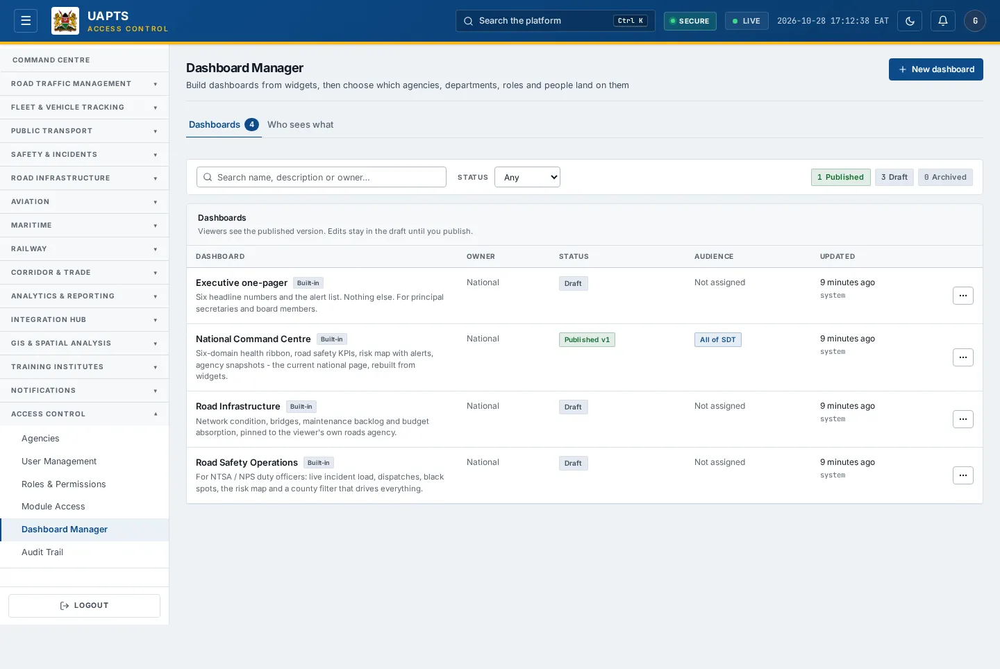

# Dashboard Manager

_Access Control › Dashboard Manager_ · Route `/admin/dashboards`

**Dashboard Manager** lets administrators build dashboards from widgets and choose which agencies, departments, roles and people land on them. Viewers see the **published** version; edits stay in a draft until published.

> 🎬 **Video tutorial:** _coming soon._  
> <!-- VIDEO-URL: access-control/dashboard-manager | paste the link here, e.g. [Watch the walkthrough](https://…) -->

## Highlights

- A list of dashboards with **Status** (Published / Draft / Archived), **Owner**, **Audience** and **Updated**; badges for **Built-in**, **National**, **Unpublished edits** and **Not assigned**.
- **What each audience lands on** — a matrix, resolved with the same rules the server uses, of the dashboard each department and role will see.
- Start from a **template** or an existing dashboard.
- Open the [editor](dashboard-editor.md) to design, preview, publish and roll back.

## Enabling and access

Open **Access Control → Dashboard Manager** (`/admin/dashboards`). The route needs the **Admin** tier **and** one of the dashboard permissions — `dashboards.manage` (national dashboards) or `dashboards.manage_agency` (your agency's). Without one the entry is hidden.

## Create a dashboard

1. Click **New dashboard**.
2. Enter a **Name**, choose the **Owner agency** (or **National (SDT)** if you manage national dashboards) and **Start from** a template.
3. Click **Create and open editor**.
4. Design the dashboard in the [editor](dashboard-editor.md), then **Publish** it and set its **Audience**.

## Find and review

1. Filter by **Status**; **Clear** resets.
2. Read the **Audience** column to see who a dashboard is assigned to; _Not assigned_ means nobody lands on it yet.
3. Use the **What each audience lands on** matrix to check, per department and role, which published dashboard wins. A national dashboard assigned to your users can take precedence over an agency one.
4. If the list says **No dashboards on the server yet**, a platform engineer must load the starter set on the backend machine (`python manage.py seed_dashboards --publish-national`) — or you can start one from a template.

## Data sources and feeds

| Data point | Endpoint | Ingested via |
|---|---|---|
| Dashboards, versions, assignments | `/dashboards/`, `/dashboards/<id>/versions/`, `/dashboards/<id>/assignments/` | Created in this tool (stored by UAPTS). |
| Directory of agencies, departments, roles | `GET /dashboards/directory/` | Platform reference data (falls back to accounts data if the directory is empty). |
| What a viewer gets | `GET /dashboards/resolve/` | Resolved from published dashboards and assignments. |

The widgets on a dashboard read the same endpoints as the module pages; see their **Data sources and feeds** sections.

## Permissions

Admin tier plus `dashboards.manage` or `dashboards.manage_agency`. Agency managers can manage only dashboards their agency owns.

## Related topics

- [Dashboard editor](dashboard-editor.md)
- [Command Centre home](../command-centre/home.md)

## On this page

- [Highlights](#highlights)
- [Enabling and access](#enabling-and-access)
- [Create a dashboard](#create-a-dashboard)
- [Find and review](#find-and-review)
- [Data sources and feeds](#data-sources-and-feeds)
- [Permissions](#permissions)
- [Related topics](#related-topics)

## Support

- **Your agency administrator** is the first contact for access, role and data-quality questions.
- **Data feeds, templates and API questions:** `api-support@uapts.go.ke` (include the `X-Request-ID` response header from a failing call).
- **Security concerns:** `security@uapts.go.ke`. Do not report suspected vulnerabilities publicly.
