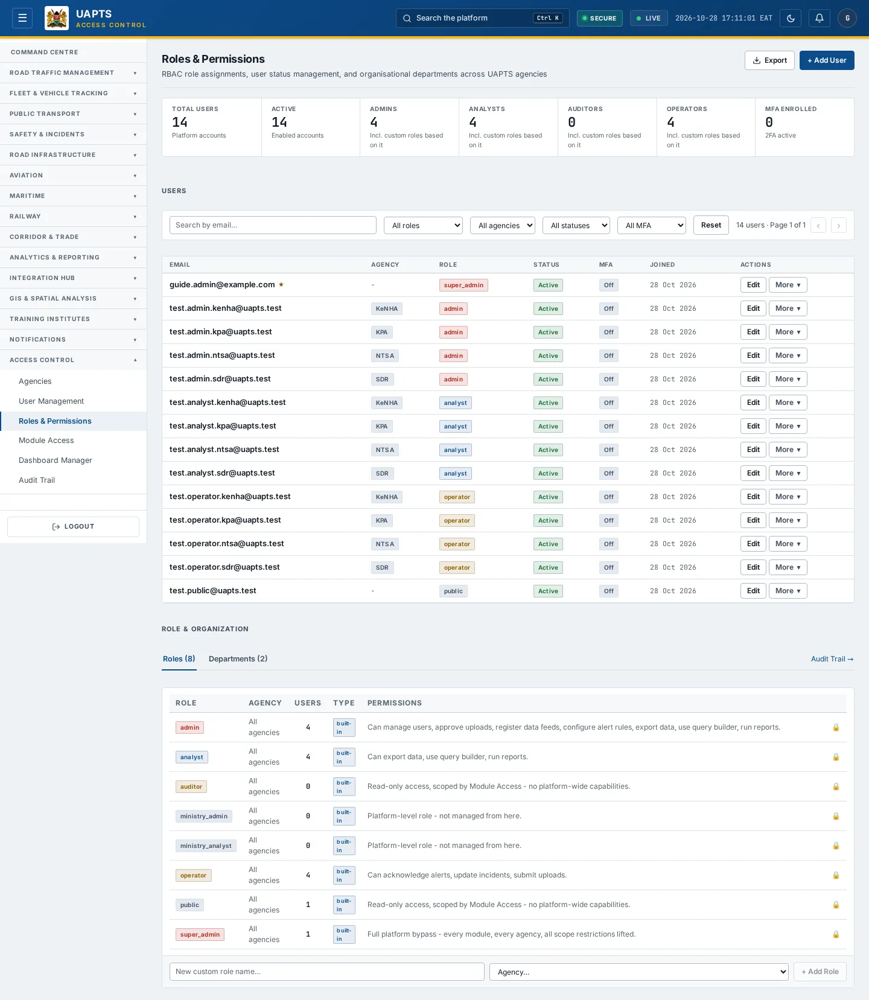
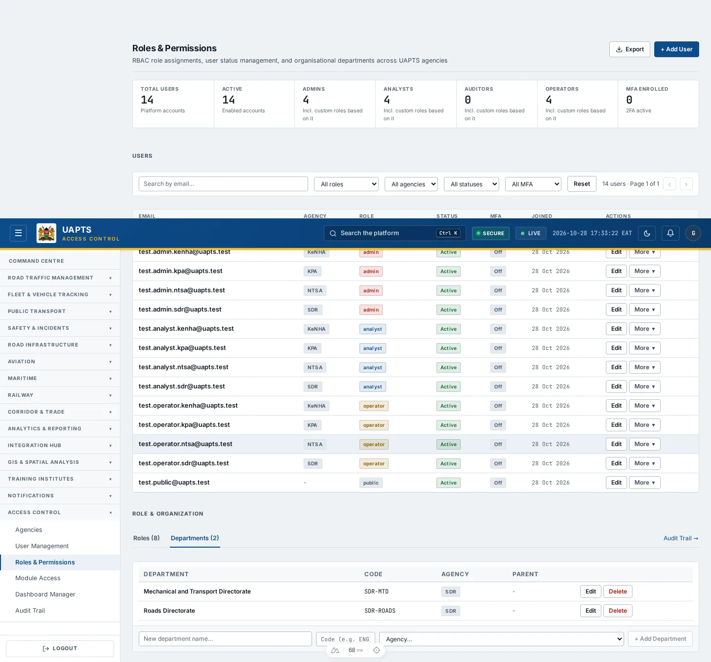

# Roles & Permissions

_Access Control › Roles & Permissions_ · Route `/roles`

**Roles & Permissions** shows who has which role, lets administrators change roles and status, and lists the platform's roles and departments. This page also explains **how access works** across UAPTS.

> 🎬 **Video tutorial:** _coming soon._  
> <!-- VIDEO-URL: access-control/roles-and-permissions | paste the link here, e.g. [Watch the walkthrough](https://…) -->

## How access works

Access is decided in layers, and each layer can only **narrow** the one above it:

1. **Baseline policy** — which modules each agency gets, by domain (Roads, Fleet, Urban transit, Regulation, Rail, Maritime, Aviation).
2. **Ceiling and enabled scopes** — set by the super admin and the agency admin (`Module Access`).
3. **Role tier** — what each role may do inside the modules.
4. **Capabilities** — named permissions such as `export` or `approve_uploads`.

The **server enforces** access; the screens only reflect it. Unknown roles are denied by default.

## Role tiers and capabilities (baseline)

| Role | Tier (higher = more) | Capabilities |
|---|---|---|
| `super_admin` | 100 | — |
| `oversight` | 50 | `export`, `query_builder`, `run_reports` |
| `admin` | 40 | `manage_users`, `approve_uploads`, `register_feeds`, `configure_rules`, `export`, `query_builder`, `run_reports` |
| `analyst` | 30 | `export`, `query_builder`, `run_reports` |
| `operator` | 20 | `acknowledge_alerts`, `update_incidents`, `submit_uploads` |
| `auditor` | 25 | — |
| `public` | 10 | — |

| Capability | What it allows |
|---|---|
| `manage_users` | Create, change and delete users and roles. |
| `query_builder` | Use the Query Builder. |
| `export` | Export CSV from tables. |
| `run_reports` | Generate reports. |
| `approve_uploads` | Commit validated uploads; promote reference GIS layers. |
| `register_feeds` | Register feeds and test connections. |
| `configure_rules` | Create alert rules and escalation workflows. |
| `acknowledge_alerts`, `update_incidents`, `submit_uploads` | Operator capabilities. |

## Highlights

- Users table with role, agency, status, MFA, staff flag and join date.
- **Edit** a user's role and active state inline; **Save** or **Cancel**.
- **Role & Organization** panel: roles (built-in or custom, each with an agency and a **base tier**) and departments, both of which you can add, edit and delete.
- **+ Add User** and **Audit Trail** shortcuts.

## Enabling and access

Open **Access Control → Roles & Permissions** (`/roles`), module **M10**. Needs the **Admin** tier.

## Change a user's role or status

1. Filter the **Users** table (role, agency, status, MFA) or search by email.
2. Click **Edit** on the row.
3. Choose the new role (admin · analyst · operator · public) and set **Active** or **Inactive**.
4. Click **Save** (or **Cancel**). Use **More ▾ → Deactivate / Activate / Delete** for account state.

## Roles and departments

1. Open the **Roles** tab. Each role shows its **Users** count, **Type** (_built-in_ or _custom_) and a plain-language **Permissions** description. Built-in roles: **admin** — manage users, configure integrations, access all modules; **analyst** — read data, run queries, generate reports; **operator** — update incident status, dispatch resources, trigger feed sync; **public** — read-only published dashboards.
2. A role has an **Agency** (or _All agencies_). A custom role with _No base tier yet_ cannot be assigned until you pick its **Base tier…** and click **Set** — the tier decides what the role may do.
3. To add a **custom role**, type its name, choose its **Agency…** and click **+ Add Role**. **Delete** removes a custom role.
4. Open the **Departments** tab to see **Department**, **Code**, **Agency** and **Parent**. Use **+ Add Department** (choose the agency first), **Edit** or **Delete**.

## Module access by agency

The baseline policy gives each agency the modules below. Super admins can narrow these under **Module Access**.

| Module | Agencies with full access | Read-only |
|---|---|---|
| M01 · Command Centre | KENHA, KURA, KERRA, SDR, SDR_MTD, SDT, NTSA, NAMATA, KRC, KPA, KMA, NCTTCA, LAPSSET | — |
| M02 · Road Traffic | KENHA, KURA, KERRA, SDR, SDT, NAMATA | COUNTY_GOV, KRB, NPS |
| M03 · Fleet and Vehicle Tracking | SDR, SDR_MTD, SDT, NTSA | — |
| M04 · Public Transport | KURA, SDT, NTSA, NAMATA | — |
| M05 · Safety and Incidents | KENHA, KURA, KERRA, SDR, NPS, SDT, NTSA | KCAA, KWS |
| M06 · Road Infrastructure | KENHA, KURA, KERRA, SDR, KRB, SDT | — |
| M07a · Aviation | KAA, KCAA, SDT | — |
| M07b · Maritime | SDT, KPA, KMA | — |
| M08 · Railway | SDT, KRC | — |
| M09 · Reporting and Query Builder | KENHA, KURA, KERRA, SDR, SDR_MTD, COUNTY_GOV, KAA, KCAA, KMD, KRA, KRB, KENTRADE, NPS, KWS, SDT, NTSA, NAMATA, KRC, KPA, KMA, NCTTCA, LAPSSET | — |
| M10 · Access Control | KENHA, KURA, KERRA, SDR, SDR_MTD, COUNTY_GOV, KAA, KCAA, KMD, KRA, KRB, KENTRADE, NPS, KWS, SDT, NTSA, NAMATA, KRC, KPA, KMA, NCTTCA, LAPSSET | — |
| M11 · Notifications | SDR, SDT | — |
| M12 · Data Integration Hub | KENHA, KURA, SDR, SDR_MTD, KRA, KENTRADE, SDT, NTSA, NAMATA, KRC, KPA, KMA, NCTTCA, LAPSSET | — |
| M13 · GIS | KENHA, KURA, KERRA, SDR, SDR_MTD, KWS, SDT, NTSA, NAMATA, KRC, KPA, KMA, NCTTCA, LAPSSET | KMD |
| M14 · Training Institutes | SDT, KRC | — |
| M15 · Corridor and Trade | SDR, SDT, NCTTCA, LAPSSET | KENTRADE |

## Data sources and feeds

| Data point | Endpoint | Ingested via |
|---|---|---|
| Users | `GET /accounts/users/` | Created in User Management. |
| Roles | `GET /accounts/roles/` | Built-in at install; custom roles added here. |
| Departments | `GET /accounts/departments/` | Seeded / administered by platform staff. |
| Access policy | `GET /access-control/` | Baseline file + overrides saved by admins. |

## Related topics

- [User Management](user-management.md)
- [Audit Trail](audit-trail.md)

## On this page

- [How access works](#how-access-works)
- [Role tiers and capabilities (baseline)](#role-tiers-and-capabilities-baseline)
- [Highlights](#highlights)
- [Enabling and access](#enabling-and-access)
- [Change a user's role or status](#change-a-users-role-or-status)
- [Roles and departments](#roles-and-departments)
- [Module access by agency](#module-access-by-agency)
- [Data sources and feeds](#data-sources-and-feeds)
- [Related topics](#related-topics)

## Support

- **Your agency administrator** is the first contact for access, role and data-quality questions.
- **Data feeds, templates and API questions:** `api-support@uapts.go.ke` (include the `X-Request-ID` response header from a failing call).
- **Security concerns:** `security@uapts.go.ke`. Do not report suspected vulnerabilities publicly.
