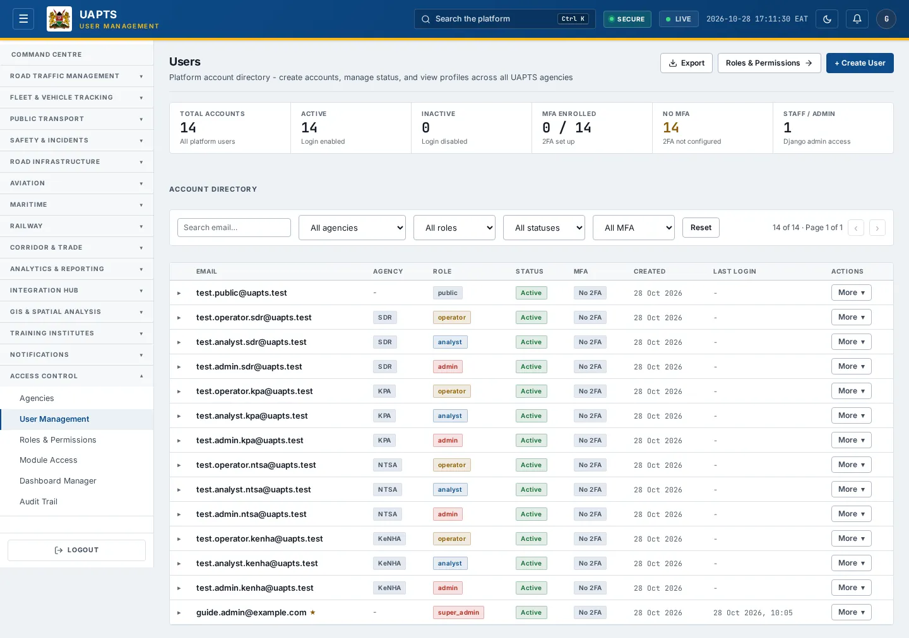
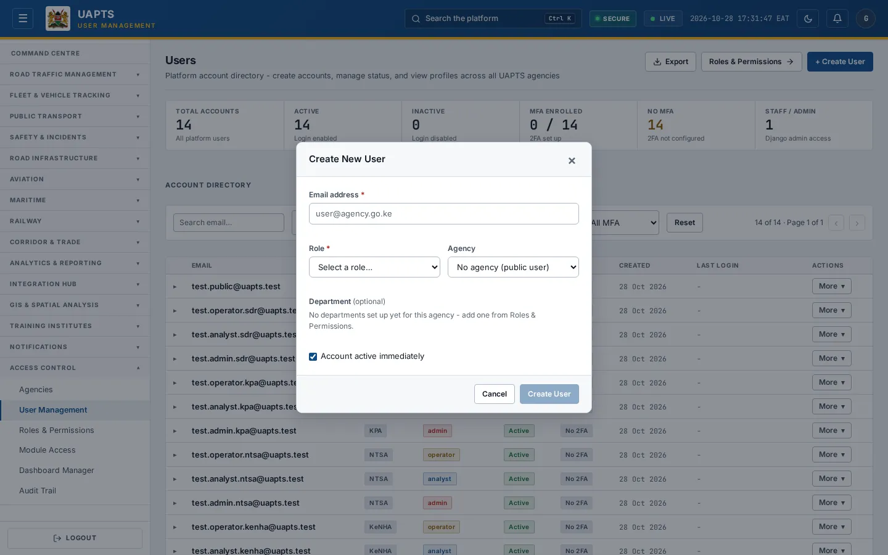

# User Management

_Access Control › User Management_ · Route `/users`

**User Management** is the account directory: create accounts, activate or deactivate them, and see each person's agency, role, two-factor status and last login.

> 🎬 **Video tutorial:** _coming soon._  
> <!-- VIDEO-URL: access-control/user-management | paste the link here, e.g. [Watch the walkthrough](https://…) -->

## Highlights

- Six summary tiles: **Total accounts**, **Active**, **Inactive**, **MFA enrolled**, **No MFA** and **Staff / Admin**.
- Directory of accounts with filters for **agency**, **role**, **status** and **MFA**.
- **+ Create User** — the new person receives an email with a temporary password.
- Row menu: **Activate / Deactivate** and **Delete**.
- Expand a row for IDs, MFA, staff access and creation/login dates.
- Link to **Roles & Permissions**.
- Export to CSV (Analyst and above).

## Enabling and access

Open **Access Control → User Management** (`/users`), module **M10**. Needs the **Admin** tier and the `manage_users` capability. An agency admin sees only their own agency; a super admin sees all.

## Create a user

1. Click **+ Create User**.
2. Enter the **Email address** (for example `user@agency.go.ke`). It becomes their sign-in name.
3. Choose the **Role** from the list (_Select a role…_). Roles come from [Roles & Permissions](roles-and-permissions.md); if the list cannot be loaded the form says so — reload the page.
4. Choose the **Agency** (or _No agency (public user)_), then optionally a **Department** (enabled after you choose an agency; if the agency has none, the form tells you to add one from Roles & Permissions).
5. Leave **Account active immediately** ticked, or untick to create it disabled.
6. Click **Create User**. UAPTS emails the person **“Your UAPTS account details”** with a temporary password.

## Find and manage accounts

1. Type in **Search email…** and/or use the drop-downs: **All agencies**, **All roles**, **All statuses** (Active only / Inactive only), **All MFA** (MFA enrolled / No MFA). **Reset** clears them.
2. Click a row to see **User ID**, **Agency UUID**, **Department UUID**, **Role (catalog)**, **Role Type**, **MFA Active**, **Staff Access**, **Account Created** and **Last Login**. **Manage Role & Permissions** jumps to the role screen.
3. Click **More ▾** on a row and choose **Deactivate** (blocks sign-in without deleting) or **Activate**. **Delete** removes the account — you are asked to confirm.
4. Use **Load more users…** at the bottom of the list.

## Status and value meanings

| Field | Values |
|---|---|
| Status | `Active` can sign in · `Inactive` cannot |
| MFA | `Enrolled` — one-time code at sign-in · `No MFA` |
| Role | admin · analyst · operator · public (see Roles & Permissions) |

## Data sources and feeds

| Data point | Endpoint | Ingested via |
|---|---|---|
| Directory and detail | `GET /accounts/users/` | Created on this page (or bootstrapped for the first super admin). |
| Agency and department lists | `GET /accounts/agencies/`, `GET /accounts/departments/` | Platform reference data (see Roles & Permissions). |

## Permissions

Only Admin tier with `manage_users` (and super admins) can create, change or delete accounts. Admins cannot see or edit other agencies' users.

## Related topics

- [Roles & Permissions](roles-and-permissions.md)
- [Audit Trail](audit-trail.md)

## On this page

- [Highlights](#highlights)
- [Enabling and access](#enabling-and-access)
- [Create a user](#create-a-user)
- [Find and manage accounts](#find-and-manage-accounts)
- [Status and value meanings](#status-and-value-meanings)
- [Data sources and feeds](#data-sources-and-feeds)
- [Permissions](#permissions)
- [Related topics](#related-topics)

## Support

- **Your agency administrator** is the first contact for access, role and data-quality questions.
- **Data feeds, templates and API questions:** `api-support@uapts.go.ke` (include the `X-Request-ID` response header from a failing call).
- **Security concerns:** `security@uapts.go.ke`. Do not report suspected vulnerabilities publicly.
