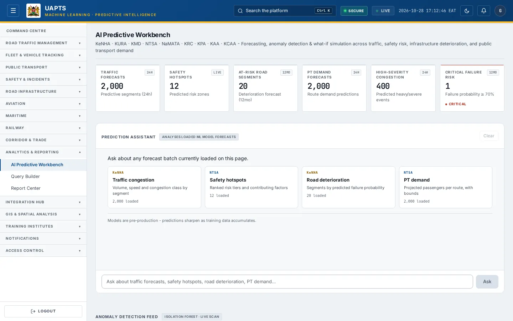
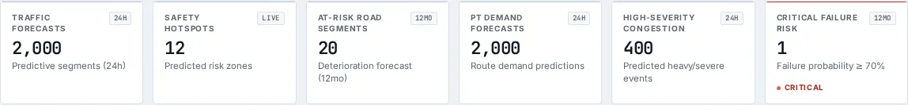
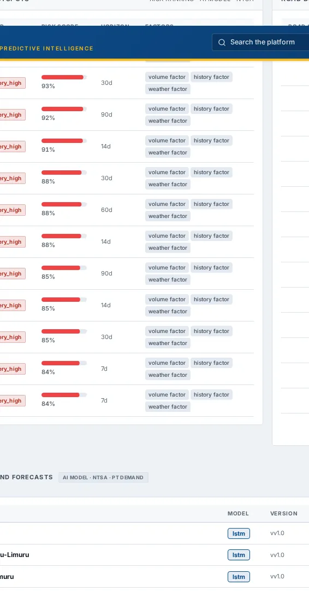
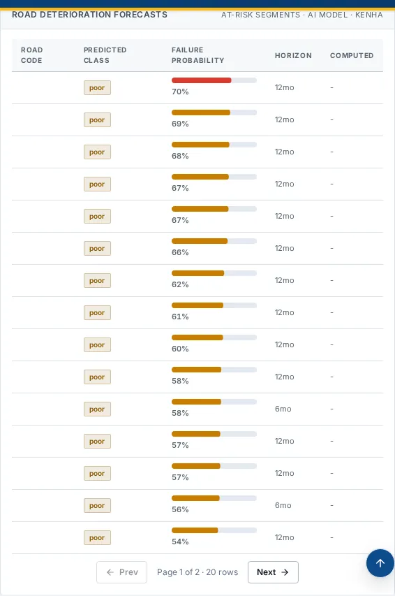

# AI Predictive Workbench

_Analytics & Reporting › AI Predictive Workbench_ · Route `/analytics`

**AI Predictive Workbench** lets you see forecasting, anomaly detection & what-if simulation across traffic, safety risk, infrastructure deterioration, and public transport demand. Data on this page comes from KeNHA, KURA, KMD, NTSA, NaMATA, KRC, KPA, KAA and KCAA.

> 🎬 **Video tutorial:** _coming soon._  
> <!-- VIDEO-URL: analytics-reporting/ai-predictive-workbench | paste the link here, e.g. [Watch the walkthrough](https://…) -->

## Highlights

- **6 headline tiles** — Traffic Forecasts, Safety Hotspots, At-Risk Road Segments, PT Demand Forecasts, High-Severity Congestion, Critical Failure Risk.
- **4 panels** — Traffic Forecasts, Predictive Safety HotspotsRisk Ranking · AI Model · NTSA, Road Deterioration ForecastsAt-Risk Segments · AI Model · KeNHA, Public Transport Demand Forecasts.
- **Refreshes itself every 120 seconds**, so you do not need to reload the page.
- **Filters and search** to narrow tables to what you need.
- Every figure is traceable to the data feed or upload template that supplies it — see [Data sources and feeds](#data-sources-and-feeds).

## Enabling and access

1. Sign in to UAPTS (see [How to access](../getting-started/how-to-access.md)).
2. In the left sidebar expand **Analytics & Reporting** and click **AI Predictive Workbench**.
3. The page opens at `/analytics`. You can also reach it with the global search (**Ctrl + K**).

This page belongs to module **M09 · Reporting and Query Builder**. The route needs at least the **Analyst** tier to open it. The sidebar and the global search only list pages your agency and role can open, and a link to a page you cannot reach sends you back to the Command Centre. If a page you expect is missing, ask your agency administrator to check your agency's [Module Access](../access-control/module-access.md).

## Page tour

### Headline tiles

| Tile | What it shows | Data from | Table → ingested via |
|---|---|---|---|
| **Traffic Forecasts** | Predictive segments (24h) _(window: 24H)_ | `/traffic/forecasts/` | _TrafficForecast_ → computed by UAPTS |
| **Safety Hotspots** | Predicted risk zones _(window: LIVE)_ | `/safety/predictive-hotspots/` | _PredictiveHotspot_ → computed by UAPTS |
| **At-Risk Road Segments** | Deterioration forecast (12mo) _(window: 12MO)_ | `/infrastructure/deterioration-forecasts/at-risk/` | _DeteriorationForecast_ → computed by UAPTS |
| **PT Demand Forecasts** | Route demand predictions _(window: 24H)_ | `/public-transport/demand-forecasts/` | _DemandForecast_ → computed by UAPTS |
| **High-Severity Congestion** | Predicted heavy/severe events _(window: 24H)_ | `/traffic/forecasts/` | _TrafficForecast_ → computed by UAPTS |
| **Critical Failure Risk** | Failure probability ≥ 70% _(window: 12MO)_ | `/infrastructure/deterioration-forecasts/at-risk/` | _DeteriorationForecast_ → computed by UAPTS |

### Traffic Forecasts

Contains a table with the columns **Segment**, **Model**, **Target Time**, **Volume**, **Speed**, **Congestion**, **Horizon**, **Computed**.

**Data from:** `/traffic/forecasts/`  
**Table → ingested via:** _TrafficForecast_ → computed by UAPTS

### Predictive Safety HotspotsRisk Ranking · AI Model · NTSA

Contains a table with the columns **Road Segment**, **Tier**, **Risk Score**, **Horizon**, **Factors**.

**Data from:** `/safety/predictive-hotspots/`  
**Table → ingested via:** _PredictiveHotspot_ → computed by UAPTS

### Road Deterioration ForecastsAt-Risk Segments · AI Model · KeNHA

Contains a table with the columns **Road Code**, **Predicted Class**, **Failure Probability**, **Horizon**, **Computed**.

**Data from:** `/infrastructure/deterioration-forecasts/at-risk/`  
**Table → ingested via:** _DeteriorationForecast_ → computed by UAPTS

### Public Transport Demand Forecasts

Contains a table with the columns **Route**, **Model**, **Version**, **Predicted Passengers**, **Confidence Range**, **Horizon**, **Computed**.

**Data from:** `/public-transport/demand-forecasts/`  
**Table → ingested via:** _DemandForecast_ → computed by UAPTS

## Prediction Assistant, anomalies and what-if

- **Prediction Assistant** answers plain-language questions about the forecast batches loaded on the page (traffic, safety hotspots, road deterioration, PT demand). Type a question such as _“which segments have failure probability above 70%?”_ and click **Ask**; use **Copy as TSV** to paste results into a spreadsheet and **Clear** to start over. It reads only the loaded forecast tables — it does not invent figures.
- **Anomaly Detection Feed** lists statistically unusual forecasts (Isolation Forest scan).
- **What-If Scenario Modelling:** move the sliders **Traffic demand growth**, **Infrastructure capacity change** and **PT ridership / policy shift** to see projected volume, congestion, demand and safety risk. It is a heuristic for directional planning, not a calibrated simulation.
- The models are pre-production; predictions sharpen as training data accumulates.

## Working with this page

1. Open **Analytics & Reporting → AI Predictive Workbench** from the sidebar.
2. Wait for the page to finish loading. It re-fetches its data every **120 s**; the figures you see are the latest the platform holds, not a one-time snapshot.
3. Click **Ask** to use this action.
4. Click **Jump to latest** to use this action.
5. Click **Stop** to use this action.
6. Click **loaded** to use this action.

## Status and value meanings

These are the values the platform stores for the fields shown on this page (`value` followed by the label you see).

| Field | Table | Values |
|---|---|---|
| model name | DeteriorationForecast | `markov_chain` · `lstm` · `gbm` Gradient Boosted Trees · `ensemble` |
| task type | MLModelRegistry | `traffic_forecast` Traffic Forecasting · `safety_hotspot` Accident Blackspot Prediction · `infra_deterioration` Infrastructure Risk Modelling · `demand_forecast` Demand & Capacity Planning · `anomaly_detection` |
| risk tier | PredictiveHotspot | `very_high` · `high` · `medium` · `low` |
| model name | TrafficForecast | `arima` · `lstm` · `gradient_boost` · `timesfm` TimesFM (foundation model) |

## Data sources and feeds

Every number and table on this page is read from the API endpoints below. The **Ingested via** column says how the underlying records get into UAPTS: a downloadable **upload template** (xlsx/CSV, loaded through the [Integration Hub](../integration-hub/upload-and-connect.md)), a **live feed** that pushes records to the ingest API, or — where neither exists yet — it is stated plainly.

| Endpoint | Records | Ingested via |
|---|---|---|
| `GET /infrastructure/deterioration-forecasts/at-risk/` | Deterioration Forecasts | Computed by UAPTS from other data (no direct feed) |
| `GET /ml/ask/` | _Aggregate of 2 tables (rows below)_ | — |
| ↳ AIQueryLog | Ai Query Logs | **No ingestion template yet** — populated by seed data or direct entry |
| ↳ MLModelRegistry | Ml Model Registrys | Platform data (accounts / configuration) |
| `GET /ml/models/` | Ml Model Registrys | Platform data (accounts / configuration) |
| `GET /public-transport/demand-forecasts/` | Demand Forecasts | Computed by UAPTS from other data (no direct feed) |
| `GET /safety/predictive-hotspots/` | Predictive Hotspots | Computed by UAPTS from other data (no direct feed) |
| `GET /traffic/forecasts/` | Traffic Forecasts | Computed by UAPTS from other data (no direct feed) |

Full details of every template (columns, formats) are in the [Data sources catalogue](../reference/data-sources.md). Interactive API documentation is available at `/api/docs/`.

## Permissions

| Who | What they can do here |
|---|---|
| Public / read-only accounts | No access to this page. |
| Operator | No access (page needs Analyst). |
| Analyst | View and **export CSV**. |
| Agency admin | Everything an analyst can do, plus the administrative capabilities listed in [Roles & Permissions](../access-control/roles-and-permissions.md). |
| Super admin | Sees every agency's data. |

**Agencies with the Reporting and Query Builder module:** full — KENHA, KURA, KERRA, SDR, SDR_MTD, COUNTY_GOV, KAA, KCAA, KMD, KRA, KRB, KENTRADE, NPS, KWS, SDT, NTSA, NAMATA, KRC, KPA, KMA, NCTTCA, LAPSSET.

_Access is evaluated by the server from the baseline policy plus any agency overrides, so a super admin or agency admin may have changed it from the defaults above._

## Related topics

- [Query Builder](query-builder.md)
- [Report Center](report-center.md)
- [Analytics & Reporting overview](index.md)
- [Upload & Connect (Integration Hub)](../integration-hub/upload-and-connect.md)
- [Data sources catalogue](../reference/data-sources.md)

## On this page

- [Highlights](#highlights)
- [Enabling and access](#enabling-and-access)
- [Page tour](#page-tour)
- [Working with this page](#working-with-this-page)
- [Status and value meanings](#status-and-value-meanings)
- [Data sources and feeds](#data-sources-and-feeds)
- [Permissions](#permissions)
- [Related topics](#related-topics)

## Support

- **Your agency administrator** is the first contact for access, role and data-quality questions.
- **Data feeds, templates and API questions:** `api-support@uapts.go.ke` (include the `X-Request-ID` response header from a failing call).
- **Security concerns:** `security@uapts.go.ke`. Do not report suspected vulnerabilities publicly.
