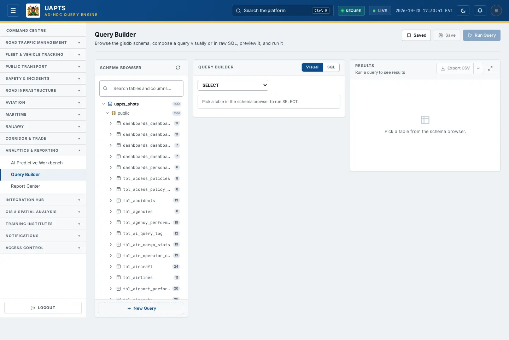
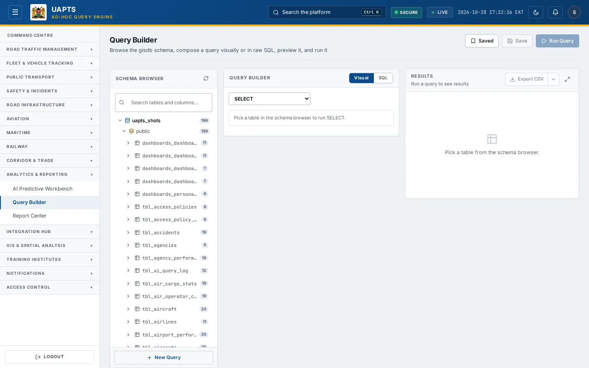
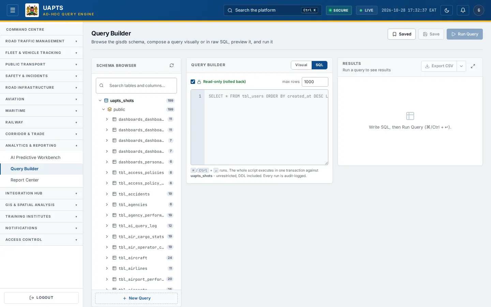

# Query Builder

_Analytics & Reporting › Query Builder_ · Route `/query-builder`

The **Query Builder** lets analysts browse the platform's database tables, compose a query visually or write it in SQL, preview it and run it, then export the result. It reads **the same tables that every other screen is built from**, so it is the quickest way to answer a question the dashboards do not.

> 🎬 **Video tutorial:** _coming soon._  
> <!-- VIDEO-URL: analytics-reporting/query-builder | paste the link here, e.g. [Watch the walkthrough](https://…) -->

## Important — read before you use it

> ⚠ **This tool runs real SQL against the live database.** The whole script executes in **one transaction**; the screen states _“unrestricted, DDL included. Every run is audit-logged.”_ Commands such as **INSERT, UPDATE, DELETE, TRUNCATE, DROP TABLE, CREATE TABLE and ALTER TABLE** change data and structure. Use **SELECT** unless you are certain; for anything else use the **Dry run (rollback)** switch first. Access is limited to users granted the Query Builder capability (Analyst tier and above in the baseline policy; see Permissions).

## Highlights

- **Schema browser** listing every table, view and materialised view with its columns, searchable.
- Two ways to build a query: **Visual** (pick table, columns, filters, sort, limit) and **SQL** (write it yourself).
- Live **SQL preview** while you build visually, with **Edit as SQL** to switch to hand-editing.
- **Dry run (rollback)** — runs the statement and rolls it back so nothing is changed.
- **Export CSV / Export JSON** of the result.
- **Save** a read-only query (name, optional description) and **Load** it later from the **Saved** list — saved queries always run rolled back.
- Every run is recorded in the [Audit Trail](../access-control/audit-trail.md).

## Enabling and access

Open **Analytics & Reporting → Query Builder** (`/query-builder`). The page belongs to module **M09 · Reporting and Query Builder** and the baseline policy requires at least the **Analyst** tier plus the **query_builder** capability. Your agency administrator can narrow or widen this under Module Access.

## Page tour

| Area | What it is |
|---|---|
| **Schema Browser** (left) | Search tables and columns. Each entry shows its kind (table / view / matview). Click a table to build a query on it. |
| **New Query** and **Visual / SQL** switch | Start a fresh query and choose how to write it. |
| Command tabs | SELECT · INSERT · UPDATE · DELETE · CREATE TABLE · ALTER TABLE · TRUNCATE · DROP TABLE. |
| **Select / Values / Set / Options** | Depending on the command: the columns to return, the values to insert, the assignments to update, or options such as CASCADE and IF EXISTS. |
| **Where** | Add conditions combined with AND; with no condition a SELECT returns every row and an UPDATE/DELETE affects every row. |
| **Order By** and **Limit** | Sort the rows and cap how many come back. |
| **SQL Preview** | The statement that will run. **Edit as SQL** moves it into the SQL editor. |
| **Results** | Rows returned, or rows affected for writes, with a note when the statement was rolled back. Export buttons sit here. |

## Working with this page — run a read-only query

1. Open **Query Builder**.
2. In the **Schema Browser**, search for a table — for example `tbl_users` or a transport table — and click it.
3. Keep the command on **SELECT**. Under **Select**, leave `* (all columns)` or pick specific columns.
4. Add one or more **Where** conditions, an **Order By**, and a **Limit** so you do not pull the whole table.
5. Check the **SQL Preview**. Click **Edit as SQL** if you want to adjust it by hand.
6. Click **Run Query** (or press **Ctrl/⌘ + Enter**).
7. Review **Results**. Use **Export CSV** or **Export JSON** to download them.
8. To keep a query, click **Save**, give it a **Name** (and optional description) and confirm. Only read-only queries can be saved, and a saved query always runs rolled back. Find it under **Saved** (click **Load**) or under _Saved Query Templates_ in the [Report Center](report-center.md).

## Working with this page — change data safely

1. Pick the command (INSERT, UPDATE, DELETE …).
2. Fill in the **Values** / **Set** / **Where** areas. A DELETE or UPDATE with **no Where** affects every row — the screen warns you.
3. Switch **Dry run (rollback)** on. The indicator reads _Dry run (rollback)_ and the result says _rolled back_.
4. Run it and check how many rows would be affected. Only then switch to **Will commit** if the change is really intended.

## Data sources and feeds

The Query Builder has no data of its own — it reads the database tables. To know how a table is filled, find it in the [Data sources catalogue](../reference/data-sources.md): tables with an upload template are loaded through the Integration Hub; others are listed with their feed status. API: `GET /api/v1/query/schema/`, `/query/datasets/`; `POST /query/execute/`, `/query/execute-join/`, `/query/raw/`; saved queries under `/query/saved/`.

## Permissions

| Tier | Query Builder |
|---|---|
| Public / Operator | Not available in the baseline policy. |
| Analyst | Available (capability `query_builder`). |
| Admin / Super admin | Available. Agency admins can grant or remove the capability per role under Module Access. |
| Oversight | Available (read-oriented tier) |

Datasets are also filtered by Module Access: you only see data from modules your agency and role can open, and non-ministry users get their own agency's rows.

## Related topics

- [Report Center](report-center.md)
- [Audit Trail](../access-control/audit-trail.md)
- [Roles & Permissions](../access-control/roles-and-permissions.md)

## On this page

- [Important — read before you use it](#important-read-before-you-use-it)
- [Highlights](#highlights)
- [Enabling and access](#enabling-and-access)
- [Page tour](#page-tour)
- [Working with this page — run a read-only query](#working-with-this-page-run-a-read-only-query)
- [Working with this page — change data safely](#working-with-this-page-change-data-safely)
- [Data sources and feeds](#data-sources-and-feeds)
- [Permissions](#permissions)
- [Related topics](#related-topics)

## Support

- **Your agency administrator** is the first contact for access, role and data-quality questions.
- **Data feeds, templates and API questions:** `api-support@uapts.go.ke` (include the `X-Request-ID` response header from a failing call).
- **Security concerns:** `security@uapts.go.ke`. Do not report suspected vulnerabilities publicly.
