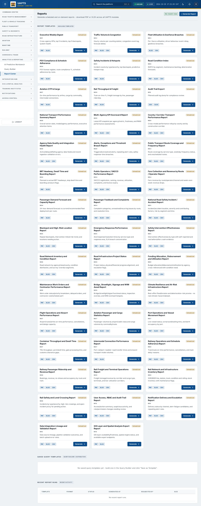
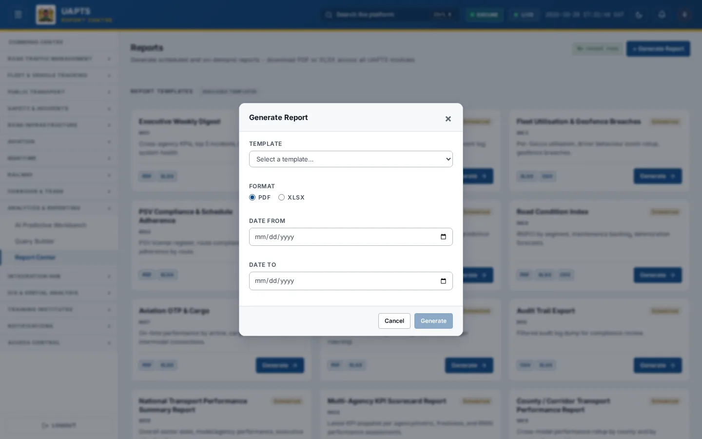

# Report Center

_Analytics & Reporting › Report Center_ · Route `/reports`

The **Report Center** generates ready-made PDF, Excel (XLSX) and CSV reports from the data in every module, and lists the reports you or your colleagues have already run. There are **44 report templates**, each tied to a module and to the tables that module reads.

> 🎬 **Video tutorial:** _coming soon._  
> <!-- VIDEO-URL: analytics-reporting/report-center | paste the link here, e.g. [Watch the walkthrough](https://…) -->

## Highlights

- Generate on demand for any date range, in the formats each template allows.
- Templates are tagged **Scheduled** or **On-demand**.
- **Saved Query Templates** from the Query Builder can be run again with **▶ Run Now**.
- **Recent Report Runs** shows status (Queued, Generating, completed, Failed), size and who requested it, with **⬇ Download**.

## Enabling and access

Open **Analytics & Reporting → Report Center** (`/reports`). The page needs at least the **Operator** tier; **generating** a report additionally needs the `run_reports` capability (Analyst tier and above in the baseline policy).

## Generate a report

1. Click **+ Generate Report** (top right) or **Generate** on a template card. These appear only if your role has the `run_reports` capability.
2. Choose the **Template**.
3. Choose the **Format** (PDF, XLSX or CSV — only the formats the template supports are offered).
4. Set **Date From** and **Date To**, and any template-specific options.
5. Click **Generate**. The run appears under **Recent Report Runs** as _Queued…_ then _Generating…_.
6. When it completes, click **⬇ Download**. A failed run shows ✕ Failed — try again or contact support.

## Run a saved query

1. Build and test a query in the [Query Builder](query-builder.md) and click **Save**.
2. Return to **Report Center → Saved Query Templates**.
3. Each card shows whether it is _Cross-module_ or _Single dataset_, its schedule, recipients and last run. Click **▶ Run Now**.

## Report templates

The catalogue below is read live from `GET /api/v1/reports/catalog/`. Each report is built from the tables of the module shown; to see how those tables are filled, open the matching module overview.

| Template ID | Name | Module | Schedule | Formats | Contents |
|---|---|---|---|---|---|
| `exec-weekly` | Executive Weekly Digest | Command Centre | weekly | PDF, XLSX | Cross-agency KPIs, top 5 incidents, top 5 blackspots, system health. |
| `traffic-volume` | Traffic Volume & Congestion | Road Traffic | daily | PDF, XLSX, CSV | Hourly volume per counting station; congestion event log; forecast deltas. |
| `fleet-utilisation` | Fleet Utilisation & Geofence Breaches | Fleet | daily | XLSX, CSV | Per-Sacco utilisation, driver behaviour event rollup, geofence breaches. |
| `psv-compliance` | PSV Compliance & Schedule Adherence | Public Transport | monthly | PDF, XLSX | PSV license register, route compliance %, schedule adherence by route. |
| `safety-incidents` | Safety Incidents & Hotspots | Safety | weekly | PDF, XLSX | Incident counts by type/severity, top blackspots, predictive hotspot map. |
| `infra-condition` | Road Condition Index | Road Infrastructure | monthly | PDF, XLSX, CSV | IRI/PCI by segment, maintenance backlog, deterioration forecasts. |
| `aviation-otp` | Aviation OTP & Cargo | Aviation & Maritime | daily | PDF, XLSX | On-time performance by airline, cargo by commodity, intermodal connections. |
| `rail-throughput` | Rail Throughput & Freight | Railway | weekly | PDF, XLSX | Train on-time %, freight tonnage by line, passenger ridership. |
| `audit-trail` | Audit Trail Export | Access Control | ad-hoc | CSV, XLSX | Filtered audit log dump for compliance review. |
| `national-transport-summary` | National Transport Performance Summary Report | Analytics & Reporting | daily | PDF, XLSX | Overall sector state, modal/agency performance, executive attention items. |
| `agency-kpi-scorecard` | Multi-Agency KPI Scorecard Report | Analytics & Reporting | monthly | PDF, XLSX, CSV | Latest KPI snapshot per agency/metric, freshness, and RMAI performance assessments. |
| `county-corridor-performance` | County / Corridor Transport Performance Report | Analytics & Reporting | monthly | PDF, XLSX, CSV | Cross-modal performance rollup by county and by construction corridor. |
| `agency-data-quality` | Agency Data Quality and Integration Health Report | Analytics & Reporting | daily | PDF, XLSX, CSV | Active/delayed/failing agency data feeds and recent ingestion validation errors. |
| `alerts-threshold-breach` | Alerts, Exceptions and Threshold Breach Report | Analytics & Reporting | weekly | PDF, XLSX, CSV | Triggered/unresolved alerts, repeating alert rules, safety response-time breaches. |
| `pt-route-coverage` | Public Transport Route Coverage and Frequency Report | Public Transport | weekly | PDF, XLSX, CSV | Route coverage by service type, weekday frequency status, and unscheduled routes. |
| `brt-headway-dwell` | BRT Headway, Dwell Time and Boarding Report | Public Transport | weekly | PDF, XLSX | Planned vs actual BRT headways, stop dwell time and boarding-pressure flags. |
| `sacco-performance` | Public Operators / SACCO Performance Report | Public Transport | monthly | PDF, XLSX, CSV | SACCO registration, ranking, revenue, utilization, complaints, and licence expiry. |
| `pt-fare-revenue` | Fare Collection and Revenue by Route / Operator Report | Public Transport | weekly | PDF, XLSX, CSV | Fare revenue by route/operator/channel and week-over-week revenue drops. |
| `pt-demand-capacity` | Passenger Demand Forecast and Capacity Report | Public Transport | daily | PDF, XLSX | 24-hour demand forecast vs current/recommended fleet deployment per route. |
| `pt-feedback-complaints` | Passenger Feedback and Complaints Report | Public Transport | weekly | PDF, XLSX, CSV | Complaint categories, unresolved/recurring issues by route, and resolution time. |
| `road-safety-incidents` | National Road Safety Incident / Accident Report | Safety | weekly | PDF, XLSX, CSV | Incident/accident location, severity and contributing factors; risk by segment and time. |
| `blackspot-high-risk` | Blackspot and High-Risk Location Report | Safety | monthly | PDF, XLSX, CSV | Repeat blackspots, intervention-linked risk trend, and locations needing action. |
| `emergency-response-performance` | Emergency Response Performance Report | Safety | weekly | PDF, XLSX, CSV | Ack/response/resolution times by service type and response area, SLA breach concentration. |
| `safety-intervention-effectiveness` | Safety Intervention Effectiveness Report | Safety | monthly | PDF, XLSX, CSV | Intervention effectiveness by type with self-reported and real before/after crash evidence. |
| `road-network-inventory` | Road Network Inventory and Condition Report | Road Infrastructure | monthly | PDF, XLSX, CSV | Road network by agency/class/county, condition distribution, and survey-overdue segments. |
| `road-project-status` | Road Infrastructure Project Status Report | Road Infrastructure | weekly | PDF, XLSX, CSV | Project status, physical/financial progress alignment, and escalation flags. |
| `funding-allocation-utilization` | Funding Allocation, Disbursement and Utilization Report | Road Infrastructure | monthly | PDF, XLSX, CSV | Budget allocation/disbursement/utilization by agency, cross-referenced with condition need. |
| `maintenance-work-orders` | Maintenance Work Orders and Contractor Performance Report | Road Infrastructure | weekly | PDF, XLSX, CSV | Work order status/priority breakdown, delayed orders, and contractor cost/schedule perf. |
| `bridge-streetlight-wim-assets` | Bridge, Streetlight, Signage and WIM Asset Report | Road Infrastructure | weekly | PDF, XLSX, CSV | Bridge/streetlight/signal functional status, inspection overdue, and WIM overload hotspots. |
| `climate-resilience-infrastructure` | Climate Resilience and At-Risk Infrastructure Report | Road Infrastructure | monthly | PDF, XLSX, CSV | Best-effort flood/erosion and deterioration-risk proxies - no real climate-hazard dataset. |
| `flight-operations-airport` | Flight Operations and Airport Performance Report | Aviation & Maritime | daily | PDF, XLSX, CSV | Airport/route/airline on-time performance, cancellations, and design capacity. |
| `aviation-passenger-cargo-stats` | Aviation Passenger and Cargo Statistics Report | Aviation & Maritime | weekly | PDF, XLSX, CSV | Passenger volumes by airport/cabin class and cargo volumes by commodity/route. |
| `port-operations-vessel-movement` | Port Operations and Vessel Movement Report | Aviation & Maritime | daily | PDF, XLSX, CSV | Live vessel status, turnaround/waiting time, and berth occupancy by port. |
| `container-throughput-dwell` | Container Throughput and Dwell Time Report | Aviation & Maritime | weekly | PDF, XLSX, CSV | TEU throughput, yard dwell time, gate processing time, and customs clearance gaps. |
| `intermodal-connection-performance` | Intermodal Connection Performance Report | Aviation & Maritime | weekly | PDF, XLSX | Port-rail/port-road/air-road transfer times and onward transport mode volumes. |
| `rail-schedule-adherence` | Railway Operations and Schedule Adherence Report | Railway | daily | PDF, XLSX, CSV | Train/route on-time performance, cancellations, and main delay reasons. |
| `rail-ridership-revenue` | Railway Passenger Ridership and Revenue Report | Railway | weekly | PDF, XLSX, CSV | Bookings, revenue, no-shows and occupancy by route and train. |
| `rail-freight-terminal-ops` | Rail Freight and Terminal Operations Report | Railway | weekly | PDF, XLSX, CSV | Freight tonnage/revenue by corridor and cargo type, terminals, and low-utilization corridors. |
| `rail-network-inventory` | Rail Network and Infrastructure Inventory Report | Railway | monthly | PDF, XLSX, CSV | SGR/MGR line, station, track-condition and rolling-stock inventory with maintenance flags. |
| `rail-safety-level-crossing` | Rail Safety and Level Crossing Report | Railway | weekly | PDF, XLSX, CSV | Incidents by type/severity, high-risk crossings, and open-incident proxy for pending action. |
| `rbac-audit-trail` | User Access, RBAC and Audit Trail Report | Access Control | weekly | PDF, XLSX, CSV | Access/action summary, suspicious activity, and role/permission changes needing review. |
| `notification-delivery-escalation` | Notification Delivery and Escalation Report | Access Control | weekly | PDF, XLSX, CSV | Delivery status by channel, alert-fatigue candidates, and repeating alert rules. |
| `data-integration-lineage` | Data Integration Lineage and Validation Report | Access Control | daily | PDF, XLSX, CSV | Data source lineage, pipeline validation outcomes, and batch upload error rates. |
| `gis-layer-spatial-export` | GIS Layer and Spatial Analysis Export Report | Access Control | weekly | PDF, XLSX | GIS layer availability/freshness, spatial engine status, and available export endpoints. |

## Data sources and feeds

| What | Endpoint | Ingested via |
|---|---|---|
| Template catalogue | `GET /reports/catalog/` | Defined in UAPTS (configuration), not uploaded. |
| Recent runs and downloads | `GET /reports/runs/` | Created when you generate a report. |
| Report contents | per template | Read from the module tables — see each module's **Data sources and feeds** section and the [Data sources catalogue](../reference/data-sources.md). |

## Permissions

| Tier | Report Center |
|---|---|
| Public | No. |
| Operator | Can open the page and download existing runs. |
| Analyst, Admin | Can also generate reports (`run_reports`). |
| Super admin | All, across agencies. |

## Related topics

- [Query Builder](query-builder.md)
- [Audit Trail](../access-control/audit-trail.md)

## On this page

- [Highlights](#highlights)
- [Enabling and access](#enabling-and-access)
- [Generate a report](#generate-a-report)
- [Run a saved query](#run-a-saved-query)
- [Report templates](#report-templates)
- [Data sources and feeds](#data-sources-and-feeds)
- [Permissions](#permissions)
- [Related topics](#related-topics)

## Support

- **Your agency administrator** is the first contact for access, role and data-quality questions.
- **Data feeds, templates and API questions:** `api-support@uapts.go.ke` (include the `X-Request-ID` response header from a failing call).
- **Security concerns:** `security@uapts.go.ke`. Do not report suspected vulnerabilities publicly.
