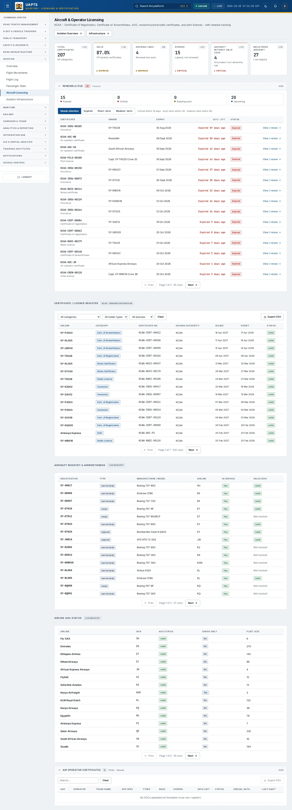
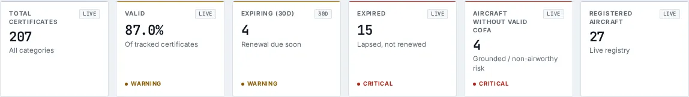

# Aircraft Licencing

_Aviation › Aircraft Licencing_ · Route `/aviation/licensing`

**Aircraft & Operator Licensing** lets you see certificate of Registration, Certificate of Airworthiness, AOC, noise/insurance/radio certificates, and pilot licences - with renewal tracking. Data on this page comes from KCAA.

> 🎬 **Video tutorial:** _coming soon._  
> <!-- VIDEO-URL: aviation/aircraft-licencing | paste the link here, e.g. [Watch the walkthrough](https://…) -->

## Highlights

- **6 headline tiles** — Total Certificates, Valid, Expiring (30d), Expired, Aircraft Without Valid CofA, Registered Aircraft.
- **3 panels** — Certificate / Licence Register, Aircraft Registry &amp; Airworthiness, Airline AOC Status.
- **Export to CSV** for the rows you are looking at (Analyst tier and above).
- **Filters and search** to narrow tables to what you need.
- Every figure is traceable to the data feed or upload template that supplies it — see [Data sources and feeds](#data-sources-and-feeds).

## Enabling and access

1. Sign in to UAPTS (see [How to access](../getting-started/how-to-access.md)).
2. In the left sidebar expand **Aviation** and click **Aircraft Licencing**.
3. The page opens at `/aviation/licensing`. You can also reach it with the global search (**Ctrl + K**).

This page belongs to module **M07a · Aviation**. The route needs at least the **Operator** tier to open it. The sidebar and the global search only list pages your agency and role can open, and a link to a page you cannot reach sends you back to the Command Centre. If a page you expect is missing, ask your agency administrator to check your agency's [Module Access](../access-control/module-access.md).

## Page tour

### Headline tiles

| Tile | What it shows | Data from | Table → ingested via |
|---|---|---|---|
| **Total Certificates** | All categories _(window: LIVE)_ | `/aviation-maritime/aviation/licensing/summary/` | aggregate of several tables — see [per-table feeds](#data-sources-and-feeds) |
| **Valid** | Of tracked certificates _(window: LIVE)_ | `/aviation-maritime/aviation/licensing/summary/` | aggregate of several tables — see [per-table feeds](#data-sources-and-feeds) |
| **Expiring (30d)** | Renewal due soon _(window: 30D)_ | `/aviation-maritime/aviation/licensing/summary/` | aggregate of several tables — see [per-table feeds](#data-sources-and-feeds) |
| **Expired** | Lapsed, not renewed _(window: LIVE)_ | `/aviation-maritime/aviation/licensing/summary/` | aggregate of several tables — see [per-table feeds](#data-sources-and-feeds) |
| **Aircraft Without Valid CofA** | Grounded / non-airworthy risk _(window: LIVE)_ | `/aviation-maritime/aviation/aircraft/`, `/aviation-maritime/aviation/licensing/summary/` | _Aircraft_ → [`kcaa-aircraft-register`](../data-templates/kcaa-aircraft-register.xlsx) |
| **Registered Aircraft** | Live registry _(window: LIVE)_ | `/aviation-maritime/aviation/aircraft/` | _Aircraft_ → [`kcaa-aircraft-register`](../data-templates/kcaa-aircraft-register.xlsx) |

### Certificate / Licence Register

Contains a table with the columns **Holder**, **Category**, **Certificate No.**, **Issuing Authority**, **Issued**, **Expiry**, **Status**.

**Data from:** `/aviation-maritime/aviation/aircraft/`, `/aviation-maritime/aviation/licensing/certificates/`  
**Table → ingested via:** _Aircraft, AviationLicence_ → [`kcaa-aircraft-register`](../data-templates/kcaa-aircraft-register.xlsx)

### Aircraft Registry &amp; Airworthiness

Contains a table with the columns **Registration**, **Type**, **Manufacturer / Model**, **Airline**, **In Service**, **Valid CofA**.

**Data from:** `/aviation-maritime/aviation/aircraft/`  
**Table → ingested via:** _Aircraft_ → [`kcaa-aircraft-register`](../data-templates/kcaa-aircraft-register.xlsx)

### Airline AOC Status

Contains a table with the columns **Airline**, **IATA**, **AOC Status**, **Cargo Only**, **Fleet Size**, **Certificate**, **Owner**, **Expiry**, **Days left**, **Status**, **Action**.

**Data from:** `/aviation-maritime/aviation/airlines/`, `/aviation-maritime/aviation/licensing/certificates/`  
**Table → ingested via:** _Airline, AviationLicence_ → [`kcaa-airline-register`](../data-templates/kcaa-airline-register.xlsx)

## Working with this page

1. Open **Aviation → Aircraft Licencing** from the sidebar.
2. Type in the **“Search…”** box to filter what is shown.
3. Use the **All categories** drop-down to narrow the list. Choices include: Certificate of Registration, Certificate of Airworthiness, Noise Certificate, Insurance, Radio Licence, Air Operator Certificate (AOC).
4. Use the **All holder types** drop-down to narrow the list. Choices include: Aircraft, Airline, Pilot.
5. Use the **All statuses** drop-down to narrow the list. Choices include: Valid, Expiring Soon, Expired, Suspended, Revoked.
6. Click **Export CSV** to download the rows currently loaded (after filters). The button only appears for Analyst tier and above.

## Status and value meanings

These are the values the platform stores for the fields shown on this page (`value` followed by the label you see).

| Field | Table | Values |
|---|---|---|
| status | AirOperatorCertificate | `valid` · `suspended` · `revoked` · `under_renewal` |
| aircraft type | Aircraft | `narrow_body` Narrow-body jet · `wide_body` Wide-body jet · `regional` Regional turboprop · `cargo` Dedicated freighter · `business` Business jet |
| aoc status | Airline | `valid` · `suspended` · `pending` · `revoked` |
| category | AviationLicence | `certificate_of_registration` · `certificate_of_airworthiness` · `noise_certificate` · `insurance` · `radio_licence` · `air_operator_certificate` · `pilot_licence` · `crew_licence` |
| holder type | AviationLicence | `aircraft` · `airline` · `pilot` |
| status | AviationLicence | `valid` · `expiring_soon` · `expired` · `suspended` · `revoked` |
| status | FlightSafetyReport | `open` · `investigating` · `closed` · `final_report` Final report published |

## Data sources and feeds

Every number and table on this page is read from the API endpoints below. The **Ingested via** column says how the underlying records get into UAPTS: a downloadable **upload template** (xlsx/CSV, loaded through the [Integration Hub](../integration-hub/upload-and-connect.md)), a **live feed** that pushes records to the ingest API, or — where neither exists yet — it is stated plainly.

| Endpoint | Records | Ingested via |
|---|---|---|
| `GET /aviation-maritime/aviation/air-cargo-stats/` | Air Cargo Stats | [`kaa-air-cargo-statistics`](../data-templates/kaa-air-cargo-statistics.xlsx) |
| `GET /aviation-maritime/aviation/air-operator-certificates/` | Air Operator Certificates | [`kcaa-aoc-register`](../data-templates/kcaa-aoc-register.xlsx) |
| `GET /aviation-maritime/aviation/aircraft/` | Aircrafts | [`kcaa-aircraft-register`](../data-templates/kcaa-aircraft-register.xlsx) |
| `GET /aviation-maritime/aviation/airlines/` | Airlines | [`kcaa-airline-register`](../data-templates/kcaa-airline-register.xlsx) |
| `GET /aviation-maritime/aviation/atm-performance/` | Atm Performance Records | [`kcaa-atm-performance`](../data-templates/kcaa-atm-performance.xlsx) |
| `GET /aviation-maritime/aviation/ground-handlers/` | Ground Handlers | [`kaa-ground-handlers`](../data-templates/kaa-ground-handlers.xlsx) |
| `GET /aviation-maritime/aviation/licensing/certificates/` | Aviation Licences | **No ingestion template yet** — populated by seed data or direct entry |
| `GET /aviation-maritime/aviation/licensing/summary/` | _Aggregate of 2 tables (rows below)_ | — |
| ↳ Aircraft | Aircrafts | [`kcaa-aircraft-register`](../data-templates/kcaa-aircraft-register.xlsx) |
| ↳ AviationLicence | Aviation Licences | **No ingestion template yet** — populated by seed data or direct entry |
| `GET /aviation-maritime/aviation/met-observations/` | Met Observations | [`kmd-aviation-weather`](../data-templates/kmd-aviation-weather.xlsx) live feed `kmd-synop` (KMD SYNOP) |
| `GET /aviation-maritime/aviation/safety-reports/` | Flight Safety Reports | [`kcaa-occurrence-reports`](../data-templates/kcaa-occurrence-reports.xlsx) |

Full details of every template (columns, formats) are in the [Data sources catalogue](../reference/data-sources.md). Interactive API documentation is available at `/api/docs/`.

## Permissions

| Who | What they can do here |
|---|---|
| Public / read-only accounts | No access to this page. |
| Operator | View the page. |
| Analyst | View and **export CSV**. |
| Agency admin | Everything an analyst can do, plus the administrative capabilities listed in [Roles & Permissions](../access-control/roles-and-permissions.md). |
| Super admin | Sees every agency's data. |

**Agencies with the Aviation module:** full — KAA, KCAA, SDT.

_Access is evaluated by the server from the baseline policy plus any agency overrides, so a super admin or agency admin may have changed it from the defaults above._

## Related topics

- [Overview](aviation-overview.md)
- [Flight Movements](flight-movements.md)
- [Flight Log](flight-log.md)
- [Passenger Stats](passenger-stats.md)
- [Aviation Infrastructure](aviation-infrastructure.md)
- [Aviation overview](index.md)
- [Upload & Connect (Integration Hub)](../integration-hub/upload-and-connect.md)
- [Data sources catalogue](../reference/data-sources.md)

## On this page

- [Highlights](#highlights)
- [Enabling and access](#enabling-and-access)
- [Page tour](#page-tour)
- [Working with this page](#working-with-this-page)
- [Status and value meanings](#status-and-value-meanings)
- [Data sources and feeds](#data-sources-and-feeds)
- [Permissions](#permissions)
- [Related topics](#related-topics)

## Support

- **Your agency administrator** is the first contact for access, role and data-quality questions.
- **Data feeds, templates and API questions:** `api-support@uapts.go.ke` (include the `X-Request-ID` response header from a failing call).
- **Security concerns:** `security@uapts.go.ke`. Do not report suspected vulnerabilities publicly.
