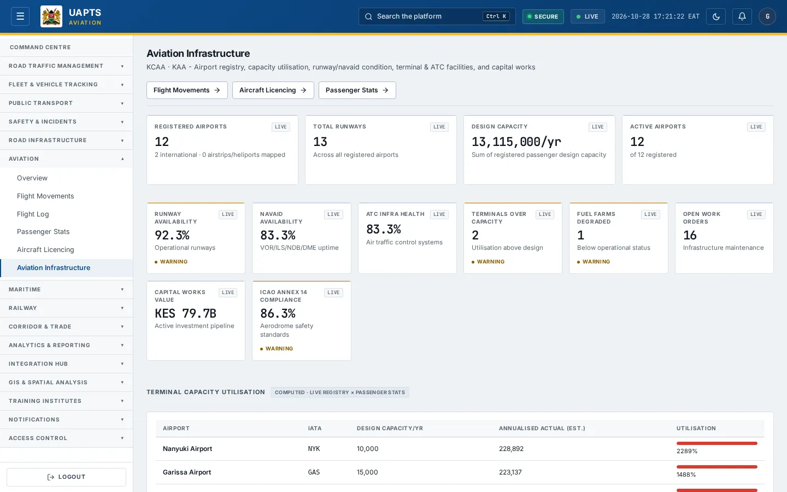
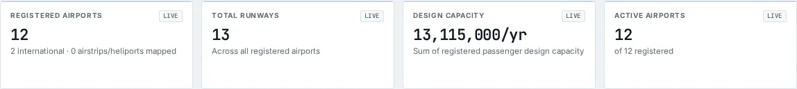

# Aviation Infrastructure

_Aviation › Aviation Infrastructure_ · Route `/aviation/infrastructure`

**Aviation Infrastructure** lets you see airport registry, capacity utilisation, runway/navaid condition, terminal & ATC facilities, and capital works. Data on this page comes from KCAA and KAA.

> 🎬 **Video tutorial:** _coming soon._  
> <!-- VIDEO-URL: aviation/aviation-infrastructure | paste the link here, e.g. [Watch the walkthrough](https://…) -->

## Highlights

- **12 headline tiles** — Registered Airports, Total Runways, Design Capacity, Active Airports, Runway Availability, Navaid Availability….
- **6 panels** — Terminal Capacity Utilisation, Airport Registry, Runway Condition, Navigational Aids, Terminal, ATC &amp; Ground Facilities, Capital Works Pipeline.
- **Refreshes itself every 120 seconds**, so you do not need to reload the page.
- **Export to CSV** for the rows you are looking at (Analyst tier and above).
- **Filters and search** to narrow tables to what you need.
- Every figure is traceable to the data feed or upload template that supplies it — see [Data sources and feeds](#data-sources-and-feeds).

## Enabling and access

1. Sign in to UAPTS (see [How to access](../getting-started/how-to-access.md)).
2. In the left sidebar expand **Aviation** and click **Aviation Infrastructure**.
3. The page opens at `/aviation/infrastructure`. You can also reach it with the global search (**Ctrl + K**).

This page belongs to module **M07a · Aviation**. The sidebar and the global search only list pages your agency and role can open, and a link to a page you cannot reach sends you back to the Command Centre. If a page you expect is missing, ask your agency administrator to check your agency's [Module Access](../access-control/module-access.md).

## Page tour

### Headline tiles

| Tile | What it shows | Data from | Table → ingested via |
|---|---|---|---|
| **Registered Airports** | — _(window: LIVE)_ | `/aviation-maritime/aviation/airports/` | _Airport_ → [`kaa-airport-register`](../data-templates/kaa-airport-register.xlsx) live feed `kaa-aodb` |
| **Total Runways** | Across all registered airports _(window: LIVE)_ | `/aviation-maritime/aviation/airports/` | _Airport_ → [`kaa-airport-register`](../data-templates/kaa-airport-register.xlsx) live feed `kaa-aodb` |
| **Design Capacity** | Sum of registered passenger design capacity _(window: LIVE)_ | `/aviation-maritime/aviation/airports/` | _Airport_ → [`kaa-airport-register`](../data-templates/kaa-airport-register.xlsx) live feed `kaa-aodb` |
| **Active Airports** | — _(window: LIVE)_ | `/aviation-maritime/aviation/airports/` | _Airport_ → [`kaa-airport-register`](../data-templates/kaa-airport-register.xlsx) live feed `kaa-aodb` |
| **Runway Availability** | Operational runways _(window: LIVE)_ | `/aviation-maritime/aviation/infrastructure/runways/`, `/aviation-maritime/aviation/infrastructure/summary/` | _Runway_ → [`kaa-runway-register`](../data-templates/kaa-runway-register.xlsx) |
| **Navaid Availability** | VOR/ILS/NDB/DME uptime _(window: LIVE)_ | `/aviation-maritime/aviation/infrastructure/navaids/`, `/aviation-maritime/aviation/infrastructure/summary/` | _AviationNavigationAid_ → no template yet |
| **ATC Infra Health** | Air traffic control systems _(window: LIVE)_ | `/aviation-maritime/aviation/infrastructure/facilities/`, `/aviation-maritime/aviation/infrastructure/summary/` | _AviationFacility_ → no template yet |
| **Terminals Over Capacity** | Utilisation above design _(window: LIVE)_ | `/aviation-maritime/aviation/airports/`, `/aviation-maritime/aviation/infrastructure/summary/`, `/aviation-maritime/aviation/passenger-stats/by-airport/` | _Airport, PassengerStat_ → [`kaa-airport-register`](../data-templates/kaa-airport-register.xlsx) [`kaa-passenger-statistics`](../data-templates/kaa-passenger-statistics.xlsx) live feed `kaa-aodb` |
| **Fuel Farms Degraded** | Below operational status _(window: LIVE)_ | `/aviation-maritime/aviation/infrastructure/facilities/`, `/aviation-maritime/aviation/infrastructure/summary/` | _AviationFacility_ → no template yet |
| **Open Work Orders** | Infrastructure maintenance _(window: LIVE)_ | `/aviation-maritime/aviation/infrastructure/capital-works/`, `/aviation-maritime/aviation/infrastructure/summary/` | _AviationCapitalWorksProject_ → no template yet |
| **Capital Works Value** | Active investment pipeline _(window: LIVE)_ | `/aviation-maritime/aviation/infrastructure/capital-works/`, `/aviation-maritime/aviation/infrastructure/summary/` | _AviationCapitalWorksProject_ → no template yet |
| **ICAO Annex 14 Compliance** | Aerodrome safety standards _(window: LIVE)_ | `/aviation-maritime/aviation/infrastructure/summary/` | aggregate of several tables — see [per-table feeds](#data-sources-and-feeds) |

### Terminal Capacity Utilisation

Contains a table with the columns **Airport**, **IATA**, **Design Capacity/yr**, **Annualised Actual (est.)**, **Utilisation**.

**Data from:** `/aviation-maritime/aviation/airports/`, `/aviation-maritime/aviation/passenger-stats/by-airport/`  
**Table → ingested via:** _Airport, PassengerStat_ → [`kaa-airport-register`](../data-templates/kaa-airport-register.xlsx) [`kaa-passenger-statistics`](../data-templates/kaa-passenger-statistics.xlsx) live feed `kaa-aodb`

### Airport Registry

Contains a table with the columns **Airport**, **IATA/ICAO**, **City**, **Type**, **Runways**, **Elevation (ft)**, **Operator**, **International**, **Status**.

**Data from:** `/aviation-maritime/aviation/airports/`  
**Table → ingested via:** _Airport_ → [`kaa-airport-register`](../data-templates/kaa-airport-register.xlsx) live feed `kaa-aodb`

### Runway Condition

Contains a table with the columns **Airport**, **Runway**, **Length (m)**, **TORA / LDA (m)**, **ILS**, **Surface**, **PCN Rating**, **Status**, **Last Inspection**, **Next Inspection**, **Defect Notes**.

**Data from:** `/aviation-maritime/aviation/infrastructure/runways/`  
**Table → ingested via:** _Runway_ → [`kaa-runway-register`](../data-templates/kaa-runway-register.xlsx)

### Navigational Aids

Contains a table with the columns **Airport**, **Type**, **Status**, **Last Calibration**, **Next Calibration**.

**Data from:** `/aviation-maritime/aviation/infrastructure/facilities/`, `/aviation-maritime/aviation/infrastructure/navaids/`  
**Table → ingested via:** _AviationFacility, AviationNavigationAid_ → no template yet

### Terminal, ATC &amp; Ground Facilities

Contains a table with the columns **Airport**, **Facility**, **Type**, **Status**, **Capacity/hr**, **Utilisation**, **Maintenance Due**.

**Data from:** `/aviation-maritime/aviation/infrastructure/facilities/`  
**Table → ingested via:** _AviationFacility_ → no template yet

### Capital Works Pipeline

Contains a table with the columns **Project**, **Airport**, **Contractor**, **Scope**, **Physical**, **Financial**, **Capacity Impact**.

**Data from:** `/aviation-maritime/aviation/infrastructure/capital-works/`  
**Table → ingested via:** _AviationCapitalWorksProject_ → no template yet

## Working with this page

1. Open **Aviation → Aviation Infrastructure** from the sidebar.
2. Wait for the page to finish loading. It re-fetches its data every **120 s**; the figures you see are the latest the platform holds, not a one-time snapshot.
3. Type in the **“Search name / IATA / city / county…”** box to filter what is shown.
4. Type in the **“Search…”** box to filter what is shown.
5. Use the **All types** drop-down to narrow the list. Choices include: International, Regional, Domestic, Military, Private, Heliport.
6. Click **Export CSV** to download the rows currently loaded (after filters). The button only appears for Analyst tier and above.

## Status and value meanings

These are the values the platform stores for the fields shown on this page (`value` followed by the label you see).

| Field | Table | Values |
|---|---|---|
| status | AirOperatorCertificate | `valid` · `suspended` · `revoked` · `under_renewal` |
| airport type | Airport | `international` · `regional` · `domestic` · `military` Military / joint-use · `private` Private / charter · `heliport` · `airstrip` |
| status | AviationCapitalWorksProject | `planned` · `in_progress` · `completed` · `suspended` |
| facility type | AviationFacility | `terminal` · `atc_tower` · `fuel_farm` · `ground_handling` · `fire_rescue` Fire & rescue |
| status | AviationFacility | `operational` · `degraded` · `out_of_service` · `under_maintenance` |
| navaid type | AviationNavigationAid | `vor` · `ils` · `ndb` · `dme` · `asr` · `aws` |
| status | AviationNavigationAid | `operational` · `degraded` · `out_of_service` |
| surface type | Runway | `asphalt` · `concrete` · `gravel` · `grass` · `composite` · `earth` Earth / murram |
| status | Runway | `operational` · `restricted` · `closed` · `under_maintenance` |

## Data sources and feeds

Every number and table on this page is read from the API endpoints below. The **Ingested via** column says how the underlying records get into UAPTS: a downloadable **upload template** (xlsx/CSV, loaded through the [Integration Hub](../integration-hub/upload-and-connect.md)), a **live feed** that pushes records to the ingest API, or — where neither exists yet — it is stated plainly.

| Endpoint | Records | Ingested via |
|---|---|---|
| `GET /aviation-maritime/aviation/air-cargo-stats/` | Air Cargo Stats | [`kaa-air-cargo-statistics`](../data-templates/kaa-air-cargo-statistics.xlsx) |
| `GET /aviation-maritime/aviation/air-operator-certificates/` | Air Operator Certificates | [`kcaa-aoc-register`](../data-templates/kcaa-aoc-register.xlsx) |
| `GET /aviation-maritime/aviation/airports/` | Airports | [`kaa-airport-register`](../data-templates/kaa-airport-register.xlsx) live feed `kaa-aodb` (KAA AODB) |
| `GET /aviation-maritime/aviation/atm-performance/` | Atm Performance Records | [`kcaa-atm-performance`](../data-templates/kcaa-atm-performance.xlsx) |
| `GET /aviation-maritime/aviation/ground-handlers/` | Ground Handlers | [`kaa-ground-handlers`](../data-templates/kaa-ground-handlers.xlsx) |
| `GET /aviation-maritime/aviation/infrastructure/capital-works/` | Aviation Capital Works Projects | **No ingestion template yet** — populated by seed data or direct entry |
| `GET /aviation-maritime/aviation/infrastructure/facilities/` | Aviation Facilitys | **No ingestion template yet** — populated by seed data or direct entry |
| `GET /aviation-maritime/aviation/infrastructure/navaids/` | Aviation Navigation Aids | **No ingestion template yet** — populated by seed data or direct entry |
| `GET /aviation-maritime/aviation/infrastructure/runways/` | Runways | [`kaa-runway-register`](../data-templates/kaa-runway-register.xlsx) |
| `GET /aviation-maritime/aviation/infrastructure/runways/geojson/` | Runways | [`kaa-runway-register`](../data-templates/kaa-runway-register.xlsx) |
| `GET /aviation-maritime/aviation/infrastructure/summary/` | _Aggregate of 4 tables (rows below)_ | — |
| ↳ AviationCapitalWorksProject | Aviation Capital Works Projects | **No ingestion template yet** — populated by seed data or direct entry |
| ↳ AviationFacility | Aviation Facilitys | **No ingestion template yet** — populated by seed data or direct entry |
| ↳ AviationNavigationAid | Aviation Navigation Aids | **No ingestion template yet** — populated by seed data or direct entry |
| ↳ Runway | Runways | [`kaa-runway-register`](../data-templates/kaa-runway-register.xlsx) |
| `GET /aviation-maritime/aviation/met-observations/` | Met Observations | [`kmd-aviation-weather`](../data-templates/kmd-aviation-weather.xlsx) live feed `kmd-synop` (KMD SYNOP) |
| `GET /aviation-maritime/aviation/passenger-stats/by-airport/` | Passenger Stats | [`kaa-passenger-statistics`](../data-templates/kaa-passenger-statistics.xlsx) |
| `GET /aviation-maritime/aviation/safety-reports/` | Flight Safety Reports | [`kcaa-occurrence-reports`](../data-templates/kcaa-occurrence-reports.xlsx) |

Full details of every template (columns, formats) are in the [Data sources catalogue](../reference/data-sources.md). Interactive API documentation is available at `/api/docs/`.

## Permissions

| Who | What they can do here |
|---|---|
| Public / read-only accounts | View the page where the module is enabled for their agency (read-only). |
| Operator | View the page. |
| Analyst | View and **export CSV**. |
| Agency admin | Everything an analyst can do, plus the administrative capabilities listed in [Roles & Permissions](../access-control/roles-and-permissions.md). |
| Super admin | Sees every agency's data. |

**Agencies with the Aviation module:** full — KAA, KCAA, SDT.

_Access is evaluated by the server from the baseline policy plus any agency overrides, so a super admin or agency admin may have changed it from the defaults above._

## Related topics

- [Overview](aviation-overview.md)
- [Flight Movements](flight-movements.md)
- [Flight Log](flight-log.md)
- [Passenger Stats](passenger-stats.md)
- [Aircraft Licencing](aircraft-licencing.md)
- [Aviation overview](index.md)
- [Upload & Connect (Integration Hub)](../integration-hub/upload-and-connect.md)
- [Data sources catalogue](../reference/data-sources.md)

## On this page

- [Highlights](#highlights)
- [Enabling and access](#enabling-and-access)
- [Page tour](#page-tour)
- [Working with this page](#working-with-this-page)
- [Status and value meanings](#status-and-value-meanings)
- [Data sources and feeds](#data-sources-and-feeds)
- [Permissions](#permissions)
- [Related topics](#related-topics)

## Support

- **Your agency administrator** is the first contact for access, role and data-quality questions.
- **Data feeds, templates and API questions:** `api-support@uapts.go.ke` (include the `X-Request-ID` response header from a failing call).
- **Security concerns:** `security@uapts.go.ke`. Do not report suspected vulnerabilities publicly.
