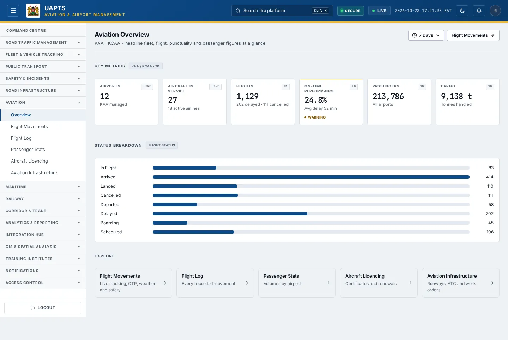
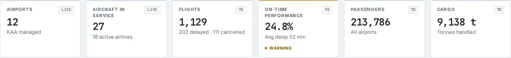

# Aviation — Overview

_Aviation › Overview_ · Route `/aviation/overview`

**Aviation Overview** lets you see headline fleet, flight, punctuality and passenger figures at a glance. Data on this page comes from KAA and KCAA.

> 🎬 **Video tutorial:** _coming soon._  
> <!-- VIDEO-URL: aviation/aviation-overview | paste the link here, e.g. [Watch the walkthrough](https://…) -->

## Highlights

- **6 headline tiles** — Airports, Aircraft in Service, Flights, On-Time Performance, Passengers, Cargo.
- Every figure is traceable to the data feed or upload template that supplies it — see [Data sources and feeds](#data-sources-and-feeds).

## Enabling and access

1. Sign in to UAPTS (see [How to access](../getting-started/how-to-access.md)).
2. In the left sidebar expand **Aviation** and click **Overview**.
3. The page opens at `/aviation/overview`. You can also reach it with the global search (**Ctrl + K**).

This page belongs to module **M07a · Aviation**. The sidebar and the global search only list pages your agency and role can open, and a link to a page you cannot reach sends you back to the Command Centre. If a page you expect is missing, ask your agency administrator to check your agency's [Module Access](../access-control/module-access.md).

## Page tour

### Headline tiles

| Tile | What it shows | Data from | Table → ingested via |
|---|---|---|---|
| **Airports** | KAA managed _(window: LIVE)_ | `/aviation-maritime/aviation/summary/` | _Airport_ → [`kaa-airport-register`](../data-templates/kaa-airport-register.xlsx) live feed `kaa-aodb` |
| **Aircraft in Service** | — _(window: LIVE)_ | `/aviation-maritime/aviation/summary/` | _Aircraft_ → [`kcaa-aircraft-register`](../data-templates/kcaa-aircraft-register.xlsx) |
| **Flights** | — _(window: timeRange.period.value)_ | `/aviation-maritime/aviation/summary/` | _Flight_ → [`kaa-flight-movements`](../data-templates/kaa-flight-movements.xlsx) live feed `kaa-aodb` |
| **On-Time Performance** | — _(window: timeRange.period.value)_ | `/aviation-maritime/aviation/summary/` | aggregate of several tables — see [per-table feeds](#data-sources-and-feeds) |
| **Passengers** | All airports _(window: timeRange.period.value)_ | `/aviation-maritime/aviation/summary/` | _PassengerStat_ → [`kaa-passenger-statistics`](../data-templates/kaa-passenger-statistics.xlsx) |
| **Cargo** | Tonnes handled _(window: timeRange.period.value)_ | `/aviation-maritime/aviation/summary/` | _CargoManifest_ → no template yet |

## Working with this page

1. Open **Aviation → Overview** from the sidebar.
2. Scroll down to move through the panels; every panel has a heading matching those in the Page tour.

## Data sources and feeds

Every number and table on this page is read from the API endpoints below. The **Ingested via** column says how the underlying records get into UAPTS: a downloadable **upload template** (xlsx/CSV, loaded through the [Integration Hub](../integration-hub/upload-and-connect.md)), a **live feed** that pushes records to the ingest API, or — where neither exists yet — it is stated plainly.

| Endpoint | Records | Ingested via |
|---|---|---|
| `GET /aviation-maritime/aviation/summary/` | _Aggregate of 6 tables (rows below)_ | — |
| ↳ Aircraft | Aircrafts | [`kcaa-aircraft-register`](../data-templates/kcaa-aircraft-register.xlsx) |
| ↳ Airline | Airlines | [`kcaa-airline-register`](../data-templates/kcaa-airline-register.xlsx) |
| ↳ Airport | Airports | [`kaa-airport-register`](../data-templates/kaa-airport-register.xlsx) live feed `kaa-aodb` (KAA AODB) |
| ↳ CargoManifest | Cargo Manifests | **No ingestion template yet** — populated by seed data or direct entry |
| ↳ Flight | Flights | [`kaa-flight-movements`](../data-templates/kaa-flight-movements.xlsx) live feed `kaa-aodb` (KAA AODB) |
| ↳ PassengerStat | Passenger Stats | [`kaa-passenger-statistics`](../data-templates/kaa-passenger-statistics.xlsx) |

Full details of every template (columns, formats) are in the [Data sources catalogue](../reference/data-sources.md). Interactive API documentation is available at `/api/docs/`.

## Permissions

| Who | What they can do here |
|---|---|
| Public / read-only accounts | View the page where the module is enabled for their agency (read-only). |
| Operator | View the page. |
| Analyst | View and **export CSV**. |
| Agency admin | Everything an analyst can do, plus the administrative capabilities listed in [Roles & Permissions](../access-control/roles-and-permissions.md). |
| Super admin | Sees every agency's data. |

**Agencies with the Aviation module:** full — KAA, KCAA, SDT.

_Access is evaluated by the server from the baseline policy plus any agency overrides, so a super admin or agency admin may have changed it from the defaults above._

## Related topics

- [Flight Movements](flight-movements.md)
- [Flight Log](flight-log.md)
- [Passenger Stats](passenger-stats.md)
- [Aircraft Licencing](aircraft-licencing.md)
- [Aviation Infrastructure](aviation-infrastructure.md)
- [Aviation overview](index.md)
- [Upload & Connect (Integration Hub)](../integration-hub/upload-and-connect.md)
- [Data sources catalogue](../reference/data-sources.md)

## On this page

- [Highlights](#highlights)
- [Enabling and access](#enabling-and-access)
- [Page tour](#page-tour)
- [Working with this page](#working-with-this-page)
- [Data sources and feeds](#data-sources-and-feeds)
- [Permissions](#permissions)
- [Related topics](#related-topics)

## Support

- **Your agency administrator** is the first contact for access, role and data-quality questions.
- **Data feeds, templates and API questions:** `api-support@uapts.go.ke` (include the `X-Request-ID` response header from a failing call).
- **Security concerns:** `security@uapts.go.ke`. Do not report suspected vulnerabilities publicly.
