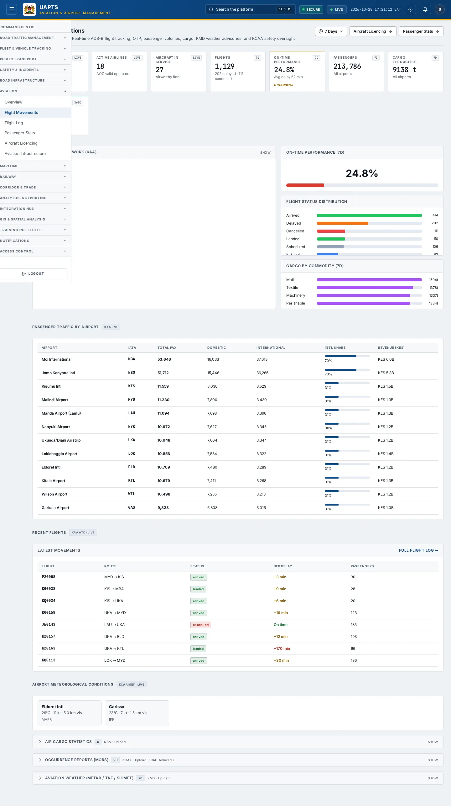
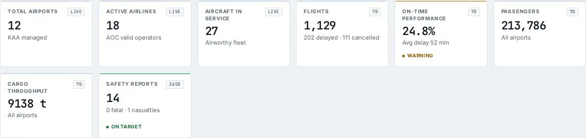
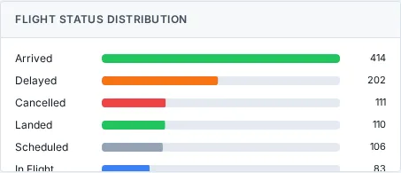
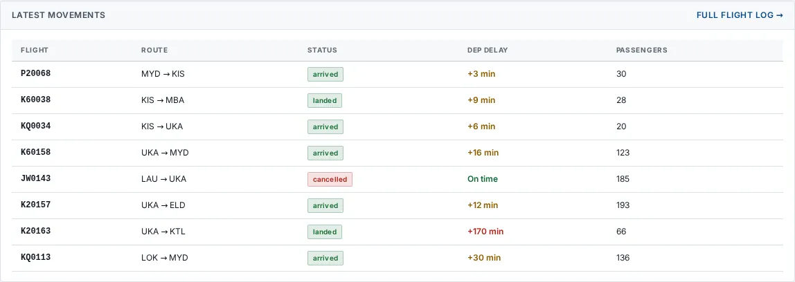

# Flight Movements

_Aviation › Flight Movements_ · Route `/aviation`

**Aviation Operations** lets you see real-time ADS-B flight tracking, OTP, passenger volumes, cargo, KMD weather advisories, and KCAA safety oversight. Data on this page comes from KAA, KCAA and KMD.

> 🎬 **Video tutorial:** _coming soon._  
> <!-- VIDEO-URL: aviation/flight-movements | paste the link here, e.g. [Watch the walkthrough](https://…) -->

## Highlights

- **8 headline tiles** — Total Airports, Active Airlines, Aircraft in Service, Flights, On-Time Performance, Passengers….
- **5 panels** — On-Time Performance (), Flight Status Distribution, Cargo by Commodity (), Passenger Traffic by Airport, Latest Movements Full flight log.
- **Refreshes itself every 120 seconds**, so you do not need to reload the page.
- **Export to CSV** for the rows you are looking at (Analyst tier and above).
- **Filters and search** to narrow tables to what you need.
- Every figure is traceable to the data feed or upload template that supplies it — see [Data sources and feeds](#data-sources-and-feeds).

## Enabling and access

1. Sign in to UAPTS (see [How to access](../getting-started/how-to-access.md)).
2. In the left sidebar expand **Aviation** and click **Flight Movements**.
3. The page opens at `/aviation`. You can also reach it with the global search (**Ctrl + K**).

This page belongs to module **M07a · Aviation**. The route needs at least the **Operator** tier to open it. The sidebar and the global search only list pages your agency and role can open, and a link to a page you cannot reach sends you back to the Command Centre. If a page you expect is missing, ask your agency administrator to check your agency's [Module Access](../access-control/module-access.md).

## Page tour

### Headline tiles

| Tile | What it shows | Data from | Table → ingested via |
|---|---|---|---|
| **Total Airports** | KAA managed _(window: LIVE)_ | `/aviation-maritime/aviation/summary/` | _Airport_ → [`kaa-airport-register`](../data-templates/kaa-airport-register.xlsx) live feed `kaa-aodb` |
| **Active Airlines** | AOC valid operators _(window: LIVE)_ | `/aviation-maritime/aviation/summary/` | _Airline_ → [`kcaa-airline-register`](../data-templates/kcaa-airline-register.xlsx) |
| **Aircraft in Service** | Airworthy fleet _(window: LIVE)_ | `/aviation-maritime/aviation/summary/` | _Aircraft_ → [`kcaa-aircraft-register`](../data-templates/kcaa-aircraft-register.xlsx) |
| **Flights** | — | `/aviation-maritime/aviation/flights/`, `/aviation-maritime/aviation/summary/` | _Flight_ → [`kaa-flight-movements`](../data-templates/kaa-flight-movements.xlsx) live feed `kaa-aodb` |
| **On-Time Performance** | — | `/aviation-maritime/aviation/flights/otp/`, `/aviation-maritime/aviation/summary/` | _Flight_ → [`kaa-flight-movements`](../data-templates/kaa-flight-movements.xlsx) live feed `kaa-aodb` |
| **Passengers** | All airports | `/aviation-maritime/aviation/airports/`, `/aviation-maritime/aviation/summary/` | _Airport, PassengerStat_ → [`kaa-airport-register`](../data-templates/kaa-airport-register.xlsx) [`kaa-passenger-statistics`](../data-templates/kaa-passenger-statistics.xlsx) live feed `kaa-aodb` |
| **Cargo Throughput** | All airports | `/aviation-maritime/aviation/airports/`, `/aviation-maritime/aviation/cargo-manifests/by-commodity/`, `/aviation-maritime/aviation/summary/` | _Airport, CargoManifest_ → [`kaa-airport-register`](../data-templates/kaa-airport-register.xlsx) live feed `kaa-aodb` |
| **Safety Reports** | — _(window: 365D)_ | `/aviation-maritime/aviation/safety-reports/stats/` | _FlightSafetyReport_ → [`kcaa-occurrence-reports`](../data-templates/kcaa-occurrence-reports.xlsx) |

### On-Time Performance ()

**Data from:** `/aviation-maritime/aviation/flights/otp/`  
**Table → ingested via:** _Flight_ → [`kaa-flight-movements`](../data-templates/kaa-flight-movements.xlsx) live feed `kaa-aodb`

### Flight Status Distribution

**Data from:** `/aviation-maritime/aviation/cargo-manifests/by-commodity/`, `/aviation-maritime/aviation/summary/`  
**Table → ingested via:** _CargoManifest, Flight_ → [`kaa-flight-movements`](../data-templates/kaa-flight-movements.xlsx) live feed `kaa-aodb`

### Cargo by Commodity ()

**Data from:** `/aviation-maritime/aviation/cargo-manifests/by-commodity/`  
**Table → ingested via:** _CargoManifest_ → no template yet

### Passenger Traffic by Airport

Contains a table with the columns **Airport**, **IATA**, **Total Pax**, **Domestic**, **International**, **Intl Share**, **Revenue (KES)**.

**Data from:** `/aviation-maritime/aviation/passenger-stats/by-airport/`  
**Table → ingested via:** _PassengerStat_ → [`kaa-passenger-statistics`](../data-templates/kaa-passenger-statistics.xlsx)

### Latest Movements Full flight log

Contains a table with the columns **Flight**, **Route**, **Status**, **Dep Delay**, **Passengers**.

**Data from:** `/aviation-maritime/aviation/flights/`  
**Table → ingested via:** _Flight_ → [`kaa-flight-movements`](../data-templates/kaa-flight-movements.xlsx) live feed `kaa-aodb`

## Working with this page

1. Open **Aviation → Flight Movements** from the sidebar.
2. Wait for the page to finish loading. It re-fetches its data every **120 s**; the figures you see are the latest the platform holds, not a one-time snapshot.
3. Type in the **“Search…”** box to filter what is shown.
4. Click **Export CSV** to download the rows currently loaded (after filters). The button only appears for Analyst tier and above.

## Status and value meanings

These are the values the platform stores for the fields shown on this page (`value` followed by the label you see).

| Field | Table | Values |
|---|---|---|
| status | AirOperatorCertificate | `valid` · `suspended` · `revoked` · `under_renewal` |
| status | Flight | `scheduled` · `boarding` · `departed` · `in_flight` · `landed` · `arrived` Arrived (gate) · `delayed` · `cancelled` · `diverted` |
| status | Runway | `operational` · `restricted` · `closed` · `under_maintenance` |
| status | FlightSafetyReport | `open` · `investigating` · `closed` · `final_report` Final report published |

## Data sources and feeds

Every number and table on this page is read from the API endpoints below. The **Ingested via** column says how the underlying records get into UAPTS: a downloadable **upload template** (xlsx/CSV, loaded through the [Integration Hub](../integration-hub/upload-and-connect.md)), a **live feed** that pushes records to the ingest API, or — where neither exists yet — it is stated plainly.

| Endpoint | Records | Ingested via |
|---|---|---|
| `GET /aviation-maritime/aviation/air-cargo-stats/` | Air Cargo Stats | [`kaa-air-cargo-statistics`](../data-templates/kaa-air-cargo-statistics.xlsx) |
| `GET /aviation-maritime/aviation/air-operator-certificates/` | Air Operator Certificates | [`kcaa-aoc-register`](../data-templates/kcaa-aoc-register.xlsx) |
| `GET /aviation-maritime/aviation/airlines/` | Airlines | [`kcaa-airline-register`](../data-templates/kcaa-airline-register.xlsx) |
| `GET /aviation-maritime/aviation/airports/` | Airports | [`kaa-airport-register`](../data-templates/kaa-airport-register.xlsx) live feed `kaa-aodb` (KAA AODB) |
| `GET /aviation-maritime/aviation/atm-performance/` | Atm Performance Records | [`kcaa-atm-performance`](../data-templates/kcaa-atm-performance.xlsx) |
| `GET /aviation-maritime/aviation/cargo-manifests/by-commodity/` | Cargo Manifests | **No ingestion template yet** — populated by seed data or direct entry |
| `GET /aviation-maritime/aviation/flights/` | Flights | [`kaa-flight-movements`](../data-templates/kaa-flight-movements.xlsx) live feed `kaa-aodb` (KAA AODB) |
| `GET /aviation-maritime/aviation/flights/by-status/` | Flights | [`kaa-flight-movements`](../data-templates/kaa-flight-movements.xlsx) live feed `kaa-aodb` (KAA AODB) |
| `GET /aviation-maritime/aviation/flights/otp/` | Flights | [`kaa-flight-movements`](../data-templates/kaa-flight-movements.xlsx) live feed `kaa-aodb` (KAA AODB) |
| `GET /aviation-maritime/aviation/ground-handlers/` | Ground Handlers | [`kaa-ground-handlers`](../data-templates/kaa-ground-handlers.xlsx) |
| `GET /aviation-maritime/aviation/infrastructure/runways/geojson/` | Runways | [`kaa-runway-register`](../data-templates/kaa-runway-register.xlsx) |
| `GET /aviation-maritime/aviation/met-observations/` | Met Observations | [`kmd-aviation-weather`](../data-templates/kmd-aviation-weather.xlsx) live feed `kmd-synop` (KMD SYNOP) |
| `GET /aviation-maritime/aviation/met-observations/latest/` | Met Observations | [`kmd-aviation-weather`](../data-templates/kmd-aviation-weather.xlsx) live feed `kmd-synop` (KMD SYNOP) |
| `GET /aviation-maritime/aviation/passenger-stats/by-airport/` | Passenger Stats | [`kaa-passenger-statistics`](../data-templates/kaa-passenger-statistics.xlsx) |
| `GET /aviation-maritime/aviation/safety-reports/` | Flight Safety Reports | [`kcaa-occurrence-reports`](../data-templates/kcaa-occurrence-reports.xlsx) |
| `GET /aviation-maritime/aviation/safety-reports/stats/` | Flight Safety Reports | [`kcaa-occurrence-reports`](../data-templates/kcaa-occurrence-reports.xlsx) |
| `GET /aviation-maritime/aviation/summary/` | _Aggregate of 6 tables (rows below)_ | — |
| ↳ Aircraft | Aircrafts | [`kcaa-aircraft-register`](../data-templates/kcaa-aircraft-register.xlsx) |
| ↳ Airline | Airlines | [`kcaa-airline-register`](../data-templates/kcaa-airline-register.xlsx) |
| ↳ Airport | Airports | [`kaa-airport-register`](../data-templates/kaa-airport-register.xlsx) live feed `kaa-aodb` (KAA AODB) |
| ↳ CargoManifest | Cargo Manifests | **No ingestion template yet** — populated by seed data or direct entry |
| ↳ Flight | Flights | [`kaa-flight-movements`](../data-templates/kaa-flight-movements.xlsx) live feed `kaa-aodb` (KAA AODB) |
| ↳ PassengerStat | Passenger Stats | [`kaa-passenger-statistics`](../data-templates/kaa-passenger-statistics.xlsx) |

Full details of every template (columns, formats) are in the [Data sources catalogue](../reference/data-sources.md). Interactive API documentation is available at `/api/docs/`.

## Permissions

| Who | What they can do here |
|---|---|
| Public / read-only accounts | No access to this page. |
| Operator | View the page. |
| Analyst | View and **export CSV**. |
| Agency admin | Everything an analyst can do, plus the administrative capabilities listed in [Roles & Permissions](../access-control/roles-and-permissions.md). |
| Super admin | Sees every agency's data. |

**Agencies with the Aviation module:** full — KAA, KCAA, SDT.

_Access is evaluated by the server from the baseline policy plus any agency overrides, so a super admin or agency admin may have changed it from the defaults above._

## Related topics

- [Overview](aviation-overview.md)
- [Flight Log](flight-log.md)
- [Passenger Stats](passenger-stats.md)
- [Aircraft Licencing](aircraft-licencing.md)
- [Aviation Infrastructure](aviation-infrastructure.md)
- [Aviation overview](index.md)
- [Upload & Connect (Integration Hub)](../integration-hub/upload-and-connect.md)
- [Data sources catalogue](../reference/data-sources.md)

## On this page

- [Highlights](#highlights)
- [Enabling and access](#enabling-and-access)
- [Page tour](#page-tour)
- [Working with this page](#working-with-this-page)
- [Status and value meanings](#status-and-value-meanings)
- [Data sources and feeds](#data-sources-and-feeds)
- [Permissions](#permissions)
- [Related topics](#related-topics)

## Support

- **Your agency administrator** is the first contact for access, role and data-quality questions.
- **Data feeds, templates and API questions:** `api-support@uapts.go.ke` (include the `X-Request-ID` response header from a failing call).
- **Security concerns:** `security@uapts.go.ke`. Do not report suspected vulnerabilities publicly.
