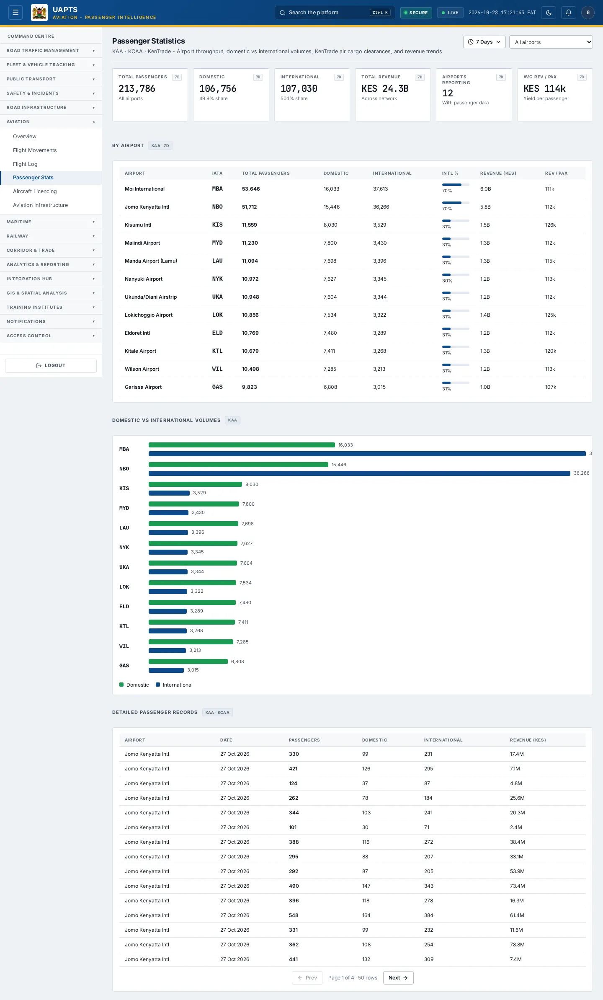
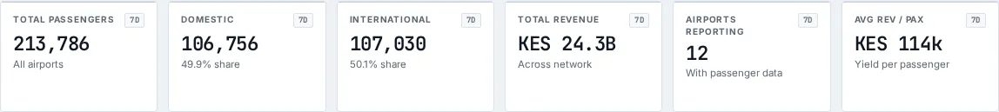

# Passenger Stats

_Aviation › Passenger Stats_ · Route `/aviation/passenger-stats`

**Passenger Statistics** lets you see airport throughput, domestic vs international volumes, KenTrade air cargo clearances, and revenue trends. Data on this page comes from KAA, KCAA and KenTrade.

> 🎬 **Video tutorial:** _coming soon._  
> <!-- VIDEO-URL: aviation/passenger-stats | paste the link here, e.g. [Watch the walkthrough](https://…) -->

## Highlights

- **6 headline tiles** — Total Passengers, Domestic, International, Total Revenue, Airports Reporting, Avg Rev / Pax.
- **2 panels** — By Airport, Detailed Passenger Records.
- **Refreshes itself every 120 seconds**, so you do not need to reload the page.
- **Filters and search** to narrow tables to what you need.
- Every figure is traceable to the data feed or upload template that supplies it — see [Data sources and feeds](#data-sources-and-feeds).

## Enabling and access

1. Sign in to UAPTS (see [How to access](../getting-started/how-to-access.md)).
2. In the left sidebar expand **Aviation** and click **Passenger Stats**.
3. The page opens at `/aviation/passenger-stats`. You can also reach it with the global search (**Ctrl + K**).

This page belongs to module **M07a · Aviation**. The sidebar and the global search only list pages your agency and role can open, and a link to a page you cannot reach sends you back to the Command Centre. If a page you expect is missing, ask your agency administrator to check your agency's [Module Access](../access-control/module-access.md).

## Page tour

### Headline tiles

| Tile | What it shows | Data from | Table → ingested via |
|---|---|---|---|
| **Total Passengers** | All airports | `/aviation-maritime/aviation/airports/`, `/aviation-maritime/aviation/passenger-stats/by-airport/` | _Airport, PassengerStat_ → [`kaa-airport-register`](../data-templates/kaa-airport-register.xlsx) [`kaa-passenger-statistics`](../data-templates/kaa-passenger-statistics.xlsx) live feed `kaa-aodb` |
| **Domestic** | — | `/aviation-maritime/aviation/passenger-stats/by-airport/` | _PassengerStat_ → [`kaa-passenger-statistics`](../data-templates/kaa-passenger-statistics.xlsx) |
| **International** | — | `/aviation-maritime/aviation/passenger-stats/by-airport/` | _PassengerStat_ → [`kaa-passenger-statistics`](../data-templates/kaa-passenger-statistics.xlsx) |
| **Total Revenue** | Across network | `/aviation-maritime/aviation/passenger-stats/by-airport/` | _PassengerStat_ → [`kaa-passenger-statistics`](../data-templates/kaa-passenger-statistics.xlsx) |
| **Airports Reporting** | With passenger data | `/aviation-maritime/aviation/passenger-stats/by-airport/` | _PassengerStat_ → [`kaa-passenger-statistics`](../data-templates/kaa-passenger-statistics.xlsx) |
| **Avg Rev / Pax** | Yield per passenger | `/aviation-maritime/aviation/passenger-stats/by-airport/` | _PassengerStat_ → [`kaa-passenger-statistics`](../data-templates/kaa-passenger-statistics.xlsx) |

### By Airport

Contains a table with the columns **Airport**, **IATA**, **Total Passengers**, **Domestic**, **International**, **Intl %**, **Revenue (KES)**, **Rev / Pax**.

**Data from:** `/aviation-maritime/aviation/passenger-stats/by-airport/`  
**Table → ingested via:** _PassengerStat_ → [`kaa-passenger-statistics`](../data-templates/kaa-passenger-statistics.xlsx)

### Detailed Passenger Records

Contains a table with the columns **Airport**, **Date**, **Passengers**, **Domestic**, **International**, **Revenue (KES)**.

**Data from:** `/aviation-maritime/aviation/passenger-stats/`  
**Table → ingested via:** _PassengerStat_ → [`kaa-passenger-statistics`](../data-templates/kaa-passenger-statistics.xlsx)

## Working with this page

1. Open **Aviation → Passenger Stats** from the sidebar.
2. Wait for the page to finish loading. It re-fetches its data every **120 s**; the figures you see are the latest the platform holds, not a one-time snapshot.
3. Use the **All airports** drop-down to narrow the list. Choices include: x.iata_code)" :key="a.iata_code!" :value="a.iata_code!"> -.

## Data sources and feeds

Every number and table on this page is read from the API endpoints below. The **Ingested via** column says how the underlying records get into UAPTS: a downloadable **upload template** (xlsx/CSV, loaded through the [Integration Hub](../integration-hub/upload-and-connect.md)), a **live feed** that pushes records to the ingest API, or — where neither exists yet — it is stated plainly.

| Endpoint | Records | Ingested via |
|---|---|---|
| `GET /aviation-maritime/aviation/airports/` | Airports | [`kaa-airport-register`](../data-templates/kaa-airport-register.xlsx) live feed `kaa-aodb` (KAA AODB) |
| `GET /aviation-maritime/aviation/passenger-stats/` | Passenger Stats | [`kaa-passenger-statistics`](../data-templates/kaa-passenger-statistics.xlsx) |
| `GET /aviation-maritime/aviation/passenger-stats/by-airport/` | Passenger Stats | [`kaa-passenger-statistics`](../data-templates/kaa-passenger-statistics.xlsx) |

Full details of every template (columns, formats) are in the [Data sources catalogue](../reference/data-sources.md). Interactive API documentation is available at `/api/docs/`.

## Permissions

| Who | What they can do here |
|---|---|
| Public / read-only accounts | View the page where the module is enabled for their agency (read-only). |
| Operator | View the page. |
| Analyst | View and **export CSV**. |
| Agency admin | Everything an analyst can do, plus the administrative capabilities listed in [Roles & Permissions](../access-control/roles-and-permissions.md). |
| Super admin | Sees every agency's data. |

**Agencies with the Aviation module:** full — KAA, KCAA, SDT.

_Access is evaluated by the server from the baseline policy plus any agency overrides, so a super admin or agency admin may have changed it from the defaults above._

## Related topics

- [Overview](aviation-overview.md)
- [Flight Movements](flight-movements.md)
- [Flight Log](flight-log.md)
- [Aircraft Licencing](aircraft-licencing.md)
- [Aviation Infrastructure](aviation-infrastructure.md)
- [Aviation overview](index.md)
- [Upload & Connect (Integration Hub)](../integration-hub/upload-and-connect.md)
- [Data sources catalogue](../reference/data-sources.md)

## On this page

- [Highlights](#highlights)
- [Enabling and access](#enabling-and-access)
- [Page tour](#page-tour)
- [Working with this page](#working-with-this-page)
- [Data sources and feeds](#data-sources-and-feeds)
- [Permissions](#permissions)
- [Related topics](#related-topics)

## Support

- **Your agency administrator** is the first contact for access, role and data-quality questions.
- **Data feeds, templates and API questions:** `api-support@uapts.go.ke` (include the `X-Request-ID` response header from a failing call).
- **Security concerns:** `security@uapts.go.ke`. Do not report suspected vulnerabilities publicly.
