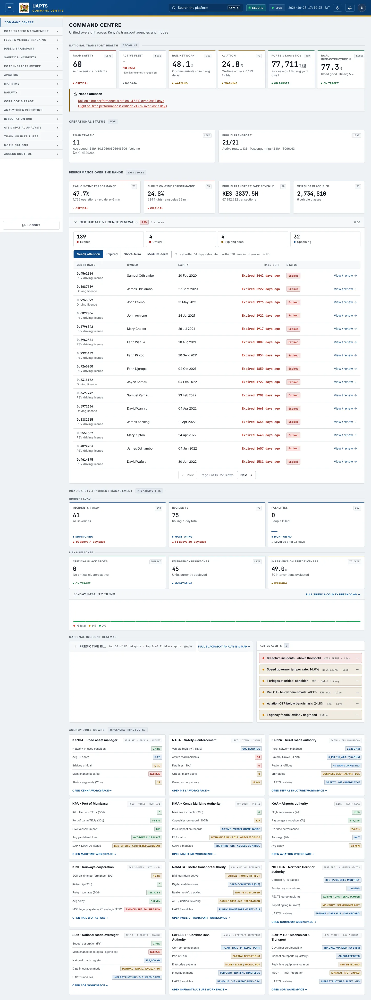
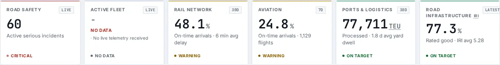

# Home

_Command Centre › Home_ · Route `/dashboard`

**Home** is part of the Command Centre module.

> 🎬 **Video tutorial:** _coming soon._  
> <!-- VIDEO-URL: command-centre/home | paste the link here, e.g. [Watch the walkthrough](https://…) -->

## Highlights

- **13 headline tiles** — t.entry.label, Road Safety, Active Fleet, Rail Network, Aviation, Ports & Logistics….
- **1 panels** — 30-Day Fatality Trend Full trend &amp; county breakdown.
- An **interactive map** with a legend, full-screen, locate-me and base-map controls.
- **Refreshes itself every 120 seconds**, so you do not need to reload the page.
- Every figure is traceable to the data feed or upload template that supplies it — see [Data sources and feeds](#data-sources-and-feeds).

## Enabling and access

1. Sign in to UAPTS (see [How to access](../getting-started/how-to-access.md)).
2. In the left sidebar click **Command Centre**.
3. The page opens at `/dashboard`. You can also reach it with the global search (**Ctrl + K**).

This page belongs to module **M01 · Command Centre**. The sidebar and the global search only list pages your agency and role can open, and a link to a page you cannot reach sends you back to the Command Centre. If a page you expect is missing, ask your agency administrator to check your agency's [Module Access](../access-control/module-access.md).

## Page tour

### Headline tiles

| Tile | What it shows | Data from | Table → ingested via |
|---|---|---|---|
| **t.entry.label** | — _(window: t.entry.period)_ | — | — |
| **Road Safety** | — Source system label on the tile: **NTSA IRSMS** | `/safety/summary/` | _SafetyIntervention_ → computed by UAPTS |
| **Active Fleet** | — Source system label on the tile: **NTSA iTIMS** | `/fleet/summary/` | aggregate of several tables — see [per-table feeds](#data-sources-and-feeds) |
| **Rail Network** | — Source system label on the tile: **KRC Operations** | `/railway/summary/` | _RailIncident, RailLine, RailRidershipDaily_ → [`krc-rail-incident-log`](../data-templates/krc-rail-incident-log.xlsx) [`krc-rail-ridership-daily`](../data-templates/krc-rail-ridership-daily.xlsx) |
| **Aviation** | — Source system label on the tile: **KAA / KCAA** | `/aviation-maritime/aviation/summary/` | aggregate of several tables — see [per-table feeds](#data-sources-and-feeds) |
| **Ports & Logistics** | — Source system label on the tile: **KPA Mombasa** | `/aviation-maritime/maritime/operations/` | aggregate of several tables — see [per-table feeds](#data-sources-and-feeds) |
| **Road Infrastructure** | — Source system label on the tile: **KeNHA / KURA / KeRRA** | `/infrastructure/summary/` | _RoadSegment_ → [`krb-road-condition`](../data-templates/krb-road-condition.xlsx) [`kura-road-network`](../data-templates/kura-road-network.xlsx) [`kenha-road-network`](../data-templates/kenha-road-network.xlsx) [`kerra-road-network`](../data-templates/kerra-road-network.xlsx) +1 more |
| **Incidents today** | — Source system label on the tile: **NTSA IRSMS** | `/safety/summary/` | _Incident_ → live feed `ntsa-itims` |
| **Incidents** | — Source system label on the tile: **NTSA IRSMS** | `/safety/summary/` | _Incident_ → live feed `ntsa-itims` |
| **Fatalities** | — Source system label on the tile: **NTSA IRSMS + NPS** | `/safety/summary/` | aggregate of several tables — see [per-table feeds](#data-sources-and-feeds) |
| **Critical black spots** | — Source system label on the tile: **NTSA KDE analysis** | `/safety/black-spots/top/`, `/safety/summary/` | _BlackSpot_ → computed by UAPTS |
| **Emergency dispatches** | — Source system label on the tile: **NPS / NTSA** | `/safety/summary/` | _EmergencyDispatch_ → no template yet |
| **Intervention effectiveness** | — Source system label on the tile: **KeNHA / NTSA** | `/safety/summary/` | _SafetyIntervention_ → computed by UAPTS |

### 30-Day Fatality Trend Full trend &amp; county breakdown

**Data from:** `/safety/summary/`  
**Table → ingested via:** aggregate of several tables — see [per-table feeds](#data-sources-and-feeds)

## Which Command Centre you see

Opening **Command Centre** asks the server which dashboard you should get:

1. If an administrator has **published and assigned** a custom dashboard to your agency, department, role or you personally, you see it. The header shows **Why this view?** (it explains the assignment) and, if you may, **Customise** and **Edit**.
2. Otherwise ministry and platform users (super admin, or agency SDT) see the **National Command Centre**.
3. Other agency users see their **Agency Command Centre** — the agency's own headline figures and workspace links.

### Customise your own view

1. Click **Customise** (shown when the assignment allows it).
2. Drag widgets to move them, drag the corner to resize, and use **Hide** for what you do not need.
3. Click **Save my layout**. Only you see it. **Reset to default** returns to the assigned layout; **Cancel** discards your edits.

Administrators build and assign dashboards in [Dashboard Manager](../access-control/dashboard-manager.md).

## Agency drill-down cards (National view)

The lower part of the page has one card per agency (**Agency Drill-Downs**, scoped by your access). Each card shows a few headline figures and an **Open … workspace →** link to the relevant module.

| Card | Figures shown |
|---|---|
| KeNHA - Road asset manager | Network in good condition, Avg IRI score, Bridges critical, Maintenance backlog, At-risk segments (12mo) |
| NTSA - Safety & enforcement | Vehicle registry (iTIMS), Active road incidents, Fatalities (30d), Critical black spots, Governor tamper rate |
| KeRRA - Rural roads authority | Rural network managed, Paved / Gravel / Earth, Regional offices, ERP status, UAPTS modules |
| KPA - Port of Mombasa | {{ port.port_name }} TEUs (30d), Live vessels in port, Avg yard dwell time, SAP + KWATOS status |
| KMA - Kenya Maritime Authority | Maritime incidents (30d), Casualties on record (2025), PSC inspection records, ERP status, UAPTS modules |
| KAA - Airports authority | Flight movements (7d), Passenger throughput (7d), On-time performance, Air cargo (7d), Avg delay |
| KRC - Railways corporation | SGR on-time performance (30d), Ridership (30d), Freight tonnage (30d), Avg delay, MGR legacy systems (Translogic/ATW) |
| NaMATA - Metro transport authority | BRT corridors active, Digital matatu routes, Real-time AVL tracking, AFC / unified ticketing, UAPTS modules |
| NCTTCA - Northern Corridor authority | Corridor KPIs tracked, Border posts monitored, RECTS cargo tracking, Reporting lag (current), UAPTS modules |
| SDR - National roads oversight | Budget absorption (FY), Maintenance backlog (all agencies), National roads register, Data integration mode, UAPTS modules |
| LAPSSET - Corridor Dev. Authority | Corridor components, Port of Lamu, Enterprise systems, Integration mode, UAPTS modules |
| SDR-MTD - Mechanical & Transport | Govt fleet serviceability, Inspection reports (quarterly), Real-time equipment location, MECH → fleet integration, UAPTS modules |

The figures come from the same endpoints as the module pages (see **Data sources and feeds**); a card marked _No data_ means the feed has not delivered yet. The tags on each card (for example _REST API · ArcGIS_) name the agency's source system.

## Working with this page

1. Open **Command Centre** from the sidebar.
2. Wait for the page to finish loading. It re-fetches its data every **120 s**; the figures you see are the latest the platform holds, not a one-time snapshot.
3. On the map, drag to pan and scroll (or pinch) to zoom. Click a marker or line for its details. Use the map toolbar to go full-screen, centre on your location, reset the view or switch the base map; click the legend chip to expand it.
4. Click **Customise** to use this action.
5. Click **Reset to default** to use this action.
6. Click **Why this view?** to use this action.

## Data sources and feeds

Every number and table on this page is read from the API endpoints below. The **Ingested via** column says how the underlying records get into UAPTS: a downloadable **upload template** (xlsx/CSV, loaded through the [Integration Hub](../integration-hub/upload-and-connect.md)), a **live feed** that pushes records to the ingest API, or — where neither exists yet — it is stated plainly.

| Endpoint | Records | Ingested via |
|---|---|---|
| `GET /aviation-maritime/aviation/summary/` | _Aggregate of 6 tables (rows below)_ | — |
| ↳ Aircraft | Aircrafts | [`kcaa-aircraft-register`](../data-templates/kcaa-aircraft-register.xlsx) |
| ↳ Airline | Airlines | [`kcaa-airline-register`](../data-templates/kcaa-airline-register.xlsx) |
| ↳ Airport | Airports | [`kaa-airport-register`](../data-templates/kaa-airport-register.xlsx) live feed `kaa-aodb` (KAA AODB) |
| ↳ CargoManifest | Cargo Manifests | **No ingestion template yet** — populated by seed data or direct entry |
| ↳ Flight | Flights | [`kaa-flight-movements`](../data-templates/kaa-flight-movements.xlsx) live feed `kaa-aodb` (KAA AODB) |
| ↳ PassengerStat | Passenger Stats | [`kaa-passenger-statistics`](../data-templates/kaa-passenger-statistics.xlsx) |
| `GET /aviation-maritime/maritime/operations/` | _Aggregate of 5 tables (rows below)_ | — |
| ↳ ContainerThroughput | Container Throughputs | Computed by UAPTS from other data (no direct feed) |
| ↳ MaritimeIncident | Maritime Incidents | [`kma-marine-incidents`](../data-templates/kma-marine-incidents.xlsx) |
| ↳ MaritimeInspection | Maritime Inspections | [`kma-vessel-inspections`](../data-templates/kma-vessel-inspections.xlsx) |
| ↳ VesselMovement | Vessel Movements | live feed `kpa-tos` (KPA TOS) |
| ↳ YardDwell | Yard Dwells | **No ingestion template yet** — populated by seed data or direct entry |
| `GET /fleet/summary/` | _Aggregate of 5 tables (rows below)_ | — |
| ↳ DriverBehaviorEvent | Driver Behavior Events | Live telemetry — push via `POST /api/v1/integrations/<source_id>/ingest/`; **no template or handler yet** |
| ↳ GeofenceEvent | Geofence Events | Live telemetry — push via `POST /api/v1/integrations/<source_id>/ingest/`; **no template or handler yet** |
| ↳ SpeedGovernorStatus | Speed Governor Statuss | Live telemetry — push via `POST /api/v1/integrations/<source_id>/ingest/`; **no template or handler yet** |
| ↳ TripPlayback | Trip Playbacks | Live telemetry — push via `POST /api/v1/integrations/<source_id>/ingest/`; **no template or handler yet** |
| ↳ Vehicle | Vehicles | [`ntsa-psv-fleet-register`](../data-templates/ntsa-psv-fleet-register.xlsx) |
| `GET /infrastructure/summary/` | _Aggregate of 8 tables (rows below)_ | — |
| ↳ Bridge | Bridges | [`kenha-bridge-register`](../data-templates/kenha-bridge-register.xlsx) [`kerra-bridge-register`](../data-templates/kerra-bridge-register.xlsx) |
| ↳ ConstructionProject | Construction Projects | [`krb-workplans`](../data-templates/krb-workplans.xlsx) [`kura-project-progress`](../data-templates/kura-project-progress.xlsx) [`kenha-project-progress`](../data-templates/kenha-project-progress.xlsx) [`kerra-project-progress`](../data-templates/kerra-project-progress.xlsx) +3 more ([catalogue](../reference/data-sources.md)) |
| ↳ DeteriorationForecast | Deterioration Forecasts | Computed by UAPTS from other data (no direct feed) |
| ↳ MaintenanceBudget | Maintenance Budgets | [`krb-funding`](../data-templates/krb-funding.xlsx) |
| ↳ MaintenanceOrder | Maintenance Orders | [`kura-maintenance-work-orders`](../data-templates/kura-maintenance-work-orders.xlsx) [`kenha-maintenance-work-orders`](../data-templates/kenha-maintenance-work-orders.xlsx) [`kerra-maintenance-work-orders`](../data-templates/kerra-maintenance-work-orders.xlsx) |
| ↳ RoadSegment | Road Segments | [`krb-road-condition`](../data-templates/krb-road-condition.xlsx) [`kura-road-network`](../data-templates/kura-road-network.xlsx) [`kenha-road-network`](../data-templates/kenha-road-network.xlsx) [`kerra-road-network`](../data-templates/kerra-road-network.xlsx) +1 more ([catalogue](../reference/data-sources.md)) |
| ↳ Streetlight | Streetlights | **No ingestion template yet** — populated by seed data or direct entry |
| ↳ WIMReading | Wim Readings | [`kura-weighbridge-transactions`](../data-templates/kura-weighbridge-transactions.xlsx) [`kenha-weighbridge-transactions`](../data-templates/kenha-weighbridge-transactions.xlsx) |
| `GET /integrations/` | Data Sources | **No ingestion template yet** — populated by seed data or direct entry |
| `GET /integrations/agency-contributions/` | _Aggregate of 2 tables (rows below)_ | — |
| ↳ DataSource | Data Sources | **No ingestion template yet** — populated by seed data or direct entry |
| ↳ IngestedRecord | Ingested Records | **No ingestion template yet** — populated by seed data or direct entry |
| `GET /railway/summary/` | _Aggregate of 10 tables (rows below)_ | — |
| ↳ Schedule | Schedules | **No ingestion template yet** — populated by seed data or direct entry |
| ↳ FreightManifest | Freight Manifests | **No ingestion template yet** — populated by seed data or direct entry |
| ↳ RailIncident | Rail Incidents | [`krc-rail-incident-log`](../data-templates/krc-rail-incident-log.xlsx) |
| ↳ RailLine | Rail Lines | **No ingestion template yet** — populated by seed data or direct entry |
| ↳ RailRidershipDaily | Rail Ridership Dailys | [`krc-rail-ridership-daily`](../data-templates/krc-rail-ridership-daily.xlsx) |
| ↳ RailStation | Rail Stations | [`krc-rail-station-register`](../data-templates/krc-rail-station-register.xlsx) |
| ↳ RailTicket | Rail Tickets | **No ingestion template yet** — populated by seed data or direct entry |
| ↳ Train | Trains | [`krc-train-register`](../data-templates/krc-train-register.xlsx) |
| ↳ TrainOperation | Train Operations | **No ingestion template yet** — populated by seed data or direct entry |
| ↳ TrainSchedule | Train Schedules | [`krc-train-schedule-register`](../data-templates/krc-train-schedule-register.xlsx) |
| `GET /safety/black-spots/top/` | Black Spots | Computed by UAPTS from other data (no direct feed) |
| `GET /safety/predictive-hotspots/` | Predictive Hotspots | Computed by UAPTS from other data (no direct feed) |
| `GET /safety/summary/` | _Aggregate of 7 tables (rows below)_ | — |
| ↳ Accident | Accidents | [`kenha-crash-records`](../data-templates/kenha-crash-records.xlsx) [`ntsa-crash-records`](../data-templates/ntsa-crash-records.xlsx) [`sdr-crash-records`](../data-templates/sdr-crash-records.xlsx) |
| ↳ BlackSpot | Black Spots | Computed by UAPTS from other data (no direct feed) |
| ↳ EmergencyDispatch | Emergency Dispatchs | **No ingestion template yet** — populated by seed data or direct entry |
| ↳ Incident | Incidents | live feed `ntsa-itims` (NTSA iTIMS) |
| ↳ PredictiveHotspot | Predictive Hotspots | Computed by UAPTS from other data (no direct feed) |
| ↳ SafetyIntervention | Safety Interventions | Computed by UAPTS from other data (no direct feed) |
| ↳ TrafficViolation | Traffic Violations | live feed `ntsa-itims` (NTSA iTIMS) |

Full details of every template (columns, formats) are in the [Data sources catalogue](../reference/data-sources.md). Interactive API documentation is available at `/api/docs/`.

## Permissions

| Who | What they can do here |
|---|---|
| Public / read-only accounts | View the page where the module is enabled for their agency (read-only). |
| Operator | View the page. |
| Analyst | View and **export CSV**. |
| Agency admin | Everything an analyst can do, plus the administrative capabilities listed in [Roles & Permissions](../access-control/roles-and-permissions.md). |
| Super admin | Sees every agency's data. |

**Agencies with the Command Centre module:** full — KENHA, KURA, KERRA, SDR, SDR_MTD, SDT, NTSA, NAMATA, KRC, KPA, KMA, NCTTCA, LAPSSET; selected pages only — COUNTY_GOV, KAA, KCAA, KMD, KRA, KRB, KENTRADE, NPS, KWS.

_Access is evaluated by the server from the baseline policy plus any agency overrides, so a super admin or agency admin may have changed it from the defaults above._

## Related topics

- [Command Centre overview](index.md)
- [Upload & Connect (Integration Hub)](../integration-hub/upload-and-connect.md)
- [Data sources catalogue](../reference/data-sources.md)

## On this page

- [Highlights](#highlights)
- [Enabling and access](#enabling-and-access)
- [Page tour](#page-tour)
- [Working with this page](#working-with-this-page)
- [Data sources and feeds](#data-sources-and-feeds)
- [Permissions](#permissions)
- [Related topics](#related-topics)

## Support

- **Your agency administrator** is the first contact for access, role and data-quality questions.
- **Data feeds, templates and API questions:** `api-support@uapts.go.ke` (include the `X-Request-ID` response header from a failing call).
- **Security concerns:** `security@uapts.go.ke`. Do not report suspected vulnerabilities publicly.
