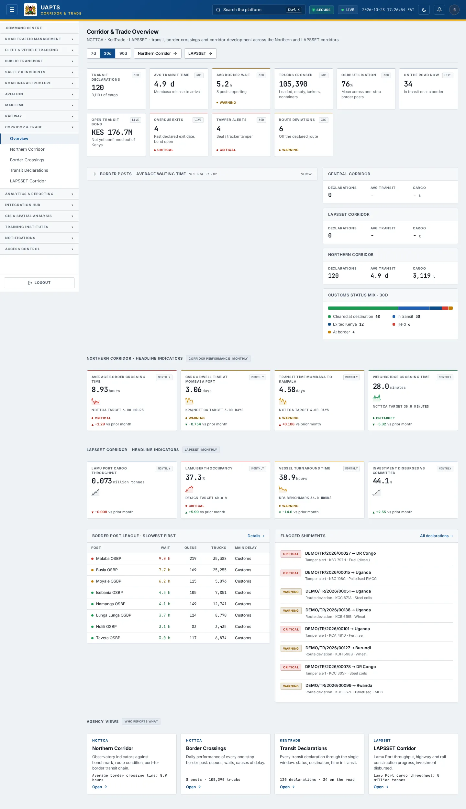
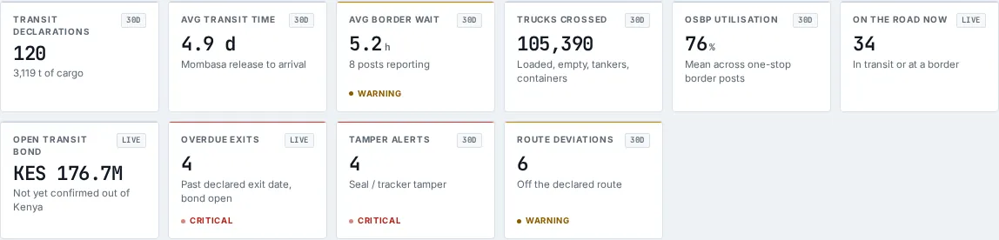
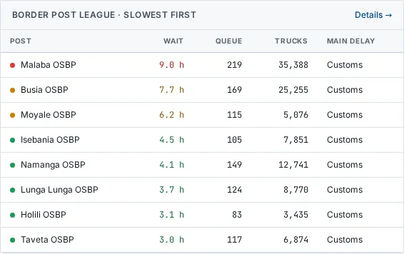
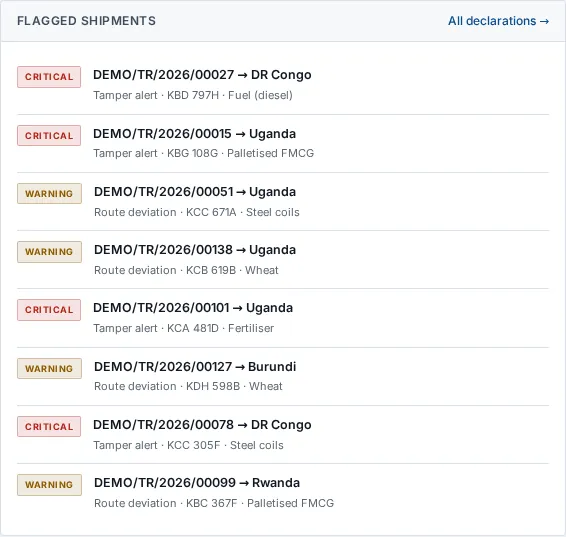

# Corridor & Trade — Overview

_Corridor & Trade › Overview_ · Route `/corridor`

**Corridor & Trade Overview** lets you see transit, border crossings and corridor development across the Northern and LAPSSET corridors. Data on this page comes from NCTTCA, KenTrade and LAPSSET.

> 🎬 **Video tutorial:** _coming soon._  
> <!-- VIDEO-URL: corridor/corridor-overview | paste the link here, e.g. [Watch the walkthrough](https://…) -->

## Highlights

- **10 headline tiles** — Transit declarations, Avg transit time, Avg border wait, Trucks crossed, OSBP utilisation, On the road now….
- **3 panels** — Customs status mix, Border post league · slowest first, Flagged shipments.
- An **interactive map** with a legend, full-screen, locate-me and base-map controls.
- Every figure is traceable to the data feed or upload template that supplies it — see [Data sources and feeds](#data-sources-and-feeds).

## Enabling and access

1. Sign in to UAPTS (see [How to access](../getting-started/how-to-access.md)).
2. In the left sidebar expand **Corridor & Trade** and click **Overview**.
3. The page opens at `/corridor`. You can also reach it with the global search (**Ctrl + K**).

This page belongs to module **M15 · Corridor and Trade**. The sidebar and the global search only list pages your agency and role can open, and a link to a page you cannot reach sends you back to the Command Centre. If a page you expect is missing, ask your agency administrator to check your agency's [Module Access](../access-control/module-access.md).

## Page tour

### Headline tiles

| Tile | What it shows | Data from | Table → ingested via |
|---|---|---|---|
| **Transit declarations** | — | `/corridor/summary/` | _TransitShipment_ → [`kentrade-transit-declarations`](../data-templates/kentrade-transit-declarations.xlsx) [`ncttca-transit-shipments`](../data-templates/ncttca-transit-shipments.xlsx) |
| **Avg transit time** | Mombasa release to arrival | `/corridor/summary/` | _TransitShipment_ → [`kentrade-transit-declarations`](../data-templates/kentrade-transit-declarations.xlsx) [`ncttca-transit-shipments`](../data-templates/ncttca-transit-shipments.xlsx) |
| **Avg border wait** | — | `/corridor/summary/` | _BorderCrossingDaily_ → [`ncttca-border-crossing-daily`](../data-templates/ncttca-border-crossing-daily.xlsx) |
| **Trucks crossed** | Loaded, empty, tankers, containers | `/corridor/summary/` | _BorderCrossingDaily_ → [`ncttca-border-crossing-daily`](../data-templates/ncttca-border-crossing-daily.xlsx) |
| **OSBP utilisation** | Mean across one-stop border posts | `/corridor/summary/` | _BorderCrossingDaily_ → [`ncttca-border-crossing-daily`](../data-templates/ncttca-border-crossing-daily.xlsx) |
| **On the road now** | In transit or at a border _(window: LIVE)_ | `/corridor/summary/` | _BorderCrossingDaily, TransitShipment_ → [`kentrade-transit-declarations`](../data-templates/kentrade-transit-declarations.xlsx) [`ncttca-border-crossing-daily`](../data-templates/ncttca-border-crossing-daily.xlsx) [`ncttca-transit-shipments`](../data-templates/ncttca-transit-shipments.xlsx) |
| **Open transit bond** | Not yet confirmed out of Kenya _(window: LIVE)_ | `/corridor/summary/` | _TransitShipment_ → [`kentrade-transit-declarations`](../data-templates/kentrade-transit-declarations.xlsx) [`ncttca-transit-shipments`](../data-templates/ncttca-transit-shipments.xlsx) |
| **Overdue exits** | Past declared exit date, bond open _(window: LIVE)_ | `/corridor/summary/` | aggregate of several tables — see [per-table feeds](#data-sources-and-feeds) |
| **Tamper alerts** | Seal / tracker tamper | `/corridor/summary/` | aggregate of several tables — see [per-table feeds](#data-sources-and-feeds) |
| **Route deviations** | Off the declared route | `/corridor/summary/` | aggregate of several tables — see [per-table feeds](#data-sources-and-feeds) |

### Customs status mix

**Data from:** `/corridor/summary/`  
**Table → ingested via:** aggregate of several tables — see [per-table feeds](#data-sources-and-feeds)

### Border post league · slowest first

Contains a table with the columns **Post**, **Wait**, **Queue**, **Trucks**, **Main delay**.

**Data from:** `/corridor/summary/`  
**Table → ingested via:** _BorderCrossingDaily_ → [`ncttca-border-crossing-daily`](../data-templates/ncttca-border-crossing-daily.xlsx)

### Flagged shipments

**Data from:** `/corridor/kpis/series/`, `/corridor/summary/`  
**Table → ingested via:** _CorridorKPIValue, TransitShipment_ → [`kentrade-transit-declarations`](../data-templates/kentrade-transit-declarations.xlsx) [`lapsset-corridor-kpis`](../data-templates/lapsset-corridor-kpis.xlsx) [`ncttca-corridor-kpis`](../data-templates/ncttca-corridor-kpis.xlsx) [`ncttca-transit-shipments`](../data-templates/ncttca-transit-shipments.xlsx)

## Working with this page

1. Open **Corridor & Trade → Overview** from the sidebar.
2. Use the date-range / day toggle above the charts to change the reporting window; the tiles and charts update together.
3. On the map, drag to pan and scroll (or pinch) to zoom. Click a marker or line for its details. Use the map toolbar to go full-screen, centre on your location, reset the view or switch the base map; click the legend chip to expand it.

## Data sources and feeds

Every number and table on this page is read from the API endpoints below. The **Ingested via** column says how the underlying records get into UAPTS: a downloadable **upload template** (xlsx/CSV, loaded through the [Integration Hub](../integration-hub/upload-and-connect.md)), a **live feed** that pushes records to the ingest API, or — where neither exists yet — it is stated plainly.

| Endpoint | Records | Ingested via |
|---|---|---|
| `GET /corridor/alignments/` | _Aggregate of 2 tables (rows below)_ | — |
| ↳ Corridor | Corridors | **No ingestion template yet** — populated by seed data or direct entry |
| ↳ CorridorAlignment | Corridor Alignments | **No ingestion template yet** — populated by seed data or direct entry |
| `GET /corridor/kpis/series/` | Corridor Kpi Values | [`lapsset-corridor-kpis`](../data-templates/lapsset-corridor-kpis.xlsx) [`ncttca-corridor-kpis`](../data-templates/ncttca-corridor-kpis.xlsx) |
| `GET /corridor/summary/` | _Aggregate of 3 tables (rows below)_ | — |
| ↳ BorderCrossingDaily | Border Crossing Dailys | [`ncttca-border-crossing-daily`](../data-templates/ncttca-border-crossing-daily.xlsx) |
| ↳ Corridor | Corridors | **No ingestion template yet** — populated by seed data or direct entry |
| ↳ TransitShipment | Transit Shipments | [`kentrade-transit-declarations`](../data-templates/kentrade-transit-declarations.xlsx) [`ncttca-transit-shipments`](../data-templates/ncttca-transit-shipments.xlsx) |

Full details of every template (columns, formats) are in the [Data sources catalogue](../reference/data-sources.md). Interactive API documentation is available at `/api/docs/`.

## Permissions

| Who | What they can do here |
|---|---|
| Public / read-only accounts | View the page where the module is enabled for their agency (read-only). |
| Operator | View the page. |
| Analyst | View and **export CSV**. |
| Agency admin | Everything an analyst can do, plus the administrative capabilities listed in [Roles & Permissions](../access-control/roles-and-permissions.md). |
| Super admin | Sees every agency's data. |

**Agencies with the Corridor and Trade module:** full — SDR, SDT, NCTTCA, LAPSSET; read-only — KENTRADE.

_Access is evaluated by the server from the baseline policy plus any agency overrides, so a super admin or agency admin may have changed it from the defaults above._

## Related topics

- [Northern Corridor](northern-corridor.md)
- [Border Crossings](border-crossings.md)
- [Transit Declarations](transit-declarations.md)
- [LAPSSET Corridor](lapsset-corridor.md)
- [Corridor & Trade overview](index.md)
- [Upload & Connect (Integration Hub)](../integration-hub/upload-and-connect.md)
- [Data sources catalogue](../reference/data-sources.md)

## On this page

- [Highlights](#highlights)
- [Enabling and access](#enabling-and-access)
- [Page tour](#page-tour)
- [Working with this page](#working-with-this-page)
- [Data sources and feeds](#data-sources-and-feeds)
- [Permissions](#permissions)
- [Related topics](#related-topics)

## Support

- **Your agency administrator** is the first contact for access, role and data-quality questions.
- **Data feeds, templates and API questions:** `api-support@uapts.go.ke` (include the `X-Request-ID` response header from a failing call).
- **Security concerns:** `security@uapts.go.ke`. Do not report suspected vulnerabilities publicly.
