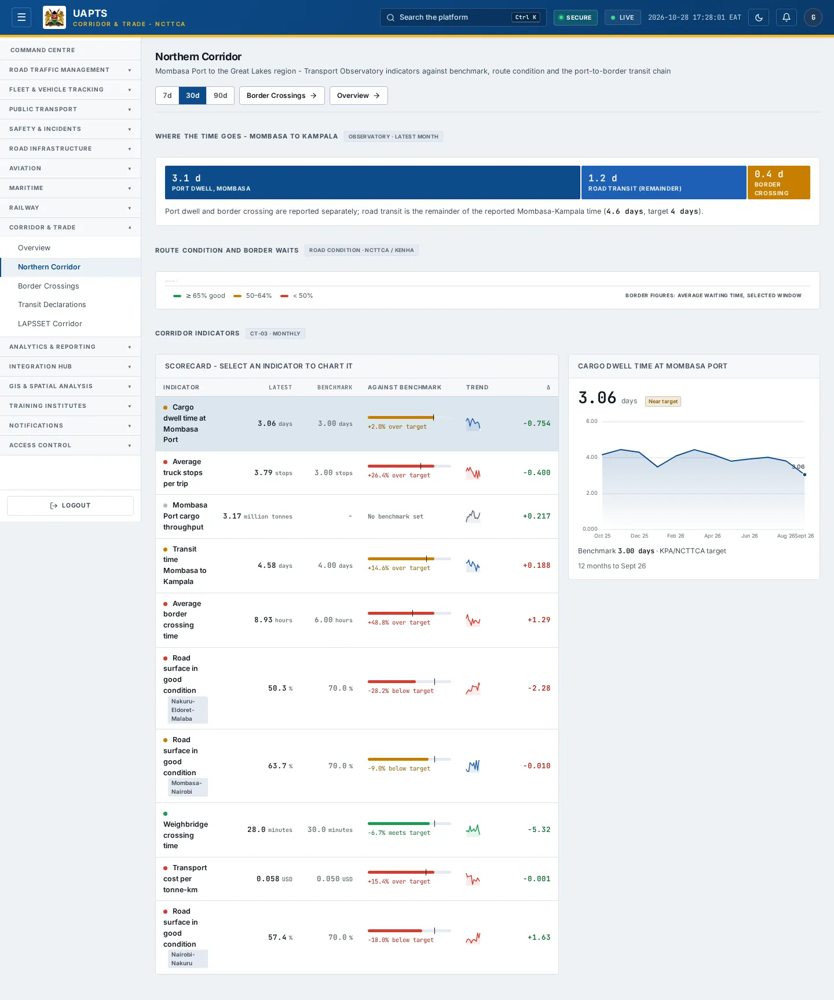
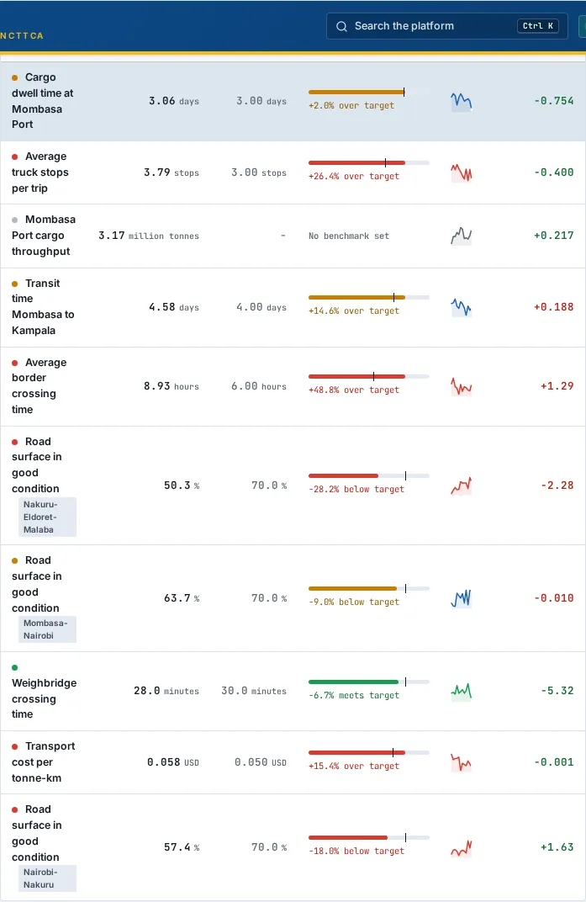

# Northern Corridor

_Corridor & Trade › Northern Corridor_ · Route `/corridor/northern`

**Northern Corridor** lets you see mombasa Port to the Great Lakes region - Transport Observatory indicators against benchmark, route condition and the port-to-border transit chain.

> 🎬 **Video tutorial:** _coming soon._  
> <!-- VIDEO-URL: corridor/northern-corridor | paste the link here, e.g. [Watch the walkthrough](https://…) -->

## Highlights

- **1 panels** — Scorecard - select an indicator to chart it.
- Every figure is traceable to the data feed or upload template that supplies it — see [Data sources and feeds](#data-sources-and-feeds).

## Enabling and access

1. Sign in to UAPTS (see [How to access](../getting-started/how-to-access.md)).
2. In the left sidebar expand **Corridor & Trade** and click **Northern Corridor**.
3. The page opens at `/corridor/northern`. You can also reach it with the global search (**Ctrl + K**).

This page belongs to module **M15 · Corridor and Trade**. The sidebar and the global search only list pages your agency and role can open, and a link to a page you cannot reach sends you back to the Command Centre. If a page you expect is missing, ask your agency administrator to check your agency's [Module Access](../access-control/module-access.md).

## Page tour

### Scorecard - select an indicator to chart it

Contains a chart and a table with the columns **Indicator**, **Latest**, **Benchmark**, **Against benchmark**, **Trend**, **Δ**.

**Data from:** `/corridor/border-crossings/performance/`, `/corridor/kpis/series/`  
**Table → ingested via:** _BorderCrossingDaily, CorridorKPIValue_ → [`lapsset-corridor-kpis`](../data-templates/lapsset-corridor-kpis.xlsx) [`ncttca-border-crossing-daily`](../data-templates/ncttca-border-crossing-daily.xlsx) [`ncttca-corridor-kpis`](../data-templates/ncttca-corridor-kpis.xlsx)

## Working with this page

1. Open **Corridor & Trade → Northern Corridor** from the sidebar.
2. Use the date-range / day toggle above the charts to change the reporting window; the tiles and charts update together.
3. Click a row to open its detail.

## Data sources and feeds

Every number and table on this page is read from the API endpoints below. The **Ingested via** column says how the underlying records get into UAPTS: a downloadable **upload template** (xlsx/CSV, loaded through the [Integration Hub](../integration-hub/upload-and-connect.md)), a **live feed** that pushes records to the ingest API, or — where neither exists yet — it is stated plainly.

| Endpoint | Records | Ingested via |
|---|---|---|
| `GET /corridor/border-crossings/performance/` | Border Crossing Dailys | [`ncttca-border-crossing-daily`](../data-templates/ncttca-border-crossing-daily.xlsx) |
| `GET /corridor/kpis/series/` | Corridor Kpi Values | [`lapsset-corridor-kpis`](../data-templates/lapsset-corridor-kpis.xlsx) [`ncttca-corridor-kpis`](../data-templates/ncttca-corridor-kpis.xlsx) |

Full details of every template (columns, formats) are in the [Data sources catalogue](../reference/data-sources.md). Interactive API documentation is available at `/api/docs/`.

## Permissions

| Who | What they can do here |
|---|---|
| Public / read-only accounts | View the page where the module is enabled for their agency (read-only). |
| Operator | View the page. |
| Analyst | View and **export CSV**. |
| Agency admin | Everything an analyst can do, plus the administrative capabilities listed in [Roles & Permissions](../access-control/roles-and-permissions.md). |
| Super admin | Sees every agency's data. |

**Agencies with the Corridor and Trade module:** full — SDR, SDT, NCTTCA, LAPSSET; read-only — KENTRADE.

_Access is evaluated by the server from the baseline policy plus any agency overrides, so a super admin or agency admin may have changed it from the defaults above._

## Related topics

- [Overview](corridor-overview.md)
- [Border Crossings](border-crossings.md)
- [Transit Declarations](transit-declarations.md)
- [LAPSSET Corridor](lapsset-corridor.md)
- [Corridor & Trade overview](index.md)
- [Upload & Connect (Integration Hub)](../integration-hub/upload-and-connect.md)
- [Data sources catalogue](../reference/data-sources.md)

## On this page

- [Highlights](#highlights)
- [Enabling and access](#enabling-and-access)
- [Page tour](#page-tour)
- [Working with this page](#working-with-this-page)
- [Data sources and feeds](#data-sources-and-feeds)
- [Permissions](#permissions)
- [Related topics](#related-topics)

## Support

- **Your agency administrator** is the first contact for access, role and data-quality questions.
- **Data feeds, templates and API questions:** `api-support@uapts.go.ke` (include the `X-Request-ID` response header from a failing call).
- **Security concerns:** `security@uapts.go.ke`. Do not report suspected vulnerabilities publicly.
