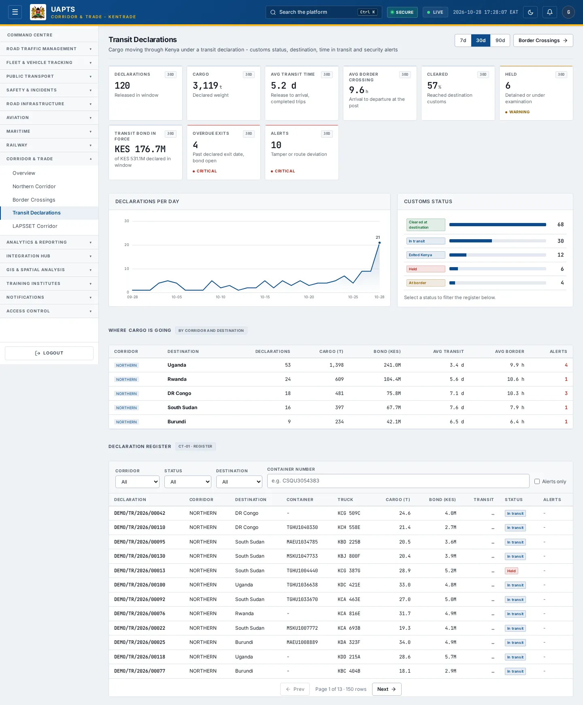
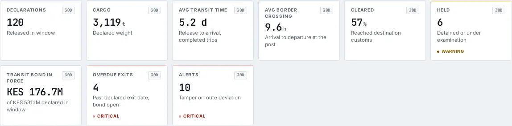
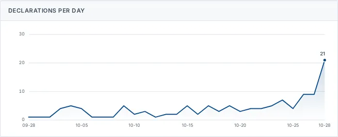
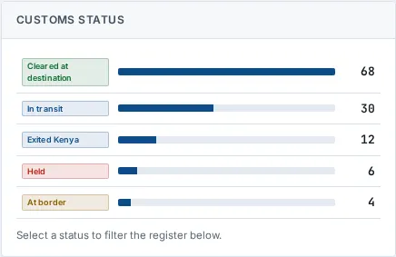

# Transit Declarations

_Corridor & Trade › Transit Declarations_ · Route `/corridor/transit`

**Transit Declarations** lets you see cargo moving through Kenya under a transit declaration - customs status, destination, time in transit and security alerts.

> 🎬 **Video tutorial:** _coming soon._  
> <!-- VIDEO-URL: corridor/transit-declarations | paste the link here, e.g. [Watch the walkthrough](https://…) -->

## Highlights

- **9 headline tiles** — Declarations, Cargo, Avg transit time, Avg border crossing, Cleared, Held….
- **4 panels** — Declarations per day, Customs status, Where cargo is going, Declaration register.
- **Filters and search** to narrow tables to what you need.
- Every figure is traceable to the data feed or upload template that supplies it — see [Data sources and feeds](#data-sources-and-feeds).

## Enabling and access

1. Sign in to UAPTS (see [How to access](../getting-started/how-to-access.md)).
2. In the left sidebar expand **Corridor & Trade** and click **Transit Declarations**.
3. The page opens at `/corridor/transit`. You can also reach it with the global search (**Ctrl + K**).

This page belongs to module **M15 · Corridor and Trade**. The route needs at least the **Analyst** tier to open it. The sidebar and the global search only list pages your agency and role can open, and a link to a page you cannot reach sends you back to the Command Centre. If a page you expect is missing, ask your agency administrator to check your agency's [Module Access](../access-control/module-access.md).

## Page tour

### Headline tiles

| Tile | What it shows | Data from | Table → ingested via |
|---|---|---|---|
| **Declarations** | Released in window | `/corridor/shipments/`, `/corridor/shipments/transit-summary/` | _TransitShipment_ → [`kentrade-transit-declarations`](../data-templates/kentrade-transit-declarations.xlsx) [`ncttca-transit-shipments`](../data-templates/ncttca-transit-shipments.xlsx) |
| **Cargo** | Declared weight | `/corridor/shipments/`, `/corridor/shipments/transit-summary/` | _TransitShipment_ → [`kentrade-transit-declarations`](../data-templates/kentrade-transit-declarations.xlsx) [`ncttca-transit-shipments`](../data-templates/ncttca-transit-shipments.xlsx) |
| **Avg transit time** | Release to arrival, completed trips | — | — |
| **Avg border crossing** | Arrival to departure at the post | — | — |
| **Cleared** | Reached destination customs | `/corridor/shipments/`, `/corridor/shipments/transit-summary/` | _TransitShipment_ → [`kentrade-transit-declarations`](../data-templates/kentrade-transit-declarations.xlsx) [`ncttca-transit-shipments`](../data-templates/ncttca-transit-shipments.xlsx) |
| **Held** | Detained or under examination | `/corridor/shipments/`, `/corridor/shipments/transit-summary/` | _TransitShipment_ → [`kentrade-transit-declarations`](../data-templates/kentrade-transit-declarations.xlsx) [`ncttca-transit-shipments`](../data-templates/ncttca-transit-shipments.xlsx) |
| **Transit bond in force** | — | `/corridor/shipments/`, `/corridor/shipments/transit-summary/` | _TransitShipment_ → [`kentrade-transit-declarations`](../data-templates/kentrade-transit-declarations.xlsx) [`ncttca-transit-shipments`](../data-templates/ncttca-transit-shipments.xlsx) |
| **Overdue exits** | Past declared exit date, bond open | `/corridor/shipments/`, `/corridor/shipments/transit-summary/` | _TransitShipment_ → [`kentrade-transit-declarations`](../data-templates/kentrade-transit-declarations.xlsx) [`ncttca-transit-shipments`](../data-templates/ncttca-transit-shipments.xlsx) |
| **Alerts** | Tamper or route deviation | `/corridor/shipments/`, `/corridor/shipments/transit-summary/` | _TransitShipment_ → [`kentrade-transit-declarations`](../data-templates/kentrade-transit-declarations.xlsx) [`ncttca-transit-shipments`](../data-templates/ncttca-transit-shipments.xlsx) |

### Declarations per day

Contains a chart.

**Data from:** `/corridor/shipments/`, `/corridor/shipments/transit-summary/`  
**Table → ingested via:** _TransitShipment_ → [`kentrade-transit-declarations`](../data-templates/kentrade-transit-declarations.xlsx) [`ncttca-transit-shipments`](../data-templates/ncttca-transit-shipments.xlsx)

### Customs status

**Data from:** `/corridor/shipments/`, `/corridor/shipments/transit-summary/`  
**Table → ingested via:** _TransitShipment_ → [`kentrade-transit-declarations`](../data-templates/kentrade-transit-declarations.xlsx) [`ncttca-transit-shipments`](../data-templates/ncttca-transit-shipments.xlsx)

### Where cargo is going

Contains a table with the columns **Corridor**, **Destination**, **Declarations**, **Cargo (t)**, **Bond (KES)**, **Avg transit**, **Avg border**, **Alerts**.

**Data from:** `/corridor/shipments/`, `/corridor/shipments/transit-summary/`  
**Table → ingested via:** _TransitShipment_ → [`kentrade-transit-declarations`](../data-templates/kentrade-transit-declarations.xlsx) [`ncttca-transit-shipments`](../data-templates/ncttca-transit-shipments.xlsx)

### Declaration register

Contains a table with the columns **Declaration**, **Corridor**, **Destination**, **Container**, **Truck**, **Cargo (t)**, **Bond (KES)**, **Transit**, **Status**, **Alerts**.

**Data from:** `/corridor/shipments/`, `/corridor/shipments/transit-summary/`  
**Table → ingested via:** _TransitShipment_ → [`kentrade-transit-declarations`](../data-templates/kentrade-transit-declarations.xlsx) [`ncttca-transit-shipments`](../data-templates/ncttca-transit-shipments.xlsx)

## Working with this page

1. Open **Corridor & Trade → Transit Declarations** from the sidebar.
2. Type in the **“e.g. CSQU3054383”** box to filter what is shown.
3. Use the date-range / day toggle above the charts to change the reporting window; the tiles and charts update together.
4. Click a row to open its detail.

## Status and value meanings

These are the values the platform stores for the fields shown on this page (`value` followed by the label you see).

| Field | Table | Values |
|---|---|---|
| customs status | TransitShipment | `lodged` · `in_transit` · `at_border` · `exited` Exited Kenya · `cleared` Cleared at destination · `held` · `cancelled` |

## Data sources and feeds

Every number and table on this page is read from the API endpoints below. The **Ingested via** column says how the underlying records get into UAPTS: a downloadable **upload template** (xlsx/CSV, loaded through the [Integration Hub](../integration-hub/upload-and-connect.md)), a **live feed** that pushes records to the ingest API, or — where neither exists yet — it is stated plainly.

| Endpoint | Records | Ingested via |
|---|---|---|
| `GET /corridor/shipments/` | Transit Shipments | [`kentrade-transit-declarations`](../data-templates/kentrade-transit-declarations.xlsx) [`ncttca-transit-shipments`](../data-templates/ncttca-transit-shipments.xlsx) |
| `GET /corridor/shipments/transit-summary/` | Transit Shipments | [`kentrade-transit-declarations`](../data-templates/kentrade-transit-declarations.xlsx) [`ncttca-transit-shipments`](../data-templates/ncttca-transit-shipments.xlsx) |

Full details of every template (columns, formats) are in the [Data sources catalogue](../reference/data-sources.md). Interactive API documentation is available at `/api/docs/`.

## Permissions

| Who | What they can do here |
|---|---|
| Public / read-only accounts | No access to this page. |
| Operator | No access (page needs Analyst). |
| Analyst | View and **export CSV**. |
| Agency admin | Everything an analyst can do, plus the administrative capabilities listed in [Roles & Permissions](../access-control/roles-and-permissions.md). |
| Super admin | Sees every agency's data. |

**Agencies with the Corridor and Trade module:** full — SDR, SDT, NCTTCA, LAPSSET; read-only — KENTRADE.

_Access is evaluated by the server from the baseline policy plus any agency overrides, so a super admin or agency admin may have changed it from the defaults above._

## Related topics

- [Overview](corridor-overview.md)
- [Northern Corridor](northern-corridor.md)
- [Border Crossings](border-crossings.md)
- [LAPSSET Corridor](lapsset-corridor.md)
- [Corridor & Trade overview](index.md)
- [Upload & Connect (Integration Hub)](../integration-hub/upload-and-connect.md)
- [Data sources catalogue](../reference/data-sources.md)

## On this page

- [Highlights](#highlights)
- [Enabling and access](#enabling-and-access)
- [Page tour](#page-tour)
- [Working with this page](#working-with-this-page)
- [Status and value meanings](#status-and-value-meanings)
- [Data sources and feeds](#data-sources-and-feeds)
- [Permissions](#permissions)
- [Related topics](#related-topics)

## Support

- **Your agency administrator** is the first contact for access, role and data-quality questions.
- **Data feeds, templates and API questions:** `api-support@uapts.go.ke` (include the `X-Request-ID` response header from a failing call).
- **Security concerns:** `security@uapts.go.ke`. Do not report suspected vulnerabilities publicly.
