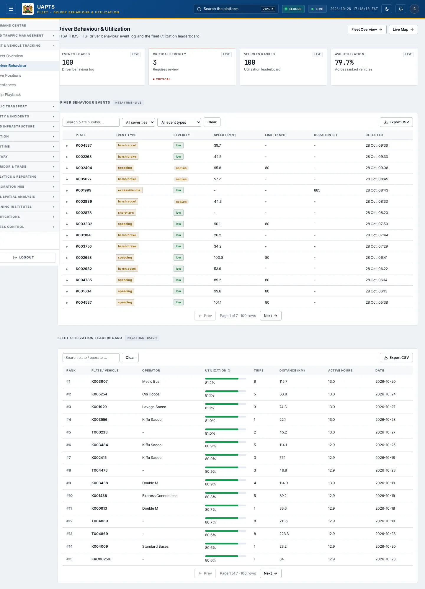
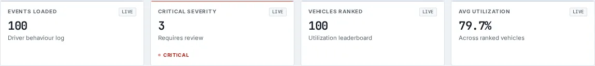

# Driver Behaviour

_Fleet & Vehicle Tracking › Driver Behaviour_ · Route `/fleet/behaviour`

**Driver Behaviour & Utilization** lets you see NTSA iTIMS - Full driver behaviour event log and the fleet utilization leaderboard.

> 🎬 **Video tutorial:** _coming soon._  
> <!-- VIDEO-URL: fleet/driver-behaviour | paste the link here, e.g. [Watch the walkthrough](https://…) -->

## Highlights

- **4 headline tiles** — Events Loaded, Critical Severity, Vehicles Ranked, Avg Utilization.
- **2 panels** — Driver Behaviour Events, Fleet Utilization Leaderboard.
- **Refreshes itself every 120 seconds**, so you do not need to reload the page.
- **Export to CSV** for the rows you are looking at (Analyst tier and above).
- **Filters and search** to narrow tables to what you need.
- Every figure is traceable to the data feed or upload template that supplies it — see [Data sources and feeds](#data-sources-and-feeds).

## Enabling and access

1. Sign in to UAPTS (see [How to access](../getting-started/how-to-access.md)).
2. In the left sidebar expand **Fleet & Vehicle Tracking** and click **Driver Behaviour**.
3. The page opens at `/fleet/behaviour`. You can also reach it with the global search (**Ctrl + K**).

This page belongs to module **M03 · Fleet and Vehicle Tracking**. The sidebar and the global search only list pages your agency and role can open, and a link to a page you cannot reach sends you back to the Command Centre. If a page you expect is missing, ask your agency administrator to check your agency's [Module Access](../access-control/module-access.md).

## Page tour

### Headline tiles

| Tile | What it shows | Data from | Table → ingested via |
|---|---|---|---|
| **Events Loaded** | Driver behaviour log _(window: LIVE)_ | `/fleet/driver-behavior-events/` | _DriverBehaviorEvent_ → live telemetry push (no template yet) |
| **Critical Severity** | Requires review _(window: LIVE)_ | `/fleet/driver-behavior-events/` | _DriverBehaviorEvent_ → live telemetry push (no template yet) |
| **Vehicles Ranked** | Utilization leaderboard _(window: LIVE)_ | `/fleet/utilization/` | _FleetUtilization_ → computed by UAPTS |
| **Avg Utilization** | Across ranked vehicles _(window: LIVE)_ | `/fleet/utilization/` | _FleetUtilization_ → computed by UAPTS |

### Driver Behaviour Events

Contains a table with the columns **Plate**, **Event Type**, **Severity**, **Speed (km/h)**, **Limit (km/h)**, **Duration (s)**, **Detected**.

**Data from:** `/fleet/driver-behavior-events/`  
**Table → ingested via:** _DriverBehaviorEvent_ → live telemetry push (no template yet)

### Fleet Utilization Leaderboard

Contains a table with the columns **Rank**, **Plate / Vehicle**, **Operator**, **Utilization %**, **Trips**, **Distance (km)**, **Active Hours**, **Date**.

**Data from:** `/fleet/utilization/`  
**Table → ingested via:** _FleetUtilization_ → computed by UAPTS

## Working with this page

1. Open **Fleet & Vehicle Tracking → Driver Behaviour** from the sidebar.
2. Wait for the page to finish loading. It re-fetches its data every **120 s**; the figures you see are the latest the platform holds, not a one-time snapshot.
3. Type in the **“Search plate / operator…”** box to filter what is shown.
4. Type in the **“Search plate number…”** box to filter what is shown.
5. Use the **All severities** drop-down to narrow the list. Choices include: Critical, High, Medium, Low.
6. Use the **All event types** drop-down to narrow the list. Choices include: Speeding, Harsh Braking, Harsh Acceleration, Excessive Idling, Sharp Turn.
7. Click a row to open its detail.
8. Click **Export CSV** to download the rows currently loaded (after filters). The button only appears for Analyst tier and above.

## Status and value meanings

These are the values the platform stores for the fields shown on this page (`value` followed by the label you see).

| Field | Table | Values |
|---|---|---|
| event type | DriverBehaviorEvent | `speeding` · `harsh_brake` Harsh Braking · `harsh_accel` Harsh Acceleration · `excessive_idle` Excessive Idling · `sharp_turn` |
| severity | DriverBehaviorEvent | `low` · `medium` · `high` · `critical` |

## Data sources and feeds

Every number and table on this page is read from the API endpoints below. The **Ingested via** column says how the underlying records get into UAPTS: a downloadable **upload template** (xlsx/CSV, loaded through the [Integration Hub](../integration-hub/upload-and-connect.md)), a **live feed** that pushes records to the ingest API, or — where neither exists yet — it is stated plainly.

| Endpoint | Records | Ingested via |
|---|---|---|
| `GET /fleet/driver-behavior-events/` | Driver Behavior Events | Live telemetry — push via `POST /api/v1/integrations/<source_id>/ingest/`; **no template or handler yet** |
| `GET /fleet/utilization/` | Fleet Utilizations | Computed by UAPTS from other data (no direct feed) |

Full details of every template (columns, formats) are in the [Data sources catalogue](../reference/data-sources.md). Interactive API documentation is available at `/api/docs/`.

## Permissions

| Who | What they can do here |
|---|---|
| Public / read-only accounts | View the page where the module is enabled for their agency (read-only). |
| Operator | View the page. |
| Analyst | View and **export CSV**. |
| Agency admin | Everything an analyst can do, plus the administrative capabilities listed in [Roles & Permissions](../access-control/roles-and-permissions.md). |
| Super admin | Sees every agency's data. |

**Agencies with the Fleet and Vehicle Tracking module:** full — SDR, SDR_MTD, SDT, NTSA; selected pages only — KENHA, NAMATA, KRC.

_Access is evaluated by the server from the baseline policy plus any agency overrides, so a super admin or agency admin may have changed it from the defaults above._

## Related topics

- [Fleet Overview](fleet-overview.md)
- [Live Positions](live-positions.md)
- [Geofences](geofences.md)
- [Trip Playback](trip-playback.md)
- [Fleet & Vehicle Tracking overview](index.md)
- [Upload & Connect (Integration Hub)](../integration-hub/upload-and-connect.md)
- [Data sources catalogue](../reference/data-sources.md)

## On this page

- [Highlights](#highlights)
- [Enabling and access](#enabling-and-access)
- [Page tour](#page-tour)
- [Working with this page](#working-with-this-page)
- [Status and value meanings](#status-and-value-meanings)
- [Data sources and feeds](#data-sources-and-feeds)
- [Permissions](#permissions)
- [Related topics](#related-topics)

## Support

- **Your agency administrator** is the first contact for access, role and data-quality questions.
- **Data feeds, templates and API questions:** `api-support@uapts.go.ke` (include the `X-Request-ID` response header from a failing call).
- **Security concerns:** `security@uapts.go.ke`. Do not report suspected vulnerabilities publicly.
