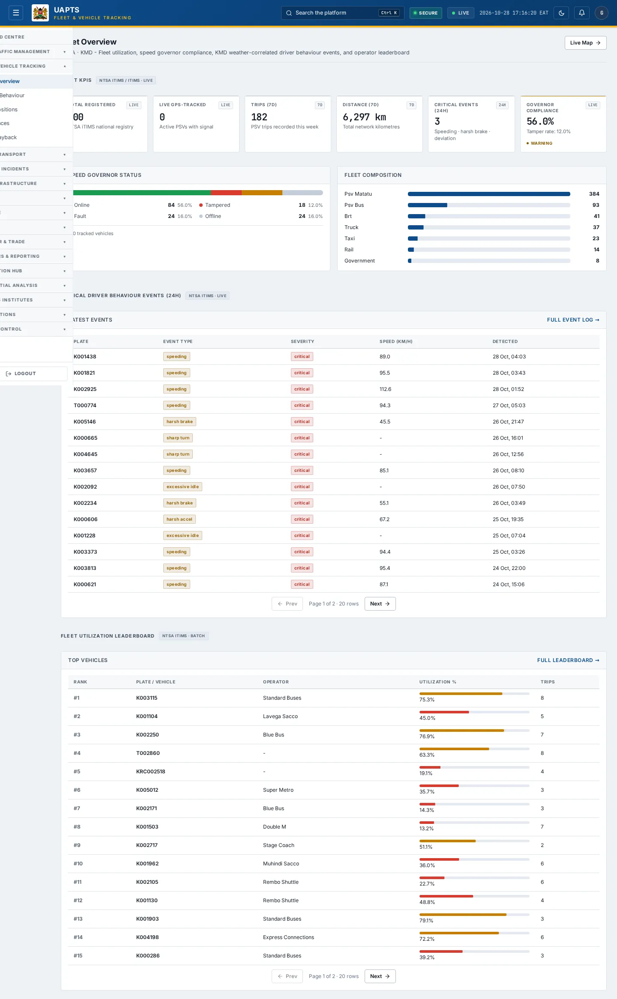
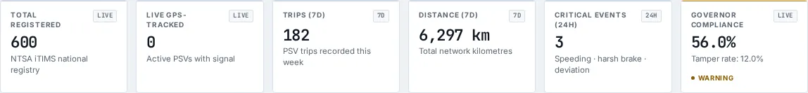
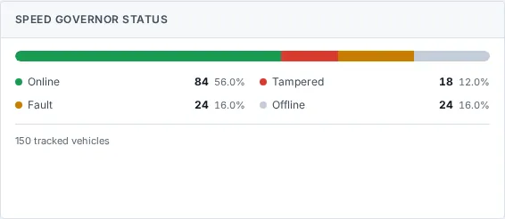
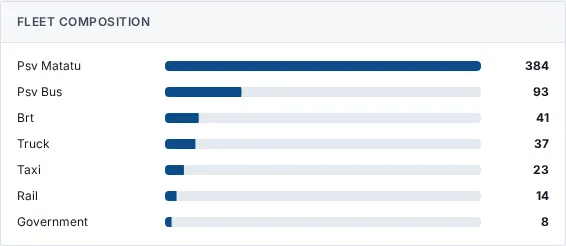
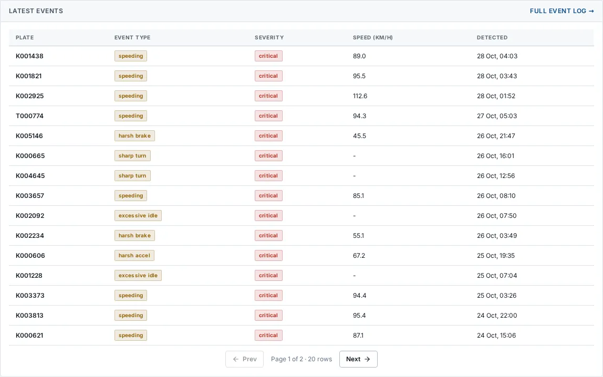
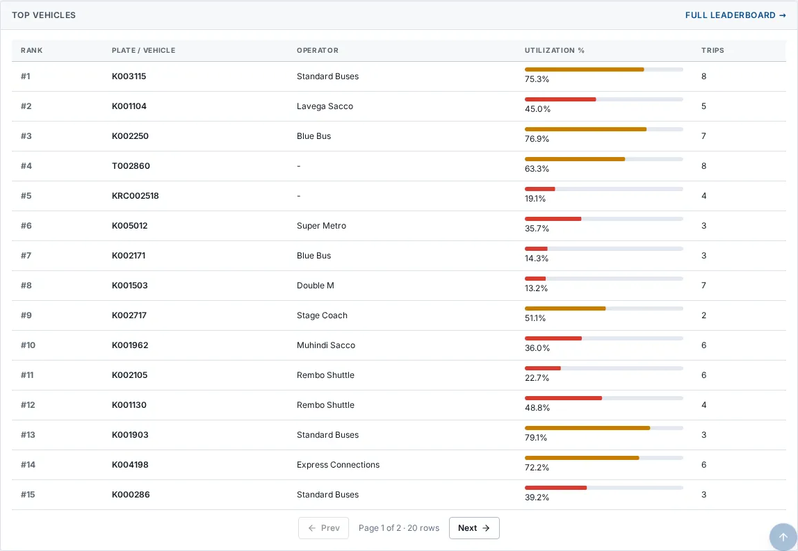

# Fleet Overview

_Fleet & Vehicle Tracking › Fleet Overview_ · Route `/fleet`

**Fleet Overview** lets you see fleet utilization, speed governor compliance, KMD weather-correlated driver behaviour events, and operator leaderboard. Data on this page comes from NTSA and KMD.

> 🎬 **Video tutorial:** _coming soon._  
> <!-- VIDEO-URL: fleet/fleet-overview | paste the link here, e.g. [Watch the walkthrough](https://…) -->

## Highlights

- **6 headline tiles** — Total Registered, Live GPS-Tracked, Trips (7d), Distance (7d), Critical Events (24h), Governor Compliance.
- **4 panels** — Speed Governor Status, Fleet Composition, Latest Events Full event log, Top Vehicles Full leaderboard.
- **Refreshes itself every 120 seconds**, so you do not need to reload the page.
- Every figure is traceable to the data feed or upload template that supplies it — see [Data sources and feeds](#data-sources-and-feeds).

## Enabling and access

1. Sign in to UAPTS (see [How to access](../getting-started/how-to-access.md)).
2. In the left sidebar expand **Fleet & Vehicle Tracking** and click **Fleet Overview**.
3. The page opens at `/fleet`. You can also reach it with the global search (**Ctrl + K**).

This page belongs to module **M03 · Fleet and Vehicle Tracking**. The route needs at least the **Operator** tier to open it. The sidebar and the global search only list pages your agency and role can open, and a link to a page you cannot reach sends you back to the Command Centre. If a page you expect is missing, ask your agency administrator to check your agency's [Module Access](../access-control/module-access.md).

## Page tour

### Headline tiles

| Tile | What it shows | Data from | Table → ingested via |
|---|---|---|---|
| **Total Registered** | NTSA iTIMS national registry _(window: LIVE)_ | `/fleet/summary/` | aggregate of several tables — see [per-table feeds](#data-sources-and-feeds) |
| **Live GPS-Tracked** | Active PSVs with signal _(window: LIVE)_ | `/fleet/summary/` | aggregate of several tables — see [per-table feeds](#data-sources-and-feeds) |
| **Trips (7d)** | PSV trips recorded this week _(window: 7D)_ | `/fleet/summary/` | _TripPlayback_ → live telemetry push (no template yet) |
| **Distance (7d)** | Total network kilometres _(window: 7D)_ | `/fleet/summary/` | aggregate of several tables — see [per-table feeds](#data-sources-and-feeds) |
| **Critical Events (24h)** | Speeding · harsh brake · deviation _(window: 24H)_ | `/fleet/summary/` | _SpeedGovernorStatus_ → live telemetry push (no template yet) |
| **Governor Compliance** | — _(window: LIVE)_ | `/fleet/speed-governor-status/compliance/` | _SpeedGovernorStatus_ → live telemetry push (no template yet) |

### Speed Governor Status

**Data from:** `/fleet/speed-governor-status/compliance/`  
**Table → ingested via:** _SpeedGovernorStatus_ → live telemetry push (no template yet)

### Fleet Composition

**Data from:** `/fleet/summary/`  
**Table → ingested via:** aggregate of several tables — see [per-table feeds](#data-sources-and-feeds)

### Latest Events Full event log

Contains a table with the columns **Plate**, **Event Type**, **Severity**, **Speed (km/h)**, **Detected**.

**Data from:** `/fleet/driver-behavior-events/critical/`  
**Table → ingested via:** _DriverBehaviorEvent_ → live telemetry push (no template yet)

### Top Vehicles Full leaderboard

Contains a table with the columns **Rank**, **Plate / Vehicle**, **Operator**, **Utilization %**, **Trips**.

**Data from:** `/fleet/utilization/`  
**Table → ingested via:** _FleetUtilization_ → computed by UAPTS

## Working with this page

1. Open **Fleet & Vehicle Tracking → Fleet Overview** from the sidebar.
2. Wait for the page to finish loading. It re-fetches its data every **120 s**; the figures you see are the latest the platform holds, not a one-time snapshot.
3. Click **↻ Refresh** to refresh the data.

## Status and value meanings

These are the values the platform stores for the fields shown on this page (`value` followed by the label you see).

| Field | Table | Values |
|---|---|---|
| event type | DriverBehaviorEvent | `speeding` · `harsh_brake` Harsh Braking · `harsh_accel` Harsh Acceleration · `excessive_idle` Excessive Idling · `sharp_turn` |
| severity | DriverBehaviorEvent | `low` · `medium` · `high` · `critical` |
| status | SpeedGovernorStatus | `online` · `offline` · `tampered` · `fault` |

## Data sources and feeds

Every number and table on this page is read from the API endpoints below. The **Ingested via** column says how the underlying records get into UAPTS: a downloadable **upload template** (xlsx/CSV, loaded through the [Integration Hub](../integration-hub/upload-and-connect.md)), a **live feed** that pushes records to the ingest API, or — where neither exists yet — it is stated plainly.

| Endpoint | Records | Ingested via |
|---|---|---|
| `GET /fleet/driver-behavior-events/critical/` | Driver Behavior Events | Live telemetry — push via `POST /api/v1/integrations/<source_id>/ingest/`; **no template or handler yet** |
| `GET /fleet/speed-governor-status/compliance/` | Speed Governor Statuss | Live telemetry — push via `POST /api/v1/integrations/<source_id>/ingest/`; **no template or handler yet** |
| `GET /fleet/summary/` | _Aggregate of 5 tables (rows below)_ | — |
| ↳ DriverBehaviorEvent | Driver Behavior Events | Live telemetry — push via `POST /api/v1/integrations/<source_id>/ingest/`; **no template or handler yet** |
| ↳ GeofenceEvent | Geofence Events | Live telemetry — push via `POST /api/v1/integrations/<source_id>/ingest/`; **no template or handler yet** |
| ↳ SpeedGovernorStatus | Speed Governor Statuss | Live telemetry — push via `POST /api/v1/integrations/<source_id>/ingest/`; **no template or handler yet** |
| ↳ TripPlayback | Trip Playbacks | Live telemetry — push via `POST /api/v1/integrations/<source_id>/ingest/`; **no template or handler yet** |
| ↳ Vehicle | Vehicles | [`ntsa-psv-fleet-register`](../data-templates/ntsa-psv-fleet-register.xlsx) |
| `GET /fleet/utilization/` | Fleet Utilizations | Computed by UAPTS from other data (no direct feed) |

Full details of every template (columns, formats) are in the [Data sources catalogue](../reference/data-sources.md). Interactive API documentation is available at `/api/docs/`.

## Permissions

| Who | What they can do here |
|---|---|
| Public / read-only accounts | No access to this page. |
| Operator | View the page. |
| Analyst | View and **export CSV**. |
| Agency admin | Everything an analyst can do, plus the administrative capabilities listed in [Roles & Permissions](../access-control/roles-and-permissions.md). |
| Super admin | Sees every agency's data. |

**Agencies with the Fleet and Vehicle Tracking module:** full — SDR, SDR_MTD, SDT, NTSA; selected pages only — KENHA, NAMATA, KRC.

_Access is evaluated by the server from the baseline policy plus any agency overrides, so a super admin or agency admin may have changed it from the defaults above._

## Related topics

- [Driver Behaviour](driver-behaviour.md)
- [Live Positions](live-positions.md)
- [Geofences](geofences.md)
- [Trip Playback](trip-playback.md)
- [Fleet & Vehicle Tracking overview](index.md)
- [Upload & Connect (Integration Hub)](../integration-hub/upload-and-connect.md)
- [Data sources catalogue](../reference/data-sources.md)

## On this page

- [Highlights](#highlights)
- [Enabling and access](#enabling-and-access)
- [Page tour](#page-tour)
- [Working with this page](#working-with-this-page)
- [Status and value meanings](#status-and-value-meanings)
- [Data sources and feeds](#data-sources-and-feeds)
- [Permissions](#permissions)
- [Related topics](#related-topics)

## Support

- **Your agency administrator** is the first contact for access, role and data-quality questions.
- **Data feeds, templates and API questions:** `api-support@uapts.go.ke` (include the `X-Request-ID` response header from a failing call).
- **Security concerns:** `security@uapts.go.ke`. Do not report suspected vulnerabilities publicly.
