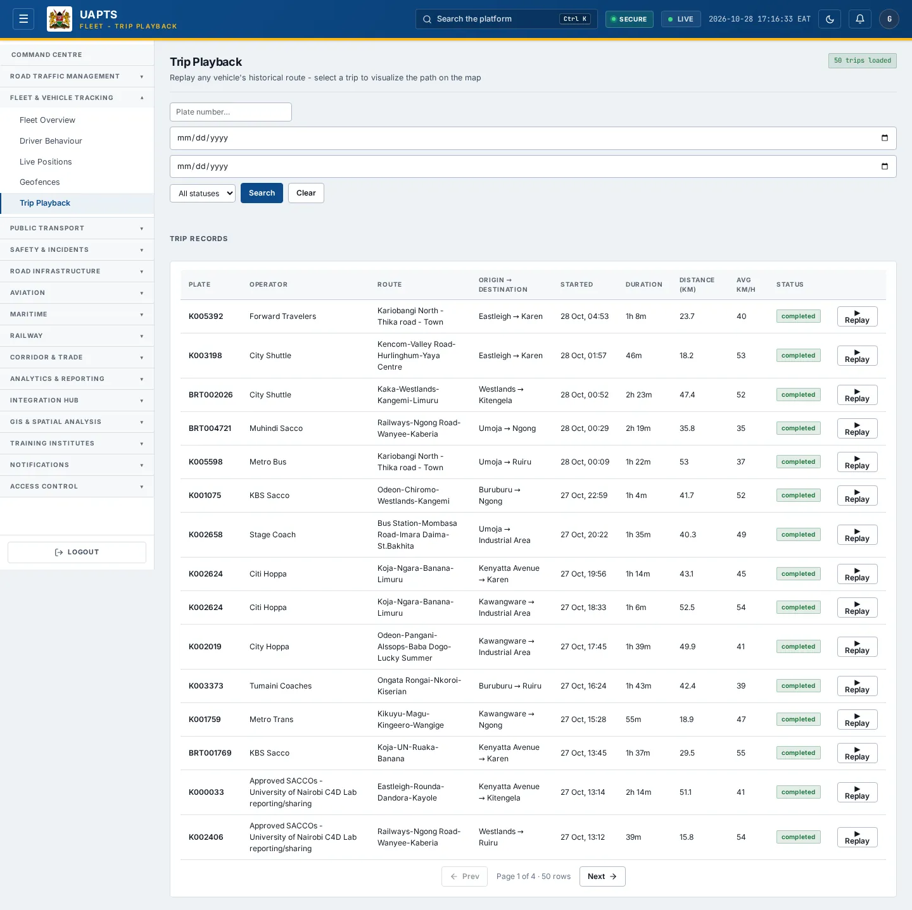

# Trip Playback

_Fleet & Vehicle Tracking › Trip Playback_ · Route `/fleet/trip-playbacks`

**Trip Playback** lets you see replay any vehicle's historical route - select a trip to visualize the path on the map.

> 🎬 **Video tutorial:** _coming soon._  
> <!-- VIDEO-URL: fleet/trip-playback | paste the link here, e.g. [Watch the walkthrough](https://…) -->

## Highlights

- **1 panels** — Trip Records.
- An **interactive map** with a legend, full-screen, locate-me and base-map controls.
- **Filters and search** to narrow tables to what you need.
- Every figure is traceable to the data feed or upload template that supplies it — see [Data sources and feeds](#data-sources-and-feeds).

## Enabling and access

1. Sign in to UAPTS (see [How to access](../getting-started/how-to-access.md)).
2. In the left sidebar expand **Fleet & Vehicle Tracking** and click **Trip Playback**.
3. The page opens at `/fleet/trip-playbacks`. You can also reach it with the global search (**Ctrl + K**).

This page belongs to module **M03 · Fleet and Vehicle Tracking**. The sidebar and the global search only list pages your agency and role can open, and a link to a page you cannot reach sends you back to the Command Centre. If a page you expect is missing, ask your agency administrator to check your agency's [Module Access](../access-control/module-access.md).

## Page tour

### Trip Records

Contains a table with the columns **Plate**, **Operator**, **Route**, **Origin → Destination**, **Started**, **Duration**, **Distance (km)**, **Avg km/h**, **Status**.

**Data from:** `/fleet/trip-playbacks/`, `/fleet/trip-playbacks/{id}/path/`  
**Table → ingested via:** _TripPlayback_ → live telemetry push (no template yet)

## Working with this page

1. Open **Fleet & Vehicle Tracking → Trip Playback** from the sidebar.
2. Type in the **“Plate number…”** box to filter what is shown.
3. Use the **All statuses** drop-down to narrow the list. Choices include: Completed, In Progress, Cancelled.
4. On the map, drag to pan and scroll (or pinch) to zoom. Click a marker or line for its details. Use the map toolbar to go full-screen, centre on your location, reset the view or switch the base map; click the legend chip to expand it.
5. Click **Search** to use this action.
6. Click **↻ Refresh** to refresh the data.
7. Click **✕ Close** to use this action.

## Status and value meanings

These are the values the platform stores for the fields shown on this page (`value` followed by the label you see).

| Field | Table | Values |
|---|---|---|
| status | TripPlayback | `completed` · `in_progress` · `interrupted` |

## Data sources and feeds

Every number and table on this page is read from the API endpoints below. The **Ingested via** column says how the underlying records get into UAPTS: a downloadable **upload template** (xlsx/CSV, loaded through the [Integration Hub](../integration-hub/upload-and-connect.md)), a **live feed** that pushes records to the ingest API, or — where neither exists yet — it is stated plainly.

| Endpoint | Records | Ingested via |
|---|---|---|
| `GET /fleet/trip-playbacks/` | Trip Playbacks | Live telemetry — push via `POST /api/v1/integrations/<source_id>/ingest/`; **no template or handler yet** |
| `GET /fleet/trip-playbacks/{id}/path/` | Trip Playbacks | Live telemetry — push via `POST /api/v1/integrations/<source_id>/ingest/`; **no template or handler yet** |

Full details of every template (columns, formats) are in the [Data sources catalogue](../reference/data-sources.md). Interactive API documentation is available at `/api/docs/`.

## Permissions

| Who | What they can do here |
|---|---|
| Public / read-only accounts | View the page where the module is enabled for their agency (read-only). |
| Operator | View the page. |
| Analyst | View and **export CSV**. |
| Agency admin | Everything an analyst can do, plus the administrative capabilities listed in [Roles & Permissions](../access-control/roles-and-permissions.md). |
| Super admin | Sees every agency's data. |

**Agencies with the Fleet and Vehicle Tracking module:** full — SDR, SDR_MTD, SDT, NTSA; selected pages only — KENHA, NAMATA, KRC.

_Access is evaluated by the server from the baseline policy plus any agency overrides, so a super admin or agency admin may have changed it from the defaults above._

## Related topics

- [Fleet Overview](fleet-overview.md)
- [Driver Behaviour](driver-behaviour.md)
- [Live Positions](live-positions.md)
- [Geofences](geofences.md)
- [Fleet & Vehicle Tracking overview](index.md)
- [Upload & Connect (Integration Hub)](../integration-hub/upload-and-connect.md)
- [Data sources catalogue](../reference/data-sources.md)

## On this page

- [Highlights](#highlights)
- [Enabling and access](#enabling-and-access)
- [Page tour](#page-tour)
- [Working with this page](#working-with-this-page)
- [Status and value meanings](#status-and-value-meanings)
- [Data sources and feeds](#data-sources-and-feeds)
- [Permissions](#permissions)
- [Related topics](#related-topics)

## Support

- **Your agency administrator** is the first contact for access, role and data-quality questions.
- **Data feeds, templates and API questions:** `api-support@uapts.go.ke` (include the `X-Request-ID` response header from a failing call).
- **Security concerns:** `security@uapts.go.ke`. Do not report suspected vulnerabilities publicly.
