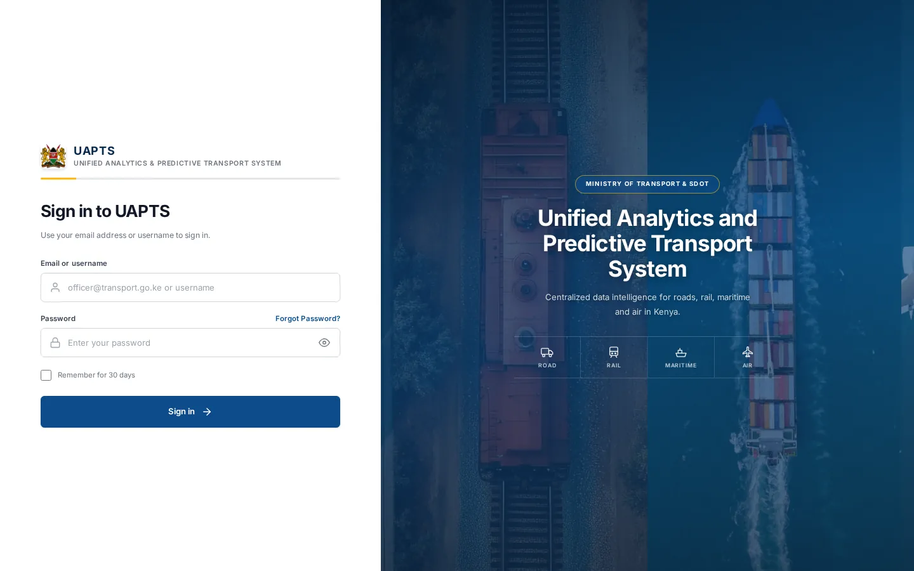
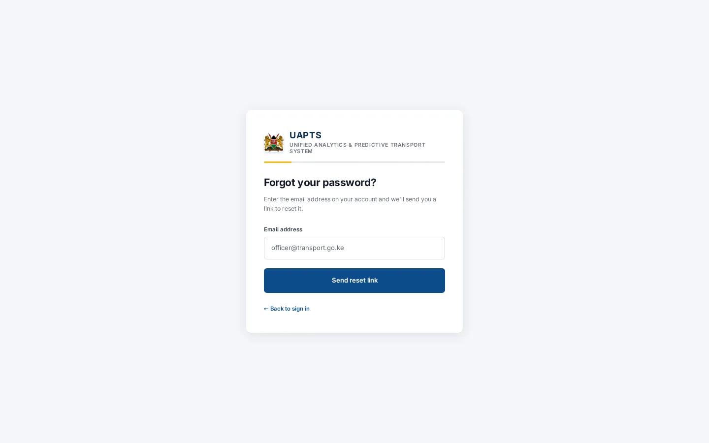
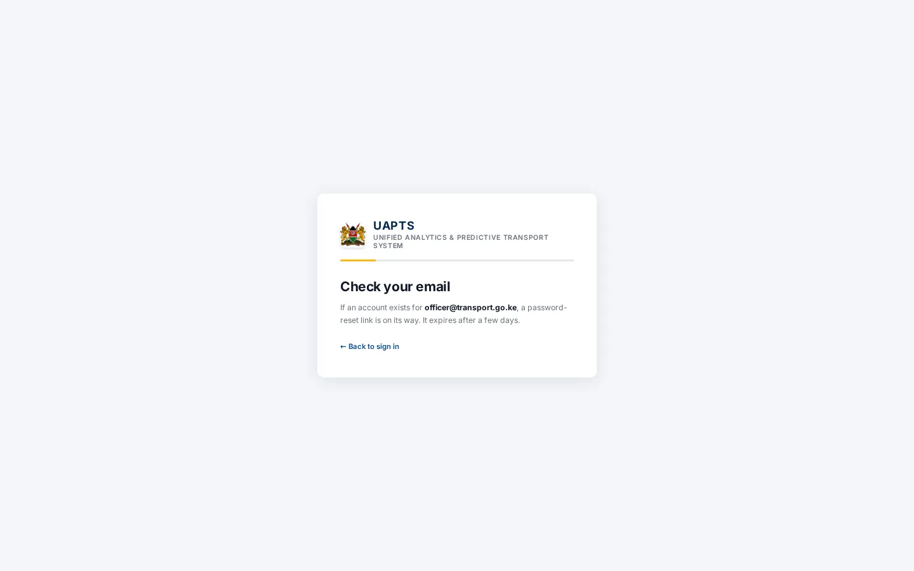
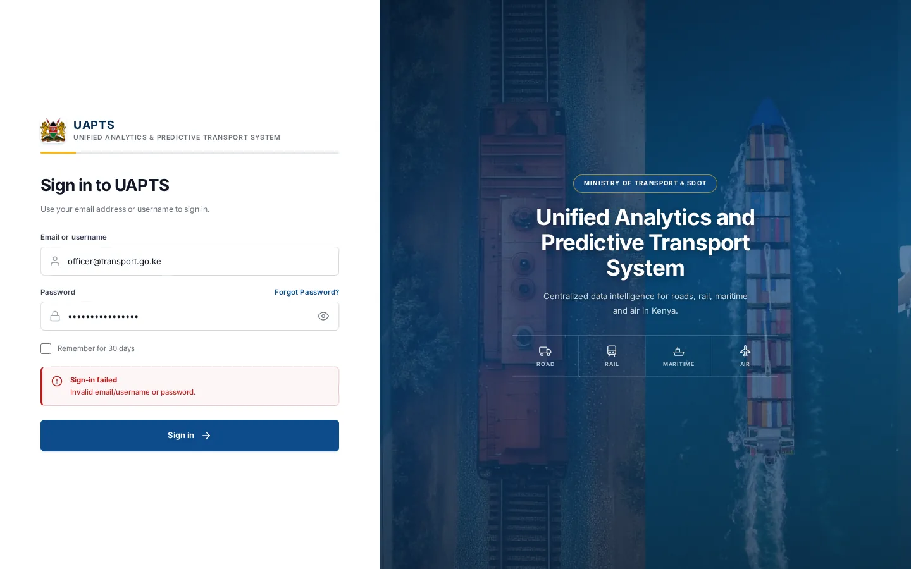

# How to access UAPTS

_Getting started › How to access_ · Route `/login`

UAPTS runs in a web browser — no installation is needed. You sign in with your **email address (or username)** and password; if two-factor authentication is on for your account you also enter a six-digit code.

> 🎬 **Video tutorial:** _coming soon._  
> <!-- VIDEO-URL: getting-started/how-to-access | paste the link here, e.g. [Watch the walkthrough](https://…) -->

## Before you start

- Your **agency administrator** creates your account. You receive an email titled **“Your UAPTS account details”** with a temporary password.
- Use a current version of Chrome, Edge, Firefox or Safari. The application is a single-page web app; keep JavaScript enabled.
- Ask your administrator for the UAPTS web address for your environment.

## Sign in

1. Open the UAPTS address in your browser. You land on **Sign in to UAPTS**.
2. Type your **Email or username** (for example `officer@transport.go.ke`). A username works only if you have set one under [Profile update](personalise/profile-update.md).
3. Type your **Password**. Click the eye icon at the right of the field to show or hide it.
4. Optional: tick **Remember for 30 days** on a device you trust.
5. Click **Sign in**.
6. If your account has two-factor authentication, continue with the next section. Otherwise you arrive at the [Command Centre](../command-centre/home.md).

## Two-factor verification

If two-factor authentication is enabled you see **Step 2 of 2 — Two-factor verification**.

1. Wait for the six-digit code. It is sent to the email address or phone number on your account, depending on the channel you chose when you enabled it.
2. Type the code into the six boxes. The cursor moves on by itself; use the **←** and **→** keys to correct a digit.
3. Click **Verify & Sign In**. If no code arrives, use **Didn't receive a code?** to request another.

To turn two-factor authentication on or off, see [Two-factor authentication](personalise/two-factor-authentication.md).

## Forgot your password?

1. On the sign-in page click **Forgot Password?**.
2. Enter the email address on your account and submit. The page then says **Check your email**. For privacy it says the same thing whether or not the address exists.
3. Open the email and follow the reset link. It expires after a few days.
4. On **Choose a new password**, enter and confirm the new password, then click **Go to sign in**.

## Password rules

- At least **10 characters**.
- Not too similar to your email address or other account details.
- Not a commonly used password.
- Not made up of digits only.

## If you cannot sign in

| What you see | What it means | What to do |
|---|---|---|
| Sign-in failed — _Invalid email/username or password._ | Email, username or password is wrong. After repeated wrong passwords (by default **5** in a row) an account is locked for **15** minutes (administrators can change both values). | Re-enter your details carefully, use **Forgot Password?**, or wait 15 minutes before trying again. |
| Sign-in failed with another message (for example about overdue two-factor setup or a locked account) | The server explains why it refused the sign-in and UAPTS shows that message as written. | Follow the message; if it says you must set up two-factor authentication, see [Two-factor authentication](personalise/two-factor-authentication.md), or ask your administrator. |
| Unable to reach the server | Your device cannot reach UAPTS. | Check your connection; if others are affected, tell your administrator. |
| Verification failed | The six-digit code is wrong or expired. | Request a new code and enter it promptly. |

## Signing out

Click **Logout** at the bottom of the sidebar. Changing your password signs you out of every device.

## Related topics

- [Navigation and shortcuts](navigation-and-shortcuts.md)
- [Change your password](personalise/password.md)
- [Troubleshooting](../reference/troubleshooting.md)

## On this page

- [Before you start](#before-you-start)
- [Sign in](#sign-in)
- [Two-factor verification](#two-factor-verification)
- [Forgot your password?](#forgot-your-password)
- [Password rules](#password-rules)
- [If you cannot sign in](#if-you-cannot-sign-in)
- [Signing out](#signing-out)
- [Related topics](#related-topics)

## Support

- **Your agency administrator** is the first contact for access, role and data-quality questions.
- **Data feeds, templates and API questions:** `api-support@uapts.go.ke` (include the `X-Request-ID` response header from a failing call).
- **Security concerns:** `security@uapts.go.ke`. Do not report suspected vulnerabilities publicly.
