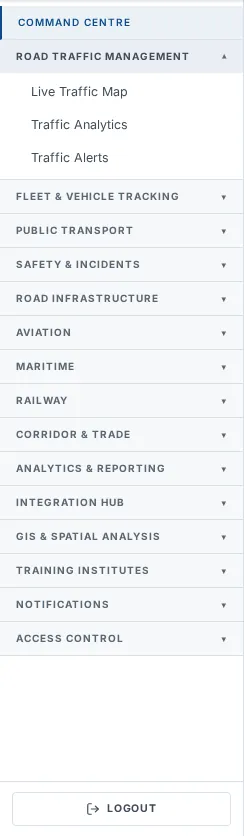
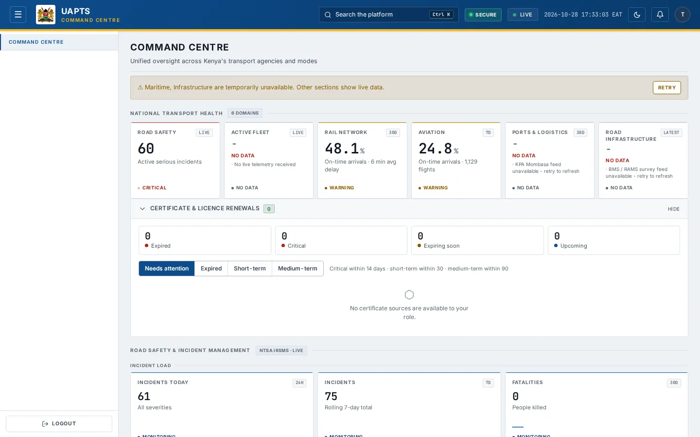
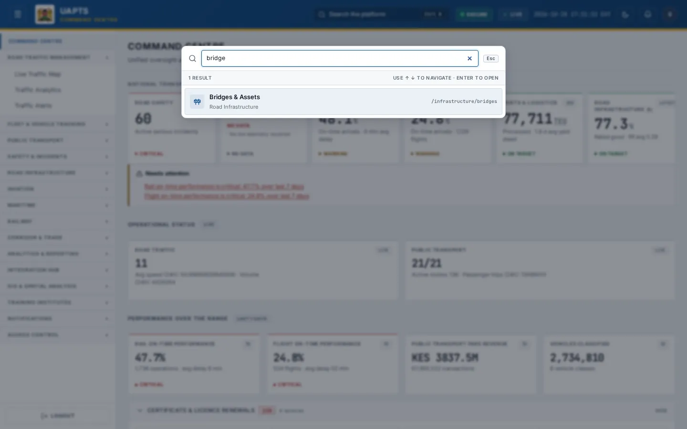

# Navigation and shortcuts

_Getting started › Navigation and shortcuts_

Every UAPTS screen shares the same frame: a **top bar**, a **sidebar** with the modules, and the **page area**. This page explains each part and the keyboard shortcuts.

> 🎬 **Video tutorial:** _coming soon._  
> <!-- VIDEO-URL: getting-started/navigation-and-shortcuts | paste the link here, e.g. [Watch the walkthrough](https://…) -->

## The top bar

| Item | What it does |
|---|---|
| ☰ menu button | On a computer it **collapses or expands the sidebar** (UAPTS remembers your choice in that browser); on a tablet or phone it opens and closes the sidebar drawer. |
| UAPTS logo and subtitle | Click the logo to return to the start. The subtitle under the name describes the screen you are on. |
| **Search the platform** (Ctrl K) | Opens the global search — see below. |
| **Secure** badge | Shows that your session is secured. |
| **Live / Offline** indicator | Green **Live** means the real-time connection is up. **Offline** means live updates are paused; pages still load on request. |
| Clock | The current date and time in **East Africa Time (EAT, UTC+3)**. |
| Moon / sun icon | Switches between light and dark theme — see [Theme change](personalise/theme-change.md). |
| Bell | Opens the [Notification Feed](../notifications/notification-feed.md). The red number is how many notifications are unread. |
| Round avatar | Opens your [profile](personalise/profile-update.md). |

## The sidebar

- **Command Centre** is a single link.
- Every other heading (for example **Road Traffic Management**) is a group. Click it to expand or collapse its pages. The group holding the page you are on opens by itself, and the current page is highlighted.
- Groups, in order: Road Traffic Management · Fleet & Vehicle Tracking · Public Transport · Safety & Incidents · Road Infrastructure · Aviation · Maritime · Railway · Corridor & Trade · Analytics & Reporting · Integration Hub · GIS & Spatial Analysis · Training Institutes · Notifications · Access Control.
- **Logout** at the bottom signs you out.
- **You only see what you may open.** Pages your agency or role cannot reach are hidden from the sidebar and from the search, and typing such an address sends you back to the Command Centre. Access is defined by [Module Access](../access-control/module-access.md) and your [role](../access-control/roles-and-permissions.md).

## If a page is not available to you

A public-tier account, for example, sees a much shorter sidebar, and opening a page outside its access returns it to the Command Centre.

If you think a page is missing by mistake, ask your agency administrator to check [Module Access](../access-control/module-access.md).

## Global search

1. Press **Ctrl + K** (**⌘ + K** on a Mac) or click **Search the platform**.
2. Type part of a page name, module or route — for example `bridges` or `/maritime`. Only pages you can open are listed.
3. Use **↑** and **↓** to move through the results and **Enter** to open the highlighted page.
4. Press **Esc** to close the window.

## Keyboard shortcuts

| Keys | Action |
|---|---|
| Ctrl K / ⌘ K | Open or close the global search |
| ↑ / ↓ | Move through search results |
| Enter | Open the selected search result |
| Esc | Close the search window |
| ← / → (verification code boxes) | Move between the six code digits at sign-in |
| Ctrl + Enter / ⌘ + Enter (Query Builder) | Run the query |

## Working with pages

- **Headline tiles** across the top give the key figures. A tile with an arrow or link opens the related detail.
- **Filters and search boxes** narrow tables. **Reset** or **Clear** returns to the full list.
- **Export CSV** buttons appear for Analyst tier and above.
- Many pages **refresh themselves** every 30–120 seconds; the interval is stated on each guide page.
- Long pages show a **back-to-top** button once you scroll down.

## Related topics

- [How to access](how-to-access.md)
- [Theme change](personalise/theme-change.md)

## On this page

- [The top bar](#the-top-bar)
- [The sidebar](#the-sidebar)
- [If a page is not available to you](#if-a-page-is-not-available-to-you)
- [Global search](#global-search)
- [Keyboard shortcuts](#keyboard-shortcuts)
- [Working with pages](#working-with-pages)
- [Related topics](#related-topics)

## Support

- **Your agency administrator** is the first contact for access, role and data-quality questions.
- **Data feeds, templates and API questions:** `api-support@uapts.go.ke` (include the `X-Request-ID` response header from a failing call).
- **Security concerns:** `security@uapts.go.ke`. Do not report suspected vulnerabilities publicly.
