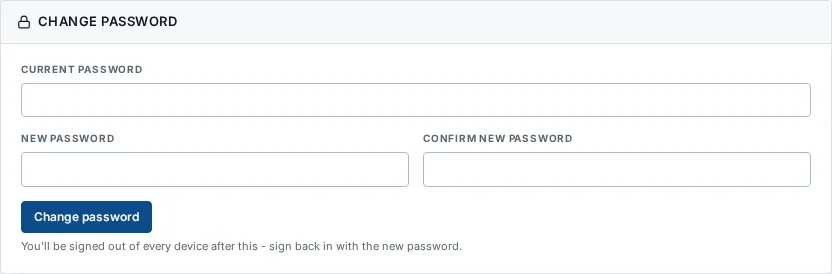

# Change your password

_Getting started › Personalise › Password_ · Route `/profile`

You can change your own password at any time from your profile. For security, UAPTS signs you out of every device afterwards.

> 🎬 **Video tutorial:** _coming soon._  
> <!-- VIDEO-URL: getting-started/personalise/password | paste the link here, e.g. [Watch the walkthrough](https://…) -->

## Change your password

1. Click your round **avatar** at the top right to open **Profile**.
2. Scroll to the **Change password** card.
3. Type your **Current password**.
4. Type the **New password**, then type it again in **Confirm new password**. The two must match (“New passwords do not match.” otherwise).
5. Click **Change password**.
6. You see _Password changed. Please sign in again._ and are signed out everywhere. Sign in with the new password.

## Choosing a good password

- At least 10 characters.
- Not a common password and not only digits.
- Not similar to your email address.
- Do not reuse a password from another system.

## If you have forgotten your password

Use **Forgot Password** on the sign-in page — see [How to access](../how-to-access.md#forgot-your-password).

## Related topics

- [Profile update](profile-update.md)
- [Two-factor authentication](two-factor-authentication.md)

## On this page

- [Change your password](#change-your-password)
- [Choosing a good password](#choosing-a-good-password)
- [If you have forgotten your password](#if-you-have-forgotten-your-password)
- [Related topics](#related-topics)

## Support

- **Your agency administrator** is the first contact for access, role and data-quality questions.
- **Data feeds, templates and API questions:** `api-support@uapts.go.ke` (include the `X-Request-ID` response header from a failing call).
- **Security concerns:** `security@uapts.go.ke`. Do not report suspected vulnerabilities publicly.
