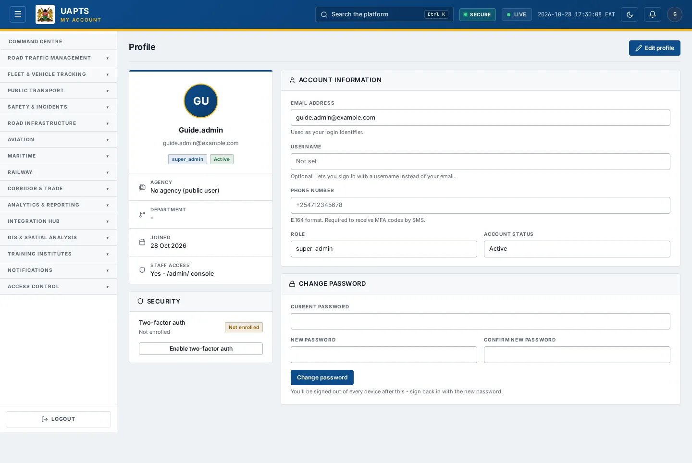
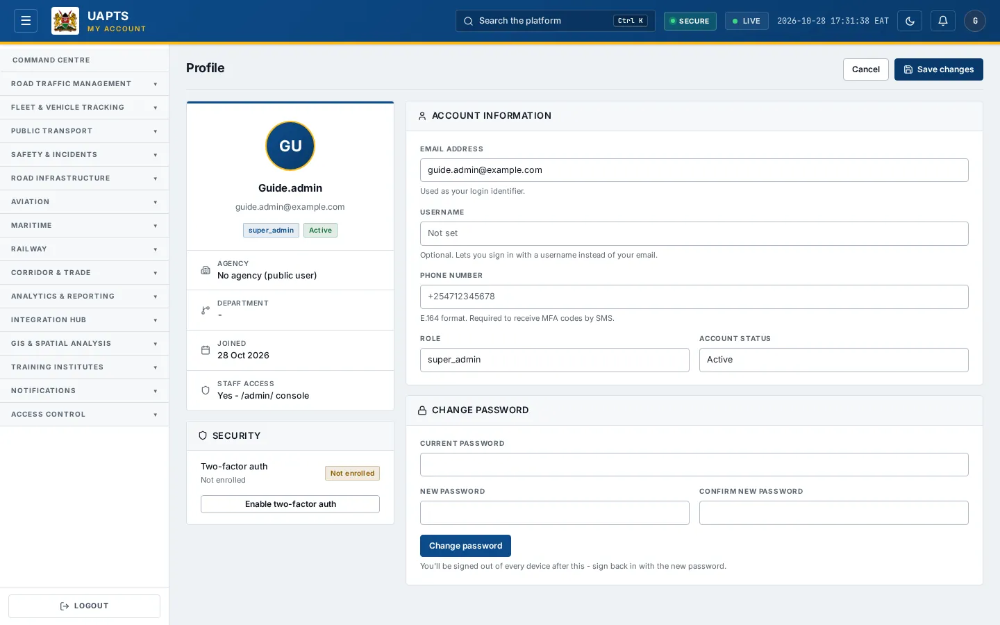

# Update your profile

_Getting started › Personalise › Profile update_ · Route `/profile`

The **Profile** page shows your account details and lets you update your email address and phone number.

> 🎬 **Video tutorial:** _coming soon._  
> <!-- VIDEO-URL: getting-started/personalise/profile-update | paste the link here, e.g. [Watch the walkthrough](https://…) -->

## Open your profile

Click the round **avatar** at the top right of any page.

## Edit mode

## What the page shows

| Item | Meaning |
|---|---|
| Agency / Department | The organisation and department your account belongs to. Set by an administrator. |
| Joined | When your account was created. |
| Staff access | Whether your account may also open the Django `/admin/` console. |
| Security → Two-factor auth | **Enabled** (with the channel, email or SMS) or **Not enrolled**. |
| Role | Your role tier. You cannot change it yourself. |
| Account status | **Active** or **Inactive**. |

## Edit your details

1. Click **Edit profile**.
2. Change the **Email address** (a sign-in name), an optional **Username** (lets you sign in with it instead of your email; clear it to go back to email-only) and/or the **Phone number**. Use international **E.164** format such as `+254712345678`; a phone number is required if you want codes by SMS.
3. Click **Save changes**. You see _Profile updated successfully._
4. Click **Cancel** instead to discard your edits.

## What you cannot change here

- **Role**, **agency** and **department** — ask your agency administrator (see [User Management](../../access-control/user-management.md)).
- **Password** — see [Change your password](password.md).

## Related topics

- [Password](password.md)
- [Two-factor authentication](two-factor-authentication.md)

## On this page

- [Open your profile](#open-your-profile)
- [Edit mode](#edit-mode)
- [What the page shows](#what-the-page-shows)
- [Edit your details](#edit-your-details)
- [What you cannot change here](#what-you-cannot-change-here)
- [Related topics](#related-topics)

## Support

- **Your agency administrator** is the first contact for access, role and data-quality questions.
- **Data feeds, templates and API questions:** `api-support@uapts.go.ke` (include the `X-Request-ID` response header from a failing call).
- **Security concerns:** `security@uapts.go.ke`. Do not report suspected vulnerabilities publicly.
