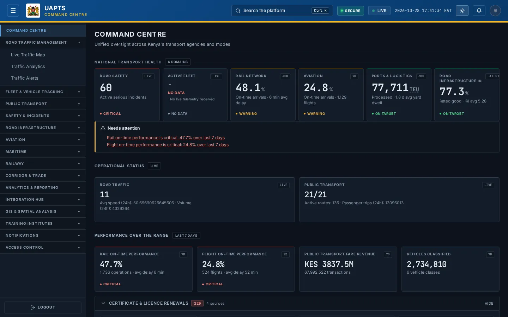

# Switch between light and dark theme

_Getting started › Personalise › Theme change_

UAPTS has a **light** and a **dark** theme. Light is the default. Your choice is remembered on that browser.

> 🎬 **Video tutorial:** _coming soon._  
> <!-- VIDEO-URL: getting-started/personalise/theme-change | paste the link here, e.g. [Watch the walkthrough](https://…) -->

## Change the theme

1. Click the **moon** icon in the top bar to switch to dark theme.
2. Click the **sun** icon (it replaces the moon) to return to light theme.

## Good to know

- The theme is stored **in your browser**, not on your account. If you use another browser or device, or clear site data, UAPTS opens in light theme again.
- UAPTS does not follow your operating-system dark-mode setting; it only changes when you click the icon.
- Maps and charts adapt to the theme; exported files are not affected.

## Related topics

- [Navigation and shortcuts](../navigation-and-shortcuts.md)

## On this page

- [Change the theme](#change-the-theme)
- [Good to know](#good-to-know)
- [Related topics](#related-topics)

## Support

- **Your agency administrator** is the first contact for access, role and data-quality questions.
- **Data feeds, templates and API questions:** `api-support@uapts.go.ke` (include the `X-Request-ID` response header from a failing call).
- **Security concerns:** `security@uapts.go.ke`. Do not report suspected vulnerabilities publicly.
