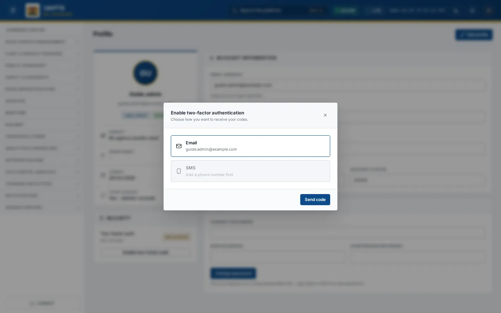

# Two-factor authentication

_Getting started › Personalise › Two-factor authentication_ · Route `/profile`

Two-factor authentication (2FA) adds a six-digit one-time code to your sign-in so that a stolen password alone is not enough. You can turn it on or off yourself from your profile.

> 🎬 **Video tutorial:** _coming soon._  
> <!-- VIDEO-URL: getting-started/personalise/two-factor-authentication | paste the link here, e.g. [Watch the walkthrough](https://…) -->

## Turn two-factor authentication on

1. Open **Profile** and find the **Security** card.
2. Click **Enable two-factor auth**.
3. Choose how to receive codes: **Email** (your account email) or **SMS** (your phone number). SMS is greyed out until you add a phone number under [Profile update](profile-update.md).
4. Click **Send code**, then type the six-digit code you receive.
5. Click **Verify & enable**. The card now shows **Enabled** and the channel. Use **Resend code** if nothing arrives.

## Signing in afterwards

After your password, UAPTS asks for the six-digit code (see [How to access](../how-to-access.md#two-factor-verification)). If you have not enabled it, UAPTS may show a **Secure Your Account with 2FA** prompt after sign-in that walks you through the same steps (choose a channel, enter the code); some accounts are required to complete it.

## Turn it off

1. On the **Security** card click **Disable two-factor auth**.
2. Enter your **password** to confirm.
3. Click to confirm. The card returns to **Not enrolled**.

## Related topics

- [Password](password.md)
- [Profile update](profile-update.md)

## On this page

- [Turn two-factor authentication on](#turn-two-factor-authentication-on)
- [Signing in afterwards](#signing-in-afterwards)
- [Turn it off](#turn-it-off)
- [Related topics](#related-topics)

## Support

- **Your agency administrator** is the first contact for access, role and data-quality questions.
- **Data feeds, templates and API questions:** `api-support@uapts.go.ke` (include the `X-Request-ID` response header from a failing call).
- **Security concerns:** `security@uapts.go.ke`. Do not report suspected vulnerabilities publicly.
