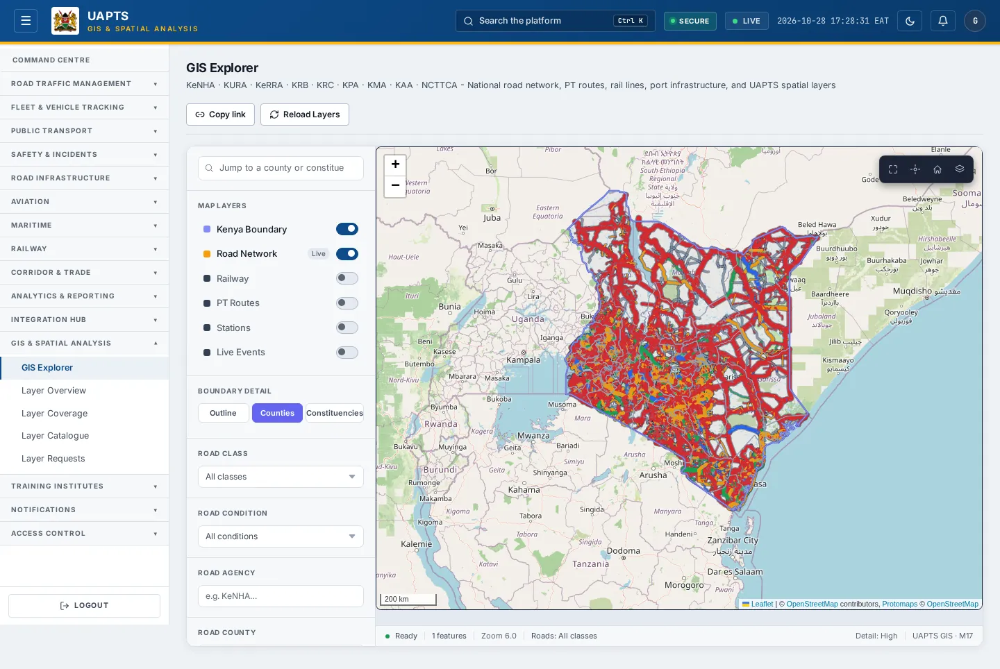

# GIS Explorer

_GIS & Spatial Analysis › GIS Explorer_ · Route `/gis`

**GIS Explorer** lets you see national road network, PT routes, rail lines, port infrastructure, and UAPTS spatial layers. Data on this page comes from KeNHA, KURA, KeRRA, KRB, KRC, KPA, KMA, KAA and NCTTCA.

> 🎬 **Video tutorial:** _coming soon._  
> <!-- VIDEO-URL: gis/gis-explorer | paste the link here, e.g. [Watch the walkthrough](https://…) -->

## Highlights

- An **interactive map** with a legend, full-screen, locate-me and base-map controls.
- **Filters and search** to narrow tables to what you need.
- Every figure is traceable to the data feed or upload template that supplies it — see [Data sources and feeds](#data-sources-and-feeds).

## Enabling and access

1. Sign in to UAPTS (see [How to access](../getting-started/how-to-access.md)).
2. In the left sidebar click **GIS & Spatial Analysis**.
3. The page opens at `/gis`. You can also reach it with the global search (**Ctrl + K**).

This page belongs to module **M13 · GIS**. The route needs at least the **Operator** tier to open it. The sidebar and the global search only list pages your agency and role can open, and a link to a page you cannot reach sends you back to the Command Centre. If a page you expect is missing, ask your agency administrator to check your agency's [Module Access](../access-control/module-access.md).

## Page tour

This page is a single working area; see the screenshot above and the steps below.

## Layers and filters

| Control | What it does |
|---|---|
| **Map Layers** | Toggle Kenya boundary, Road Network, Railway, PT Routes, Stations and Live Events. |
| **Road Class** | A International trunk · B National trunk · C Primary · D Secondary · E Minor · G Unclassified · S Special purpose. |
| **Road Condition / Road Agency / Road County** | Filter roads by surface condition (Poor, Fair, Good, Under Construction), agency and county. |
| **Route Service Type** | Bus, BRT, Matatu, Rail, Ferry. |
| **Sync to map view** | Reloads routes, stations and events as you pan and zoom; off shows a fixed national snapshot. |
| **Detail Level** | High, Med or Fast — trade detail for speed. |
| **Copy link** | Copies a link that reopens this exact map view. **Reload Layers** refetches them. |

Roads and rail stream as vector tiles (PMTiles), so the full national network is available without a size cap. Data sources shown in the legend: KeNHA, KURA, KeRRA, KRB, KRC, KPA, KMA, KAA, NCTTCA.

## Working with this page

1. Open **GIS & Spatial Analysis → GIS Explorer** from the sidebar.
2. Type in the **“Jump to a county or constituency…”** box to filter what is shown.
3. Type in the **“e.g. KeNHA…”** box to filter what is shown.
4. Use the **All classes** drop-down to narrow the list. Choices include: A - International trunk, B - National trunk, C - Primary, D - Secondary, E - Minor, F.
5. Use the **All conditions** drop-down to narrow the list. Choices include: Poor, Fair, Good, Under Construction.
6. Use the **All service types** drop-down to narrow the list. Choices include: Bus, BRT (Rapid Transit), Matatu, Rail, Ferry.
7. On the map, drag to pan and scroll (or pinch) to zoom. Click a marker or line for its details. Use the map toolbar to go full-screen, centre on your location, reset the view or switch the base map; click the legend chip to expand it.
8. Click **Kenya Boundary** to use this action.
9. Click **Live Events** to use this action.
10. Click **PT Routes** to use this action.
11. Click **Railway Live** to use this action.
12. Click **Reload Layers** to use this action.
13. Click **Road Network Live** to use this action.
14. Click **Stations** to use this action.

## Data sources and feeds

This page does not call a data endpoint of its own.

## Permissions

| Who | What they can do here |
|---|---|
| Public / read-only accounts | No access to this page. |
| Operator | View the page. |
| Analyst | View and **export CSV**. |
| Agency admin | Everything an analyst can do, plus the administrative capabilities listed in [Roles & Permissions](../access-control/roles-and-permissions.md). |
| Super admin | Sees every agency's data. |

**Agencies with the GIS module:** full — KENHA, KURA, KERRA, SDR, SDR_MTD, KWS, SDT, NTSA, NAMATA, KRC, KPA, KMA, NCTTCA, LAPSSET; read-only — KMD.

_Access is evaluated by the server from the baseline policy plus any agency overrides, so a super admin or agency admin may have changed it from the defaults above._

## Related topics

- [Layer Overview](layer-overview.md)
- [Layer Coverage](layer-coverage.md)
- [Layer Catalogue](layer-catalogue.md)
- [Layer analysis](layer-analysis.md)
- [Layer Requests](layer-requests.md)
- [GIS & Spatial Analysis overview](index.md)
- [Upload & Connect (Integration Hub)](../integration-hub/upload-and-connect.md)
- [Data sources catalogue](../reference/data-sources.md)

## On this page

- [Highlights](#highlights)
- [Enabling and access](#enabling-and-access)
- [Page tour](#page-tour)
- [Working with this page](#working-with-this-page)
- [Data sources and feeds](#data-sources-and-feeds)
- [Permissions](#permissions)
- [Related topics](#related-topics)

## Support

- **Your agency administrator** is the first contact for access, role and data-quality questions.
- **Data feeds, templates and API questions:** `api-support@uapts.go.ke` (include the `X-Request-ID` response header from a failing call).
- **Security concerns:** `security@uapts.go.ke`. Do not report suspected vulnerabilities publicly.
