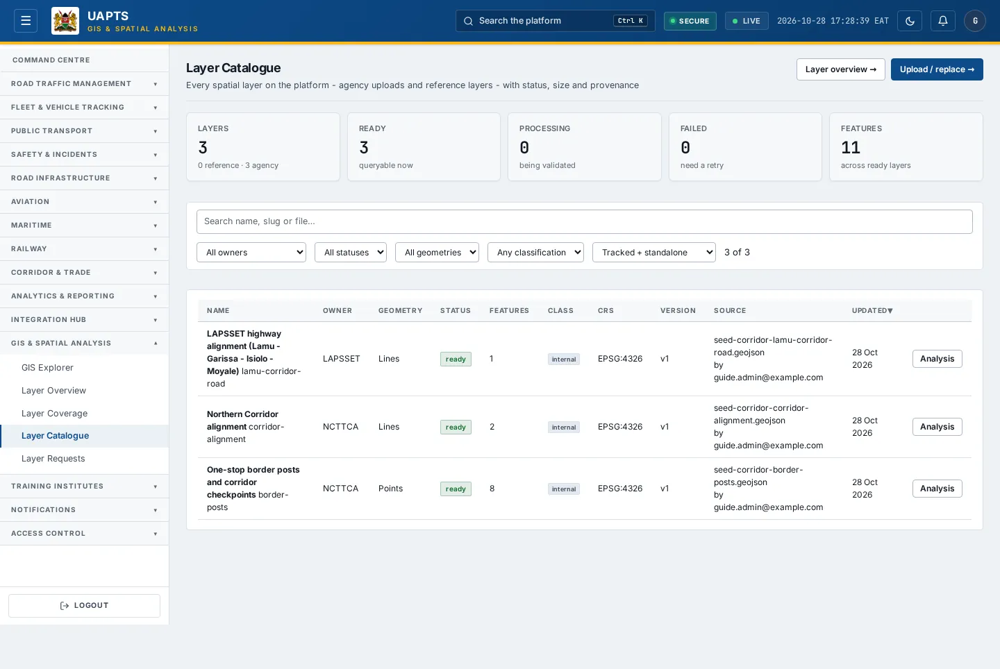

# Layer Catalogue

_GIS & Spatial Analysis › Layer Catalogue_ · Route `/gis/layers`

**Layer Catalogue** lets you see every spatial layer on the platform - agency uploads and reference layers - with status, size and provenance.

> 🎬 **Video tutorial:** _coming soon._  
> <!-- VIDEO-URL: gis/layer-catalogue | paste the link here, e.g. [Watch the walkthrough](https://…) -->

## Highlights

- **5 headline tiles** — Layers, Ready, Processing, Failed, Features.
- **Filters and search** to narrow tables to what you need.
- Every figure is traceable to the data feed or upload template that supplies it — see [Data sources and feeds](#data-sources-and-feeds).

## Enabling and access

1. Sign in to UAPTS (see [How to access](../getting-started/how-to-access.md)).
2. In the left sidebar click **GIS & Spatial Analysis**.
3. The page opens at `/gis/layers`. You can also reach it with the global search (**Ctrl + K**).

This page belongs to module **M13 · GIS**. The route needs at least the **Operator** tier to open it. The sidebar and the global search only list pages your agency and role can open, and a link to a page you cannot reach sends you back to the Command Centre. If a page you expect is missing, ask your agency administrator to check your agency's [Module Access](../access-control/module-access.md).

## Page tour

### Headline tiles

| Tile | What it shows | Data from | Table → ingested via |
|---|---|---|---|
| **Layers** | — | — | — |
| **Ready** | — | — | — |
| **Processing** | — | — | — |
| **Failed** | — | — | — |
| **Features** | — | — | — |

## Working with this page

1. Open **GIS & Spatial Analysis → Layer Catalogue** from the sidebar.
2. Type in the **“Search name, slug or file…”** box to filter what is shown.
3. Use the **All owners** drop-down to narrow the list. Choices include: Reference (platform).
4. Use the **All statuses** drop-down to narrow the list. Choices include: ready, processing, failed.
5. Use the **Tracked + standalone** drop-down to narrow the list. Choices include: Fulfils an expected layer, Standalone.

## Data sources and feeds

Every number and table on this page is read from the API endpoints below. The **Ingested via** column says how the underlying records get into UAPTS: a downloadable **upload template** (xlsx/CSV, loaded through the [Integration Hub](../integration-hub/upload-and-connect.md)), a **live feed** that pushes records to the ingest API, or — where neither exists yet — it is stated plainly.

| Endpoint | Records | Ingested via |
|---|---|---|
| `GET /gis/layers/` | _Aggregate of 1 tables (rows below)_ | — |
| ↳ GeoLayer | Geo Layers | **No ingestion template yet** — populated by seed data or direct entry |
| `GET /gis/layers/{id}/` | _Aggregate of 1 tables (rows below)_ | — |
| ↳ GeoLayer | Geo Layers | **No ingestion template yet** — populated by seed data or direct entry |
| `GET /gis/layers/{id}/features/` | _Aggregate of 2 tables (rows below)_ | — |
| ↳ GeoFeature | Geo Features | **No ingestion template yet** — populated by seed data or direct entry |
| ↳ GeoLayer | Geo Layers | **No ingestion template yet** — populated by seed data or direct entry |
| `GET /gis/layers/{id}/reload/` | _Aggregate of 1 tables (rows below)_ | — |
| ↳ GeoLayer | Geo Layers | **No ingestion template yet** — populated by seed data or direct entry |
| `GET /gis/layers/{id}/summary/` | _Aggregate of 1 tables (rows below)_ | — |
| ↳ GeoLayer | Geo Layers | **No ingestion template yet** — populated by seed data or direct entry |

Full details of every template (columns, formats) are in the [Data sources catalogue](../reference/data-sources.md). Interactive API documentation is available at `/api/docs/`.

## Permissions

| Who | What they can do here |
|---|---|
| Public / read-only accounts | No access to this page. |
| Operator | View the page. |
| Analyst | View and **export CSV**. |
| Agency admin | Everything an analyst can do, plus the administrative capabilities listed in [Roles & Permissions](../access-control/roles-and-permissions.md). |
| Super admin | Sees every agency's data. |

**Agencies with the GIS module:** full — KENHA, KURA, KERRA, SDR, SDR_MTD, KWS, SDT, NTSA, NAMATA, KRC, KPA, KMA, NCTTCA, LAPSSET; read-only — KMD.

_Access is evaluated by the server from the baseline policy plus any agency overrides, so a super admin or agency admin may have changed it from the defaults above._

## Related topics

- [GIS Explorer](gis-explorer.md)
- [Layer Overview](layer-overview.md)
- [Layer Coverage](layer-coverage.md)
- [Layer analysis](layer-analysis.md)
- [Layer Requests](layer-requests.md)
- [GIS & Spatial Analysis overview](index.md)
- [Upload & Connect (Integration Hub)](../integration-hub/upload-and-connect.md)
- [Data sources catalogue](../reference/data-sources.md)

## On this page

- [Highlights](#highlights)
- [Enabling and access](#enabling-and-access)
- [Page tour](#page-tour)
- [Working with this page](#working-with-this-page)
- [Data sources and feeds](#data-sources-and-feeds)
- [Permissions](#permissions)
- [Related topics](#related-topics)

## Support

- **Your agency administrator** is the first contact for access, role and data-quality questions.
- **Data feeds, templates and API questions:** `api-support@uapts.go.ke` (include the `X-Request-ID` response header from a failing call).
- **Security concerns:** `security@uapts.go.ke`. Do not report suspected vulnerabilities publicly.
