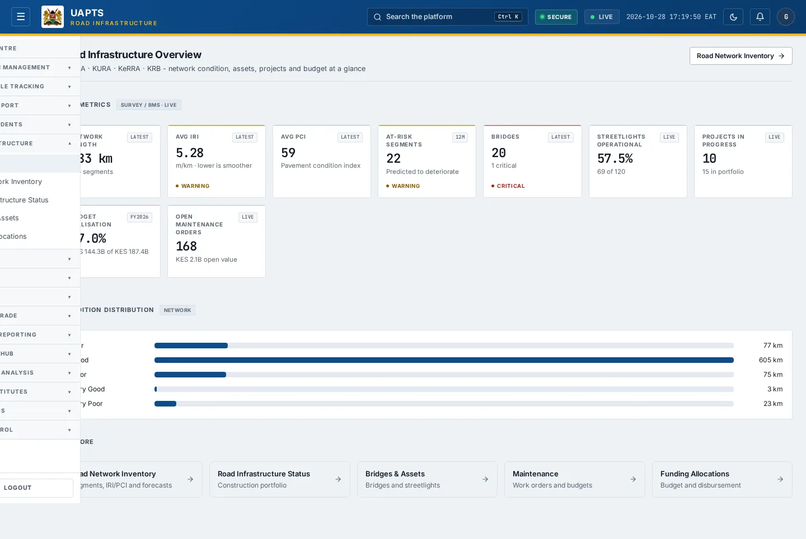
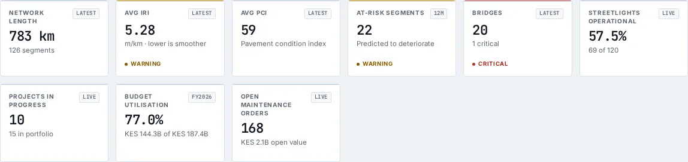

# Road Infrastructure — Overview

_Road Infrastructure › Overview_ · Route `/infrastructure/overview`

**Road Infrastructure Overview** lets you see network condition, assets, projects and budget at a glance. Data on this page comes from KeNHA, KURA, KeRRA and KRB.

> 🎬 **Video tutorial:** _coming soon._  
> <!-- VIDEO-URL: infrastructure/infrastructure-overview | paste the link here, e.g. [Watch the walkthrough](https://…) -->

## Highlights

- **9 headline tiles** — Network Length, Avg IRI, Avg PCI, At-Risk Segments, Bridges, Streetlights Operational….
- Every figure is traceable to the data feed or upload template that supplies it — see [Data sources and feeds](#data-sources-and-feeds).

## Enabling and access

1. Sign in to UAPTS (see [How to access](../getting-started/how-to-access.md)).
2. In the left sidebar expand **Road Infrastructure** and click **Overview**.
3. The page opens at `/infrastructure/overview`. You can also reach it with the global search (**Ctrl + K**).

This page belongs to module **M06 · Road Infrastructure**. The route needs at least the **Operator** tier to open it. The sidebar and the global search only list pages your agency and role can open, and a link to a page you cannot reach sends you back to the Command Centre. If a page you expect is missing, ask your agency administrator to check your agency's [Module Access](../access-control/module-access.md).

## Page tour

### Headline tiles

| Tile | What it shows | Data from | Table → ingested via |
|---|---|---|---|
| **Network Length** | — _(window: LATEST)_ | `/infrastructure/summary/` | aggregate of several tables — see [per-table feeds](#data-sources-and-feeds) |
| **Avg IRI** | m/km · lower is smoother _(window: LATEST)_ | `/infrastructure/summary/` | aggregate of several tables — see [per-table feeds](#data-sources-and-feeds) |
| **Avg PCI** | Pavement condition index _(window: LATEST)_ | `/infrastructure/summary/` | aggregate of several tables — see [per-table feeds](#data-sources-and-feeds) |
| **At-Risk Segments** | Predicted to deteriorate _(window: 12M)_ | `/infrastructure/summary/` | _RoadSegment_ → [`krb-road-condition`](../data-templates/krb-road-condition.xlsx) [`kura-road-network`](../data-templates/kura-road-network.xlsx) [`kenha-road-network`](../data-templates/kenha-road-network.xlsx) [`kerra-road-network`](../data-templates/kerra-road-network.xlsx) +1 more |
| **Bridges** | — _(window: LATEST)_ | `/infrastructure/summary/` | _Bridge_ → [`kenha-bridge-register`](../data-templates/kenha-bridge-register.xlsx) [`kerra-bridge-register`](../data-templates/kerra-bridge-register.xlsx) |
| **Streetlights Operational** | — _(window: LIVE)_ | `/infrastructure/summary/` | _Streetlight_ → no template yet |
| **Projects In Progress** | — _(window: LIVE)_ | `/infrastructure/summary/` | _ConstructionProject_ → [`krb-workplans`](../data-templates/krb-workplans.xlsx) [`kura-project-progress`](../data-templates/kura-project-progress.xlsx) [`kenha-project-progress`](../data-templates/kenha-project-progress.xlsx) [`kerra-project-progress`](../data-templates/kerra-project-progress.xlsx) +3 more |
| **Budget Utilisation** | — | `/infrastructure/summary/` | _MaintenanceBudget_ → [`krb-funding`](../data-templates/krb-funding.xlsx) |
| **Open Maintenance Orders** | — _(window: LIVE)_ | `/infrastructure/summary/` | _MaintenanceOrder_ → [`kura-maintenance-work-orders`](../data-templates/kura-maintenance-work-orders.xlsx) [`kenha-maintenance-work-orders`](../data-templates/kenha-maintenance-work-orders.xlsx) [`kerra-maintenance-work-orders`](../data-templates/kerra-maintenance-work-orders.xlsx) |

## Working with this page

1. Open **Road Infrastructure → Overview** from the sidebar.
2. Scroll down to move through the panels; every panel has a heading matching those in the Page tour.

## Data sources and feeds

Every number and table on this page is read from the API endpoints below. The **Ingested via** column says how the underlying records get into UAPTS: a downloadable **upload template** (xlsx/CSV, loaded through the [Integration Hub](../integration-hub/upload-and-connect.md)), a **live feed** that pushes records to the ingest API, or — where neither exists yet — it is stated plainly.

| Endpoint | Records | Ingested via |
|---|---|---|
| `GET /infrastructure/summary/` | _Aggregate of 8 tables (rows below)_ | — |
| ↳ Bridge | Bridges | [`kenha-bridge-register`](../data-templates/kenha-bridge-register.xlsx) [`kerra-bridge-register`](../data-templates/kerra-bridge-register.xlsx) |
| ↳ ConstructionProject | Construction Projects | [`krb-workplans`](../data-templates/krb-workplans.xlsx) [`kura-project-progress`](../data-templates/kura-project-progress.xlsx) [`kenha-project-progress`](../data-templates/kenha-project-progress.xlsx) [`kerra-project-progress`](../data-templates/kerra-project-progress.xlsx) +3 more ([catalogue](../reference/data-sources.md)) |
| ↳ DeteriorationForecast | Deterioration Forecasts | Computed by UAPTS from other data (no direct feed) |
| ↳ MaintenanceBudget | Maintenance Budgets | [`krb-funding`](../data-templates/krb-funding.xlsx) |
| ↳ MaintenanceOrder | Maintenance Orders | [`kura-maintenance-work-orders`](../data-templates/kura-maintenance-work-orders.xlsx) [`kenha-maintenance-work-orders`](../data-templates/kenha-maintenance-work-orders.xlsx) [`kerra-maintenance-work-orders`](../data-templates/kerra-maintenance-work-orders.xlsx) |
| ↳ RoadSegment | Road Segments | [`krb-road-condition`](../data-templates/krb-road-condition.xlsx) [`kura-road-network`](../data-templates/kura-road-network.xlsx) [`kenha-road-network`](../data-templates/kenha-road-network.xlsx) [`kerra-road-network`](../data-templates/kerra-road-network.xlsx) +1 more ([catalogue](../reference/data-sources.md)) |
| ↳ Streetlight | Streetlights | **No ingestion template yet** — populated by seed data or direct entry |
| ↳ WIMReading | Wim Readings | [`kura-weighbridge-transactions`](../data-templates/kura-weighbridge-transactions.xlsx) [`kenha-weighbridge-transactions`](../data-templates/kenha-weighbridge-transactions.xlsx) |

Full details of every template (columns, formats) are in the [Data sources catalogue](../reference/data-sources.md). Interactive API documentation is available at `/api/docs/`.

## Permissions

| Who | What they can do here |
|---|---|
| Public / read-only accounts | No access to this page. |
| Operator | View the page. |
| Analyst | View and **export CSV**. |
| Agency admin | Everything an analyst can do, plus the administrative capabilities listed in [Roles & Permissions](../access-control/roles-and-permissions.md). |
| Super admin | Sees every agency's data. |

**Agencies with the Road Infrastructure module:** full — KENHA, KURA, KERRA, SDR, KRB, SDT; selected pages only — SDR_MTD, COUNTY_GOV, NTSA, LAPSSET.

_Access is evaluated by the server from the baseline policy plus any agency overrides, so a super admin or agency admin may have changed it from the defaults above._

## Related topics

- [Road Network Inventory](road-network-inventory.md)
- [Road Infrastructure Status](road-infrastructure-status.md)
- [Bridges & Assets](bridges-and-assets.md)
- [Funding Allocations](funding-allocations.md)
- [Maintenance Orders](maintenance-orders.md)
- [Road Infrastructure overview](index.md)
- [Upload & Connect (Integration Hub)](../integration-hub/upload-and-connect.md)
- [Data sources catalogue](../reference/data-sources.md)

## On this page

- [Highlights](#highlights)
- [Enabling and access](#enabling-and-access)
- [Page tour](#page-tour)
- [Working with this page](#working-with-this-page)
- [Data sources and feeds](#data-sources-and-feeds)
- [Permissions](#permissions)
- [Related topics](#related-topics)

## Support

- **Your agency administrator** is the first contact for access, role and data-quality questions.
- **Data feeds, templates and API questions:** `api-support@uapts.go.ke` (include the `X-Request-ID` response header from a failing call).
- **Security concerns:** `security@uapts.go.ke`. Do not report suspected vulnerabilities publicly.
