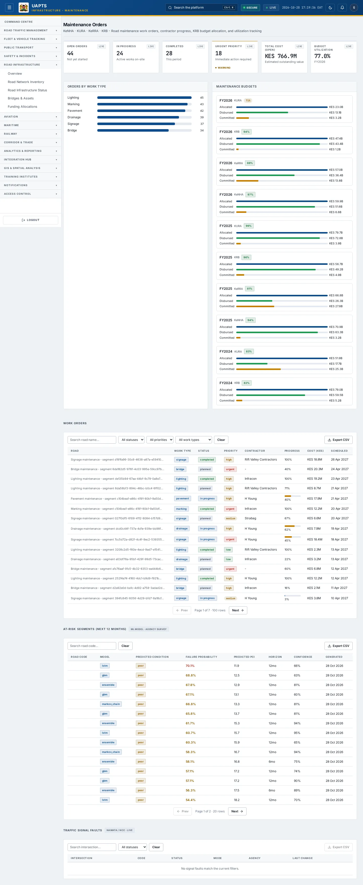
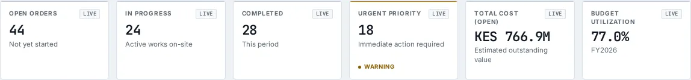
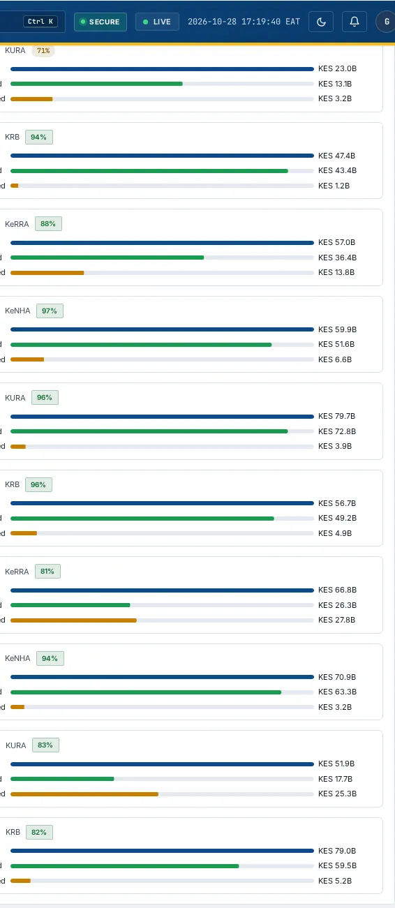

# Maintenance Orders

_Road Infrastructure › Maintenance Orders_ · Route `/infrastructure/maintenance`

**Maintenance Orders** lets you see road maintenance work orders, contractor progress, KRB budget allocation, and utilization tracking. Data on this page comes from KeNHA, KURA, KeRRA and KRB.

> 🎬 **Video tutorial:** _coming soon._  
> <!-- VIDEO-URL: infrastructure/maintenance-orders | paste the link here, e.g. [Watch the walkthrough](https://…) -->

## Highlights

- **6 headline tiles** — Open Orders, In Progress, Completed, Urgent Priority, Total Cost (Open), Budget Utilization.
- **5 panels** — Orders by Work Type, Maintenance Budgets, Work Orders, At-Risk Segments (Next 12 Months), Traffic Signal Faults.
- **Refreshes itself every 120 seconds**, so you do not need to reload the page.
- **Export to CSV** for the rows you are looking at (Analyst tier and above).
- **Filters and search** to narrow tables to what you need.
- Every figure is traceable to the data feed or upload template that supplies it — see [Data sources and feeds](#data-sources-and-feeds).

## Enabling and access

1. Sign in to UAPTS (see [How to access](../getting-started/how-to-access.md)).
2. In the left sidebar expand **Road Infrastructure** and click **Maintenance Orders**.
3. The page opens at `/infrastructure/maintenance`. You can also reach it with the global search (**Ctrl + K**).

This page belongs to module **M06 · Road Infrastructure**. The route needs at least the **Operator** tier to open it. The sidebar and the global search only list pages your agency and role can open, and a link to a page you cannot reach sends you back to the Command Centre. If a page you expect is missing, ask your agency administrator to check your agency's [Module Access](../access-control/module-access.md).

## Page tour

### Headline tiles

| Tile | What it shows | Data from | Table → ingested via |
|---|---|---|---|
| **Open Orders** | Not yet started _(window: LIVE)_ | `/infrastructure/maintenance-orders/` | _MaintenanceOrder_ → [`kura-maintenance-work-orders`](../data-templates/kura-maintenance-work-orders.xlsx) [`kenha-maintenance-work-orders`](../data-templates/kenha-maintenance-work-orders.xlsx) [`kerra-maintenance-work-orders`](../data-templates/kerra-maintenance-work-orders.xlsx) |
| **In Progress** | Active works on-site _(window: LIVE)_ | `/infrastructure/maintenance-orders/` | _MaintenanceOrder_ → [`kura-maintenance-work-orders`](../data-templates/kura-maintenance-work-orders.xlsx) [`kenha-maintenance-work-orders`](../data-templates/kenha-maintenance-work-orders.xlsx) [`kerra-maintenance-work-orders`](../data-templates/kerra-maintenance-work-orders.xlsx) |
| **Completed** | This period _(window: LIVE)_ | `/infrastructure/maintenance-orders/` | _MaintenanceOrder_ → [`kura-maintenance-work-orders`](../data-templates/kura-maintenance-work-orders.xlsx) [`kenha-maintenance-work-orders`](../data-templates/kenha-maintenance-work-orders.xlsx) [`kerra-maintenance-work-orders`](../data-templates/kerra-maintenance-work-orders.xlsx) |
| **Urgent Priority** | Immediate action required _(window: LIVE)_ | `/infrastructure/maintenance-orders/` | _MaintenanceOrder_ → [`kura-maintenance-work-orders`](../data-templates/kura-maintenance-work-orders.xlsx) [`kenha-maintenance-work-orders`](../data-templates/kenha-maintenance-work-orders.xlsx) [`kerra-maintenance-work-orders`](../data-templates/kerra-maintenance-work-orders.xlsx) |
| **Total Cost (Open)** | Estimated outstanding value _(window: LIVE)_ | `/infrastructure/maintenance-orders/` | _MaintenanceOrder_ → [`kura-maintenance-work-orders`](../data-templates/kura-maintenance-work-orders.xlsx) [`kenha-maintenance-work-orders`](../data-templates/kenha-maintenance-work-orders.xlsx) [`kerra-maintenance-work-orders`](../data-templates/kerra-maintenance-work-orders.xlsx) |
| **Budget Utilization** | — _(window: LIVE)_ | `/infrastructure/maintenance-budgets/`, `/infrastructure/summary/` | _MaintenanceBudget_ → [`krb-funding`](../data-templates/krb-funding.xlsx) |

### Orders by Work Type

**Data from:** `/infrastructure/maintenance-budgets/`, `/infrastructure/maintenance-orders/by-type/`  
**Table → ingested via:** _MaintenanceBudget, MaintenanceOrder_ → [`krb-funding`](../data-templates/krb-funding.xlsx) [`kura-maintenance-work-orders`](../data-templates/kura-maintenance-work-orders.xlsx) [`kenha-maintenance-work-orders`](../data-templates/kenha-maintenance-work-orders.xlsx) [`kerra-maintenance-work-orders`](../data-templates/kerra-maintenance-work-orders.xlsx)

### Maintenance Budgets

**Data from:** `/infrastructure/maintenance-budgets/`  
**Table → ingested via:** _MaintenanceBudget_ → [`krb-funding`](../data-templates/krb-funding.xlsx)

### Work Orders

Contains a table with the columns **Road**, **Work Type**, **Status**, **Priority**, **Contractor**, **Progress**, **Cost (KES)**, **Scheduled**.

**Data from:** `/infrastructure/maintenance-orders/`  
**Table → ingested via:** _MaintenanceOrder_ → [`kura-maintenance-work-orders`](../data-templates/kura-maintenance-work-orders.xlsx) [`kenha-maintenance-work-orders`](../data-templates/kenha-maintenance-work-orders.xlsx) [`kerra-maintenance-work-orders`](../data-templates/kerra-maintenance-work-orders.xlsx)

### At-Risk Segments (Next 12 Months)

Contains a table with the columns **Road Code**, **Model**, **Predicted Condition**, **Failure Probability**, **Predicted PCI**, **Horizon**, **Confidence**, **Generated**.

**Data from:** `/infrastructure/deterioration-forecasts/at-risk/`  
**Table → ingested via:** _DeteriorationForecast_ → computed by UAPTS

### Traffic Signal Faults

Contains a table with the columns **Intersection**, **Code**, **Status**, **Mode**, **Agency**, **Last Change**.

**Data from:** `/infrastructure/traffic-signals/faults/`  
**Table → ingested via:** _TrafficSignal_ → no template yet

## Working with this page

1. Open **Road Infrastructure → Maintenance Orders** from the sidebar.
2. Wait for the page to finish loading. It re-fetches its data every **120 s**; the figures you see are the latest the platform holds, not a one-time snapshot.
3. Type in the **“Search intersection…”** box to filter what is shown.
4. Type in the **“Search road code…”** box to filter what is shown.
5. Type in the **“Search road name…”** box to filter what is shown.
6. Use the **All statuses** drop-down to narrow the list. Choices include: Planned, In Progress, Completed, Cancelled.
7. Use the **All priorities** drop-down to narrow the list. Choices include: Urgent, High, Medium, Low.
8. Use the **All work types** drop-down to narrow the list. Choices include: Pavement, Lighting, Bridge, Drainage, Signage, Road Marking.
9. Use the **All statuses** drop-down to narrow the list. Choices include: Operational, Degraded, Fault, Maintenance, Offline.
10. Click **↻ Refresh** to refresh the data.
11. Click **Export CSV** to download the rows currently loaded (after filters). The button only appears for Analyst tier and above.

## Status and value meanings

These are the values the platform stores for the fields shown on this page (`value` followed by the label you see).

| Field | Table | Values |
|---|---|---|
| model name | DeteriorationForecast | `markov_chain` · `lstm` · `gbm` Gradient Boosted Trees · `ensemble` |
| work type | MaintenanceOrder | `pavement` · `lighting` · `bridge` · `drainage` · `signage` · `marking` Road Marking · `vegetation` Vegetation Control · `emergency` Emergency Repair |
| status | MaintenanceOrder | `planned` · `in_progress` · `completed` · `cancelled` |
| priority | MaintenanceOrder | `low` · `medium` · `high` · `urgent` |
| status | TrafficSignal | `operational` · `degraded` · `fault` · `offline` · `maintenance` Under Maintenance |

## Data sources and feeds

Every number and table on this page is read from the API endpoints below. The **Ingested via** column says how the underlying records get into UAPTS: a downloadable **upload template** (xlsx/CSV, loaded through the [Integration Hub](../integration-hub/upload-and-connect.md)), a **live feed** that pushes records to the ingest API, or — where neither exists yet — it is stated plainly.

| Endpoint | Records | Ingested via |
|---|---|---|
| `GET /infrastructure/deterioration-forecasts/at-risk/` | Deterioration Forecasts | Computed by UAPTS from other data (no direct feed) |
| `GET /infrastructure/maintenance-budgets/` | Maintenance Budgets | [`krb-funding`](../data-templates/krb-funding.xlsx) |
| `GET /infrastructure/maintenance-orders/` | Maintenance Orders | [`kura-maintenance-work-orders`](../data-templates/kura-maintenance-work-orders.xlsx) [`kenha-maintenance-work-orders`](../data-templates/kenha-maintenance-work-orders.xlsx) [`kerra-maintenance-work-orders`](../data-templates/kerra-maintenance-work-orders.xlsx) |
| `GET /infrastructure/maintenance-orders/by-type/` | Maintenance Orders | [`kura-maintenance-work-orders`](../data-templates/kura-maintenance-work-orders.xlsx) [`kenha-maintenance-work-orders`](../data-templates/kenha-maintenance-work-orders.xlsx) [`kerra-maintenance-work-orders`](../data-templates/kerra-maintenance-work-orders.xlsx) |
| `GET /infrastructure/maintenance-orders/export/` | Maintenance Orders | [`kura-maintenance-work-orders`](../data-templates/kura-maintenance-work-orders.xlsx) [`kenha-maintenance-work-orders`](../data-templates/kenha-maintenance-work-orders.xlsx) [`kerra-maintenance-work-orders`](../data-templates/kerra-maintenance-work-orders.xlsx) |
| `GET /infrastructure/summary/` | _Aggregate of 8 tables (rows below)_ | — |
| ↳ Bridge | Bridges | [`kenha-bridge-register`](../data-templates/kenha-bridge-register.xlsx) [`kerra-bridge-register`](../data-templates/kerra-bridge-register.xlsx) |
| ↳ ConstructionProject | Construction Projects | [`krb-workplans`](../data-templates/krb-workplans.xlsx) [`kura-project-progress`](../data-templates/kura-project-progress.xlsx) [`kenha-project-progress`](../data-templates/kenha-project-progress.xlsx) [`kerra-project-progress`](../data-templates/kerra-project-progress.xlsx) +3 more ([catalogue](../reference/data-sources.md)) |
| ↳ DeteriorationForecast | Deterioration Forecasts | Computed by UAPTS from other data (no direct feed) |
| ↳ MaintenanceBudget | Maintenance Budgets | [`krb-funding`](../data-templates/krb-funding.xlsx) |
| ↳ MaintenanceOrder | Maintenance Orders | [`kura-maintenance-work-orders`](../data-templates/kura-maintenance-work-orders.xlsx) [`kenha-maintenance-work-orders`](../data-templates/kenha-maintenance-work-orders.xlsx) [`kerra-maintenance-work-orders`](../data-templates/kerra-maintenance-work-orders.xlsx) |
| ↳ RoadSegment | Road Segments | [`krb-road-condition`](../data-templates/krb-road-condition.xlsx) [`kura-road-network`](../data-templates/kura-road-network.xlsx) [`kenha-road-network`](../data-templates/kenha-road-network.xlsx) [`kerra-road-network`](../data-templates/kerra-road-network.xlsx) +1 more ([catalogue](../reference/data-sources.md)) |
| ↳ Streetlight | Streetlights | **No ingestion template yet** — populated by seed data or direct entry |
| ↳ WIMReading | Wim Readings | [`kura-weighbridge-transactions`](../data-templates/kura-weighbridge-transactions.xlsx) [`kenha-weighbridge-transactions`](../data-templates/kenha-weighbridge-transactions.xlsx) |
| `GET /infrastructure/traffic-signals/faults/` | Traffic Signals | **No ingestion template yet** — populated by seed data or direct entry |

Full details of every template (columns, formats) are in the [Data sources catalogue](../reference/data-sources.md). Interactive API documentation is available at `/api/docs/`.

## Permissions

| Who | What they can do here |
|---|---|
| Public / read-only accounts | No access to this page. |
| Operator | View the page. |
| Analyst | View and **export CSV**. |
| Agency admin | Everything an analyst can do, plus the administrative capabilities listed in [Roles & Permissions](../access-control/roles-and-permissions.md). |
| Super admin | Sees every agency's data. |

**Agencies with the Road Infrastructure module:** full — KENHA, KURA, KERRA, SDR, KRB, SDT; selected pages only — SDR_MTD, COUNTY_GOV, NTSA, LAPSSET.

_Access is evaluated by the server from the baseline policy plus any agency overrides, so a super admin or agency admin may have changed it from the defaults above._

## Related topics

- [Overview](infrastructure-overview.md)
- [Road Network Inventory](road-network-inventory.md)
- [Road Infrastructure Status](road-infrastructure-status.md)
- [Bridges & Assets](bridges-and-assets.md)
- [Funding Allocations](funding-allocations.md)
- [Road Infrastructure overview](index.md)
- [Upload & Connect (Integration Hub)](../integration-hub/upload-and-connect.md)
- [Data sources catalogue](../reference/data-sources.md)

## On this page

- [Highlights](#highlights)
- [Enabling and access](#enabling-and-access)
- [Page tour](#page-tour)
- [Working with this page](#working-with-this-page)
- [Status and value meanings](#status-and-value-meanings)
- [Data sources and feeds](#data-sources-and-feeds)
- [Permissions](#permissions)
- [Related topics](#related-topics)

## Support

- **Your agency administrator** is the first contact for access, role and data-quality questions.
- **Data feeds, templates and API questions:** `api-support@uapts.go.ke` (include the `X-Request-ID` response header from a failing call).
- **Security concerns:** `security@uapts.go.ke`. Do not report suspected vulnerabilities publicly.
