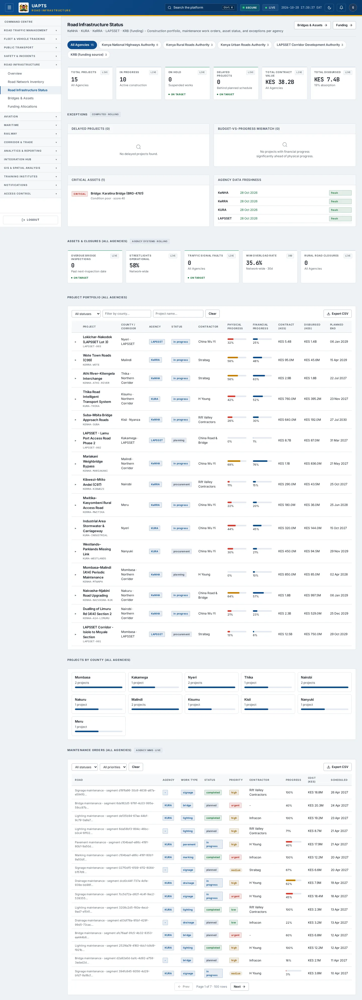
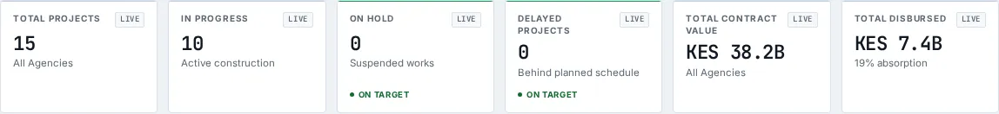
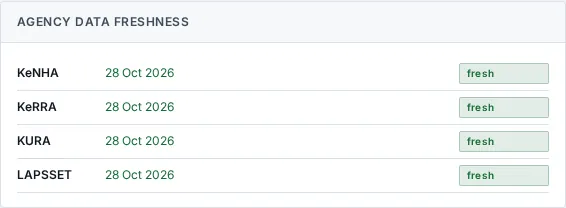

# Road Infrastructure Status

_Road Infrastructure › Road Infrastructure Status_ · Route `/infrastructure/projects`

**Road Infrastructure Status** lets you see keNHA · KURA · KeRRA · LAPSSET · KRB (funding) - Construction portfolio, maintenance work orders, asset status, and exceptions per agency.

> 🎬 **Video tutorial:** _coming soon._  
> <!-- VIDEO-URL: infrastructure/road-infrastructure-status | paste the link here, e.g. [Watch the walkthrough](https://…) -->

## Highlights

- **11 headline tiles** — Total Projects, In Progress, On Hold, Delayed Projects, Total Contract Value, Total Disbursed….
- **7 panels** — Delayed Projects (), Budget-vs-Progress Mismatch (), Critical Assets (), Agency Data Freshness, Closures / Restrictions, Project Portfolio ()….
- **Refreshes itself every 120 seconds**, so you do not need to reload the page.
- **Export to CSV** for the rows you are looking at (Analyst tier and above).
- **Filters and search** to narrow tables to what you need.
- Every figure is traceable to the data feed or upload template that supplies it — see [Data sources and feeds](#data-sources-and-feeds).

## Enabling and access

1. Sign in to UAPTS (see [How to access](../getting-started/how-to-access.md)).
2. In the left sidebar expand **Road Infrastructure** and click **Road Infrastructure Status**.
3. The page opens at `/infrastructure/projects`. You can also reach it with the global search (**Ctrl + K**).

This page belongs to module **M06 · Road Infrastructure**. The sidebar and the global search only list pages your agency and role can open, and a link to a page you cannot reach sends you back to the Command Centre. If a page you expect is missing, ask your agency administrator to check your agency's [Module Access](../access-control/module-access.md).

## Page tour

### Headline tiles

| Tile | What it shows | Data from | Table → ingested via |
|---|---|---|---|
| **Total Projects** | agencyLabel _(window: LIVE)_ | `/infrastructure/construction-projects/` | _ConstructionProject_ → [`krb-workplans`](../data-templates/krb-workplans.xlsx) [`kura-project-progress`](../data-templates/kura-project-progress.xlsx) [`kenha-project-progress`](../data-templates/kenha-project-progress.xlsx) [`kerra-project-progress`](../data-templates/kerra-project-progress.xlsx) +3 more |
| **In Progress** | Active construction _(window: LIVE)_ | — | — |
| **On Hold** | Suspended works _(window: LIVE)_ | — | — |
| **Delayed Projects** | Behind planned schedule _(window: LIVE)_ | `/infrastructure/construction-projects/delayed/` | _ConstructionProject_ → [`krb-workplans`](../data-templates/krb-workplans.xlsx) [`kura-project-progress`](../data-templates/kura-project-progress.xlsx) [`kenha-project-progress`](../data-templates/kenha-project-progress.xlsx) [`kerra-project-progress`](../data-templates/kerra-project-progress.xlsx) +3 more |
| **Total Contract Value** | agencyLabel _(window: LIVE)_ | `/infrastructure/construction-projects/` | _ConstructionProject_ → [`krb-workplans`](../data-templates/krb-workplans.xlsx) [`kura-project-progress`](../data-templates/kura-project-progress.xlsx) [`kenha-project-progress`](../data-templates/kenha-project-progress.xlsx) [`kerra-project-progress`](../data-templates/kerra-project-progress.xlsx) +3 more |
| **Total Disbursed** | — _(window: LIVE)_ | `/infrastructure/construction-projects/` | _ConstructionProject_ → [`krb-workplans`](../data-templates/krb-workplans.xlsx) [`kura-project-progress`](../data-templates/kura-project-progress.xlsx) [`kenha-project-progress`](../data-templates/kenha-project-progress.xlsx) [`kerra-project-progress`](../data-templates/kerra-project-progress.xlsx) +3 more |
| **Overdue Bridge Inspections** | Past next-inspection date _(window: LIVE)_ | `/infrastructure/bridges/` | _Bridge_ → [`kenha-bridge-register`](../data-templates/kenha-bridge-register.xlsx) [`kerra-bridge-register`](../data-templates/kerra-bridge-register.xlsx) |
| **Streetlights Operational** | Network-wide _(window: LIVE)_ | `/infrastructure/summary/` | _Streetlight_ → no template yet |
| **Traffic Signal Faults** | agencyLabel _(window: LIVE)_ | `/infrastructure/traffic-signals/faults/` | _TrafficSignal_ → no template yet |
| **WIM Overload Rate** | Network-wide · 30d _(window: 30D)_ | `/infrastructure/summary/` | _WIMReading_ → [`kura-weighbridge-transactions`](../data-templates/kura-weighbridge-transactions.xlsx) [`kenha-weighbridge-transactions`](../data-templates/kenha-weighbridge-transactions.xlsx) |
| **Rural Road Closures** | agencyLabel _(window: LIVE)_ | `/infrastructure/road-segments/`, `/infrastructure/rural-road-status/` | _RoadSegment, RuralRoadStatus_ → [`krb-road-condition`](../data-templates/krb-road-condition.xlsx) [`kura-road-network`](../data-templates/kura-road-network.xlsx) [`kenha-road-network`](../data-templates/kenha-road-network.xlsx) [`kerra-road-network`](../data-templates/kerra-road-network.xlsx) +1 more |

### Delayed Projects ()

**Data from:** `/infrastructure/construction-projects/`, `/infrastructure/construction-projects/delayed/`  
**Table → ingested via:** _ConstructionProject_ → [`krb-workplans`](../data-templates/krb-workplans.xlsx) [`kura-project-progress`](../data-templates/kura-project-progress.xlsx) [`kenha-project-progress`](../data-templates/kenha-project-progress.xlsx) [`kerra-project-progress`](../data-templates/kerra-project-progress.xlsx) +3 more

### Budget-vs-Progress Mismatch ()

**Data from:** `/infrastructure/construction-projects/`  
**Table → ingested via:** _ConstructionProject_ → [`krb-workplans`](../data-templates/krb-workplans.xlsx) [`kura-project-progress`](../data-templates/kura-project-progress.xlsx) [`kenha-project-progress`](../data-templates/kenha-project-progress.xlsx) [`kerra-project-progress`](../data-templates/kerra-project-progress.xlsx) +3 more

### Critical Assets ()

**Data from:** `/infrastructure/bridges/`, `/infrastructure/traffic-signals/faults/`  
**Table → ingested via:** _Bridge, TrafficSignal_ → [`kenha-bridge-register`](../data-templates/kenha-bridge-register.xlsx) [`kerra-bridge-register`](../data-templates/kerra-bridge-register.xlsx)

### Agency Data Freshness

**Data from:** `/infrastructure/construction-projects/`, `/infrastructure/road-segments/`, `/infrastructure/rural-road-status/`, `/infrastructure/summary/`  
**Table → ingested via:** _ConstructionProject, RoadSegment, RuralRoadStatus_ → [`krb-road-condition`](../data-templates/krb-road-condition.xlsx) [`krb-workplans`](../data-templates/krb-workplans.xlsx) [`kura-project-progress`](../data-templates/kura-project-progress.xlsx) [`kura-road-network`](../data-templates/kura-road-network.xlsx) +8 more

### Closures / Restrictions

Contains a table with the columns **Road**, **Status**, **Reason**, **Reported**.

### Project Portfolio ()

Contains a table with the columns **Project**, **County / Corridor**, **Agency**, **Status**, **Contractor**, **Physical Progress**, **Financial Progress**, **Contract (KES)**, **Disbursed (KES)**, **Planned End**.

**Data from:** `/infrastructure/bridges/`, `/infrastructure/construction-projects/`, `/infrastructure/construction-projects/delayed/`, `/infrastructure/maintenance-budgets/`, `/infrastructure/road-segments/`, `/infrastructure/summary/`  
**Table → ingested via:** _Bridge, ConstructionProject, MaintenanceBudget, RoadSegment_ → [`krb-funding`](../data-templates/krb-funding.xlsx) [`krb-road-condition`](../data-templates/krb-road-condition.xlsx) [`krb-workplans`](../data-templates/krb-workplans.xlsx) [`kura-project-progress`](../data-templates/kura-project-progress.xlsx) +11 more

### Maintenance Orders ()

Contains a table with the columns **Road**, **Agency**, **Work Type**, **Status**, **Priority**, **Contractor**, **Progress**, **Cost (KES)**, **Scheduled**.

**Data from:** `/infrastructure/bridges/`, `/infrastructure/construction-projects/`, `/infrastructure/maintenance-budgets/`, `/infrastructure/maintenance-orders/`, `/infrastructure/road-segments/`, `/infrastructure/summary/`  
**Table → ingested via:** _Bridge, ConstructionProject, MaintenanceBudget, MaintenanceOrder, RoadSegment_ → [`krb-funding`](../data-templates/krb-funding.xlsx) [`krb-road-condition`](../data-templates/krb-road-condition.xlsx) [`krb-workplans`](../data-templates/krb-workplans.xlsx) [`kura-maintenance-work-orders`](../data-templates/kura-maintenance-work-orders.xlsx) +14 more

## Working with this page

1. Open **Road Infrastructure → Road Infrastructure Status** from the sidebar.
2. Wait for the page to finish loading. It re-fetches its data every **120 s**; the figures you see are the latest the platform holds, not a one-time snapshot.
3. Type in the **“Filter by county…”** box to filter what is shown.
4. Type in the **“Project name…”** box to filter what is shown.
5. Use the **All statuses** drop-down to narrow the list. Choices include: Planning, Procurement, In Progress, On Hold, Completed, Cancelled.
6. Use the **All statuses** drop-down to narrow the list. Choices include: Planned, In Progress, Completed, Cancelled.
7. Use the **All priorities** drop-down to narrow the list. Choices include: Urgent, High, Medium, Low.
8. Click a row to open its detail.
9. Click **All Agencies** to use this action.
10. Click **KRB (funding source)** to use this action.
11. Click **Export CSV** to download the rows currently loaded (after filters). The button only appears for Analyst tier and above.

## Status and value meanings

These are the values the platform stores for the fields shown on this page (`value` followed by the label you see).

| Field | Table | Values |
|---|---|---|
| condition class | Bridge | `excellent` · `good` · `fair` · `poor` · `critical` |
| project type | ConstructionProject | `new_construction` · `rehabilitation` · `periodic_maintenance` · `routine_maintenance` · `bridge` · `interchange` · `bypass` |
| status | ConstructionProject | `planning` · `procurement` · `in_progress` · `on_hold` · `completed` · `cancelled` |
| work type | MaintenanceOrder | `pavement` · `lighting` · `bridge` · `drainage` · `signage` · `marking` Road Marking · `vegetation` Vegetation Control · `emergency` Emergency Repair |
| status | MaintenanceOrder | `planned` · `in_progress` · `completed` · `cancelled` |
| priority | MaintenanceOrder | `low` · `medium` · `high` · `urgent` |
| condition class | RoadSegment | `very_good` · `good` · `fair` · `poor` · `very_poor` · `under_con` Under Construction |
| status | RuralRoadStatus | `passable` · `partially_passable` · `impassable` · `closed` |
| status | TrafficSignal | `operational` · `degraded` · `fault` · `offline` · `maintenance` Under Maintenance |

## Data sources and feeds

Every number and table on this page is read from the API endpoints below. The **Ingested via** column says how the underlying records get into UAPTS: a downloadable **upload template** (xlsx/CSV, loaded through the [Integration Hub](../integration-hub/upload-and-connect.md)), a **live feed** that pushes records to the ingest API, or — where neither exists yet — it is stated plainly.

| Endpoint | Records | Ingested via |
|---|---|---|
| `GET /accounts/agencies/` | Agencies | Platform data (accounts / configuration) |
| `GET /infrastructure/bridges/` | Bridges | [`kenha-bridge-register`](../data-templates/kenha-bridge-register.xlsx) [`kerra-bridge-register`](../data-templates/kerra-bridge-register.xlsx) |
| `GET /infrastructure/construction-projects/` | Construction Projects | [`krb-workplans`](../data-templates/krb-workplans.xlsx) [`kura-project-progress`](../data-templates/kura-project-progress.xlsx) [`kenha-project-progress`](../data-templates/kenha-project-progress.xlsx) [`kerra-project-progress`](../data-templates/kerra-project-progress.xlsx) [`lapsset-project-progress`](../data-templates/lapsset-project-progress.xlsx) [`namata-project-progress`](../data-templates/namata-project-progress.xlsx) +1 more ([catalogue](../reference/data-sources.md)) |
| `GET /infrastructure/construction-projects/by-county/` | Construction Projects | [`krb-workplans`](../data-templates/krb-workplans.xlsx) [`kura-project-progress`](../data-templates/kura-project-progress.xlsx) [`kenha-project-progress`](../data-templates/kenha-project-progress.xlsx) [`kerra-project-progress`](../data-templates/kerra-project-progress.xlsx) [`lapsset-project-progress`](../data-templates/lapsset-project-progress.xlsx) [`namata-project-progress`](../data-templates/namata-project-progress.xlsx) +1 more ([catalogue](../reference/data-sources.md)) |
| `GET /infrastructure/construction-projects/delayed/` | Construction Projects | [`krb-workplans`](../data-templates/krb-workplans.xlsx) [`kura-project-progress`](../data-templates/kura-project-progress.xlsx) [`kenha-project-progress`](../data-templates/kenha-project-progress.xlsx) [`kerra-project-progress`](../data-templates/kerra-project-progress.xlsx) [`lapsset-project-progress`](../data-templates/lapsset-project-progress.xlsx) [`namata-project-progress`](../data-templates/namata-project-progress.xlsx) +1 more ([catalogue](../reference/data-sources.md)) |
| `GET /infrastructure/construction-projects/export/` | Construction Projects | [`krb-workplans`](../data-templates/krb-workplans.xlsx) [`kura-project-progress`](../data-templates/kura-project-progress.xlsx) [`kenha-project-progress`](../data-templates/kenha-project-progress.xlsx) [`kerra-project-progress`](../data-templates/kerra-project-progress.xlsx) [`lapsset-project-progress`](../data-templates/lapsset-project-progress.xlsx) [`namata-project-progress`](../data-templates/namata-project-progress.xlsx) +1 more ([catalogue](../reference/data-sources.md)) |
| `GET /infrastructure/maintenance-budgets/` | Maintenance Budgets | [`krb-funding`](../data-templates/krb-funding.xlsx) |
| `GET /infrastructure/maintenance-orders/` | Maintenance Orders | [`kura-maintenance-work-orders`](../data-templates/kura-maintenance-work-orders.xlsx) [`kenha-maintenance-work-orders`](../data-templates/kenha-maintenance-work-orders.xlsx) [`kerra-maintenance-work-orders`](../data-templates/kerra-maintenance-work-orders.xlsx) |
| `GET /infrastructure/maintenance-orders/export/` | Maintenance Orders | [`kura-maintenance-work-orders`](../data-templates/kura-maintenance-work-orders.xlsx) [`kenha-maintenance-work-orders`](../data-templates/kenha-maintenance-work-orders.xlsx) [`kerra-maintenance-work-orders`](../data-templates/kerra-maintenance-work-orders.xlsx) |
| `GET /infrastructure/road-segments/` | Road Segments | [`krb-road-condition`](../data-templates/krb-road-condition.xlsx) [`kura-road-network`](../data-templates/kura-road-network.xlsx) [`kenha-road-network`](../data-templates/kenha-road-network.xlsx) [`kerra-road-network`](../data-templates/kerra-road-network.xlsx) [`sdr-road-network-register`](../data-templates/sdr-road-network-register.xlsx) |
| `GET /infrastructure/rural-road-status/` | Rural Road Statuss | **No ingestion template yet** — populated by seed data or direct entry |
| `GET /infrastructure/summary/` | _Aggregate of 8 tables (rows below)_ | — |
| ↳ Bridge | Bridges | [`kenha-bridge-register`](../data-templates/kenha-bridge-register.xlsx) [`kerra-bridge-register`](../data-templates/kerra-bridge-register.xlsx) |
| ↳ ConstructionProject | Construction Projects | [`krb-workplans`](../data-templates/krb-workplans.xlsx) [`kura-project-progress`](../data-templates/kura-project-progress.xlsx) [`kenha-project-progress`](../data-templates/kenha-project-progress.xlsx) [`kerra-project-progress`](../data-templates/kerra-project-progress.xlsx) +3 more ([catalogue](../reference/data-sources.md)) |
| ↳ DeteriorationForecast | Deterioration Forecasts | Computed by UAPTS from other data (no direct feed) |
| ↳ MaintenanceBudget | Maintenance Budgets | [`krb-funding`](../data-templates/krb-funding.xlsx) |
| ↳ MaintenanceOrder | Maintenance Orders | [`kura-maintenance-work-orders`](../data-templates/kura-maintenance-work-orders.xlsx) [`kenha-maintenance-work-orders`](../data-templates/kenha-maintenance-work-orders.xlsx) [`kerra-maintenance-work-orders`](../data-templates/kerra-maintenance-work-orders.xlsx) |
| ↳ RoadSegment | Road Segments | [`krb-road-condition`](../data-templates/krb-road-condition.xlsx) [`kura-road-network`](../data-templates/kura-road-network.xlsx) [`kenha-road-network`](../data-templates/kenha-road-network.xlsx) [`kerra-road-network`](../data-templates/kerra-road-network.xlsx) +1 more ([catalogue](../reference/data-sources.md)) |
| ↳ Streetlight | Streetlights | **No ingestion template yet** — populated by seed data or direct entry |
| ↳ WIMReading | Wim Readings | [`kura-weighbridge-transactions`](../data-templates/kura-weighbridge-transactions.xlsx) [`kenha-weighbridge-transactions`](../data-templates/kenha-weighbridge-transactions.xlsx) |
| `GET /infrastructure/traffic-signals/faults/` | Traffic Signals | **No ingestion template yet** — populated by seed data or direct entry |

Full details of every template (columns, formats) are in the [Data sources catalogue](../reference/data-sources.md). Interactive API documentation is available at `/api/docs/`.

## Permissions

| Who | What they can do here |
|---|---|
| Public / read-only accounts | View the page where the module is enabled for their agency (read-only). |
| Operator | View the page. |
| Analyst | View and **export CSV**. |
| Agency admin | Everything an analyst can do, plus the administrative capabilities listed in [Roles & Permissions](../access-control/roles-and-permissions.md). |
| Super admin | Sees every agency's data. |

**Agencies with the Road Infrastructure module:** full — KENHA, KURA, KERRA, SDR, KRB, SDT; selected pages only — SDR_MTD, COUNTY_GOV, NTSA, LAPSSET.

_Access is evaluated by the server from the baseline policy plus any agency overrides, so a super admin or agency admin may have changed it from the defaults above._

## Related topics

- [Overview](infrastructure-overview.md)
- [Road Network Inventory](road-network-inventory.md)
- [Bridges & Assets](bridges-and-assets.md)
- [Funding Allocations](funding-allocations.md)
- [Maintenance Orders](maintenance-orders.md)
- [Road Infrastructure overview](index.md)
- [Upload & Connect (Integration Hub)](../integration-hub/upload-and-connect.md)
- [Data sources catalogue](../reference/data-sources.md)

## On this page

- [Highlights](#highlights)
- [Enabling and access](#enabling-and-access)
- [Page tour](#page-tour)
- [Working with this page](#working-with-this-page)
- [Status and value meanings](#status-and-value-meanings)
- [Data sources and feeds](#data-sources-and-feeds)
- [Permissions](#permissions)
- [Related topics](#related-topics)

## Support

- **Your agency administrator** is the first contact for access, role and data-quality questions.
- **Data feeds, templates and API questions:** `api-support@uapts.go.ke` (include the `X-Request-ID` response header from a failing call).
- **Security concerns:** `security@uapts.go.ke`. Do not report suspected vulnerabilities publicly.
