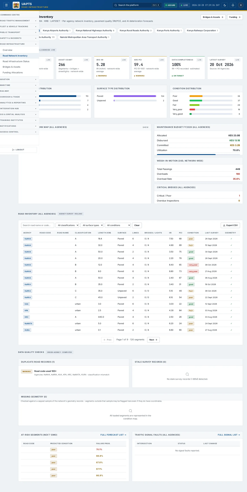
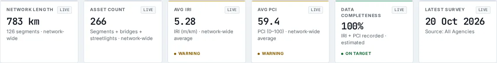
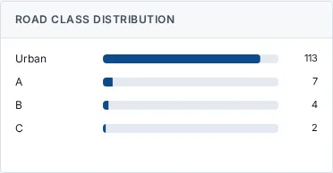
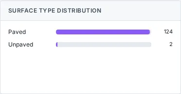
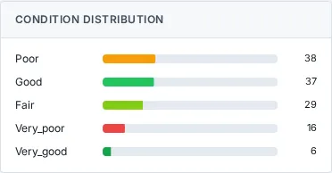
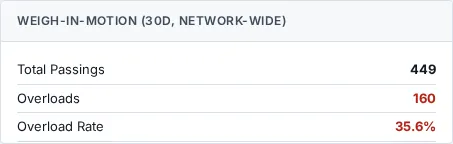
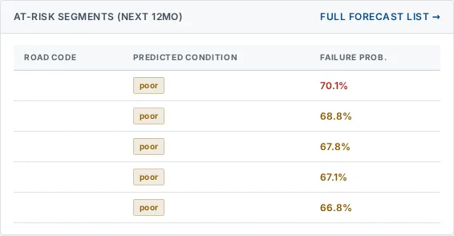

# Road Network Inventory

_Road Infrastructure › Road Network Inventory_ · Route `/infrastructure`

**Road Network Inventory** lets you see per-agency network inventory, pavement quality (IRI/PCI), and AI deterioration forecasts. Data on this page comes from KeNHA, KURA, KeRRA, KRB and LAPSSET.

> 🎬 **Video tutorial:** _coming soon._  
> <!-- VIDEO-URL: infrastructure/road-network-inventory | paste the link here, e.g. [Watch the walkthrough](https://…) -->

## Highlights

- **6 headline tiles** — Network Length, Asset Count, Avg IRI, Avg PCI, Data Completeness, Latest Survey.
- **12 panels** — Road Class Distribution, Surface Type Distribution, Condition Distribution, Maintenance Budget FY (), Weigh-in-Motion (30d, network-wide), Critical Bridges ()….
- An **interactive map** with a legend, full-screen, locate-me and base-map controls.
- **Refreshes itself every 120 seconds**, so you do not need to reload the page.
- **Export to CSV** for the rows you are looking at (Analyst tier and above).
- **Filters and search** to narrow tables to what you need.
- Every figure is traceable to the data feed or upload template that supplies it — see [Data sources and feeds](#data-sources-and-feeds).

## Enabling and access

1. Sign in to UAPTS (see [How to access](../getting-started/how-to-access.md)).
2. In the left sidebar expand **Road Infrastructure** and click **Road Network Inventory**.
3. The page opens at `/infrastructure`. You can also reach it with the global search (**Ctrl + K**).

This page belongs to module **M06 · Road Infrastructure**. The sidebar and the global search only list pages your agency and role can open, and a link to a page you cannot reach sends you back to the Command Centre. If a page you expect is missing, ask your agency administrator to check your agency's [Module Access](../access-control/module-access.md).

## Page tour

### Headline tiles

| Tile | What it shows | Data from | Table → ingested via |
|---|---|---|---|
| **Network Length** | — _(window: LIVE)_ | `/infrastructure/road-segments/`, `/infrastructure/road-segments/condition-map/`, `/infrastructure/summary/` | _RoadSegment_ → [`krb-road-condition`](../data-templates/krb-road-condition.xlsx) [`kura-road-network`](../data-templates/kura-road-network.xlsx) [`kenha-road-network`](../data-templates/kenha-road-network.xlsx) [`kerra-road-network`](../data-templates/kerra-road-network.xlsx) +1 more |
| **Asset Count** | — _(window: LIVE)_ | `/infrastructure/bridges/`, `/infrastructure/road-segments/`, `/infrastructure/road-segments/condition-map/` | _Bridge, RoadSegment_ → [`krb-road-condition`](../data-templates/krb-road-condition.xlsx) [`kura-road-network`](../data-templates/kura-road-network.xlsx) [`kenha-bridge-register`](../data-templates/kenha-bridge-register.xlsx) [`kenha-road-network`](../data-templates/kenha-road-network.xlsx) +3 more |
| **Avg IRI** | — _(window: LIVE)_ | `/infrastructure/road-segments/`, `/infrastructure/road-segments/condition-map/`, `/infrastructure/summary/` | _RoadSegment_ → [`krb-road-condition`](../data-templates/krb-road-condition.xlsx) [`kura-road-network`](../data-templates/kura-road-network.xlsx) [`kenha-road-network`](../data-templates/kenha-road-network.xlsx) [`kerra-road-network`](../data-templates/kerra-road-network.xlsx) +1 more |
| **Avg PCI** | — _(window: LIVE)_ | `/infrastructure/road-segments/`, `/infrastructure/road-segments/condition-map/`, `/infrastructure/summary/` | _RoadSegment_ → [`krb-road-condition`](../data-templates/krb-road-condition.xlsx) [`kura-road-network`](../data-templates/kura-road-network.xlsx) [`kenha-road-network`](../data-templates/kenha-road-network.xlsx) [`kerra-road-network`](../data-templates/kerra-road-network.xlsx) +1 more |
| **Data Completeness** | IRI + PCI recorded · estimated _(window: LIVE)_ | `/infrastructure/road-segments/`, `/infrastructure/road-segments/condition-map/`, `/infrastructure/summary/` | _RoadSegment_ → [`krb-road-condition`](../data-templates/krb-road-condition.xlsx) [`kura-road-network`](../data-templates/kura-road-network.xlsx) [`kenha-road-network`](../data-templates/kenha-road-network.xlsx) [`kerra-road-network`](../data-templates/kerra-road-network.xlsx) +1 more |
| **Latest Survey** | — _(window: LIVE)_ | `/infrastructure/road-segments/`, `/infrastructure/road-segments/condition-map/`, `/infrastructure/summary/` | _RoadSegment_ → [`krb-road-condition`](../data-templates/krb-road-condition.xlsx) [`kura-road-network`](../data-templates/kura-road-network.xlsx) [`kenha-road-network`](../data-templates/kenha-road-network.xlsx) [`kerra-road-network`](../data-templates/kerra-road-network.xlsx) +1 more |

### Road Class Distribution

**Data from:** `/infrastructure/road-segments/`, `/infrastructure/road-segments/condition-map/`, `/infrastructure/summary/`  
**Table → ingested via:** _RoadSegment_ → [`krb-road-condition`](../data-templates/krb-road-condition.xlsx) [`kura-road-network`](../data-templates/kura-road-network.xlsx) [`kenha-road-network`](../data-templates/kenha-road-network.xlsx) [`kerra-road-network`](../data-templates/kerra-road-network.xlsx) +1 more

### Surface Type Distribution

**Data from:** `/infrastructure/road-segments/`, `/infrastructure/road-segments/condition-map/`, `/infrastructure/summary/`  
**Table → ingested via:** _RoadSegment_ → [`krb-road-condition`](../data-templates/krb-road-condition.xlsx) [`kura-road-network`](../data-templates/kura-road-network.xlsx) [`kenha-road-network`](../data-templates/kenha-road-network.xlsx) [`kerra-road-network`](../data-templates/kerra-road-network.xlsx) +1 more

### Condition Distribution

Contains an interactive map.

**Data from:** `/infrastructure/maintenance-budgets/`, `/infrastructure/road-segments/`, `/infrastructure/road-segments/condition-map/`, `/infrastructure/summary/`  
**Table → ingested via:** _MaintenanceBudget, RoadSegment_ → [`krb-funding`](../data-templates/krb-funding.xlsx) [`krb-road-condition`](../data-templates/krb-road-condition.xlsx) [`kura-road-network`](../data-templates/kura-road-network.xlsx) [`kenha-road-network`](../data-templates/kenha-road-network.xlsx) +2 more

### Maintenance Budget FY ()

**Data from:** `/infrastructure/maintenance-budgets/`, `/infrastructure/road-segments/`, `/infrastructure/summary/`  
**Table → ingested via:** _MaintenanceBudget, RoadSegment_ → [`krb-funding`](../data-templates/krb-funding.xlsx) [`krb-road-condition`](../data-templates/krb-road-condition.xlsx) [`kura-road-network`](../data-templates/kura-road-network.xlsx) [`kenha-road-network`](../data-templates/kenha-road-network.xlsx) +2 more

### Weigh-in-Motion (30d, network-wide)

**Data from:** `/infrastructure/summary/`  
**Table → ingested via:** aggregate of several tables — see [per-table feeds](#data-sources-and-feeds)

### Critical Bridges ()

**Data from:** `/infrastructure/bridges/`, `/infrastructure/road-segments/`, `/infrastructure/summary/`  
**Table → ingested via:** _Bridge, RoadSegment_ → [`krb-road-condition`](../data-templates/krb-road-condition.xlsx) [`kura-road-network`](../data-templates/kura-road-network.xlsx) [`kenha-bridge-register`](../data-templates/kenha-bridge-register.xlsx) [`kenha-road-network`](../data-templates/kenha-road-network.xlsx) +3 more

### Road Inventory ()

Contains a table with the columns **Agency**, **Road Code**, **Road Name**, **Classification**, **Length (km)**, **Surface**, **Lanes**, **Bridges / Lights**, **IRI**, **PCI**, **Condition**, **Last Survey**, **Geometry**.

**Data from:** `/infrastructure/road-segments/`, `/infrastructure/road-segments/condition-map/`, `/infrastructure/summary/`  
**Table → ingested via:** _RoadSegment_ → [`krb-road-condition`](../data-templates/krb-road-condition.xlsx) [`kura-road-network`](../data-templates/kura-road-network.xlsx) [`kenha-road-network`](../data-templates/kenha-road-network.xlsx) [`kerra-road-network`](../data-templates/kerra-road-network.xlsx) +1 more

### Duplicate Road Records ()

**Data from:** `/infrastructure/road-segments/`, `/infrastructure/road-segments/condition-map/`  
**Table → ingested via:** _RoadSegment_ → [`krb-road-condition`](../data-templates/krb-road-condition.xlsx) [`kura-road-network`](../data-templates/kura-road-network.xlsx) [`kenha-road-network`](../data-templates/kenha-road-network.xlsx) [`kerra-road-network`](../data-templates/kerra-road-network.xlsx) +1 more

### Stale Survey Records ()

**Data from:** `/infrastructure/road-segments/`, `/infrastructure/road-segments/condition-map/`  
**Table → ingested via:** _RoadSegment_ → [`krb-road-condition`](../data-templates/krb-road-condition.xlsx) [`kura-road-network`](../data-templates/kura-road-network.xlsx) [`kenha-road-network`](../data-templates/kenha-road-network.xlsx) [`kerra-road-network`](../data-templates/kerra-road-network.xlsx) +1 more

### Missing Geometry ()

Contains a table with the columns **Agency**, **Road Code**, **Road Name**.

**Data from:** `/infrastructure/road-segments/`, `/infrastructure/road-segments/condition-map/`  
**Table → ingested via:** _RoadSegment_ → [`krb-road-condition`](../data-templates/krb-road-condition.xlsx) [`kura-road-network`](../data-templates/kura-road-network.xlsx) [`kenha-road-network`](../data-templates/kenha-road-network.xlsx) [`kerra-road-network`](../data-templates/kerra-road-network.xlsx) +1 more

### At-Risk Segments (Next 12mo) Full forecast list

Contains a table with the columns **Road Code**, **Predicted Condition**, **Failure Prob.**.

**Data from:** `/infrastructure/deterioration-forecasts/at-risk/`, `/infrastructure/road-segments/`, `/infrastructure/road-segments/condition-map/`  
**Table → ingested via:** _DeteriorationForecast, RoadSegment_ → [`krb-road-condition`](../data-templates/krb-road-condition.xlsx) [`kura-road-network`](../data-templates/kura-road-network.xlsx) [`kenha-road-network`](../data-templates/kenha-road-network.xlsx) [`kerra-road-network`](../data-templates/kerra-road-network.xlsx) +1 more

### Traffic Signal Faults () Full signal list

Contains a table with the columns **Intersection**, **Status**, **Last Change**.

**Data from:** `/infrastructure/road-segments/`, `/infrastructure/summary/`, `/infrastructure/traffic-signals/faults/`  
**Table → ingested via:** _RoadSegment, TrafficSignal_ → [`krb-road-condition`](../data-templates/krb-road-condition.xlsx) [`kura-road-network`](../data-templates/kura-road-network.xlsx) [`kenha-road-network`](../data-templates/kenha-road-network.xlsx) [`kerra-road-network`](../data-templates/kerra-road-network.xlsx) +1 more

## Working with this page

1. Open **Road Infrastructure → Road Network Inventory** from the sidebar.
2. Wait for the page to finish loading. It re-fetches its data every **120 s**; the figures you see are the latest the platform holds, not a one-time snapshot.
3. Type in the **“Search road name or code…”** box to filter what is shown.
4. Use the **All conditions** drop-down to narrow the list. Choices include: Very Good, Good, Fair, Poor, Very Poor, Under Construction.
5. On the map, drag to pan and scroll (or pinch) to zoom. Click a marker or line for its details. Use the map toolbar to go full-screen, centre on your location, reset the view or switch the base map; click the legend chip to expand it.
6. Click **All Agencies** to use this action.
7. Click **Prev** to use this action.
8. Click **Export CSV** to download the rows currently loaded (after filters). The button only appears for Analyst tier and above.

## Status and value meanings

These are the values the platform stores for the fields shown on this page (`value` followed by the label you see).

| Field | Table | Values |
|---|---|---|
| condition class | Bridge | `excellent` · `good` · `fair` · `poor` · `critical` |
| surface type | RoadSegment | `paved` · `unpaved` |
| condition class | RoadSegment | `very_good` · `good` · `fair` · `poor` · `very_poor` · `under_con` Under Construction |
| status | TrafficSignal | `operational` · `degraded` · `fault` · `offline` · `maintenance` Under Maintenance |

## Data sources and feeds

Every number and table on this page is read from the API endpoints below. The **Ingested via** column says how the underlying records get into UAPTS: a downloadable **upload template** (xlsx/CSV, loaded through the [Integration Hub](../integration-hub/upload-and-connect.md)), a **live feed** that pushes records to the ingest API, or — where neither exists yet — it is stated plainly.

| Endpoint | Records | Ingested via |
|---|---|---|
| `GET /accounts/agencies/` | Agencies | Platform data (accounts / configuration) |
| `GET /infrastructure/bridges/` | Bridges | [`kenha-bridge-register`](../data-templates/kenha-bridge-register.xlsx) [`kerra-bridge-register`](../data-templates/kerra-bridge-register.xlsx) |
| `GET /infrastructure/deterioration-forecasts/at-risk/` | Deterioration Forecasts | Computed by UAPTS from other data (no direct feed) |
| `GET /infrastructure/maintenance-budgets/` | Maintenance Budgets | [`krb-funding`](../data-templates/krb-funding.xlsx) |
| `GET /infrastructure/road-segments/` | Road Segments | [`krb-road-condition`](../data-templates/krb-road-condition.xlsx) [`kura-road-network`](../data-templates/kura-road-network.xlsx) [`kenha-road-network`](../data-templates/kenha-road-network.xlsx) [`kerra-road-network`](../data-templates/kerra-road-network.xlsx) [`sdr-road-network-register`](../data-templates/sdr-road-network-register.xlsx) |
| `GET /infrastructure/road-segments/condition-map/` | Road Segments | [`krb-road-condition`](../data-templates/krb-road-condition.xlsx) [`kura-road-network`](../data-templates/kura-road-network.xlsx) [`kenha-road-network`](../data-templates/kenha-road-network.xlsx) [`kerra-road-network`](../data-templates/kerra-road-network.xlsx) [`sdr-road-network-register`](../data-templates/sdr-road-network-register.xlsx) |
| `GET /infrastructure/road-segments/export/` | Road Segments | [`krb-road-condition`](../data-templates/krb-road-condition.xlsx) [`kura-road-network`](../data-templates/kura-road-network.xlsx) [`kenha-road-network`](../data-templates/kenha-road-network.xlsx) [`kerra-road-network`](../data-templates/kerra-road-network.xlsx) [`sdr-road-network-register`](../data-templates/sdr-road-network-register.xlsx) |
| `GET /infrastructure/summary/` | _Aggregate of 8 tables (rows below)_ | — |
| ↳ Bridge | Bridges | [`kenha-bridge-register`](../data-templates/kenha-bridge-register.xlsx) [`kerra-bridge-register`](../data-templates/kerra-bridge-register.xlsx) |
| ↳ ConstructionProject | Construction Projects | [`krb-workplans`](../data-templates/krb-workplans.xlsx) [`kura-project-progress`](../data-templates/kura-project-progress.xlsx) [`kenha-project-progress`](../data-templates/kenha-project-progress.xlsx) [`kerra-project-progress`](../data-templates/kerra-project-progress.xlsx) +3 more ([catalogue](../reference/data-sources.md)) |
| ↳ DeteriorationForecast | Deterioration Forecasts | Computed by UAPTS from other data (no direct feed) |
| ↳ MaintenanceBudget | Maintenance Budgets | [`krb-funding`](../data-templates/krb-funding.xlsx) |
| ↳ MaintenanceOrder | Maintenance Orders | [`kura-maintenance-work-orders`](../data-templates/kura-maintenance-work-orders.xlsx) [`kenha-maintenance-work-orders`](../data-templates/kenha-maintenance-work-orders.xlsx) [`kerra-maintenance-work-orders`](../data-templates/kerra-maintenance-work-orders.xlsx) |
| ↳ RoadSegment | Road Segments | [`krb-road-condition`](../data-templates/krb-road-condition.xlsx) [`kura-road-network`](../data-templates/kura-road-network.xlsx) [`kenha-road-network`](../data-templates/kenha-road-network.xlsx) [`kerra-road-network`](../data-templates/kerra-road-network.xlsx) +1 more ([catalogue](../reference/data-sources.md)) |
| ↳ Streetlight | Streetlights | **No ingestion template yet** — populated by seed data or direct entry |
| ↳ WIMReading | Wim Readings | [`kura-weighbridge-transactions`](../data-templates/kura-weighbridge-transactions.xlsx) [`kenha-weighbridge-transactions`](../data-templates/kenha-weighbridge-transactions.xlsx) |
| `GET /infrastructure/traffic-signals/faults/` | Traffic Signals | **No ingestion template yet** — populated by seed data or direct entry |

Full details of every template (columns, formats) are in the [Data sources catalogue](../reference/data-sources.md). Interactive API documentation is available at `/api/docs/`.

## Permissions

| Who | What they can do here |
|---|---|
| Public / read-only accounts | View the page where the module is enabled for their agency (read-only). |
| Operator | View the page. |
| Analyst | View and **export CSV**. |
| Agency admin | Everything an analyst can do, plus the administrative capabilities listed in [Roles & Permissions](../access-control/roles-and-permissions.md). |
| Super admin | Sees every agency's data. |

**Agencies with the Road Infrastructure module:** full — KENHA, KURA, KERRA, SDR, KRB, SDT; selected pages only — SDR_MTD, COUNTY_GOV, NTSA, LAPSSET.

_Access is evaluated by the server from the baseline policy plus any agency overrides, so a super admin or agency admin may have changed it from the defaults above._

## Related topics

- [Overview](infrastructure-overview.md)
- [Road Infrastructure Status](road-infrastructure-status.md)
- [Bridges & Assets](bridges-and-assets.md)
- [Funding Allocations](funding-allocations.md)
- [Maintenance Orders](maintenance-orders.md)
- [Road Infrastructure overview](index.md)
- [Upload & Connect (Integration Hub)](../integration-hub/upload-and-connect.md)
- [Data sources catalogue](../reference/data-sources.md)

## On this page

- [Highlights](#highlights)
- [Enabling and access](#enabling-and-access)
- [Page tour](#page-tour)
- [Working with this page](#working-with-this-page)
- [Status and value meanings](#status-and-value-meanings)
- [Data sources and feeds](#data-sources-and-feeds)
- [Permissions](#permissions)
- [Related topics](#related-topics)

## Support

- **Your agency administrator** is the first contact for access, role and data-quality questions.
- **Data feeds, templates and API questions:** `api-support@uapts.go.ke` (include the `X-Request-ID` response header from a failing call).
- **Security concerns:** `security@uapts.go.ke`. Do not report suspected vulnerabilities publicly.
