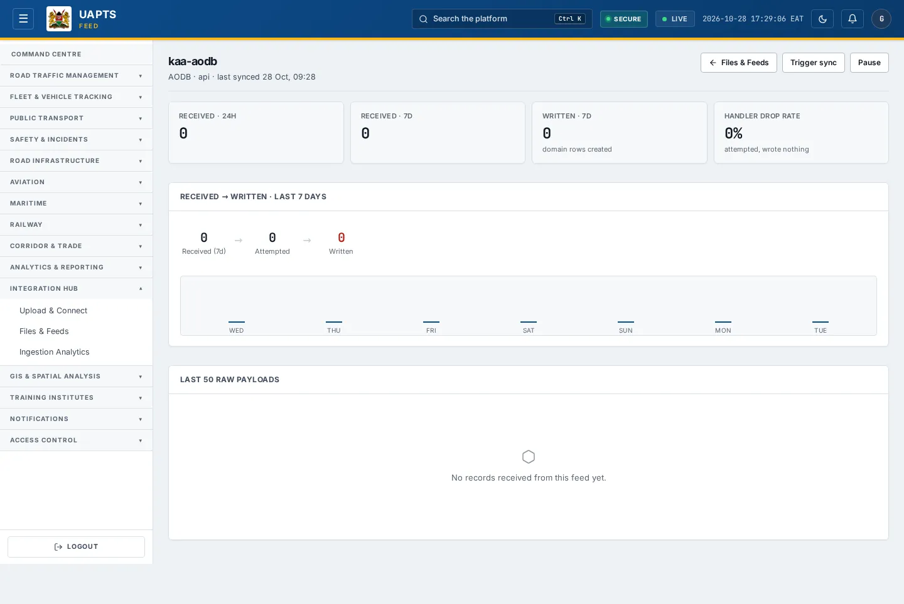

# Feed detail

_Integration Hub › Files & Feeds › Feed detail_ · Route `/integrations/feeds/<source_id>`

The **feed detail** page shows how one live feed is behaving: connection details, what it received versus what it wrote to the platform, and the errors that stopped records landing.

> 🎬 **Video tutorial:** _coming soon._  
> <!-- VIDEO-URL: integration-hub/feed-detail | paste the link here, e.g. [Watch the walkthrough](https://…) -->

## Highlights

- **Trigger sync**, **Pause** and **Resume** controls.
- **Connection details** with a **Test connection** button.
- **Received → written** for the last 7 days, with a warning when a feed that looks “connected” writes **zero** rows.
- **Unrecognised record types**, **Top handler errors** and the **last 50 raw payloads** for troubleshooting.

## Enabling and access

Open a feed from the **Feeds** table in [Files & Feeds](files-and-feeds.md) (`/integrations/feeds/<source_id>`). The route needs at least the **Analyst** tier.

## Working with a feed

1. Read the header: source system · mode · last synced.
2. Under **Connection details** check **Protocol**, **Auth method**, **Feed key** (push) or **Endpoint** (pull), and **Reconcile cron**.
3. Click **Test connection**. Result: ✓ reachable or ✕ with the reason. A push feed has nothing to reach, so it reads _never tested (nothing to reach for a push feed)_.
4. Check **Received → written · last 7 days**. If the page warns that the feed received records but wrote **zero**, the connection works but nothing is landing: read **Top handler errors** below.
5. Use **Unrecognised record types** to find `record_type` values that never reached a handler — either the source has no handler or the payload's type does not match.
6. Open the **Last 50 raw payloads** to see exactly what was received (marked _handler failed_ or _unhandled_ when relevant).
7. Use **Pause** to stop a misbehaving feed and **Resume** when fixed; **Trigger sync** asks UAPTS to pull now.

## Data sources and feeds

| Data point | Endpoint |
|---|---|
| Feed record | `GET /integrations/<source_id>/` |
| Statistics (received, written, errors) | `GET /integrations/<source_id>/stats/` |
| Raw payloads | `GET /integrations/records/` |
| Pause / resume / trigger | `POST /integrations/<id>/pause/`, `/resume/`, `/trigger/` |
| Test | `POST /integrations/test-connection/` |

Which tables a feed writes to is listed in the [Data sources catalogue](../reference/data-sources.md#live-feeds).

## Related topics

- [Ingestion Analytics](ingestion-analytics.md)
- [Files & Feeds](files-and-feeds.md)

## On this page

- [Highlights](#highlights)
- [Enabling and access](#enabling-and-access)
- [Working with a feed](#working-with-a-feed)
- [Data sources and feeds](#data-sources-and-feeds)
- [Related topics](#related-topics)

## Support

- **Your agency administrator** is the first contact for access, role and data-quality questions.
- **Data feeds, templates and API questions:** `api-support@uapts.go.ke` (include the `X-Request-ID` response header from a failing call).
- **Security concerns:** `security@uapts.go.ke`. Do not report suspected vulnerabilities publicly.
