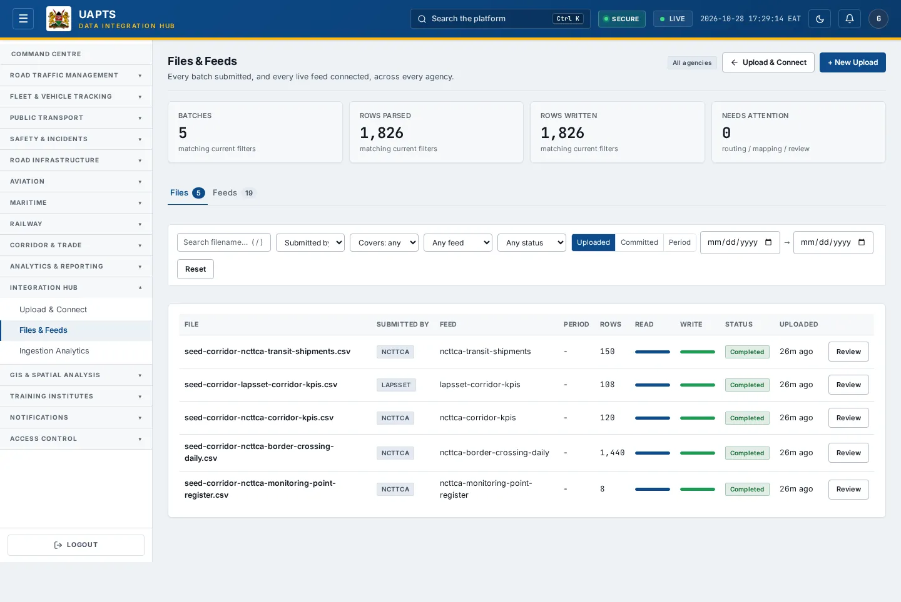

# Files & Feeds

_Integration Hub › Files & Feeds_ · Route `/integrations/files`

**Files & Feeds** shows **every batch submitted** and **every live feed connected**, across all agencies you can see. Use it to find a file, see why it was held back, and check which feeds are healthy.

> 🎬 **Video tutorial:** _coming soon._  
> <!-- VIDEO-URL: integration-hub/files-and-feeds | paste the link here, e.g. [Watch the walkthrough](https://…) -->

## Highlights

- A banner counts files **waiting for a template** with a **Review the queue** shortcut.
- Filter batches by **Submitted by**, **Covers** (agency), **feed** and **status**.
- Open any batch to review, map columns, commit or replace it.
- A second table lists **feeds** with status, records today, last sync and last error.

## Enabling and access

Open **Integration Hub → Files & Feeds** (`/integrations/files`), module **M12**.

## Batches (files)

1. Use **+ New Upload** to start a new upload (it takes you to [Upload & Connect](upload-and-connect.md)).
2. Use the filters (**Submitted by**, **Covers**, **feed**, **status**) and **Reset** to clear them.
3. Read the columns: **File**, **Submitted by**, **Feed**, **Period**, **Rows**, **Read**, **Write**, **Status**, **Uploaded**.
4. Click **Review** — or **Route** for a file with no feed — to open the [batch detail](upload-detail.md).

Statuses are explained in [Upload & Connect](upload-and-connect.md#upload-and-batch-statuses).

## Feeds

| Status | Meaning |
|---|---|
| Connected | Last sync was **less than 2 hours** ago. |
| Degraded | Last sync was **2 to 24 hours** ago. |
| Disconnected | No sync for **more than 24 hours**. |
| Paused | Paused by an administrator (see Feed detail). |
| Pending | Registered but **never synced**. |

Click a feed to open its [detail page](feed-detail.md).

## Data sources and feeds

| Data point | Endpoint | Ingested via |
|---|---|---|
| Batches table | `GET /integrations/uploads/` | Created by each upload. |
| Feeds table | `GET /integrations/` | Feed registry. |
| Feed statistics | `GET /integrations/<source_id>/stats/` | Counted from received records. |

## Related topics

- [Upload & Connect](upload-and-connect.md)
- [Ingestion Analytics](ingestion-analytics.md)

## On this page

- [Highlights](#highlights)
- [Enabling and access](#enabling-and-access)
- [Batches (files)](#batches-files)
- [Feeds](#feeds)
- [Data sources and feeds](#data-sources-and-feeds)
- [Related topics](#related-topics)

## Support

- **Your agency administrator** is the first contact for access, role and data-quality questions.
- **Data feeds, templates and API questions:** `api-support@uapts.go.ke` (include the `X-Request-ID` response header from a failing call).
- **Security concerns:** `security@uapts.go.ke`. Do not report suspected vulnerabilities publicly.
