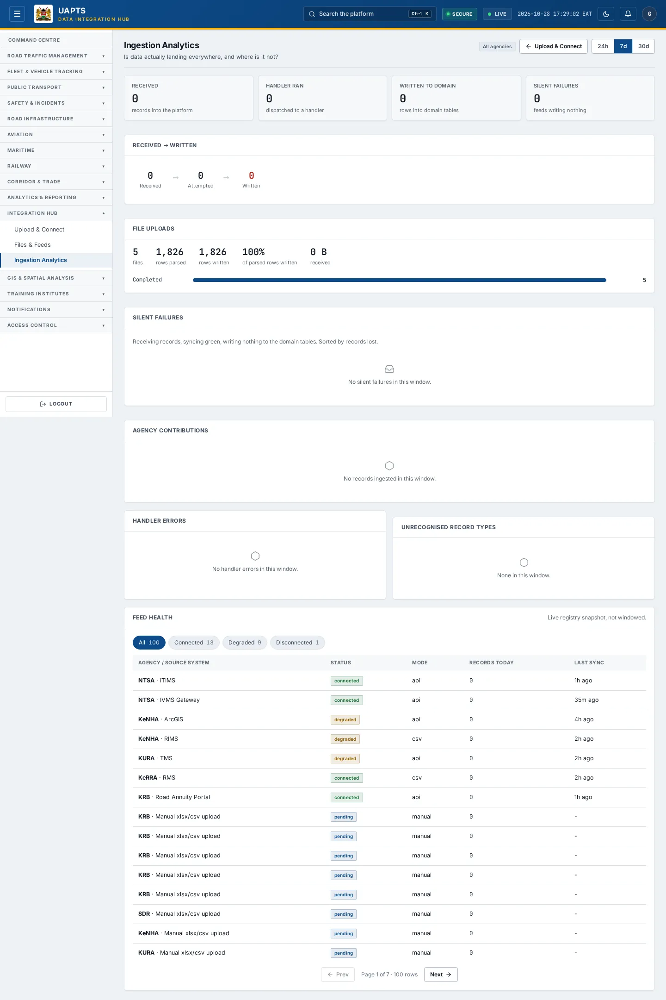

# Ingestion Analytics

_Integration Hub › Ingestion Analytics_ · Route `/integrations/analytics`

**Ingestion Analytics** answers one question: _is data actually landing everywhere, and where is it not?_ It compares what each feed received with what reached the domain tables.

> 🎬 **Video tutorial:** _coming soon._  
> <!-- VIDEO-URL: integration-hub/ingestion-analytics | paste the link here, e.g. [Watch the walkthrough](https://…) -->

## Highlights

- **Received → written** across the platform (top feeds by volume when there are many).
- **Silent failures** — feeds that receive records and sync “green” but write nothing, sorted by records lost.
- **Agency contributions** and **Handler errors** with counts and messages.
- **Unrecognised record types**.
- **Feed health** — a live snapshot filtered by status chips.

## Enabling and access

Open **Integration Hub → Ingestion Analytics** (`/integrations/analytics`), module **M12**.

## Working with this page

1. Read **Received → written** first: the gap between the two numbers is data that did not land.
2. Open **Silent failures**. Each row shows the **Feed**, **Agency** and **Records lost**. Click through to the [feed detail](feed-detail.md) to see why.
3. Use **Handler errors** to find the most common failure messages across feeds.
4. Use the status chips under **Feed health** to filter feeds (All, Connected, Degraded, Disconnected …) and check **Records today** and **Last sync**.

## Data sources and feeds

| Data point | Endpoint |
|---|---|
| Received → written, silent failures, handler errors | `GET /integrations/stats/` |
| Agency contributions | `GET /integrations/agency-contributions/` |
| Feed health | `GET /integrations/` |

## Related topics

- [Files & Feeds](files-and-feeds.md)
- [Upload & Connect](upload-and-connect.md)

## On this page

- [Highlights](#highlights)
- [Enabling and access](#enabling-and-access)
- [Working with this page](#working-with-this-page)
- [Data sources and feeds](#data-sources-and-feeds)
- [Related topics](#related-topics)

## Support

- **Your agency administrator** is the first contact for access, role and data-quality questions.
- **Data feeds, templates and API questions:** `api-support@uapts.go.ke` (include the `X-Request-ID` response header from a failing call).
- **Security concerns:** `security@uapts.go.ke`. Do not report suspected vulnerabilities publicly.
