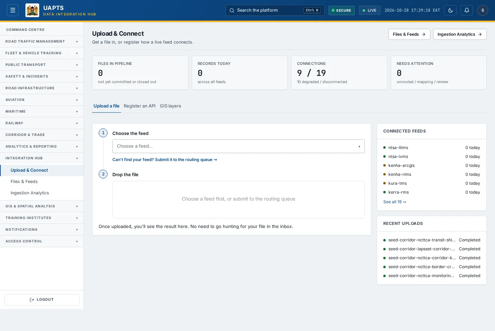
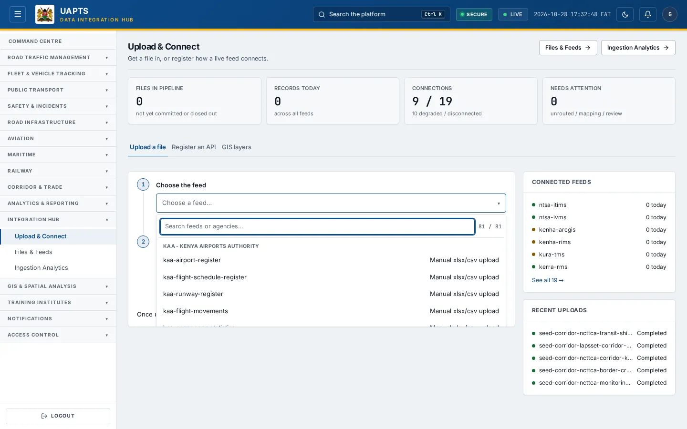
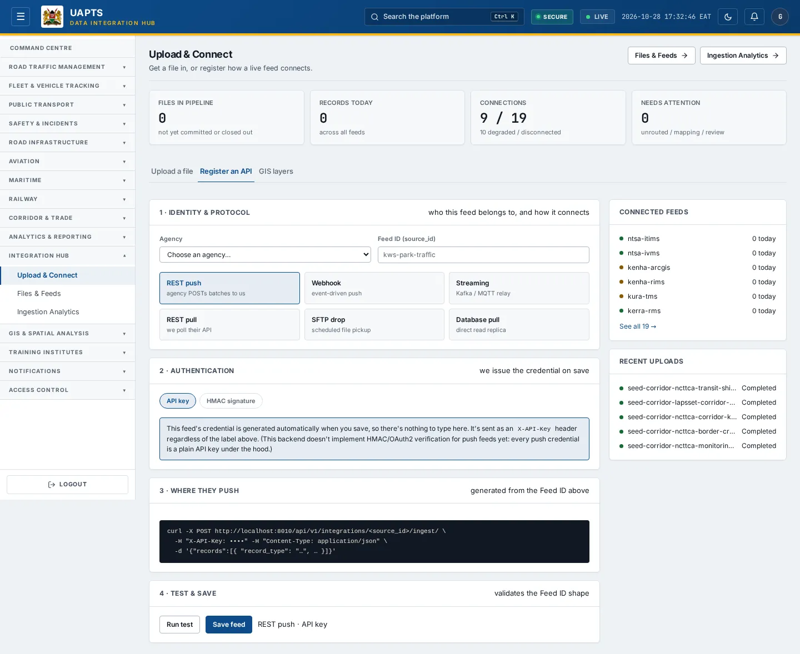

# Upload & Connect

_Integration Hub › Upload & Connect_ · Route `/integrations`

**Upload & Connect** is where agency data enters UAPTS. You can **upload a file** using a locked Excel/CSV template, or **register an API** so a live system pushes (or UAPTS pulls) records automatically.

> 🎬 **Video tutorial:** _coming soon._  
> <!-- VIDEO-URL: integration-hub/upload-and-connect | paste the link here, e.g. [Watch the walkthrough](https://…) -->

## Highlights

- **Files in pipeline**, **Records today**, **Connections** (connected vs degraded/disconnected) and **Needs attention** (unrouted / mapping / review) at a glance.
- **Upload a file** in four steps: choose the feed → get the template → drop the file → review and commit.
- **Routing queue** — upload a file in a format that has no template yet; it is held until someone assigns a template.
- **Register an API** with six protocols and a guided four-step form; push feeds get an API key shown once.
- **86 ready-made templates** — [download them all](../reference/data-sources.md).

## Enabling and access

Open **Integration Hub → Upload & Connect** (`/integrations`), module **M12**. Any role with the **submit_uploads** capability (Operator tier in the baseline) can upload; **committing** a validated batch needs `approve_uploads` (Admin); **registering feeds** and **testing connections** need `register_feeds` (Admin).

## Upload a file

1. Choose the tab **Upload a file**.
2. **Choose the feed.** Pick your feed from the list (for example `kenha-bridge-register`). The line underneath shows the source system, template version and when it was last submitted. If your format is not listed, choose **Can't find your feed? Submit it to the routing queue**.
3. **Get the template.** Click **⬇ Download .xlsx**. The workbook has locked headers and dropdowns for constrained fields. Every template is also in the [Data sources catalogue](../reference/data-sources.md) as `.xlsx` and `.csv`.
4. Fill in one row per record. Columns marked with * are required. Do not rename or reorder the headers.
5. **Drop the file** into the upload area (or click to browse). For CSV files declare the template version when asked.
6. Wait for the result. You will see **✓ N row(s) ready**, **⚠ Column names don't match the template** (click **Map columns**), or **✕** with the reason every row failed (click **Upload a correction**).
7. Click **Review and commit** to open the [batch detail](upload-detail.md), check the preview and commit.

## Register an API

1. Choose the tab **Register an API**.
2. **1 · Identity & protocol:** choose the **Agency**, a **Feed ID (source_id)** such as `kws-park-traffic`, and the protocol.
3. **2 · Authentication:** for push protocols UAPTS generates the credential when you save. For pull protocols enter the agency's credential (stored encrypted).
4. **3 · Where they push / Endpoint & schedule:** push feeds show the URL to send to; pull feeds ask for the endpoint and a **Reconcile cron** schedule.
5. **4 · Test & save:** click **Run test** (a reachability check for pull feeds; a Feed-ID check for push feeds), then **Save feed**.
6. **Copy the key now.** For push feeds the API key is shown **once**; send it to the agency as the `X-API-Key` header value for their POSTs.
7. Track the feed from [Files & Feeds](files-and-feeds.md) once it starts sending data.

| Protocol | Direction | How it works |
|---|---|---|
| REST push | Push | The agency POSTs batches to UAPTS (`POST /api/v1/integrations/<source_id>/ingest/`). |
| Webhook | Push | Event-driven push. |
| Streaming | Push | Kafka/MQTT relay. |
| REST pull | Pull | UAPTS polls the agency's API. |
| SFTP drop | Pull | Scheduled file pickup. |
| Database pull | Pull | Direct read from a replica. |

_Authentication choices per protocol include API key, HMAC, Bearer, Basic, OAuth2 and mTLS; at present every push credential is a plain API key under the hood._

## Upload and batch statuses

| Status | Meaning | What you do |
|---|---|---|
| `unrouted` | Unrouted — awaiting a template | The file is stored but not yet assigned to a feed. Use **Route** to assign one. |
| `pending` | Pending — awaiting validation | Queued for validation. |
| `validating` | Validating | Rows are being checked against the template. |
| `needs_mapping` | Needs column mapping | The headers do not match the template. Map the columns, then re-validate. |
| `validated` | Validated — awaiting commit | Ready. An approver can review and **Commit** it. |
| `rejected` | Rejected | Every row failed validation or the template was wrong. Upload a correction. |
| `committing` | Committing | Valid rows are being written to the domain tables. |
| `committed` | Committed | All valid rows are in the platform. |
| `partial` | Partially committed | Some rows were written; others failed. Check the batch details. |
| `failed` | Failed | The commit failed. See the error on the batch and contact support. |
| `superseded` | Superseded by a replacement upload | A correction replaced this file. |

## Data sources and feeds

| Data point | Endpoint | Ingested via |
|---|---|---|
| Feeds list, connection status | `GET /integrations/` | Feed registry (created by **Register an API** or seeded). |
| Files in pipeline / needs attention | `GET /integrations/uploads/` | Every file you upload creates a batch record. |
| Records today, connections | `GET /integrations/stats/` | Counted from records received by each feed. |
| Template download | `GET /integrations/<source_id>/upload-template/` | Generated from the template definition — same file as in the catalogue. |
| Upload | `POST /integrations/<source_id>/uploads/` | This page. |

## Permissions

| Capability | Who (baseline) | Allows |
|---|---|---|
| submit_uploads | Operator | Upload files |
| approve_uploads | Admin | Commit validated batches; promote reference layers |
| register_feeds | Admin | Register feeds and test connections |

## Related topics

- [Files & Feeds](files-and-feeds.md)
- [Ingestion Analytics](ingestion-analytics.md)
- [Data sources catalogue](../reference/data-sources.md)

## On this page

- [Highlights](#highlights)
- [Enabling and access](#enabling-and-access)
- [Upload a file](#upload-a-file)
- [Register an API](#register-an-api)
- [Upload and batch statuses](#upload-and-batch-statuses)
- [Data sources and feeds](#data-sources-and-feeds)
- [Permissions](#permissions)
- [Related topics](#related-topics)

## Support

- **Your agency administrator** is the first contact for access, role and data-quality questions.
- **Data feeds, templates and API questions:** `api-support@uapts.go.ke` (include the `X-Request-ID` response header from a failing call).
- **Security concerns:** `security@uapts.go.ke`. Do not report suspected vulnerabilities publicly.
