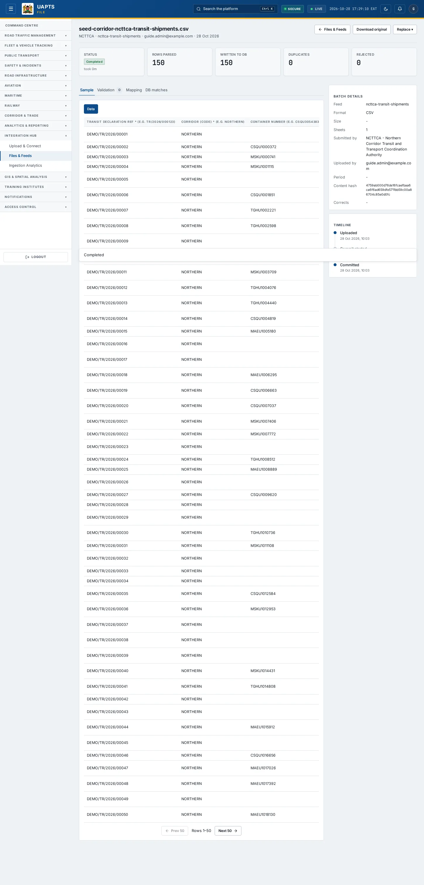

# Upload detail

_Integration Hub › Files & Feeds › Upload detail_ · Route `/integrations/files/<id>`

The **upload detail** page opens when you click **Review** on a batch. It is where you check what was read, fix problems, and **commit** the rows to the platform.

> 🎬 **Video tutorial:** _coming soon._  
> <!-- VIDEO-URL: integration-hub/upload-detail | paste the link here, e.g. [Watch the walkthrough](https://…) -->

## Highlights

- **Preview** of the rows read, with a status on each row.
- **What's wrong, grouped** — validation errors summarised so you can fix the cause once.
- **Map this file's columns** when headers do not match the template, with an option to save the mapping for future uploads.
- **Duplicate** detection: within the file and against earlier uploads.
- **Download original**, **Upload a correction** and **Replace** — nothing is lost.
- A **Timeline** of everything that happened to the batch.

## Enabling and access

Reached from [Files & Feeds](files-and-feeds.md) (`/integrations/files/<id>`). **Commit** needs the `approve_uploads` capability (Admin in the baseline policy).

## Review and commit a batch

1. Open the batch from **Files & Feeds**. Read the **Status** banner at the top.
2. If a banner says **This exact file matches an earlier upload**, click **View it** — you may not need to commit again.
3. Scan the **Preview**. Row marks: ✓ written; ○ not yet committed; ⚠ same key as an earlier row in this file; ⚠ already recorded from an earlier upload; or the error message.
4. Read **What's wrong, grouped**. Fix the source file and click **Upload a correction** (or **Replace ▾**) if needed.
5. If the status is **Needs column mapping**, use **Review mapping**. Match each _Our field_ to a column of the file (best guesses are pre-filled; choose **Ignore** to skip), optionally tick _Save this mapping for future uploads_, then **Apply mapping**.
6. If duplicates were found, decide whether to include them (**Include N duplicate row(s)**) — by default they are left out.
7. Click **Commit N row(s)**. A confirmation says _This will write N row(s) to the domain tables … This can't be undone._ Click **Confirm commit**.
8. Watch the status become **Committing** then **Committed** (or **Partially committed**). Written rows show a link to the record they created.

## Batch details panel

Shows the **Feed**, **Format**, **Size**, **Sheets**, **Submitted by**, **Uploaded by**, **Period**, the **Content hash** (used to detect identical files), and a link to the upload this one **Corrects** if any.

## Statuses

| Status | Meaning |
|---|---|
| `unrouted` | Unrouted — awaiting a template |
| `pending` | Pending — awaiting validation |
| `validating` | Validating |
| `needs_mapping` | Needs column mapping |
| `validated` | Validated — awaiting commit |
| `rejected` | Rejected |
| `committing` | Committing |
| `committed` | Committed |
| `partial` | Partially committed |
| `failed` | Failed |
| `superseded` | Superseded by a replacement upload |

## Data sources and feeds

| Data point | Endpoint |
|---|---|
| Batch and timeline | `GET /integrations/uploads/<id>/` |
| Preview rows | `GET /integrations/uploads/<id>/preview/` |
| Download original | `GET /integrations/uploads/<id>/download/` |
| Commit | `POST /integrations/uploads/<id>/commit/` |
| Route to a feed | `POST /integrations/uploads/<id>/route/` |
| Replace | `POST /integrations/uploads/<id>/replace/` |
| Include duplicates | `POST /integrations/uploads/<id>/include-duplicates/` |
| Apply column mapping | `POST /integrations/uploads/<id>/apply-mapping/` |

The rows come from the file you uploaded using the template for its feed — see the [Data sources catalogue](../reference/data-sources.md).

## Related topics

- [Upload & Connect](upload-and-connect.md)
- [Files & Feeds](files-and-feeds.md)

## On this page

- [Highlights](#highlights)
- [Enabling and access](#enabling-and-access)
- [Review and commit a batch](#review-and-commit-a-batch)
- [Batch details panel](#batch-details-panel)
- [Statuses](#statuses)
- [Data sources and feeds](#data-sources-and-feeds)
- [Related topics](#related-topics)

## Support

- **Your agency administrator** is the first contact for access, role and data-quality questions.
- **Data feeds, templates and API questions:** `api-support@uapts.go.ke` (include the `X-Request-ID` response header from a failing call).
- **Security concerns:** `security@uapts.go.ke`. Do not report suspected vulnerabilities publicly.
