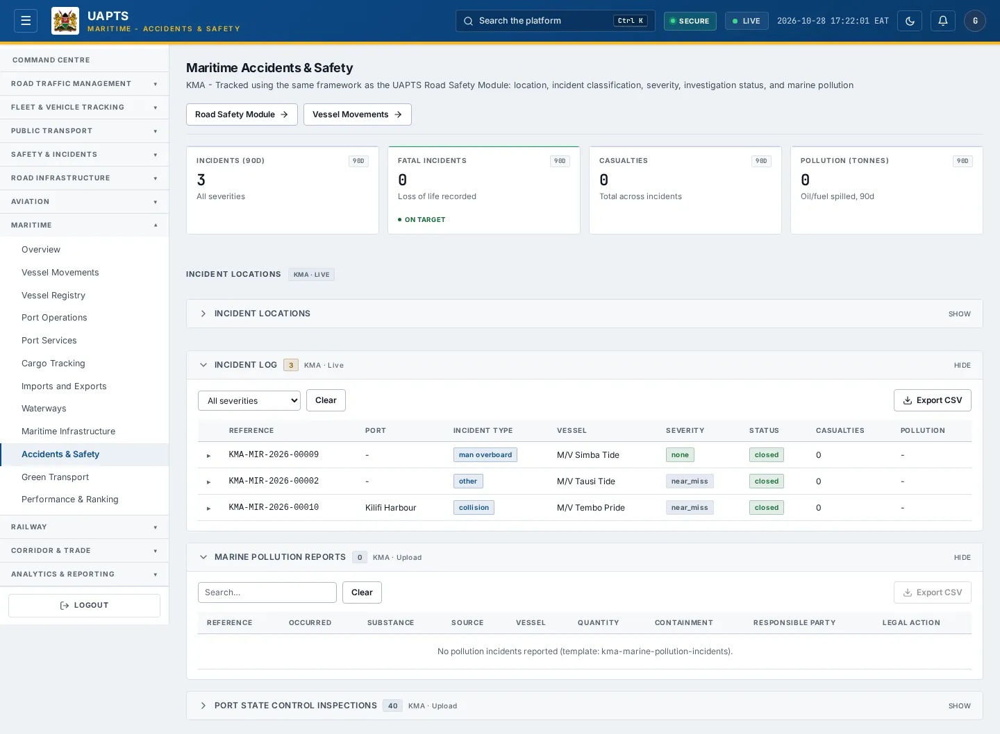
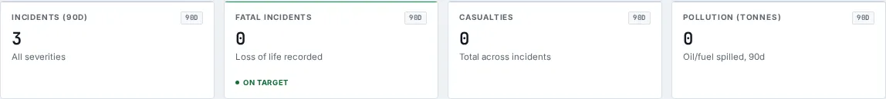

# Accidents & Safety

_Maritime › Accidents & Safety_ · Route `/maritime/accidents`

**Maritime Accidents & Safety** lets you see tracked using the same framework as the UAPTS Road Safety Module: location, incident classification, severity, investigation status, and marine pollution. Data on this page comes from KMA.

> 🎬 **Video tutorial:** _coming soon._  
> <!-- VIDEO-URL: maritime/accidents-and-safety | paste the link here, e.g. [Watch the walkthrough](https://…) -->

## Highlights

- **4 headline tiles** — Incidents (90d), Fatal Incidents, Casualties, Pollution (tonnes).
- **1 panels** — Incident Locations.
- An **interactive map** with a legend, full-screen, locate-me and base-map controls.
- **Export to CSV** for the rows you are looking at (Analyst tier and above).
- **Filters and search** to narrow tables to what you need.
- Every figure is traceable to the data feed or upload template that supplies it — see [Data sources and feeds](#data-sources-and-feeds).

## Enabling and access

1. Sign in to UAPTS (see [How to access](../getting-started/how-to-access.md)).
2. In the left sidebar expand **Maritime** and click **Accidents & Safety**.
3. The page opens at `/maritime/accidents`. You can also reach it with the global search (**Ctrl + K**).

This page belongs to module **M07b · Maritime**. The sidebar and the global search only list pages your agency and role can open, and a link to a page you cannot reach sends you back to the Command Centre. If a page you expect is missing, ask your agency administrator to check your agency's [Module Access](../access-control/module-access.md).

## Page tour

### Headline tiles

| Tile | What it shows | Data from | Table → ingested via |
|---|---|---|---|
| **Incidents (90d)** | All severities _(window: 90D)_ | `/aviation-maritime/maritime/maritime-incidents/stats/` | _MaritimeIncident_ → [`kma-marine-incidents`](../data-templates/kma-marine-incidents.xlsx) |
| **Fatal Incidents** | Loss of life recorded _(window: 90D)_ | `/aviation-maritime/maritime/maritime-incidents/stats/` | _MaritimeIncident_ → [`kma-marine-incidents`](../data-templates/kma-marine-incidents.xlsx) |
| **Casualties** | Total across incidents _(window: 90D)_ | `/aviation-maritime/maritime/maritime-incidents/`, `/aviation-maritime/maritime/maritime-incidents/stats/` | _MaritimeIncident_ → [`kma-marine-incidents`](../data-templates/kma-marine-incidents.xlsx) |
| **Pollution (tonnes)** | Oil/fuel spilled, 90d _(window: 90D)_ | `/aviation-maritime/maritime/maritime-incidents/stats/` | _MaritimeIncident_ → [`kma-marine-incidents`](../data-templates/kma-marine-incidents.xlsx) |

### Incident Locations

Contains an interactive map and a table with the columns **Reference**, **Port**, **Incident Type**, **Vessel**, **Severity**, **Status**, **Casualties**, **Pollution**.

**Data from:** `/aviation-maritime/maritime/maritime-incidents/`  
**Table → ingested via:** _MaritimeIncident_ → [`kma-marine-incidents`](../data-templates/kma-marine-incidents.xlsx)

## Working with this page

1. Open **Maritime → Accidents & Safety** from the sidebar.
2. Type in the **“Search…”** box to filter what is shown.
3. Use the **All severities** drop-down to narrow the list. Choices include: Fatal, Serious, Minor, None, Very serious (KMA), Less serious (KMA).
4. Click a row to open its detail.
5. On the map, drag to pan and scroll (or pinch) to zoom. Click a marker or line for its details. Use the map toolbar to go full-screen, centre on your location, reset the view or switch the base map; click the legend chip to expand it.
6. Click **Export CSV** to download the rows currently loaded (after filters). The button only appears for Analyst tier and above.

## Status and value meanings

These are the values the platform stores for the fields shown on this page (`value` followed by the label you see).

| Field | Table | Values |
|---|---|---|
| status | ContainerMovement | `incoming` · `stacking` · `delivered` · `outgoing` |
| incident type | MaritimeIncident | `collision` · `grounding` · `fire` Fire / explosion · `man_overboard` · `capsize` · `oil_spill` · `mechanical` Mechanical failure · `collision_interest` Vessel of interest · `security` Security incident · `foundering` · `flooding` · `contact` · `hijacking` · `pollution` · `other` |
| severity | MaritimeIncident | `fatal` Fatality · `serious` Serious injury · `minor` Minor injury · `none` No injury · `near_miss` Near-miss · `very_serious` · `less_serious` · `injury_only` |
| investigation status | MaritimeIncident | `pending` · `ongoing` · `completed` |
| status | MaritimeIncident | `open` · `investigating` · `resolved` · `closed` |

## Data sources and feeds

Every number and table on this page is read from the API endpoints below. The **Ingested via** column says how the underlying records get into UAPTS: a downloadable **upload template** (xlsx/CSV, loaded through the [Integration Hub](../integration-hub/upload-and-connect.md)), a **live feed** that pushes records to the ingest API, or — where neither exists yet — it is stated plainly.

| Endpoint | Records | Ingested via |
|---|---|---|
| `GET /aviation-maritime/maritime/bulk-cargo/` | Bulk Cargo Transactions | [`kpa-bulk-cargo-transactions`](../data-templates/kpa-bulk-cargo-transactions.xlsx) |
| `GET /aviation-maritime/maritime/container-dwell/` | Container Dwell Records | [`kpa-container-dwell`](../data-templates/kpa-container-dwell.xlsx) |
| `GET /aviation-maritime/maritime/container-movements/` | Container Movements | [`kpa-container-movements`](../data-templates/kpa-container-movements.xlsx) |
| `GET /aviation-maritime/maritime/maritime-incidents/` | Maritime Incidents | [`kma-marine-incidents`](../data-templates/kma-marine-incidents.xlsx) |
| `GET /aviation-maritime/maritime/maritime-incidents/stats/` | Maritime Incidents | [`kma-marine-incidents`](../data-templates/kma-marine-incidents.xlsx) |
| `GET /aviation-maritime/maritime/maritime-inspections/` | Maritime Inspections | [`kma-vessel-inspections`](../data-templates/kma-vessel-inspections.xlsx) |
| `GET /aviation-maritime/maritime/pollution-incidents/` | Marine Pollution Incidents | [`kma-marine-pollution-incidents`](../data-templates/kma-marine-pollution-incidents.xlsx) |
| `GET /aviation-maritime/maritime/ports/` | Ports | [`kma-port-register`](../data-templates/kma-port-register.xlsx) live feed `kpa-tos` (KPA TOS) |
| `GET /aviation-maritime/maritime/vessel-calls/` | Vessel Calls | [`kpa-vessel-calls`](../data-templates/kpa-vessel-calls.xlsx) |

Full details of every template (columns, formats) are in the [Data sources catalogue](../reference/data-sources.md). Interactive API documentation is available at `/api/docs/`.

## Permissions

| Who | What they can do here |
|---|---|
| Public / read-only accounts | View the page where the module is enabled for their agency (read-only). |
| Operator | View the page. |
| Analyst | View and **export CSV**. |
| Agency admin | Everything an analyst can do, plus the administrative capabilities listed in [Roles & Permissions](../access-control/roles-and-permissions.md). |
| Super admin | Sees every agency's data. |

**Agencies with the Maritime module:** full — SDT, KPA, KMA; selected pages only — KENHA, KRA, KENTRADE, KRC, NCTTCA, LAPSSET.

_Access is evaluated by the server from the baseline policy plus any agency overrides, so a super admin or agency admin may have changed it from the defaults above._

## Related topics

- [Overview](maritime-overview.md)
- [Vessel Movements](vessel-movements.md)
- [Vessel Registry](vessel-registry.md)
- [Port Operations](port-operations.md)
- [Port Services](port-services.md)
- [Cargo Tracking](cargo-tracking.md)
- [Maritime overview](index.md)
- [Upload & Connect (Integration Hub)](../integration-hub/upload-and-connect.md)
- [Data sources catalogue](../reference/data-sources.md)

## On this page

- [Highlights](#highlights)
- [Enabling and access](#enabling-and-access)
- [Page tour](#page-tour)
- [Working with this page](#working-with-this-page)
- [Status and value meanings](#status-and-value-meanings)
- [Data sources and feeds](#data-sources-and-feeds)
- [Permissions](#permissions)
- [Related topics](#related-topics)

## Support

- **Your agency administrator** is the first contact for access, role and data-quality questions.
- **Data feeds, templates and API questions:** `api-support@uapts.go.ke` (include the `X-Request-ID` response header from a failing call).
- **Security concerns:** `security@uapts.go.ke`. Do not report suspected vulnerabilities publicly.
