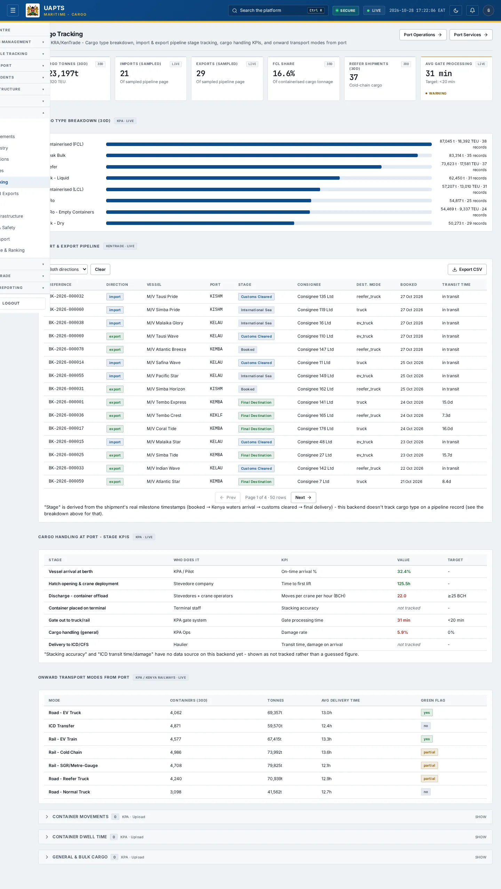
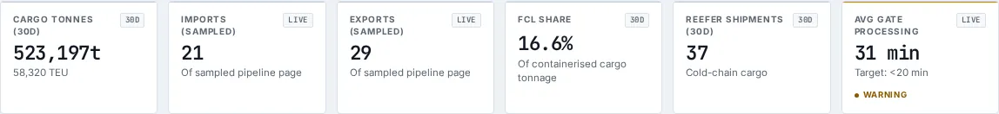

# Cargo Tracking

_Maritime › Cargo Tracking_ · Route `/maritime/cargo`

**Cargo Tracking** lets you see cargo type breakdown, import &amp; export pipeline stage tracking, cargo handling KPIs, and onward transport modes from port. Data on this page comes from KPA and KRA/KenTrade.

> 🎬 **Video tutorial:** _coming soon._  
> <!-- VIDEO-URL: maritime/cargo-tracking | paste the link here, e.g. [Watch the walkthrough](https://…) -->

## Highlights

- **6 headline tiles** — Cargo Tonnes (30d), Imports (sampled), Exports (sampled), FCL Share, Reefer Shipments (30d), Avg Gate Processing.
- **3 panels** — Import &amp; Export Pipeline, Cargo Handling at Port - Stage KPIs, Onward Transport Modes from Port.
- **Export to CSV** for the rows you are looking at (Analyst tier and above).
- **Filters and search** to narrow tables to what you need.
- Every figure is traceable to the data feed or upload template that supplies it — see [Data sources and feeds](#data-sources-and-feeds).

## Enabling and access

1. Sign in to UAPTS (see [How to access](../getting-started/how-to-access.md)).
2. In the left sidebar expand **Maritime** and click **Cargo Tracking**.
3. The page opens at `/maritime/cargo`. You can also reach it with the global search (**Ctrl + K**).

This page belongs to module **M07b · Maritime**. The route needs at least the **Operator** tier to open it. The sidebar and the global search only list pages your agency and role can open, and a link to a page you cannot reach sends you back to the Command Centre. If a page you expect is missing, ask your agency administrator to check your agency's [Module Access](../access-control/module-access.md).

## Page tour

### Headline tiles

| Tile | What it shows | Data from | Table → ingested via |
|---|---|---|---|
| **Cargo Tonnes (30d)** | — _(window: 30D)_ | `/aviation-maritime/maritime/cargo/summary/` | _CargoPipelineRecord, CargoTypeRecord_ → computed by UAPTS |
| **Imports (sampled)** | Of sampled pipeline page _(window: LIVE)_ | `/aviation-maritime/maritime/cargo/pipeline/` | _CargoPipelineRecord_ → computed by UAPTS |
| **Exports (sampled)** | Of sampled pipeline page _(window: LIVE)_ | `/aviation-maritime/maritime/cargo/pipeline/` | _CargoPipelineRecord_ → computed by UAPTS |
| **FCL Share** | Of containerised cargo tonnage _(window: 30D)_ | `/aviation-maritime/maritime/cargo/by-type/` | _CargoTypeRecord_ → no template yet |
| **Reefer Shipments (30d)** | Cold-chain cargo _(window: 30D)_ | `/aviation-maritime/maritime/cargo/by-type/` | _CargoTypeRecord_ → no template yet |
| **Avg Gate Processing** | Target: &lt;20 min _(window: LIVE)_ | `/aviation-maritime/maritime/cargo/handling-stage-kpis/` | _GateEvent_ → no template yet |

### Import &amp; Export Pipeline

Contains a table with the columns **Reference**, **Direction**, **Vessel**, **Port**, **Stage**, **Consignee**, **Dest. Mode**, **Booked**, **Transit Time**.

**Data from:** `/aviation-maritime/maritime/cargo/pipeline/`  
**Table → ingested via:** _CargoPipelineRecord_ → computed by UAPTS

### Cargo Handling at Port - Stage KPIs

Contains a table with the columns **Stage**, **Who Does It**, **KPI**, **Value**, **Target**.

**Data from:** `/aviation-maritime/maritime/cargo/handling-stage-kpis/`  
**Table → ingested via:** _CargoHandlingOperation_ → no template yet

### Onward Transport Modes from Port

Contains a table with the columns **Mode**, **Containers (30d)**, **Tonnes**, **Avg Delivery Time**, **Green Flag**.

**Data from:** `/aviation-maritime/maritime/cargo/onward-transport/`  
**Table → ingested via:** _OnwardTransportRecord_ → no template yet

## Working with this page

1. Open **Maritime → Cargo Tracking** from the sidebar.
2. Type in the **“Search…”** box to filter what is shown.
3. Use the **Both directions** drop-down to narrow the list. Choices include: Import, Export.
4. Click **Export CSV** to download the rows currently loaded (after filters). The button only appears for Analyst tier and above.

## Status and value meanings

These are the values the platform stores for the fields shown on this page (`value` followed by the label you see).

| Field | Table | Values |
|---|---|---|
| final destination mode | CargoPipelineRecord | `truck` · `ev_truck` · `reefer_truck` · `rail` · `icd_cfs` ICD / CFS |
| status | ContainerMovement | `incoming` · `stacking` · `delivered` · `outgoing` |

## Data sources and feeds

Every number and table on this page is read from the API endpoints below. The **Ingested via** column says how the underlying records get into UAPTS: a downloadable **upload template** (xlsx/CSV, loaded through the [Integration Hub](../integration-hub/upload-and-connect.md)), a **live feed** that pushes records to the ingest API, or — where neither exists yet — it is stated plainly.

| Endpoint | Records | Ingested via |
|---|---|---|
| `GET /aviation-maritime/maritime/bulk-cargo/` | Bulk Cargo Transactions | [`kpa-bulk-cargo-transactions`](../data-templates/kpa-bulk-cargo-transactions.xlsx) |
| `GET /aviation-maritime/maritime/cargo/by-type/` | _Aggregate of 1 tables (rows below)_ | — |
| ↳ CargoTypeRecord | Cargo Type Records | **No ingestion template yet** — populated by seed data or direct entry |
| `GET /aviation-maritime/maritime/cargo/handling-stage-kpis/` | _Aggregate of 4 tables (rows below)_ | — |
| ↳ CargoHandlingOperation | Cargo Handling Operations | **No ingestion template yet** — populated by seed data or direct entry |
| ↳ CraneOperationLog | Crane Operation Logs | **No ingestion template yet** — populated by seed data or direct entry |
| ↳ GateEvent | Gate Events | **No ingestion template yet** — populated by seed data or direct entry |
| ↳ VesselMovement | Vessel Movements | live feed `kpa-tos` (KPA TOS) |
| `GET /aviation-maritime/maritime/cargo/onward-transport/` | _Aggregate of 1 tables (rows below)_ | — |
| ↳ OnwardTransportRecord | Onward Transport Records | **No ingestion template yet** — populated by seed data or direct entry |
| `GET /aviation-maritime/maritime/cargo/pipeline/` | Cargo Pipeline Records | Computed by UAPTS from other data (no direct feed) |
| `GET /aviation-maritime/maritime/cargo/summary/` | _Aggregate of 4 tables (rows below)_ | — |
| ↳ CargoPipelineRecord | Cargo Pipeline Records | Computed by UAPTS from other data (no direct feed) |
| ↳ CargoTypeRecord | Cargo Type Records | **No ingestion template yet** — populated by seed data or direct entry |
| ↳ GateEvent | Gate Events | **No ingestion template yet** — populated by seed data or direct entry |
| ↳ OnwardTransportRecord | Onward Transport Records | **No ingestion template yet** — populated by seed data or direct entry |
| `GET /aviation-maritime/maritime/container-dwell/` | Container Dwell Records | [`kpa-container-dwell`](../data-templates/kpa-container-dwell.xlsx) |
| `GET /aviation-maritime/maritime/container-movements/` | Container Movements | [`kpa-container-movements`](../data-templates/kpa-container-movements.xlsx) |
| `GET /aviation-maritime/maritime/maritime-inspections/` | Maritime Inspections | [`kma-vessel-inspections`](../data-templates/kma-vessel-inspections.xlsx) |
| `GET /aviation-maritime/maritime/pollution-incidents/` | Marine Pollution Incidents | [`kma-marine-pollution-incidents`](../data-templates/kma-marine-pollution-incidents.xlsx) |
| `GET /aviation-maritime/maritime/vessel-calls/` | Vessel Calls | [`kpa-vessel-calls`](../data-templates/kpa-vessel-calls.xlsx) |

Full details of every template (columns, formats) are in the [Data sources catalogue](../reference/data-sources.md). Interactive API documentation is available at `/api/docs/`.

## Permissions

| Who | What they can do here |
|---|---|
| Public / read-only accounts | No access to this page. |
| Operator | View the page. |
| Analyst | View and **export CSV**. |
| Agency admin | Everything an analyst can do, plus the administrative capabilities listed in [Roles & Permissions](../access-control/roles-and-permissions.md). |
| Super admin | Sees every agency's data. |

**Agencies with the Maritime module:** full — SDT, KPA, KMA; selected pages only — KENHA, KRA, KENTRADE, KRC, NCTTCA, LAPSSET.

_Access is evaluated by the server from the baseline policy plus any agency overrides, so a super admin or agency admin may have changed it from the defaults above._

## Related topics

- [Overview](maritime-overview.md)
- [Vessel Movements](vessel-movements.md)
- [Vessel Registry](vessel-registry.md)
- [Port Operations](port-operations.md)
- [Port Services](port-services.md)
- [Imports and Exports](imports-and-exports.md)
- [Maritime overview](index.md)
- [Upload & Connect (Integration Hub)](../integration-hub/upload-and-connect.md)
- [Data sources catalogue](../reference/data-sources.md)

## On this page

- [Highlights](#highlights)
- [Enabling and access](#enabling-and-access)
- [Page tour](#page-tour)
- [Working with this page](#working-with-this-page)
- [Status and value meanings](#status-and-value-meanings)
- [Data sources and feeds](#data-sources-and-feeds)
- [Permissions](#permissions)
- [Related topics](#related-topics)

## Support

- **Your agency administrator** is the first contact for access, role and data-quality questions.
- **Data feeds, templates and API questions:** `api-support@uapts.go.ke` (include the `X-Request-ID` response header from a failing call).
- **Security concerns:** `security@uapts.go.ke`. Do not report suspected vulnerabilities publicly.
