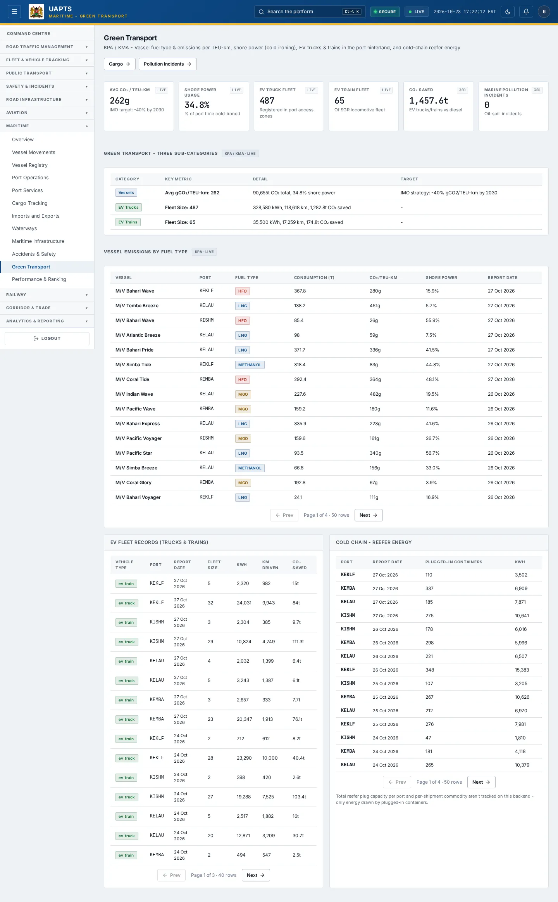
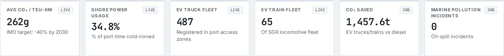
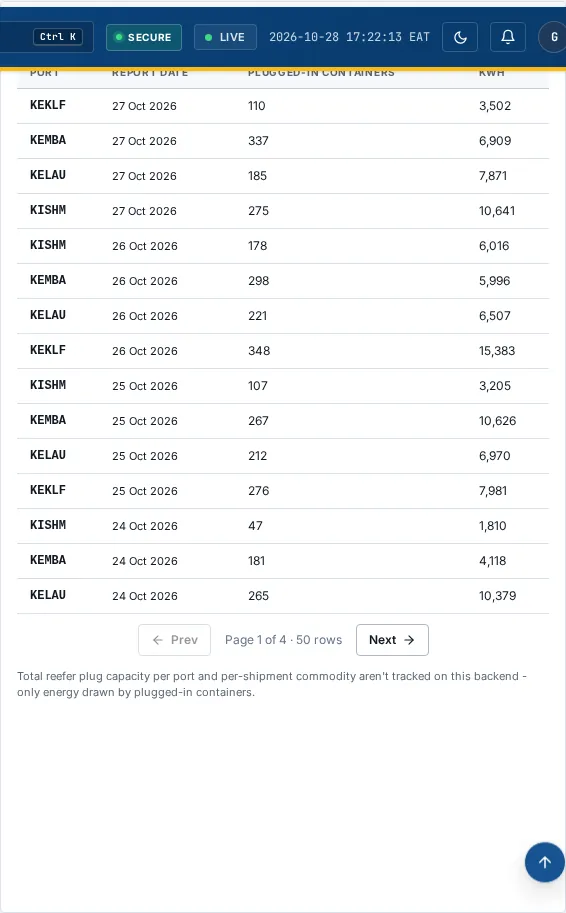

# Green Transport

_Maritime › Green Transport_ · Route `/maritime/green-transport`

**Green Transport** lets you see KPA / KMA - Vessel fuel type &amp; emissions per TEU-km, shore power (cold ironing), EV trucks &amp; trains in the port hinterland, and cold-chain reefer energy.

> 🎬 **Video tutorial:** _coming soon._  
> <!-- VIDEO-URL: maritime/green-transport | paste the link here, e.g. [Watch the walkthrough](https://…) -->

## Highlights

- **6 headline tiles** — Avg CO₂ / TEU-km, Shore Power Usage, EV Truck Fleet, EV Train Fleet, CO₂ Saved, Marine Pollution Incidents.
- **4 panels** — Green Transport - Three Sub-Categories, Vessel Emissions by Fuel Type, EV Fleet Records (Trucks &amp; Trains), Cold Chain - Reefer Energy.
- Every figure is traceable to the data feed or upload template that supplies it — see [Data sources and feeds](#data-sources-and-feeds).

## Enabling and access

1. Sign in to UAPTS (see [How to access](../getting-started/how-to-access.md)).
2. In the left sidebar expand **Maritime** and click **Green Transport**.
3. The page opens at `/maritime/green-transport`. You can also reach it with the global search (**Ctrl + K**).

This page belongs to module **M07b · Maritime**. The sidebar and the global search only list pages your agency and role can open, and a link to a page you cannot reach sends you back to the Command Centre. If a page you expect is missing, ask your agency administrator to check your agency's [Module Access](../access-control/module-access.md).

## Page tour

### Headline tiles

| Tile | What it shows | Data from | Table → ingested via |
|---|---|---|---|
| **Avg CO₂ / TEU-km** | IMO target: -40% by 2030 _(window: LIVE)_ | `/aviation-maritime/maritime/green-transport/mode-stats/`, `/aviation-maritime/maritime/green-transport/vessel-emissions/` | _VesselEmissionRecord_ → [`kma-vessel-emissions`](../data-templates/kma-vessel-emissions.xlsx) |
| **Shore Power Usage** | % of port time cold-ironed _(window: LIVE)_ | `/aviation-maritime/maritime/green-transport/mode-stats/`, `/aviation-maritime/maritime/green-transport/vessel-emissions/` | _VesselEmissionRecord_ → [`kma-vessel-emissions`](../data-templates/kma-vessel-emissions.xlsx) |
| **EV Truck Fleet** | Registered in port access zones _(window: LIVE)_ | `/aviation-maritime/maritime/green-transport/mode-stats/` | _EVFleetRecord_ → [`kpa-ev-fleet`](../data-templates/kpa-ev-fleet.xlsx) |
| **EV Train Fleet** | Of SGR locomotive fleet _(window: LIVE)_ | `/aviation-maritime/maritime/green-transport/mode-stats/` | _EVFleetRecord_ → [`kpa-ev-fleet`](../data-templates/kpa-ev-fleet.xlsx) |
| **CO₂ Saved** | EV trucks/trains vs diesel | `/aviation-maritime/maritime/green-transport/mode-stats/` | aggregate of several tables — see [per-table feeds](#data-sources-and-feeds) |
| **Marine Pollution Incidents** | Oil-spill incidents | `/aviation-maritime/maritime/green-transport/summary/` | _MarinePollutionIncident_ → [`kma-marine-pollution-incidents`](../data-templates/kma-marine-pollution-incidents.xlsx) |

### Green Transport - Three Sub-Categories

Contains a table with the columns **Category**, **Key Metric**, **Detail**, **Target**.

**Data from:** `/aviation-maritime/maritime/green-transport/mode-stats/`, `/aviation-maritime/maritime/green-transport/vessel-emissions/`  
**Table → ingested via:** _VesselEmissionRecord_ → [`kma-vessel-emissions`](../data-templates/kma-vessel-emissions.xlsx)

### Vessel Emissions by Fuel Type

Contains a table with the columns **Vessel**, **Port**, **Fuel Type**, **Consumption (t)**, **CO₂/TEU-km**, **Shore Power**, **Report Date**.

**Data from:** `/aviation-maritime/maritime/green-transport/vessel-emissions/`  
**Table → ingested via:** _VesselEmissionRecord_ → [`kma-vessel-emissions`](../data-templates/kma-vessel-emissions.xlsx)

### EV Fleet Records (Trucks &amp; Trains)

Contains a table with the columns **Vehicle Type**, **Port**, **Report Date**, **Fleet Size**, **kWh**, **km Driven**, **CO₂ Saved**.

**Data from:** `/aviation-maritime/maritime/green-transport/ev-fleet/`  
**Table → ingested via:** _EVFleetRecord_ → [`kpa-ev-fleet`](../data-templates/kpa-ev-fleet.xlsx)

### Cold Chain - Reefer Energy

Contains a table with the columns **Port**, **Report Date**, **Plugged-in Containers**, **kWh**.

**Data from:** `/aviation-maritime/maritime/green-transport/reefer-energy/`  
**Table → ingested via:** _ReeferEnergyRecord_ → [`kpa-reefer-energy`](../data-templates/kpa-reefer-energy.xlsx)

## Working with this page

1. Open **Maritime → Green Transport** from the sidebar.
2. Scroll down to move through the panels; every panel has a heading matching those in the Page tour.

## Status and value meanings

These are the values the platform stores for the fields shown on this page (`value` followed by the label you see).

| Field | Table | Values |
|---|---|---|
| vehicle type | EVFleetRecord | `ev_truck` · `ev_train` |
| fuel type | VesselEmissionRecord | `hfo` Heavy Fuel Oil · `mgo` Marine Gas Oil · `lng` · `methanol` · `zero_emission` Zero-emission |

## Data sources and feeds

Every number and table on this page is read from the API endpoints below. The **Ingested via** column says how the underlying records get into UAPTS: a downloadable **upload template** (xlsx/CSV, loaded through the [Integration Hub](../integration-hub/upload-and-connect.md)), a **live feed** that pushes records to the ingest API, or — where neither exists yet — it is stated plainly.

| Endpoint | Records | Ingested via |
|---|---|---|
| `GET /aviation-maritime/maritime/green-transport/ev-fleet/` | Ev Fleet Records | [`kpa-ev-fleet`](../data-templates/kpa-ev-fleet.xlsx) |
| `GET /aviation-maritime/maritime/green-transport/mode-stats/` | _Aggregate of 2 tables (rows below)_ | — |
| ↳ EVFleetRecord | Ev Fleet Records | [`kpa-ev-fleet`](../data-templates/kpa-ev-fleet.xlsx) |
| ↳ VesselEmissionRecord | Vessel Emission Records | [`kma-vessel-emissions`](../data-templates/kma-vessel-emissions.xlsx) |
| `GET /aviation-maritime/maritime/green-transport/reefer-energy/` | Reefer Energy Records | [`kpa-reefer-energy`](../data-templates/kpa-reefer-energy.xlsx) |
| `GET /aviation-maritime/maritime/green-transport/summary/` | _Aggregate of 5 tables (rows below)_ | — |
| ↳ EVFleetRecord | Ev Fleet Records | [`kpa-ev-fleet`](../data-templates/kpa-ev-fleet.xlsx) |
| ↳ MarinePollutionIncident | Marine Pollution Incidents | [`kma-marine-pollution-incidents`](../data-templates/kma-marine-pollution-incidents.xlsx) |
| ↳ MaritimeIncident | Maritime Incidents | [`kma-marine-incidents`](../data-templates/kma-marine-incidents.xlsx) |
| ↳ ReeferEnergyRecord | Reefer Energy Records | [`kpa-reefer-energy`](../data-templates/kpa-reefer-energy.xlsx) |
| ↳ VesselEmissionRecord | Vessel Emission Records | [`kma-vessel-emissions`](../data-templates/kma-vessel-emissions.xlsx) |
| `GET /aviation-maritime/maritime/green-transport/vessel-emissions/` | Vessel Emission Records | [`kma-vessel-emissions`](../data-templates/kma-vessel-emissions.xlsx) |

Full details of every template (columns, formats) are in the [Data sources catalogue](../reference/data-sources.md). Interactive API documentation is available at `/api/docs/`.

## Permissions

| Who | What they can do here |
|---|---|
| Public / read-only accounts | View the page where the module is enabled for their agency (read-only). |
| Operator | View the page. |
| Analyst | View and **export CSV**. |
| Agency admin | Everything an analyst can do, plus the administrative capabilities listed in [Roles & Permissions](../access-control/roles-and-permissions.md). |
| Super admin | Sees every agency's data. |

**Agencies with the Maritime module:** full — SDT, KPA, KMA; selected pages only — KENHA, KRA, KENTRADE, KRC, NCTTCA, LAPSSET.

_Access is evaluated by the server from the baseline policy plus any agency overrides, so a super admin or agency admin may have changed it from the defaults above._

## Related topics

- [Overview](maritime-overview.md)
- [Vessel Movements](vessel-movements.md)
- [Vessel Registry](vessel-registry.md)
- [Port Operations](port-operations.md)
- [Port Services](port-services.md)
- [Cargo Tracking](cargo-tracking.md)
- [Maritime overview](index.md)
- [Upload & Connect (Integration Hub)](../integration-hub/upload-and-connect.md)
- [Data sources catalogue](../reference/data-sources.md)

## On this page

- [Highlights](#highlights)
- [Enabling and access](#enabling-and-access)
- [Page tour](#page-tour)
- [Working with this page](#working-with-this-page)
- [Status and value meanings](#status-and-value-meanings)
- [Data sources and feeds](#data-sources-and-feeds)
- [Permissions](#permissions)
- [Related topics](#related-topics)

## Support

- **Your agency administrator** is the first contact for access, role and data-quality questions.
- **Data feeds, templates and API questions:** `api-support@uapts.go.ke` (include the `X-Request-ID` response header from a failing call).
- **Security concerns:** `security@uapts.go.ke`. Do not report suspected vulnerabilities publicly.
