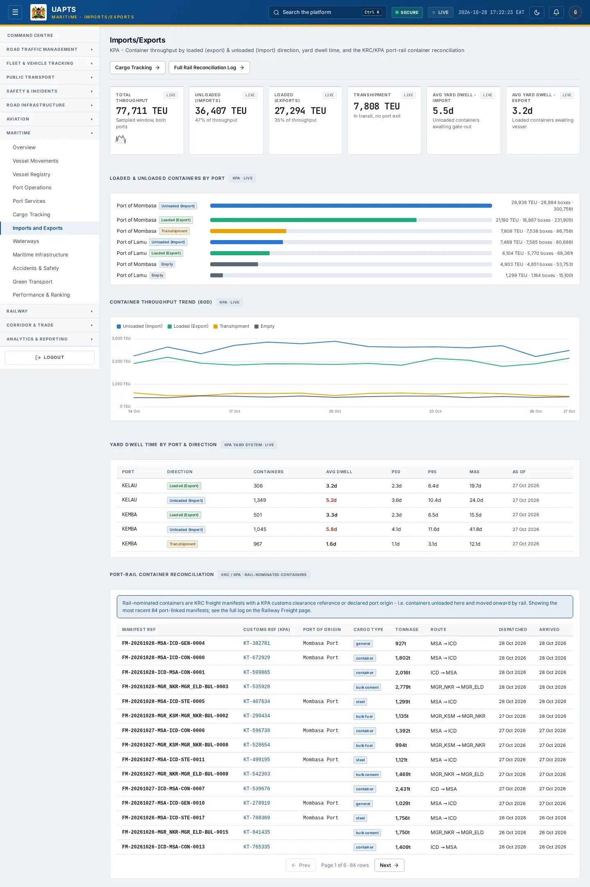
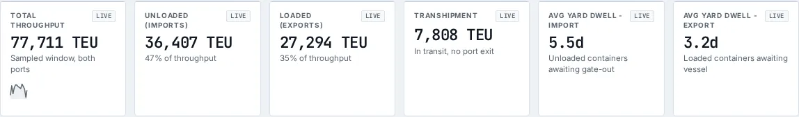

# Imports and Exports

_Maritime › Imports and Exports_ · Route `/maritime/imports-exports`

**Imports/Exports** lets you see container throughput by loaded (export) &amp; unloaded (import) direction, yard dwell time, and the KRC/KPA port-rail container reconciliation. Data on this page comes from KPA.

> 🎬 **Video tutorial:** _coming soon._  
> <!-- VIDEO-URL: maritime/imports-and-exports | paste the link here, e.g. [Watch the walkthrough](https://…) -->

## Highlights

- **6 headline tiles** — Total Throughput, Unloaded (Imports), Loaded (Exports), Transhipment, Avg Yard Dwell - Import, Avg Yard Dwell - Export.
- **3 panels** — Container Throughput Trend (60d), Yard Dwell Time by Port &amp; Direction, Port-Rail Container Reconciliation.
- Every figure is traceable to the data feed or upload template that supplies it — see [Data sources and feeds](#data-sources-and-feeds).

## Enabling and access

1. Sign in to UAPTS (see [How to access](../getting-started/how-to-access.md)).
2. In the left sidebar expand **Maritime** and click **Imports and Exports**.
3. The page opens at `/maritime/imports-exports`. You can also reach it with the global search (**Ctrl + K**).

This page belongs to module **M07b · Maritime**. The route needs at least the **Operator** tier to open it. The sidebar and the global search only list pages your agency and role can open, and a link to a page you cannot reach sends you back to the Command Centre. If a page you expect is missing, ask your agency administrator to check your agency's [Module Access](../access-control/module-access.md).

## Page tour

### Headline tiles

| Tile | What it shows | Data from | Table → ingested via |
|---|---|---|---|
| **Total Throughput** | Sampled window, both ports _(window: LIVE)_ | `/aviation-maritime/maritime/container-throughput/`, `/aviation-maritime/maritime/container-throughput/trend/` | _ContainerThroughput_ → computed by UAPTS |
| **Unloaded (Imports)** | — _(window: LIVE)_ | `/aviation-maritime/maritime/container-throughput/` | _ContainerThroughput_ → computed by UAPTS |
| **Loaded (Exports)** | — _(window: LIVE)_ | `/aviation-maritime/maritime/container-throughput/` | _ContainerThroughput_ → computed by UAPTS |
| **Transhipment** | In transit, no port exit _(window: LIVE)_ | `/aviation-maritime/maritime/container-throughput/` | _ContainerThroughput_ → computed by UAPTS |
| **Avg Yard Dwell - Import** | Unloaded containers awaiting gate-out _(window: LIVE)_ | `/aviation-maritime/maritime/yard-dwell/` | _YardDwell_ → no template yet |
| **Avg Yard Dwell - Export** | Loaded containers awaiting vessel _(window: LIVE)_ | `/aviation-maritime/maritime/yard-dwell/` | _YardDwell_ → no template yet |

### Container Throughput Trend (60d)

Contains a chart.

**Data from:** `/aviation-maritime/maritime/container-throughput/trend/`, `/aviation-maritime/maritime/yard-dwell/`  
**Table → ingested via:** _ContainerThroughput, YardDwell_ → computed by UAPTS

### Yard Dwell Time by Port &amp; Direction

Contains a table with the columns **Port**, **Direction**, **Containers**, **Avg Dwell**, **P50**, **P95**, **Max**, **As of**.

**Data from:** `/aviation-maritime/maritime/yard-dwell/`  
**Table → ingested via:** _YardDwell_ → no template yet

### Port-Rail Container Reconciliation

Contains a table with the columns **Manifest Ref**, **Customs Ref (KPA)**, **Port of Origin**, **Cargo Type**, **Tonnage**, **Route**, **Dispatched**, **Arrived**.

**Data from:** `/railway/freight/`  
**Table → ingested via:** _FreightManifest_ → no template yet

## Working with this page

1. Open **Maritime → Imports and Exports** from the sidebar.
2. Scroll down to move through the panels; every panel has a heading matching those in the Page tour.

## Status and value meanings

These are the values the platform stores for the fields shown on this page (`value` followed by the label you see).

| Field | Table | Values |
|---|---|---|
| cargo type | FreightManifest | `container` · `bulk_fuel` · `bulk_cement` Bulk cement / clinker · `grain` · `general` General goods · `vehicle` Vehicles · `steel` Steel / metals · `other` |

## Data sources and feeds

Every number and table on this page is read from the API endpoints below. The **Ingested via** column says how the underlying records get into UAPTS: a downloadable **upload template** (xlsx/CSV, loaded through the [Integration Hub](../integration-hub/upload-and-connect.md)), a **live feed** that pushes records to the ingest API, or — where neither exists yet — it is stated plainly.

| Endpoint | Records | Ingested via |
|---|---|---|
| `GET /aviation-maritime/maritime/container-throughput/` | Container Throughputs | Computed by UAPTS from other data (no direct feed) |
| `GET /aviation-maritime/maritime/container-throughput/by-port/` | Container Throughputs | Computed by UAPTS from other data (no direct feed) |
| `GET /aviation-maritime/maritime/container-throughput/trend/` | Container Throughputs | Computed by UAPTS from other data (no direct feed) |
| `GET /aviation-maritime/maritime/yard-dwell/` | Yard Dwells | **No ingestion template yet** — populated by seed data or direct entry |
| `GET /railway/freight/` | Freight Manifests | **No ingestion template yet** — populated by seed data or direct entry |

Full details of every template (columns, formats) are in the [Data sources catalogue](../reference/data-sources.md). Interactive API documentation is available at `/api/docs/`.

## Permissions

| Who | What they can do here |
|---|---|
| Public / read-only accounts | No access to this page. |
| Operator | View the page. |
| Analyst | View and **export CSV**. |
| Agency admin | Everything an analyst can do, plus the administrative capabilities listed in [Roles & Permissions](../access-control/roles-and-permissions.md). |
| Super admin | Sees every agency's data. |

**Agencies with the Maritime module:** full — SDT, KPA, KMA; selected pages only — KENHA, KRA, KENTRADE, KRC, NCTTCA, LAPSSET.

_Access is evaluated by the server from the baseline policy plus any agency overrides, so a super admin or agency admin may have changed it from the defaults above._

## Related topics

- [Overview](maritime-overview.md)
- [Vessel Movements](vessel-movements.md)
- [Vessel Registry](vessel-registry.md)
- [Port Operations](port-operations.md)
- [Port Services](port-services.md)
- [Cargo Tracking](cargo-tracking.md)
- [Maritime overview](index.md)
- [Upload & Connect (Integration Hub)](../integration-hub/upload-and-connect.md)
- [Data sources catalogue](../reference/data-sources.md)

## On this page

- [Highlights](#highlights)
- [Enabling and access](#enabling-and-access)
- [Page tour](#page-tour)
- [Working with this page](#working-with-this-page)
- [Status and value meanings](#status-and-value-meanings)
- [Data sources and feeds](#data-sources-and-feeds)
- [Permissions](#permissions)
- [Related topics](#related-topics)

## Support

- **Your agency administrator** is the first contact for access, role and data-quality questions.
- **Data feeds, templates and API questions:** `api-support@uapts.go.ke` (include the `X-Request-ID` response header from a failing call).
- **Security concerns:** `security@uapts.go.ke`. Do not report suspected vulnerabilities publicly.
