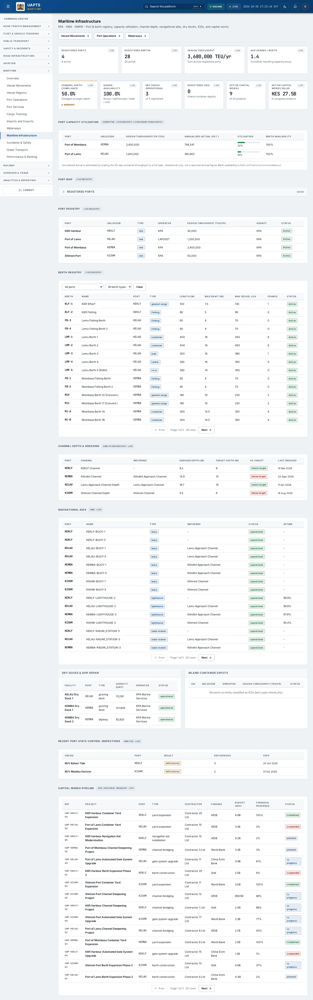
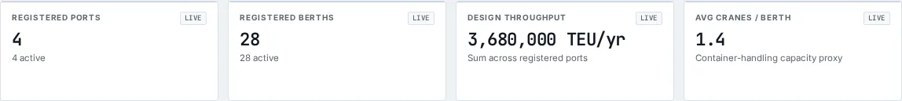
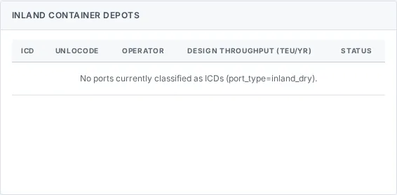

# Maritime Infrastructure

_Maritime › Maritime Infrastructure_ · Route `/maritime/infrastructure`

**Maritime Infrastructure** lets you see port &amp; berth registry, capacity utilisation, channel depth, navigational aids, dry docks, ICDs, and capital works. Data on this page comes from KPA, KMA and KMFRI.

> 🎬 **Video tutorial:** _coming soon._  
> <!-- VIDEO-URL: maritime/maritime-infrastructure | paste the link here, e.g. [Watch the walkthrough](https://…) -->

## Highlights

- **10 headline tiles** — Registered Ports, Registered Berths, Design Throughput, Avg Cranes / Berth, Channel Depth Compliance, Navaid Availability….
- **10 panels** — Port Capacity Utilisation, Port Map, Port Registry, Berth Registry, Channel Depth &amp; Dredging, Navigational Aids….
- An **interactive map** with a legend, full-screen, locate-me and base-map controls.
- **Refreshes itself every 120 seconds**, so you do not need to reload the page.
- **Filters and search** to narrow tables to what you need.
- Every figure is traceable to the data feed or upload template that supplies it — see [Data sources and feeds](#data-sources-and-feeds).

## Enabling and access

1. Sign in to UAPTS (see [How to access](../getting-started/how-to-access.md)).
2. In the left sidebar expand **Maritime** and click **Maritime Infrastructure**.
3. The page opens at `/maritime/infrastructure`. You can also reach it with the global search (**Ctrl + K**).

This page belongs to module **M07b · Maritime**. The sidebar and the global search only list pages your agency and role can open, and a link to a page you cannot reach sends you back to the Command Centre. If a page you expect is missing, ask your agency administrator to check your agency's [Module Access](../access-control/module-access.md).

## Page tour

### Headline tiles

| Tile | What it shows | Data from | Table → ingested via |
|---|---|---|---|
| **Registered Ports** | — _(window: LIVE)_ | `/aviation-maritime/maritime/ports/` | _Port_ → [`kma-port-register`](../data-templates/kma-port-register.xlsx) live feed `kpa-tos` |
| **Registered Berths** | — _(window: LIVE)_ | `/aviation-maritime/maritime/berths/` | _Berth_ → [`kpa-berth-register`](../data-templates/kpa-berth-register.xlsx) |
| **Design Throughput** | Sum across registered ports _(window: LIVE)_ | `/aviation-maritime/maritime/ports/` | _Port_ → [`kma-port-register`](../data-templates/kma-port-register.xlsx) live feed `kpa-tos` |
| **Avg Cranes / Berth** | Container-handling capacity proxy _(window: LIVE)_ | `/aviation-maritime/maritime/berths/` | _Berth_ → [`kpa-berth-register`](../data-templates/kpa-berth-register.xlsx) |
| **Channel Depth Compliance** | Dredged vs target depth _(window: LIVE)_ | `/aviation-maritime/maritime/infrastructure/channels/` | _Channel_ → no template yet |
| **Navaid Availability** | Buoys / lighthouses / radar / VHF _(window: LIVE)_ | `/aviation-maritime/maritime/infrastructure/navaids/` | _NavigationAid_ → no template yet |
| **Dry Docks Operational** | — _(window: LIVE)_ | `/aviation-maritime/maritime/infrastructure/dry-docks/` | _DryDock_ → no template yet |
| **Registered ICDs** | Inland container depots _(window: LIVE)_ | `/aviation-maritime/maritime/infrastructure/icds/` | _Port_ → [`kma-port-register`](../data-templates/kma-port-register.xlsx) live feed `kpa-tos` |
| **Active Capital Works** | — _(window: LIVE)_ | `/aviation-maritime/maritime/infrastructure/capital-works/` | _CapitalWorksProject_ → no template yet |
| **Active Capital Works Value** | In-progress projects _(window: LIVE)_ | `/aviation-maritime/maritime/infrastructure/capital-works/` | _CapitalWorksProject_ → no template yet |

### Port Capacity Utilisation

Contains a table with the columns **Port**, **UNLOCODE**, **Design Throughput/yr (TEU)**, **Annualised Actual (est.)**, **Utilisation**, **Berth Availability**.

**Data from:** `/aviation-maritime/maritime/container-throughput/by-port/`, `/aviation-maritime/maritime/ports/`  
**Table → ingested via:** _ContainerThroughput, Port_ → [`kma-port-register`](../data-templates/kma-port-register.xlsx) live feed `kpa-tos`

### Port Map

Contains an interactive map.

### Port Registry

Contains a table with the columns **Port**, **UNLOCODE**, **Type**, **Operator**, **Design Throughput (TEU/yr)**, **Agency**, **Status**.

**Data from:** `/aviation-maritime/maritime/ports/`  
**Table → ingested via:** _Port_ → [`kma-port-register`](../data-templates/kma-port-register.xlsx) live feed `kpa-tos`

### Berth Registry

Contains a table with the columns **Berth**, **Name**, **Port**, **Type**, **Length (m)**, **Max Draft (m)**, **Max Vessel LOA**, **Cranes**, **Status**.

**Data from:** `/aviation-maritime/maritime/berths/`, `/aviation-maritime/maritime/ports/`  
**Table → ingested via:** _Berth, Port_ → [`kma-port-register`](../data-templates/kma-port-register.xlsx) [`kpa-berth-register`](../data-templates/kpa-berth-register.xlsx) live feed `kpa-tos`

### Channel Depth &amp; Dredging

Contains a table with the columns **Port**, **Channel**, **Waterway**, **Dredged Depth (m)**, **Target Depth (m)**, **vs Target**, **Last Dredged**.

**Data from:** `/aviation-maritime/maritime/infrastructure/channels/`  
**Table → ingested via:** _Channel_ → no template yet

### Navigational Aids

Contains a table with the columns **Port**, **Name**, **Type**, **Waterway**, **Status**, **Uptime**.

**Data from:** `/aviation-maritime/maritime/infrastructure/navaids/`  
**Table → ingested via:** _NavigationAid_ → no template yet

### Dry Docks &amp; Ship Repair

Contains a table with the columns **Facility**, **Port**, **Type**, **Capacity (DWT)**, **Operator**, **Status**.

**Data from:** `/aviation-maritime/maritime/infrastructure/dry-docks/`, `/aviation-maritime/maritime/infrastructure/icds/`  
**Table → ingested via:** _DryDock, Port_ → [`kma-port-register`](../data-templates/kma-port-register.xlsx) live feed `kpa-tos`

### Inland Container Depots

Contains a table with the columns **ICD**, **UNLOCODE**, **Operator**, **Design Throughput (TEU/yr)**, **Status**.

**Data from:** `/aviation-maritime/maritime/infrastructure/icds/`, `/aviation-maritime/maritime/maritime-inspections/`, `/aviation-maritime/maritime/ports/`  
**Table → ingested via:** _Port, MaritimeInspection_ → [`kma-port-register`](../data-templates/kma-port-register.xlsx) [`kma-vessel-inspections`](../data-templates/kma-vessel-inspections.xlsx) live feed `kpa-tos`

### Recent Port State Control Inspections

Contains a table with the columns **Vessel**, **Port**, **Result**, **Deficiencies**, **Date**.

**Data from:** `/aviation-maritime/maritime/maritime-inspections/`  
**Table → ingested via:** _MaritimeInspection_ → [`kma-vessel-inspections`](../data-templates/kma-vessel-inspections.xlsx)

### Capital Works Pipeline

Contains a table with the columns **Ref**, **Project**, **Port**, **Type**, **Contractor**, **Funding**, **Budget (KES)**, **Financial Progress**, **Status**.

**Data from:** `/aviation-maritime/maritime/infrastructure/capital-works/`  
**Table → ingested via:** _CapitalWorksProject_ → no template yet

## Working with this page

1. Open **Maritime → Maritime Infrastructure** from the sidebar.
2. Wait for the page to finish loading. It re-fetches its data every **120 s**; the figures you see are the latest the platform holds, not a one-time snapshot.
3. Use the **All ports** drop-down to narrow the list. Choices include: ().
4. Use the **All berth types** drop-down to narrow the list. Choices include: Container, General Cargo, Bulk, Tanker, Fishing, Ro-Ro.
5. On the map, drag to pan and scroll (or pinch) to zoom. Click a marker or line for its details. Use the map toolbar to go full-screen, centre on your location, reset the view or switch the base map; click the legend chip to expand it.

## Status and value meanings

These are the values the platform stores for the fields shown on this page (`value` followed by the label you see).

| Field | Table | Values |
|---|---|---|
| berth type | Berth | `container` Container terminal · `general_cargo` · `bulk` Bulk cargo · `tanker` Tanker / liquid · `fishing` · `ro_ro` RoRo · `cruise` |
| operational status | Berth | `operational` · `limited` · `maintenance` Under maintenance · `closed` |
| project type | CapitalWorksProject | `berth_construction` · `channel_dredging` · `yard_expansion` · `gate_system_upgrade` · `navigation_aid_installation` · `other` |
| status | CapitalWorksProject | `planned` · `in_progress` · `completed` · `suspended` |
| dock type | DryDock | `graving_dock` · `floating_dock` · `slipway` |
| operational status | DryDock | `operational` · `under_maintenance` · `decommissioned` |
| port type | Port | `sea` Sea port · `inland_dry` Inland container depot · `oil` Oil terminal · `fishing` Fishing harbour · `marina` · `ferry` Ferry terminal / landing |
| aid type | NavigationAid | `buoy` Navigation buoy · `lighthouse` · `lightvessel` · `radar_station` · `vhf_station` VHF radio station |
| operational status | NavigationAid | `operational` · `non_operational` Non-operational · `maintenance` Under maintenance |

## Data sources and feeds

Every number and table on this page is read from the API endpoints below. The **Ingested via** column says how the underlying records get into UAPTS: a downloadable **upload template** (xlsx/CSV, loaded through the [Integration Hub](../integration-hub/upload-and-connect.md)), a **live feed** that pushes records to the ingest API, or — where neither exists yet — it is stated plainly.

| Endpoint | Records | Ingested via |
|---|---|---|
| `GET /aviation-maritime/maritime/berths/` | Berths | [`kpa-berth-register`](../data-templates/kpa-berth-register.xlsx) |
| `GET /aviation-maritime/maritime/container-throughput/by-port/` | Container Throughputs | Computed by UAPTS from other data (no direct feed) |
| `GET /aviation-maritime/maritime/infrastructure/capital-works/` | Capital Works Projects | **No ingestion template yet** — populated by seed data or direct entry |
| `GET /aviation-maritime/maritime/infrastructure/channels/` | Channels | **No ingestion template yet** — populated by seed data or direct entry |
| `GET /aviation-maritime/maritime/infrastructure/dry-docks/` | Dry Docks | **No ingestion template yet** — populated by seed data or direct entry |
| `GET /aviation-maritime/maritime/infrastructure/icds/` | Ports | [`kma-port-register`](../data-templates/kma-port-register.xlsx) live feed `kpa-tos` (KPA TOS) |
| `GET /aviation-maritime/maritime/infrastructure/navaids/` | Navigation Aids | **No ingestion template yet** — populated by seed data or direct entry |
| `GET /aviation-maritime/maritime/infrastructure/summary/` | _Aggregate of 6 tables (rows below)_ | — |
| ↳ CapitalWorksProject | Capital Works Projects | **No ingestion template yet** — populated by seed data or direct entry |
| ↳ Channel | Channels | **No ingestion template yet** — populated by seed data or direct entry |
| ↳ DryDock | Dry Docks | **No ingestion template yet** — populated by seed data or direct entry |
| ↳ NavigationAid | Navigation Aids | **No ingestion template yet** — populated by seed data or direct entry |
| ↳ Port | Ports | [`kma-port-register`](../data-templates/kma-port-register.xlsx) live feed `kpa-tos` (KPA TOS) |
| ↳ Vessel | Vessels | [`kma-vessel-registry`](../data-templates/kma-vessel-registry.xlsx) live feed `kpa-vts` (KPA VTS) live feed `kpa-tos` (KPA TOS) |
| `GET /aviation-maritime/maritime/maritime-inspections/` | Maritime Inspections | [`kma-vessel-inspections`](../data-templates/kma-vessel-inspections.xlsx) |
| `GET /aviation-maritime/maritime/ports/` | Ports | [`kma-port-register`](../data-templates/kma-port-register.xlsx) live feed `kpa-tos` (KPA TOS) |

Full details of every template (columns, formats) are in the [Data sources catalogue](../reference/data-sources.md). Interactive API documentation is available at `/api/docs/`.

## Permissions

| Who | What they can do here |
|---|---|
| Public / read-only accounts | View the page where the module is enabled for their agency (read-only). |
| Operator | View the page. |
| Analyst | View and **export CSV**. |
| Agency admin | Everything an analyst can do, plus the administrative capabilities listed in [Roles & Permissions](../access-control/roles-and-permissions.md). |
| Super admin | Sees every agency's data. |

**Agencies with the Maritime module:** full — SDT, KPA, KMA; selected pages only — KENHA, KRA, KENTRADE, KRC, NCTTCA, LAPSSET.

_Access is evaluated by the server from the baseline policy plus any agency overrides, so a super admin or agency admin may have changed it from the defaults above._

## Related topics

- [Overview](maritime-overview.md)
- [Vessel Movements](vessel-movements.md)
- [Vessel Registry](vessel-registry.md)
- [Port Operations](port-operations.md)
- [Port Services](port-services.md)
- [Cargo Tracking](cargo-tracking.md)
- [Maritime overview](index.md)
- [Upload & Connect (Integration Hub)](../integration-hub/upload-and-connect.md)
- [Data sources catalogue](../reference/data-sources.md)

## On this page

- [Highlights](#highlights)
- [Enabling and access](#enabling-and-access)
- [Page tour](#page-tour)
- [Working with this page](#working-with-this-page)
- [Status and value meanings](#status-and-value-meanings)
- [Data sources and feeds](#data-sources-and-feeds)
- [Permissions](#permissions)
- [Related topics](#related-topics)

## Support

- **Your agency administrator** is the first contact for access, role and data-quality questions.
- **Data feeds, templates and API questions:** `api-support@uapts.go.ke` (include the `X-Request-ID` response header from a failing call).
- **Security concerns:** `security@uapts.go.ke`. Do not report suspected vulnerabilities publicly.
