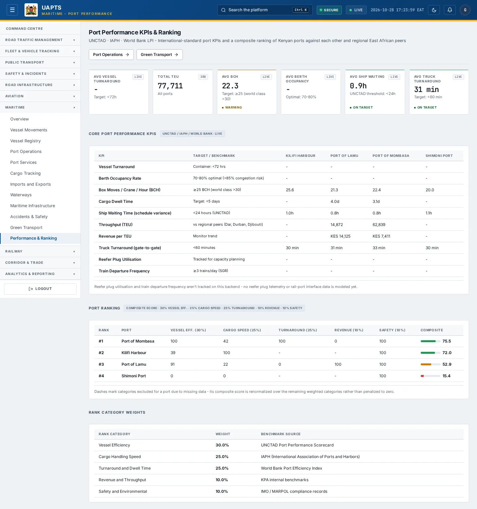
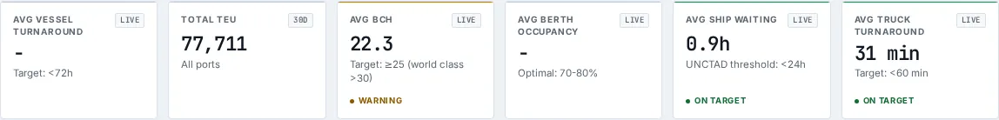

# Performance & Ranking

_Maritime › Performance & Ranking_ · Route `/maritime/performance`

**Port Performance KPIs & Ranking** lets you see international-standard port KPIs and a composite ranking of Kenyan ports against each other and regional East African peers. Data on this page comes from UNCTAD, IAPH and World Bank LPI.

> 🎬 **Video tutorial:** _coming soon._  
> <!-- VIDEO-URL: maritime/performance-and-ranking | paste the link here, e.g. [Watch the walkthrough](https://…) -->

## Highlights

- **6 headline tiles** — Avg Vessel Turnaround, Total TEU, Avg BCH, Avg Berth Occupancy, Avg Ship Waiting, Avg Truck Turnaround.
- **3 panels** — Core Port Performance KPIs, Port Ranking, Rank Category Weights.
- Every figure is traceable to the data feed or upload template that supplies it — see [Data sources and feeds](#data-sources-and-feeds).

## Enabling and access

1. Sign in to UAPTS (see [How to access](../getting-started/how-to-access.md)).
2. In the left sidebar expand **Maritime** and click **Performance & Ranking**.
3. The page opens at `/maritime/performance`. You can also reach it with the global search (**Ctrl + K**).

This page belongs to module **M07b · Maritime**. The sidebar and the global search only list pages your agency and role can open, and a link to a page you cannot reach sends you back to the Command Centre. If a page you expect is missing, ask your agency administrator to check your agency's [Module Access](../access-control/module-access.md).

## Page tour

### Headline tiles

| Tile | What it shows | Data from | Table → ingested via |
|---|---|---|---|
| **Avg Vessel Turnaround** | Target: &lt;72h _(window: LIVE)_ | `/aviation-maritime/maritime/performance/summary/` | _Vessel, VesselCall, VesselEmissionRecord_ → [`kma-vessel-emissions`](../data-templates/kma-vessel-emissions.xlsx) [`kma-vessel-registry`](../data-templates/kma-vessel-registry.xlsx) [`kpa-vessel-calls`](../data-templates/kpa-vessel-calls.xlsx) live feed `kpa-vts` live feed `kpa-tos` |
| **Total TEU** | All ports | `/aviation-maritime/maritime/performance/summary/` | _Port, PortFinancialRecord_ → [`kma-port-register`](../data-templates/kma-port-register.xlsx) live feed `kpa-tos` |
| **Avg BCH** | Target: ≥25 (world class &gt;30) _(window: LIVE)_ | `/aviation-maritime/maritime/performance/summary/` | aggregate of several tables — see [per-table feeds](#data-sources-and-feeds) |
| **Avg Berth Occupancy** | Optimal: 70-80% _(window: LIVE)_ | `/aviation-maritime/maritime/performance/summary/` | _Berth_ → [`kpa-berth-register`](../data-templates/kpa-berth-register.xlsx) |
| **Avg Ship Waiting** | UNCTAD threshold: &lt;24h _(window: LIVE)_ | `/aviation-maritime/maritime/performance/kpis/` | aggregate of several tables — see [per-table feeds](#data-sources-and-feeds) |
| **Avg Truck Turnaround** | Target: &lt;60 min _(window: LIVE)_ | `/aviation-maritime/maritime/performance/kpis/` | aggregate of several tables — see [per-table feeds](#data-sources-and-feeds) |

### Core Port Performance KPIs

Contains a table with the columns **KPI**, **Target / Benchmark**.

**Data from:** `/aviation-maritime/maritime/performance/kpis/`, `/aviation-maritime/maritime/performance/ranking/`  
**Table → ingested via:** _AirportPerformanceRecord, AtmPerformanceRecord, Port_ → [`kaa-airport-performance`](../data-templates/kaa-airport-performance.xlsx) [`kcaa-atm-performance`](../data-templates/kcaa-atm-performance.xlsx) [`kma-port-register`](../data-templates/kma-port-register.xlsx) live feed `kpa-tos`

### Port Ranking

Contains a table with the columns **Rank**, **Port**, **Vessel Eff. (30%)**, **Cargo Speed (25%)**, **Turnaround (25%)**, **Revenue (10%)**, **Safety (10%)**, **Composite**.

**Data from:** `/aviation-maritime/maritime/performance/ranking/`  
**Table → ingested via:** _Port, PortFinancialRecord_ → [`kma-port-register`](../data-templates/kma-port-register.xlsx) live feed `kpa-tos`

### Rank Category Weights

Contains a table with the columns **Rank Category**, **Weight**, **Benchmark Source**.

## Working with this page

1. Open **Maritime → Performance & Ranking** from the sidebar.
2. Scroll down to move through the panels; every panel has a heading matching those in the Page tour.

## Data sources and feeds

Every number and table on this page is read from the API endpoints below. The **Ingested via** column says how the underlying records get into UAPTS: a downloadable **upload template** (xlsx/CSV, loaded through the [Integration Hub](../integration-hub/upload-and-connect.md)), a **live feed** that pushes records to the ingest API, or — where neither exists yet — it is stated plainly.

| Endpoint | Records | Ingested via |
|---|---|---|
| `GET /aviation-maritime/maritime/performance/kpis/` | _Aggregate of 1 tables (rows below)_ | — |
| ↳ GateEvent | Gate Events | **No ingestion template yet** — populated by seed data or direct entry |
| `GET /aviation-maritime/maritime/performance/ranking/` | _Aggregate of 51 tables (rows below)_ | — |
| ↳ AirCargoStat | Air Cargo Stats | [`kaa-air-cargo-statistics`](../data-templates/kaa-air-cargo-statistics.xlsx) |
| ↳ AirOperatorCertificate | Air Operator Certificates | [`kcaa-aoc-register`](../data-templates/kcaa-aoc-register.xlsx) |
| ↳ Aircraft | Aircrafts | [`kcaa-aircraft-register`](../data-templates/kcaa-aircraft-register.xlsx) |
| ↳ Airline | Airlines | [`kcaa-airline-register`](../data-templates/kcaa-airline-register.xlsx) |
| ↳ Airport | Airports | [`kaa-airport-register`](../data-templates/kaa-airport-register.xlsx) live feed `kaa-aodb` (KAA AODB) |
| ↳ AirportPerformanceRecord | Airport Performance Records | [`kaa-airport-performance`](../data-templates/kaa-airport-performance.xlsx) |
| ↳ AtmPerformanceRecord | Atm Performance Records | [`kcaa-atm-performance`](../data-templates/kcaa-atm-performance.xlsx) |
| ↳ AviationCapitalWorksProject | Aviation Capital Works Projects | **No ingestion template yet** — populated by seed data or direct entry |
| ↳ AviationFacility | Aviation Facilitys | **No ingestion template yet** — populated by seed data or direct entry |
| ↳ AviationLicence | Aviation Licences | **No ingestion template yet** — populated by seed data or direct entry |
| ↳ AviationNavigationAid | Aviation Navigation Aids | **No ingestion template yet** — populated by seed data or direct entry |
| ↳ Berth | Berths | [`kpa-berth-register`](../data-templates/kpa-berth-register.xlsx) |
| `GET /aviation-maritime/maritime/performance/summary/` | _Aggregate of 51 tables (rows below)_ | — |
| ↳ AirCargoStat | Air Cargo Stats | [`kaa-air-cargo-statistics`](../data-templates/kaa-air-cargo-statistics.xlsx) |
| ↳ AirOperatorCertificate | Air Operator Certificates | [`kcaa-aoc-register`](../data-templates/kcaa-aoc-register.xlsx) |
| ↳ Aircraft | Aircrafts | [`kcaa-aircraft-register`](../data-templates/kcaa-aircraft-register.xlsx) |
| ↳ Airline | Airlines | [`kcaa-airline-register`](../data-templates/kcaa-airline-register.xlsx) |
| ↳ Airport | Airports | [`kaa-airport-register`](../data-templates/kaa-airport-register.xlsx) live feed `kaa-aodb` (KAA AODB) |
| ↳ AirportPerformanceRecord | Airport Performance Records | [`kaa-airport-performance`](../data-templates/kaa-airport-performance.xlsx) |
| ↳ AtmPerformanceRecord | Atm Performance Records | [`kcaa-atm-performance`](../data-templates/kcaa-atm-performance.xlsx) |
| ↳ AviationCapitalWorksProject | Aviation Capital Works Projects | **No ingestion template yet** — populated by seed data or direct entry |
| ↳ AviationFacility | Aviation Facilitys | **No ingestion template yet** — populated by seed data or direct entry |
| ↳ AviationLicence | Aviation Licences | **No ingestion template yet** — populated by seed data or direct entry |
| ↳ AviationNavigationAid | Aviation Navigation Aids | **No ingestion template yet** — populated by seed data or direct entry |
| ↳ Berth | Berths | [`kpa-berth-register`](../data-templates/kpa-berth-register.xlsx) |

Full details of every template (columns, formats) are in the [Data sources catalogue](../reference/data-sources.md). Interactive API documentation is available at `/api/docs/`.

## Permissions

| Who | What they can do here |
|---|---|
| Public / read-only accounts | View the page where the module is enabled for their agency (read-only). |
| Operator | View the page. |
| Analyst | View and **export CSV**. |
| Agency admin | Everything an analyst can do, plus the administrative capabilities listed in [Roles & Permissions](../access-control/roles-and-permissions.md). |
| Super admin | Sees every agency's data. |

**Agencies with the Maritime module:** full — SDT, KPA, KMA; selected pages only — KENHA, KRA, KENTRADE, KRC, NCTTCA, LAPSSET.

_Access is evaluated by the server from the baseline policy plus any agency overrides, so a super admin or agency admin may have changed it from the defaults above._

## Related topics

- [Overview](maritime-overview.md)
- [Vessel Movements](vessel-movements.md)
- [Vessel Registry](vessel-registry.md)
- [Port Operations](port-operations.md)
- [Port Services](port-services.md)
- [Cargo Tracking](cargo-tracking.md)
- [Maritime overview](index.md)
- [Upload & Connect (Integration Hub)](../integration-hub/upload-and-connect.md)
- [Data sources catalogue](../reference/data-sources.md)

## On this page

- [Highlights](#highlights)
- [Enabling and access](#enabling-and-access)
- [Page tour](#page-tour)
- [Working with this page](#working-with-this-page)
- [Data sources and feeds](#data-sources-and-feeds)
- [Permissions](#permissions)
- [Related topics](#related-topics)

## Support

- **Your agency administrator** is the first contact for access, role and data-quality questions.
- **Data feeds, templates and API questions:** `api-support@uapts.go.ke` (include the `X-Request-ID` response header from a failing call).
- **Security concerns:** `security@uapts.go.ke`. Do not report suspected vulnerabilities publicly.
