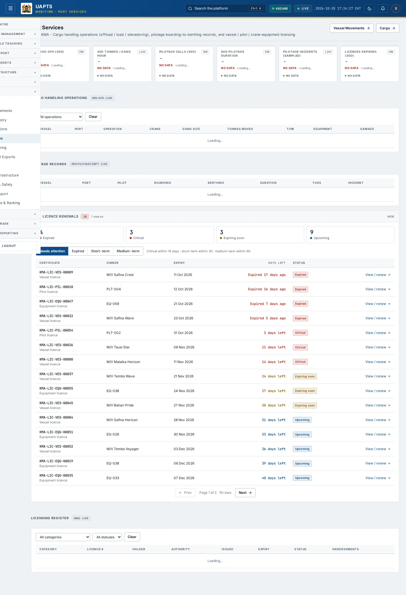
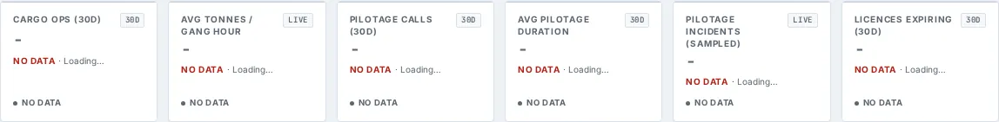

# Port Services

_Maritime › Port Services_ · Route `/maritime/services`

**Port Services** lets you see cargo handling operations (offload / load / stevedoring), pilotage boarding-to-berthing records, and vessel / pilot / crane-equipment licensing. Data on this page comes from KPA and KMA.

> 🎬 **Video tutorial:** _coming soon._  
> <!-- VIDEO-URL: maritime/port-services | paste the link here, e.g. [Watch the walkthrough](https://…) -->

## Highlights

- **6 headline tiles** — Cargo Ops (30d), Avg Tonnes / Gang Hour, Pilotage Calls (30d), Avg Pilotage Duration, Pilotage Incidents (sampled), Licences Expiring (30d).
- **3 panels** — Cargo Handling Operations, Pilotage Records, Licensing Register.
- **Filters and search** to narrow tables to what you need.
- Every figure is traceable to the data feed or upload template that supplies it — see [Data sources and feeds](#data-sources-and-feeds).

## Enabling and access

1. Sign in to UAPTS (see [How to access](../getting-started/how-to-access.md)).
2. In the left sidebar expand **Maritime** and click **Port Services**.
3. The page opens at `/maritime/services`. You can also reach it with the global search (**Ctrl + K**).

This page belongs to module **M07b · Maritime**. The sidebar and the global search only list pages your agency and role can open, and a link to a page you cannot reach sends you back to the Command Centre. If a page you expect is missing, ask your agency administrator to check your agency's [Module Access](../access-control/module-access.md).

## Page tour

### Headline tiles

| Tile | What it shows | Data from | Table → ingested via |
|---|---|---|---|
| **Cargo Ops (30d)** | Offload / load / stevedoring _(window: 30D)_ | `/aviation-maritime/maritime/services/summary/` | _CargoHandlingOperation_ → no template yet |
| **Avg Tonnes / Gang Hour** | Stevedoring productivity (from sampled ops) _(window: LIVE)_ | `/aviation-maritime/maritime/services/cargo-handling/` | _CargoHandlingOperation_ → no template yet |
| **Pilotage Calls (30d)** | Boarding to berthing _(window: 30D)_ | `/aviation-maritime/maritime/services/pilotage/`, `/aviation-maritime/maritime/services/summary/` | _PilotageRecord_ → no template yet |
| **Avg Pilotage Duration** | Target: &lt;120 min (Mombasa) _(window: 30D)_ | `/aviation-maritime/maritime/services/pilotage/`, `/aviation-maritime/maritime/services/summary/` | _PilotageRecord_ → no template yet |
| **Pilotage Incidents (sampled)** | Flagged near-miss / grounding / collision _(window: LIVE)_ | `/aviation-maritime/maritime/services/pilotage/` | _PilotageRecord_ → no template yet |
| **Licences Expiring (30d)** | Vessel / pilot / equipment _(window: 30D)_ | `/aviation-maritime/maritime/services/summary/` | _MaritimeLicence_ → no template yet |

### Cargo Handling Operations

Contains a table with the columns **Vessel**, **Port**, **Operation**, **Crane**, **Gang Size**, **Tonnes Moved**, **t/hr**, **Equipment**, **Damage**.

**Data from:** `/aviation-maritime/maritime/services/cargo-handling/`  
**Table → ingested via:** _CargoHandlingOperation_ → no template yet

### Pilotage Records

Contains a table with the columns **Vessel**, **Port**, **Pilot**, **Boarding**, **Berthing**, **Duration**, **Tugs**, **Incident**.

**Data from:** `/aviation-maritime/maritime/services/licences/`, `/aviation-maritime/maritime/services/pilotage/`  
**Table → ingested via:** _MaritimeLicence, PilotageRecord_ → no template yet

### Licensing Register

Contains a table with the columns **Category**, **Licence #**, **Holder**, **Authority**, **Issued**, **Expiry**, **Status**, **Endorsements**, **Certificate**, **Owner**, **Days left**, **Action**.

**Data from:** `/aviation-maritime/maritime/services/licences/`  
**Table → ingested via:** _MaritimeLicence_ → no template yet

## Working with this page

1. Open **Maritime → Port Services** from the sidebar.
2. Use the **All operations** drop-down to narrow the list. Choices include: Offloading (Discharge), Loading (Onloading), Stevedoring.
3. Use the **All categories** drop-down to narrow the list. Choices include: Vessel Licence, Pilot Licence, Crane / Equipment Licence.
4. Use the **All statuses** drop-down to narrow the list. Choices include: Active, Expired, Suspended.

## Status and value meanings

These are the values the platform stores for the fields shown on this page (`value` followed by the label you see).

| Field | Table | Values |
|---|---|---|
| operation type | CargoHandlingOperation | `offload` Offloading (discharge) · `load` Loading (onloading) · `stevedoring` |
| licence type | MaritimeLicence | `vessel` Vessel licence · `pilot` Pilot licence · `equipment` Crane / equipment licence |
| status | MaritimeLicence | `active` · `expired` · `suspended` |

## Data sources and feeds

Every number and table on this page is read from the API endpoints below. The **Ingested via** column says how the underlying records get into UAPTS: a downloadable **upload template** (xlsx/CSV, loaded through the [Integration Hub](../integration-hub/upload-and-connect.md)), a **live feed** that pushes records to the ingest API, or — where neither exists yet — it is stated plainly.

| Endpoint | Records | Ingested via |
|---|---|---|
| `GET /aviation-maritime/maritime/services/cargo-handling/` | Cargo Handling Operations | **No ingestion template yet** — populated by seed data or direct entry |
| `GET /aviation-maritime/maritime/services/licences/` | Maritime Licences | **No ingestion template yet** — populated by seed data or direct entry |
| `GET /aviation-maritime/maritime/services/pilotage/` | Pilotage Records | **No ingestion template yet** — populated by seed data or direct entry |
| `GET /aviation-maritime/maritime/services/summary/` | _Aggregate of 3 tables (rows below)_ | — |
| ↳ CargoHandlingOperation | Cargo Handling Operations | **No ingestion template yet** — populated by seed data or direct entry |
| ↳ MaritimeLicence | Maritime Licences | **No ingestion template yet** — populated by seed data or direct entry |
| ↳ PilotageRecord | Pilotage Records | **No ingestion template yet** — populated by seed data or direct entry |

Full details of every template (columns, formats) are in the [Data sources catalogue](../reference/data-sources.md). Interactive API documentation is available at `/api/docs/`.

## Permissions

| Who | What they can do here |
|---|---|
| Public / read-only accounts | View the page where the module is enabled for their agency (read-only). |
| Operator | View the page. |
| Analyst | View and **export CSV**. |
| Agency admin | Everything an analyst can do, plus the administrative capabilities listed in [Roles & Permissions](../access-control/roles-and-permissions.md). |
| Super admin | Sees every agency's data. |

**Agencies with the Maritime module:** full — SDT, KPA, KMA; selected pages only — KENHA, KRA, KENTRADE, KRC, NCTTCA, LAPSSET.

_Access is evaluated by the server from the baseline policy plus any agency overrides, so a super admin or agency admin may have changed it from the defaults above._

## Related topics

- [Overview](maritime-overview.md)
- [Vessel Movements](vessel-movements.md)
- [Vessel Registry](vessel-registry.md)
- [Port Operations](port-operations.md)
- [Cargo Tracking](cargo-tracking.md)
- [Imports and Exports](imports-and-exports.md)
- [Maritime overview](index.md)
- [Upload & Connect (Integration Hub)](../integration-hub/upload-and-connect.md)
- [Data sources catalogue](../reference/data-sources.md)

## On this page

- [Highlights](#highlights)
- [Enabling and access](#enabling-and-access)
- [Page tour](#page-tour)
- [Working with this page](#working-with-this-page)
- [Status and value meanings](#status-and-value-meanings)
- [Data sources and feeds](#data-sources-and-feeds)
- [Permissions](#permissions)
- [Related topics](#related-topics)

## Support

- **Your agency administrator** is the first contact for access, role and data-quality questions.
- **Data feeds, templates and API questions:** `api-support@uapts.go.ke` (include the `X-Request-ID` response header from a failing call).
- **Security concerns:** `security@uapts.go.ke`. Do not report suspected vulnerabilities publicly.
