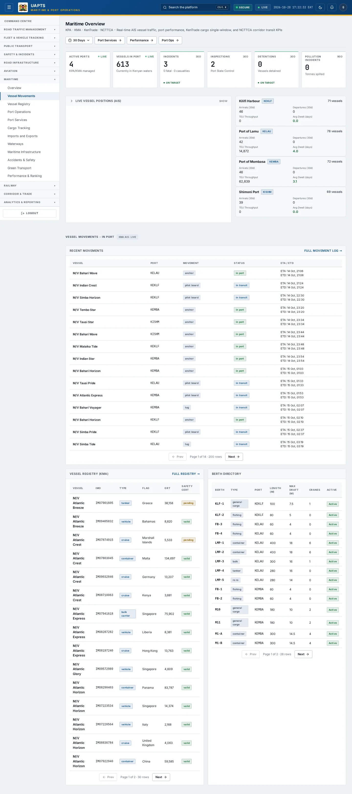
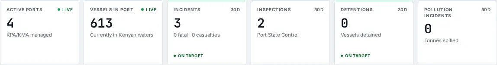
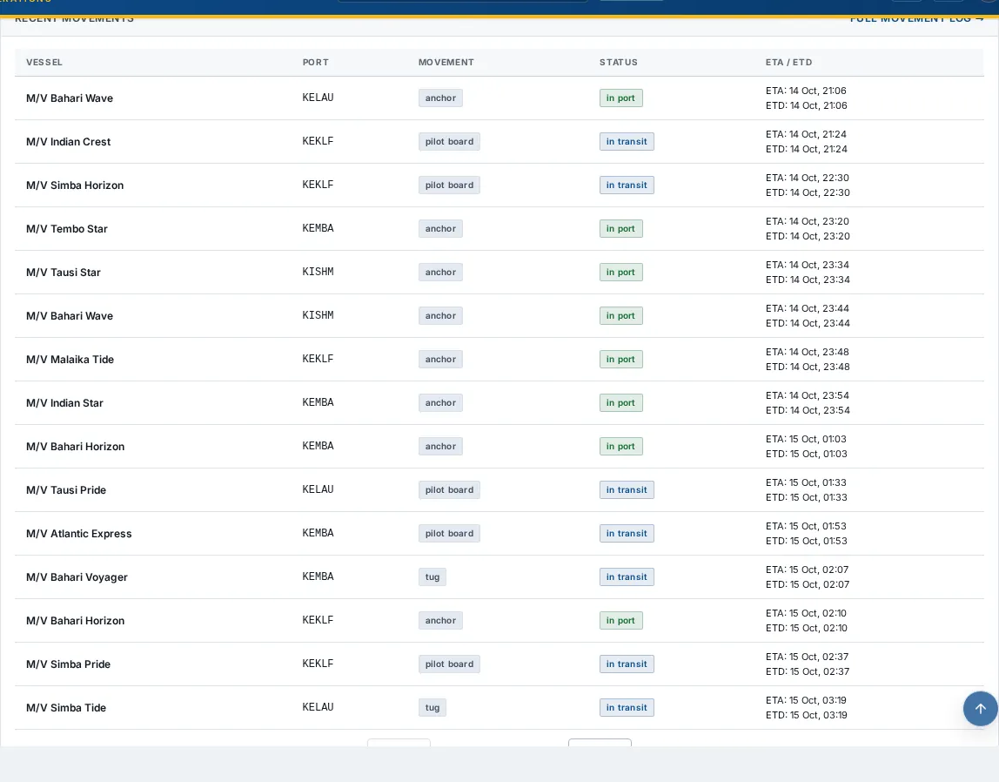
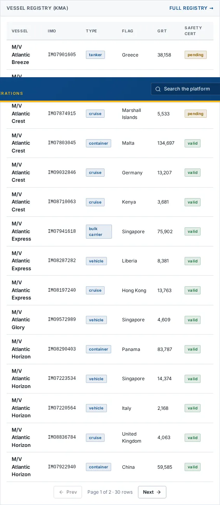
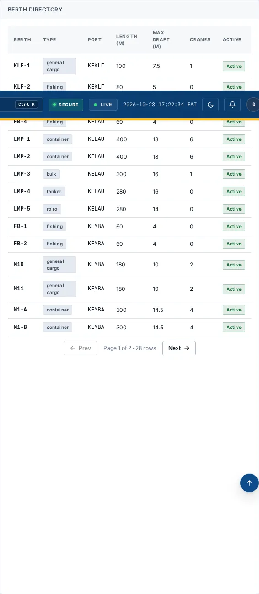

# Vessel Movements

_Maritime › Vessel Movements_ · Route `/maritime`

**Maritime Overview** lets you see real-time AIS vessel traffic, port performance, KenTrade cargo single-window, and NCTTCA corridor transit KPIs. Data on this page comes from KPA, KMA, KenTrade and NCTTCA.

> 🎬 **Video tutorial:** _coming soon._  
> <!-- VIDEO-URL: maritime/vessel-movements | paste the link here, e.g. [Watch the walkthrough](https://…) -->

## Highlights

- **6 headline tiles** — Active Ports, Vessels in Port, Incidents, Inspections, Detentions, Pollution Incidents.
- **4 panels** — Container Throughput by Port (), Recent Movements Full movement log, Vessel Registry (KMA) Full registry, Berth Directory.
- An **interactive map** with a legend, full-screen, locate-me and base-map controls.
- **Refreshes itself every 120 seconds**, so you do not need to reload the page.
- Every figure is traceable to the data feed or upload template that supplies it — see [Data sources and feeds](#data-sources-and-feeds).

## Enabling and access

1. Sign in to UAPTS (see [How to access](../getting-started/how-to-access.md)).
2. In the left sidebar expand **Maritime** and click **Vessel Movements**.
3. The page opens at `/maritime`. You can also reach it with the global search (**Ctrl + K**).

This page belongs to module **M07b · Maritime**. The sidebar and the global search only list pages your agency and role can open, and a link to a page you cannot reach sends you back to the Command Centre. If a page you expect is missing, ask your agency administrator to check your agency's [Module Access](../access-control/module-access.md).

## Page tour

### Headline tiles

| Tile | What it shows | Data from | Table → ingested via |
|---|---|---|---|
| **Active Ports** | KPA/KMA managed _(window: LIVE)_ | `/aviation-maritime/maritime/operations/` | aggregate of several tables — see [per-table feeds](#data-sources-and-feeds) |
| **Vessels in Port** | Currently in Kenyan waters _(window: LIVE)_ | `/aviation-maritime/maritime/operations/` | _VesselMovement_ → live feed `kpa-tos` |
| **Incidents** | — _(window: 30D)_ | `/aviation-maritime/maritime/maritime-incidents/stats/` | _MaritimeIncident_ → [`kma-marine-incidents`](../data-templates/kma-marine-incidents.xlsx) |
| **Inspections** | Port State Control _(window: 30D)_ | `/aviation-maritime/maritime/operations/` | _MaritimeInspection_ → [`kma-vessel-inspections`](../data-templates/kma-vessel-inspections.xlsx) |
| **Detentions** | Vessels detained _(window: 30D)_ | `/aviation-maritime/maritime/operations/` | _VesselMovement_ → live feed `kpa-tos` |
| **Pollution Incidents** | Tonnes spilled _(window: 90D)_ | `/aviation-maritime/maritime/maritime-incidents/stats/` | _MaritimeIncident_ → [`kma-marine-incidents`](../data-templates/kma-marine-incidents.xlsx) |

### Container Throughput by Port ()

**Data from:** `/aviation-maritime/maritime/container-throughput/by-port/`  
**Table → ingested via:** _ContainerThroughput_ → computed by UAPTS

### Recent Movements Full movement log

Contains a table with the columns **Vessel**, **Port**, **Movement**, **Status**, **ETA / ETD**.

**Data from:** `/aviation-maritime/maritime/vessel-movements/live/`, `/aviation-maritime/maritime/vessels/`  
**Table → ingested via:** _VesselMovement, Vessel_ → [`kma-vessel-registry`](../data-templates/kma-vessel-registry.xlsx) live feed `kpa-tos` live feed `kpa-vts`

### Vessel Registry (KMA) Full registry

Contains a table with the columns **Vessel**, **IMO**, **Type**, **Flag**, **GRT**, **Safety Cert**.

**Data from:** `/aviation-maritime/maritime/vessels/`  
**Table → ingested via:** _Vessel_ → [`kma-vessel-registry`](../data-templates/kma-vessel-registry.xlsx) live feed `kpa-vts` live feed `kpa-tos`

### Berth Directory

Contains a table with the columns **Berth**, **Type**, **Port**, **Length (m)**, **Max Draft (m)**, **Cranes**, **Active**.

**Data from:** `/aviation-maritime/maritime/berths/`  
**Table → ingested via:** _Berth_ → [`kpa-berth-register`](../data-templates/kpa-berth-register.xlsx)

## Working with this page

1. Open **Maritime → Vessel Movements** from the sidebar.
2. Wait for the page to finish loading. It re-fetches its data every **120 s**; the figures you see are the latest the platform holds, not a one-time snapshot.
3. On the map, drag to pan and scroll (or pinch) to zoom. Click a marker or line for its details. Use the map toolbar to go full-screen, centre on your location, reset the view or switch the base map; click the legend chip to expand it.

## Status and value meanings

These are the values the platform stores for the fields shown on this page (`value` followed by the label you see).

| Field | Table | Values |
|---|---|---|
| berth type | Berth | `container` Container terminal · `general_cargo` · `bulk` Bulk cargo · `tanker` Tanker / liquid · `fishing` · `ro_ro` RoRo · `cruise` |
| status | MaritimeIncident | `open` · `investigating` · `resolved` · `closed` |
| movement type | VesselMovement | `arrival` · `berthing` · `departure` · `anchor` At anchor · `pilot_board` Pilot on / off · `tug` Tug assist |
| status | VesselMovement | `scheduled` · `in_transit` · `in_port` · `departed` · `delayed` · `cancelled` |
| vessel type | Vessel | `container` Container ship · `bulk_carrier` · `tanker` · `general_cargo` · `vehicle` Vehicle carrier · `cruise` Cruise ship · `fishing` Fishing vessel · `passenger` Passenger vessel · `tug` · `supply` Offshore supply vessel · `dredger` · `other` |
| safety cert status | Vessel | `valid` · `expired` · `pending` |

## Data sources and feeds

Every number and table on this page is read from the API endpoints below. The **Ingested via** column says how the underlying records get into UAPTS: a downloadable **upload template** (xlsx/CSV, loaded through the [Integration Hub](../integration-hub/upload-and-connect.md)), a **live feed** that pushes records to the ingest API, or — where neither exists yet — it is stated plainly.

| Endpoint | Records | Ingested via |
|---|---|---|
| `GET /aviation-maritime/maritime/berths/` | Berths | [`kpa-berth-register`](../data-templates/kpa-berth-register.xlsx) |
| `GET /aviation-maritime/maritime/container-throughput/by-port/` | Container Throughputs | Computed by UAPTS from other data (no direct feed) |
| `GET /aviation-maritime/maritime/maritime-incidents/stats/` | Maritime Incidents | [`kma-marine-incidents`](../data-templates/kma-marine-incidents.xlsx) |
| `GET /aviation-maritime/maritime/operations/` | _Aggregate of 5 tables (rows below)_ | — |
| ↳ ContainerThroughput | Container Throughputs | Computed by UAPTS from other data (no direct feed) |
| ↳ MaritimeIncident | Maritime Incidents | [`kma-marine-incidents`](../data-templates/kma-marine-incidents.xlsx) |
| ↳ MaritimeInspection | Maritime Inspections | [`kma-vessel-inspections`](../data-templates/kma-vessel-inspections.xlsx) |
| ↳ VesselMovement | Vessel Movements | live feed `kpa-tos` (KPA TOS) |
| ↳ YardDwell | Yard Dwells | **No ingestion template yet** — populated by seed data or direct entry |
| `GET /aviation-maritime/maritime/ports/` | Ports | [`kma-port-register`](../data-templates/kma-port-register.xlsx) live feed `kpa-tos` (KPA TOS) |
| `GET /aviation-maritime/maritime/vessel-movements/live/` | Vessel Movements | live feed `kpa-tos` (KPA TOS) |
| `GET /aviation-maritime/maritime/vessels/` | Vessels | [`kma-vessel-registry`](../data-templates/kma-vessel-registry.xlsx) live feed `kpa-vts` (KPA VTS) live feed `kpa-tos` (KPA TOS) |

Full details of every template (columns, formats) are in the [Data sources catalogue](../reference/data-sources.md). Interactive API documentation is available at `/api/docs/`.

## Permissions

| Who | What they can do here |
|---|---|
| Public / read-only accounts | View the page where the module is enabled for their agency (read-only). |
| Operator | View the page. |
| Analyst | View and **export CSV**. |
| Agency admin | Everything an analyst can do, plus the administrative capabilities listed in [Roles & Permissions](../access-control/roles-and-permissions.md). |
| Super admin | Sees every agency's data. |

**Agencies with the Maritime module:** full — SDT, KPA, KMA; selected pages only — KENHA, KRA, KENTRADE, KRC, NCTTCA, LAPSSET.

_Access is evaluated by the server from the baseline policy plus any agency overrides, so a super admin or agency admin may have changed it from the defaults above._

## Related topics

- [Overview](maritime-overview.md)
- [Vessel Registry](vessel-registry.md)
- [Port Operations](port-operations.md)
- [Port Services](port-services.md)
- [Cargo Tracking](cargo-tracking.md)
- [Imports and Exports](imports-and-exports.md)
- [Maritime overview](index.md)
- [Upload & Connect (Integration Hub)](../integration-hub/upload-and-connect.md)
- [Data sources catalogue](../reference/data-sources.md)

## On this page

- [Highlights](#highlights)
- [Enabling and access](#enabling-and-access)
- [Page tour](#page-tour)
- [Working with this page](#working-with-this-page)
- [Status and value meanings](#status-and-value-meanings)
- [Data sources and feeds](#data-sources-and-feeds)
- [Permissions](#permissions)
- [Related topics](#related-topics)

## Support

- **Your agency administrator** is the first contact for access, role and data-quality questions.
- **Data feeds, templates and API questions:** `api-support@uapts.go.ke` (include the `X-Request-ID` response header from a failing call).
- **Security concerns:** `security@uapts.go.ke`. Do not report suspected vulnerabilities publicly.
