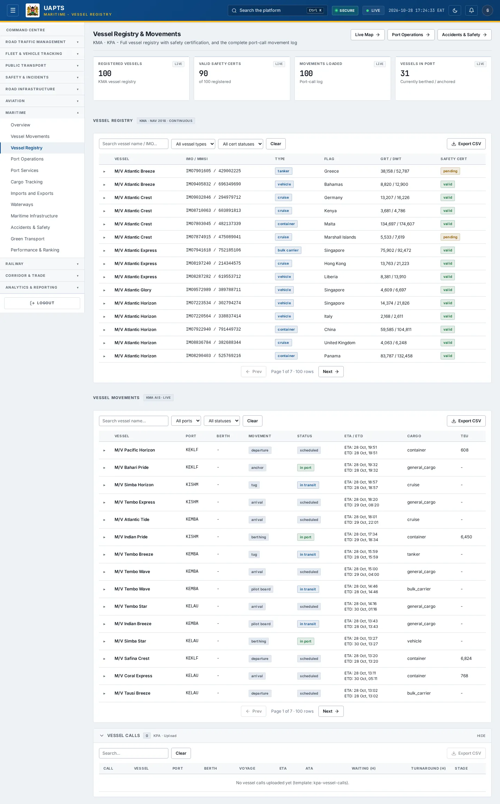
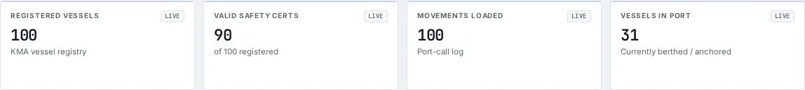

# Vessel Registry

_Maritime › Vessel Registry_ · Route `/maritime/vessels`

**Vessel Registry & Movements** lets you see full vessel registry with safety certification, and the complete port-call movement log. Data on this page comes from KMA and KPA.

> 🎬 **Video tutorial:** _coming soon._  
> <!-- VIDEO-URL: maritime/vessel-registry | paste the link here, e.g. [Watch the walkthrough](https://…) -->

## Highlights

- **4 headline tiles** — Registered Vessels, Valid Safety Certs, Movements Loaded, Vessels In Port.
- **2 panels** — Vessel Registry, Vessel Movements.
- **Refreshes itself every 120 seconds**, so you do not need to reload the page.
- **Export to CSV** for the rows you are looking at (Analyst tier and above).
- **Filters and search** to narrow tables to what you need.
- Every figure is traceable to the data feed or upload template that supplies it — see [Data sources and feeds](#data-sources-and-feeds).

## Enabling and access

1. Sign in to UAPTS (see [How to access](../getting-started/how-to-access.md)).
2. In the left sidebar expand **Maritime** and click **Vessel Registry**.
3. The page opens at `/maritime/vessels`. You can also reach it with the global search (**Ctrl + K**).

This page belongs to module **M07b · Maritime**. The route needs at least the **Operator** tier to open it. The sidebar and the global search only list pages your agency and role can open, and a link to a page you cannot reach sends you back to the Command Centre. If a page you expect is missing, ask your agency administrator to check your agency's [Module Access](../access-control/module-access.md).

## Page tour

### Headline tiles

| Tile | What it shows | Data from | Table → ingested via |
|---|---|---|---|
| **Registered Vessels** | KMA vessel registry _(window: LIVE)_ | `/aviation-maritime/maritime/vessels/` | _Vessel_ → [`kma-vessel-registry`](../data-templates/kma-vessel-registry.xlsx) live feed `kpa-vts` live feed `kpa-tos` |
| **Valid Safety Certs** | — _(window: LIVE)_ | `/aviation-maritime/maritime/vessels/` | _Vessel_ → [`kma-vessel-registry`](../data-templates/kma-vessel-registry.xlsx) live feed `kpa-vts` live feed `kpa-tos` |
| **Movements Loaded** | Port-call log _(window: LIVE)_ | `/aviation-maritime/maritime/vessel-movements/` | _VesselMovement_ → live feed `kpa-tos` |
| **Vessels In Port** | Currently berthed / anchored _(window: LIVE)_ | `/aviation-maritime/maritime/vessel-movements/` | _VesselMovement_ → live feed `kpa-tos` |

### Vessel Registry

Contains a table with the columns **Vessel**, **IMO / MMSI**, **Type**, **Flag**, **GRT / DWT**, **Safety Cert**.

**Data from:** `/aviation-maritime/maritime/vessel-movements/`, `/aviation-maritime/maritime/vessels/`  
**Table → ingested via:** _VesselMovement, Vessel_ → [`kma-vessel-registry`](../data-templates/kma-vessel-registry.xlsx) live feed `kpa-tos` live feed `kpa-vts`

### Vessel Movements

Contains a table with the columns **Vessel**, **Port**, **Berth**, **Movement**, **Status**, **ETA / ETD**, **Cargo**, **TEU**.

**Data from:** `/aviation-maritime/maritime/vessel-movements/`  
**Table → ingested via:** _VesselMovement_ → live feed `kpa-tos`

## Working with this page

1. Open **Maritime → Vessel Registry** from the sidebar.
2. Wait for the page to finish loading. It re-fetches its data every **120 s**; the figures you see are the latest the platform holds, not a one-time snapshot.
3. Type in the **“Search vessel name / IMO…”** box to filter what is shown.
4. Type in the **“Search vessel name…”** box to filter what is shown.
5. Type in the **“Search…”** box to filter what is shown.
6. Use the **All vessel types** drop-down to narrow the list. Choices include: Container, Bulk Carrier, Passenger, Tug, Supply, Dredger.
7. Use the **All cert statuses** drop-down to narrow the list. Choices include: Valid, Pending, Expired.
8. Use the **All statuses** drop-down to narrow the list. Choices include: Scheduled, In Transit, In Port, Departed, Delayed, Cancelled.
9. Click a row to open its detail.
10. Click **Export CSV** to download the rows currently loaded (after filters). The button only appears for Analyst tier and above.

## Status and value meanings

These are the values the platform stores for the fields shown on this page (`value` followed by the label you see).

| Field | Table | Values |
|---|---|---|
| movement type | ContainerMovement | `discharge` · `load` · `gate_in` · `gate_out` · `yard_move` · `rail_load` · `rail_discharge` · `shift` Shift / restow |
| status | ContainerMovement | `incoming` · `stacking` · `delivered` · `outgoing` |
| movement type | VesselMovement | `arrival` · `berthing` · `departure` · `anchor` At anchor · `pilot_board` Pilot on / off · `tug` Tug assist |
| status | VesselMovement | `scheduled` · `in_transit` · `in_port` · `departed` · `delayed` · `cancelled` |
| vessel type | Vessel | `container` Container ship · `bulk_carrier` · `tanker` · `general_cargo` · `vehicle` Vehicle carrier · `cruise` Cruise ship · `fishing` Fishing vessel · `passenger` Passenger vessel · `tug` · `supply` Offshore supply vessel · `dredger` · `other` |
| safety cert status | Vessel | `valid` · `expired` · `pending` |

## Data sources and feeds

Every number and table on this page is read from the API endpoints below. The **Ingested via** column says how the underlying records get into UAPTS: a downloadable **upload template** (xlsx/CSV, loaded through the [Integration Hub](../integration-hub/upload-and-connect.md)), a **live feed** that pushes records to the ingest API, or — where neither exists yet — it is stated plainly.

| Endpoint | Records | Ingested via |
|---|---|---|
| `GET /aviation-maritime/maritime/bulk-cargo/` | Bulk Cargo Transactions | [`kpa-bulk-cargo-transactions`](../data-templates/kpa-bulk-cargo-transactions.xlsx) |
| `GET /aviation-maritime/maritime/container-dwell/` | Container Dwell Records | [`kpa-container-dwell`](../data-templates/kpa-container-dwell.xlsx) |
| `GET /aviation-maritime/maritime/container-movements/` | Container Movements | [`kpa-container-movements`](../data-templates/kpa-container-movements.xlsx) |
| `GET /aviation-maritime/maritime/maritime-inspections/` | Maritime Inspections | [`kma-vessel-inspections`](../data-templates/kma-vessel-inspections.xlsx) |
| `GET /aviation-maritime/maritime/pollution-incidents/` | Marine Pollution Incidents | [`kma-marine-pollution-incidents`](../data-templates/kma-marine-pollution-incidents.xlsx) |
| `GET /aviation-maritime/maritime/vessel-calls/` | Vessel Calls | [`kpa-vessel-calls`](../data-templates/kpa-vessel-calls.xlsx) |
| `GET /aviation-maritime/maritime/vessel-movements/` | Vessel Movements | live feed `kpa-tos` (KPA TOS) |
| `GET /aviation-maritime/maritime/vessels/` | Vessels | [`kma-vessel-registry`](../data-templates/kma-vessel-registry.xlsx) live feed `kpa-vts` (KPA VTS) live feed `kpa-tos` (KPA TOS) |

Full details of every template (columns, formats) are in the [Data sources catalogue](../reference/data-sources.md). Interactive API documentation is available at `/api/docs/`.

## Permissions

| Who | What they can do here |
|---|---|
| Public / read-only accounts | No access to this page. |
| Operator | View the page. |
| Analyst | View and **export CSV**. |
| Agency admin | Everything an analyst can do, plus the administrative capabilities listed in [Roles & Permissions](../access-control/roles-and-permissions.md). |
| Super admin | Sees every agency's data. |

**Agencies with the Maritime module:** full — SDT, KPA, KMA; selected pages only — KENHA, KRA, KENTRADE, KRC, NCTTCA, LAPSSET.

_Access is evaluated by the server from the baseline policy plus any agency overrides, so a super admin or agency admin may have changed it from the defaults above._

## Related topics

- [Overview](maritime-overview.md)
- [Vessel Movements](vessel-movements.md)
- [Port Operations](port-operations.md)
- [Port Services](port-services.md)
- [Cargo Tracking](cargo-tracking.md)
- [Imports and Exports](imports-and-exports.md)
- [Maritime overview](index.md)
- [Upload & Connect (Integration Hub)](../integration-hub/upload-and-connect.md)
- [Data sources catalogue](../reference/data-sources.md)

## On this page

- [Highlights](#highlights)
- [Enabling and access](#enabling-and-access)
- [Page tour](#page-tour)
- [Working with this page](#working-with-this-page)
- [Status and value meanings](#status-and-value-meanings)
- [Data sources and feeds](#data-sources-and-feeds)
- [Permissions](#permissions)
- [Related topics](#related-topics)

## Support

- **Your agency administrator** is the first contact for access, role and data-quality questions.
- **Data feeds, templates and API questions:** `api-support@uapts.go.ke` (include the `X-Request-ID` response header from a failing call).
- **Security concerns:** `security@uapts.go.ke`. Do not report suspected vulnerabilities publicly.
