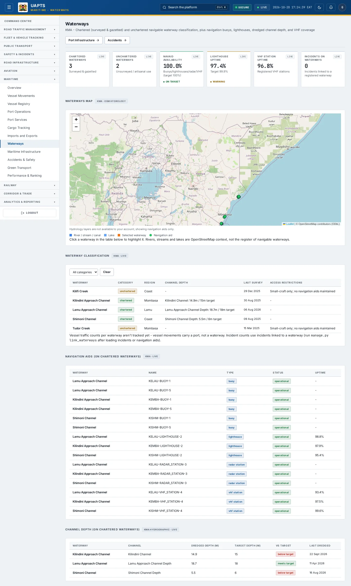
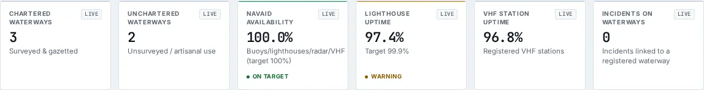

# Waterways

_Maritime › Waterways_ · Route `/maritime/waterways`

**Waterways** lets you see chartered (surveyed &amp; gazetted) and unchartered navigable waterway classification, plus navigation buoys, lighthouses, dredged channel depth, and VHF coverage. Data on this page comes from KMA.

> 🎬 **Video tutorial:** _coming soon._  
> <!-- VIDEO-URL: maritime/waterways | paste the link here, e.g. [Watch the walkthrough](https://…) -->

## Highlights

- **6 headline tiles** — Chartered Waterways, Unchartered Waterways, Navaid Availability, Lighthouse Uptime, VHF Station Uptime, Incidents on Waterways.
- **3 panels** — Waterway Classification, Navigation Aids (on chartered waterways), Channel Depth (on chartered waterways).
- **Filters and search** to narrow tables to what you need.
- Every figure is traceable to the data feed or upload template that supplies it — see [Data sources and feeds](#data-sources-and-feeds).

## Enabling and access

1. Sign in to UAPTS (see [How to access](../getting-started/how-to-access.md)).
2. In the left sidebar expand **Maritime** and click **Waterways**.
3. The page opens at `/maritime/waterways`. You can also reach it with the global search (**Ctrl + K**).

This page belongs to module **M07b · Maritime**. The sidebar and the global search only list pages your agency and role can open, and a link to a page you cannot reach sends you back to the Command Centre. If a page you expect is missing, ask your agency administrator to check your agency's [Module Access](../access-control/module-access.md).

## Page tour

### Headline tiles

| Tile | What it shows | Data from | Table → ingested via |
|---|---|---|---|
| **Chartered Waterways** | Surveyed &amp; gazetted _(window: LIVE)_ | `/aviation-maritime/maritime/waterways/` | _Waterway_ → no template yet |
| **Unchartered Waterways** | Unsurveyed / artisanal use _(window: LIVE)_ | `/aviation-maritime/maritime/waterways/` | _Waterway_ → no template yet |
| **Navaid Availability** | Buoys/lighthouses/radar/VHF (target 100%) _(window: LIVE)_ | `/aviation-maritime/maritime/waterways/infrastructure/` | aggregate of several tables — see [per-table feeds](#data-sources-and-feeds) |
| **Lighthouse Uptime** | Target 99.9% _(window: LIVE)_ | — | — |
| **VHF Station Uptime** | Registered VHF stations _(window: LIVE)_ | — | — |
| **Incidents on Waterways** | Incidents linked to a registered waterway _(window: LIVE)_ | `/aviation-maritime/maritime/waterways/summary/` | _MaritimeIncident, Waterway_ → [`kma-marine-incidents`](../data-templates/kma-marine-incidents.xlsx) |

### Waterway Classification

Contains a chart and a table with the columns **Waterway**, **Category**, **Region**, **Channel Depth**, **Last Survey**, **Access Restrictions**.

**Data from:** `/aviation-maritime/maritime/waterways/`  
**Table → ingested via:** _Waterway_ → no template yet

### Navigation Aids (on chartered waterways)

Contains a table with the columns **Waterway**, **Name**, **Type**, **Status**, **Uptime**.

**Data from:** `/aviation-maritime/maritime/waterways/`, `/aviation-maritime/maritime/waterways/infrastructure/`  
**Table → ingested via:** _Waterway, NavigationAid_ → no template yet

### Channel Depth (on chartered waterways)

Contains a table with the columns **Waterway**, **Channel**, **Dredged Depth (m)**, **Target Depth (m)**, **vs Target**, **Last Dredged**.

**Data from:** `/aviation-maritime/maritime/waterways/`, `/aviation-maritime/maritime/waterways/infrastructure/`  
**Table → ingested via:** _Waterway, Channel_ → no template yet

## Working with this page

1. Open **Maritime → Waterways** from the sidebar.
2. Use the **All categories** drop-down to narrow the list. Choices include: Chartered, Unchartered.
3. Click a row to open its detail.

## Status and value meanings

These are the values the platform stores for the fields shown on this page (`value` followed by the label you see).

| Field | Table | Values |
|---|---|---|
| category | Waterway | `chartered` · `unchartered` |

## Data sources and feeds

Every number and table on this page is read from the API endpoints below. The **Ingested via** column says how the underlying records get into UAPTS: a downloadable **upload template** (xlsx/CSV, loaded through the [Integration Hub](../integration-hub/upload-and-connect.md)), a **live feed** that pushes records to the ingest API, or — where neither exists yet — it is stated plainly.

| Endpoint | Records | Ingested via |
|---|---|---|
| `GET /aviation-maritime/maritime/waterways/` | Waterways | **No ingestion template yet** — populated by seed data or direct entry |
| `GET /aviation-maritime/maritime/waterways/infrastructure/` | _Aggregate of 2 tables (rows below)_ | — |
| ↳ Channel | Channels | **No ingestion template yet** — populated by seed data or direct entry |
| ↳ NavigationAid | Navigation Aids | **No ingestion template yet** — populated by seed data or direct entry |
| `GET /aviation-maritime/maritime/waterways/summary/` | _Aggregate of 5 tables (rows below)_ | — |
| ↳ Channel | Channels | **No ingestion template yet** — populated by seed data or direct entry |
| ↳ MaritimeIncident | Maritime Incidents | [`kma-marine-incidents`](../data-templates/kma-marine-incidents.xlsx) |
| ↳ NavigationAid | Navigation Aids | **No ingestion template yet** — populated by seed data or direct entry |
| ↳ VesselMovement | Vessel Movements | live feed `kpa-tos` (KPA TOS) |
| ↳ Waterway | Waterways | **No ingestion template yet** — populated by seed data or direct entry |
| `GET /aviation-maritime/maritime/waterways/{id}/geometry/` | Waterways | **No ingestion template yet** — populated by seed data or direct entry |

Full details of every template (columns, formats) are in the [Data sources catalogue](../reference/data-sources.md). Interactive API documentation is available at `/api/docs/`.

## Permissions

| Who | What they can do here |
|---|---|
| Public / read-only accounts | View the page where the module is enabled for their agency (read-only). |
| Operator | View the page. |
| Analyst | View and **export CSV**. |
| Agency admin | Everything an analyst can do, plus the administrative capabilities listed in [Roles & Permissions](../access-control/roles-and-permissions.md). |
| Super admin | Sees every agency's data. |

**Agencies with the Maritime module:** full — SDT, KPA, KMA; selected pages only — KENHA, KRA, KENTRADE, KRC, NCTTCA, LAPSSET.

_Access is evaluated by the server from the baseline policy plus any agency overrides, so a super admin or agency admin may have changed it from the defaults above._

## Related topics

- [Overview](maritime-overview.md)
- [Vessel Movements](vessel-movements.md)
- [Vessel Registry](vessel-registry.md)
- [Port Operations](port-operations.md)
- [Port Services](port-services.md)
- [Cargo Tracking](cargo-tracking.md)
- [Maritime overview](index.md)
- [Upload & Connect (Integration Hub)](../integration-hub/upload-and-connect.md)
- [Data sources catalogue](../reference/data-sources.md)

## On this page

- [Highlights](#highlights)
- [Enabling and access](#enabling-and-access)
- [Page tour](#page-tour)
- [Working with this page](#working-with-this-page)
- [Status and value meanings](#status-and-value-meanings)
- [Data sources and feeds](#data-sources-and-feeds)
- [Permissions](#permissions)
- [Related topics](#related-topics)

## Support

- **Your agency administrator** is the first contact for access, role and data-quality questions.
- **Data feeds, templates and API questions:** `api-support@uapts.go.ke` (include the `X-Request-ID` response header from a failing call).
- **Security concerns:** `security@uapts.go.ke`. Do not report suspected vulnerabilities publicly.
