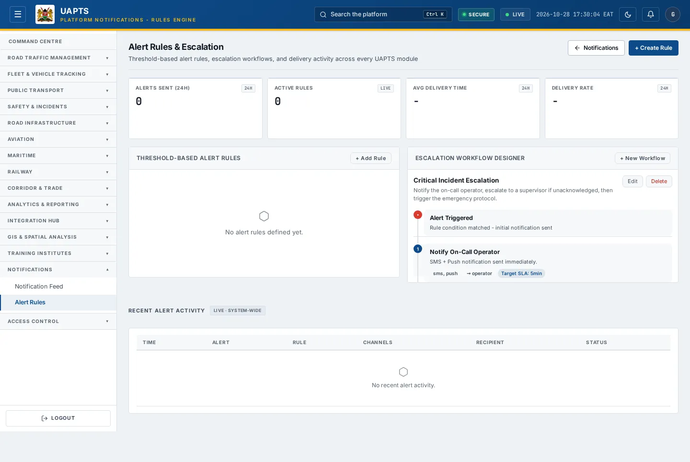

# Alert Rules & Escalation

_Notifications › Alert Rules_ · Route `/notifications/rules`

**Alert Rules** decide which events raise a notification, how serious they are, who receives them and by which channel, and how an unanswered alert is escalated.

> 🎬 **Video tutorial:** _coming soon._  
> <!-- VIDEO-URL: notifications/alert-rules | paste the link here, e.g. [Watch the walkthrough](https://…) -->

## Highlights

- Four headline tiles: **Alerts Sent (24h)**, **Active Rules**, **Avg Delivery Time**, **Delivery Rate**.
- **Threshold-Based Alert Rules** you can add, edit, switch **On/Off** or delete.
- **Escalation Workflow Designer** for multi-step escalation.
- **Active Escalations** with **Acknowledge** and **Escalate now**.
- **Recent Alert Activity** log with channel, recipient and status.

## Enabling and access

Open **Notifications → Alert Rules** (`/notifications/rules`). The route needs at least the **Admin** tier. The **+ Add Rule**, **Edit**, **Delete**, **On/Off** and workflow buttons appear and work only with the `configure_rules` capability; without it the page is read-only.

## Create an alert rule

1. Click **+ Add Rule** (or **+ Create Rule**).
2. Enter a **Rule Name** (required), for example _High-severity safety alert_.
3. Choose the **Event Type** (required): Traffic Violation Created · Traffic Congestion High · Safety Incident Created · Weather Observation Created · Revenue Anomaly Detected · Integration Sync Failed · Vessel Created · Vessel Position Updated · Vessel Seen · Vessel Movement Recorded · Flight Status Updated (the list reflects the events the platform can emit).
4. Set **Minimum Severity**: Any, Info, Warning, High or Critical.
5. Choose **Delivery Channels** (in-app, WebSocket, email, SMS) and **Target Roles** (blank = everyone).
6. Set a **Cooldown (seconds)** so the same condition does not alert repeatedly.
7. Optionally choose an **Escalation Policy**.
8. Write the **Message Template**. Use `{field}` placeholders that match the event's data, such as `{plate_number}`, `{violation_type}`, `{station}` or `{weight_kg}`.
9. Click **Create** (or **Update** when editing).

## Design an escalation workflow

1. Click **+ New Workflow**.
2. Give it a **Workflow Name** (required) and a **Description**.
3. Under **Steps (after the initial trigger)** click **+ Add Step**. For each step give a title and description, choose the **Target role** (admin, analyst or operator), set **Wait (min)** before the step fires, tick the delivery channels (in-app, WebSocket, email, SMS) and tick **Emergency** for an emergency step.
4. Click **Create**. Attach it to a rule through **Escalation Policy**.
5. When an alert fires the first notification is sent immediately (**Alert Triggered — Rule condition matched**); later steps fire if nobody acknowledges.
6. Use **Acknowledge** or **Escalate now** on an **Active Escalation** to take manual control.

## Data sources and feeds

| Data point | Endpoint | Ingested via |
|---|---|---|
| Tiles and Recent Alert Activity | `GET /notifications/stats/`, `GET /notifications/activity/` | Recorded by UAPTS each time an alert is delivered. |
| Rules | `GET /notifications/rules/` | Created on this page. |
| Escalation workflows and runs | `GET /notifications/escalation-policies/` | Created on this page. |

## Permissions

Admin tier with `configure_rules` can create, edit and delete rules and workflows. Others can read activity only.

## Related topics

- [Notification Feed](notification-feed.md)

## On this page

- [Highlights](#highlights)
- [Enabling and access](#enabling-and-access)
- [Create an alert rule](#create-an-alert-rule)
- [Design an escalation workflow](#design-an-escalation-workflow)
- [Data sources and feeds](#data-sources-and-feeds)
- [Permissions](#permissions)
- [Related topics](#related-topics)

## Support

- **Your agency administrator** is the first contact for access, role and data-quality questions.
- **Data feeds, templates and API questions:** `api-support@uapts.go.ke` (include the `X-Request-ID` response header from a failing call).
- **Security concerns:** `security@uapts.go.ke`. Do not report suspected vulnerabilities publicly.
