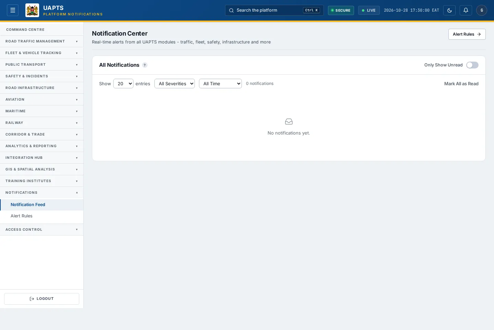

# Notification Feed

_Notifications › Notification Feed_ · Route `/notifications`

The **Notification Feed** lists real-time alerts from every UAPTS module — traffic, fleet, safety, infrastructure and more — and lets you mark them as read.

> 🎬 **Video tutorial:** _coming soon._  
> <!-- VIDEO-URL: notifications/notification-feed | paste the link here, e.g. [Watch the walkthrough](https://…) -->

## Highlights

- Live updates over a WebSocket connection (a banner warns if the live feed is unavailable).
- Filters for **read state**, **severity** and **time period**.
- **Mark as Read** per notification or **Mark All as Read**.
- Unread count on the **bell** in the top bar.
- Quick link to **Alert Rules**.

## Enabling and access

Click the **bell** in the top bar or open **Notifications → Notification Feed** (`/notifications`), module **M11**.

## Working with this page

1. Choose **All Notifications** or **Only Show Unread**.
2. Set **Show N entries** to control how many rows appear.
3. Filter by severity: **Critical**, **High**, **Warning**, **Info** (or **All Severities**).
4. Filter by time: **All Time**, **Last 24 Hours**, **Last 7 Days**, **Last 30 Days**.
5. Click **Mark as Read** on a notification, or **Mark All as Read** for everything.
6. Click **Alert Rules** to change what raises alerts (Admin).

## Severity meanings

| Severity | Typical meaning |
|---|---|
| Critical | Needs immediate action. |
| High | Serious; act soon. |
| Warning | Worth attention. |
| Info | For awareness. |

## Data sources and feeds

Notifications are **not loaded from a template**. UAPTS raises them automatically when something happens in another module (for example a traffic violation is recorded, congestion becomes high, a safety incident is created, a feed sync fails, a vessel position updates). Which events raise alerts, to whom and by which channel is controlled by [Alert Rules](alert-rules.md). Endpoints: `GET /notifications/`, `GET /notifications/unread-count/`, `POST /notifications/<id>/read/`, `POST /notifications/read-all/`; live updates arrive over `/ws/notifications/`.

## Permissions

Everyone with the Notifications module can read and mark their notifications. Changing rules needs the `configure_rules` capability (Admin).

## Related topics

- [Alert Rules](alert-rules.md)

## On this page

- [Highlights](#highlights)
- [Enabling and access](#enabling-and-access)
- [Working with this page](#working-with-this-page)
- [Severity meanings](#severity-meanings)
- [Data sources and feeds](#data-sources-and-feeds)
- [Permissions](#permissions)
- [Related topics](#related-topics)

## Support

- **Your agency administrator** is the first contact for access, role and data-quality questions.
- **Data feeds, templates and API questions:** `api-support@uapts.go.ke` (include the `X-Request-ID` response header from a failing call).
- **Security concerns:** `security@uapts.go.ke`. Do not report suspected vulnerabilities publicly.
