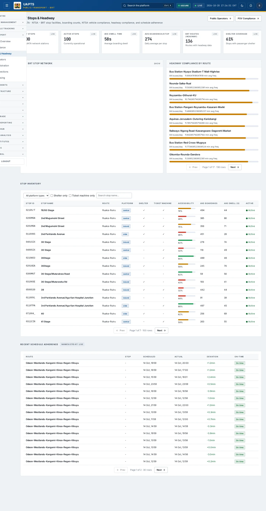
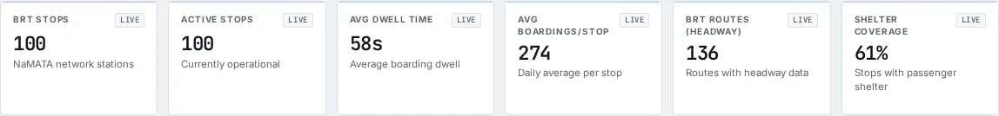
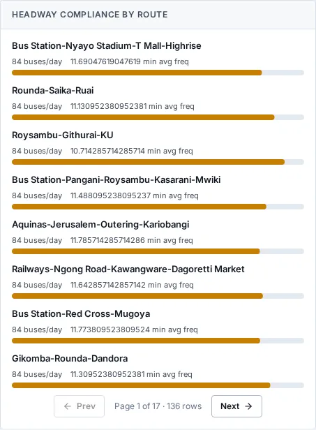

# BRT Stops & Headway

_Public Transport › BRT Stops & Headway_ · Route `/public-transport/brt`

**BRT Stops & Headway** lets you see BRT stop facilities, boarding counts, NTSA vehicle compliance, headway compliance, and schedule adherence. Data on this page comes from NaMATA and NTSA.

> 🎬 **Video tutorial:** _coming soon._  
> <!-- VIDEO-URL: public-transport/brt-stops-headway | paste the link here, e.g. [Watch the walkthrough](https://…) -->

## Highlights

- **6 headline tiles** — BRT Stops, Active Stops, Avg Dwell Time, Avg Boardings/Stop, BRT Routes (Headway), Shelter Coverage.
- **3 panels** — Headway Compliance by Route, Stop Inventory, Recent Schedule Adherence.
- An **interactive map** with a legend, full-screen, locate-me and base-map controls.
- **Refreshes itself every 120 seconds**, so you do not need to reload the page.
- **Filters and search** to narrow tables to what you need.
- Every figure is traceable to the data feed or upload template that supplies it — see [Data sources and feeds](#data-sources-and-feeds).

## Enabling and access

1. Sign in to UAPTS (see [How to access](../getting-started/how-to-access.md)).
2. In the left sidebar expand **Public Transport** and click **BRT Stops & Headway**.
3. The page opens at `/public-transport/brt`. You can also reach it with the global search (**Ctrl + K**).

This page belongs to module **M04 · Public Transport**. The sidebar and the global search only list pages your agency and role can open, and a link to a page you cannot reach sends you back to the Command Centre. If a page you expect is missing, ask your agency administrator to check your agency's [Module Access](../access-control/module-access.md).

## Page tour

### Headline tiles

| Tile | What it shows | Data from | Table → ingested via |
|---|---|---|---|
| **BRT Stops** | NaMATA network stations _(window: LIVE)_ | `/public-transport/brt-stops/` | _BRTStop_ → [`namata-brt-stop-register`](../data-templates/namata-brt-stop-register.xlsx) |
| **Active Stops** | Currently operational _(window: LIVE)_ | `/public-transport/brt-stops/` | _BRTStop_ → [`namata-brt-stop-register`](../data-templates/namata-brt-stop-register.xlsx) |
| **Avg Dwell Time** | Average boarding dwell _(window: LIVE)_ | `/public-transport/brt-stops/` | _BRTStop_ → [`namata-brt-stop-register`](../data-templates/namata-brt-stop-register.xlsx) |
| **Avg Boardings/Stop** | Daily average per stop _(window: LIVE)_ | `/public-transport/brt-stops/` | _BRTStop_ → [`namata-brt-stop-register`](../data-templates/namata-brt-stop-register.xlsx) |
| **BRT Routes (Headway)** | Routes with headway data _(window: LIVE)_ | `/public-transport/brt-stops/headway/` | _BRTStop_ → [`namata-brt-stop-register`](../data-templates/namata-brt-stop-register.xlsx) |
| **Shelter Coverage** | Stops with passenger shelter _(window: LIVE)_ | `/public-transport/brt-stops/` | _BRTStop_ → [`namata-brt-stop-register`](../data-templates/namata-brt-stop-register.xlsx) |

### Headway Compliance by Route

**Data from:** `/public-transport/brt-stops/`, `/public-transport/brt-stops/headway/`  
**Table → ingested via:** _BRTStop_ → [`namata-brt-stop-register`](../data-templates/namata-brt-stop-register.xlsx)

### Stop Inventory

Contains a table with the columns **Stop ID**, **Stop Name**, **Route**, **Platform**, **Shelter**, **Ticket Machine**, **Accessibility**, **Avg Boardings**, **Avg Dwell (s)**, **Active**.

**Data from:** `/public-transport/brt-stops/`, `/public-transport/schedule-adherence/`  
**Table → ingested via:** _BRTStop, ScheduleAdherence_ → [`namata-brt-stop-register`](../data-templates/namata-brt-stop-register.xlsx)

### Recent Schedule Adherence

Contains a table with the columns **Route**, **Stop**, **Scheduled**, **Actual**, **Deviation**, **On-Time**.

**Data from:** `/public-transport/schedule-adherence/`  
**Table → ingested via:** _ScheduleAdherence_ → no template yet

## Working with this page

1. Open **Public Transport → BRT Stops & Headway** from the sidebar.
2. Wait for the page to finish loading. It re-fetches its data every **120 s**; the figures you see are the latest the platform holds, not a one-time snapshot.
3. Type in the **“Search stop name…”** box to filter what is shown.
4. Use the **All platform types** drop-down to narrow the list. Choices include: Center, Side, Island.
5. On the map, drag to pan and scroll (or pinch) to zoom. Click a marker or line for its details. Use the map toolbar to go full-screen, centre on your location, reset the view or switch the base map; click the legend chip to expand it.

## Status and value meanings

These are the values the platform stores for the fields shown on this page (`value` followed by the label you see).

| Field | Table | Values |
|---|---|---|
| platform type | BRTStop | `center` Center platform · `side` Side platform · `island` Island platform |

## Data sources and feeds

Every number and table on this page is read from the API endpoints below. The **Ingested via** column says how the underlying records get into UAPTS: a downloadable **upload template** (xlsx/CSV, loaded through the [Integration Hub](../integration-hub/upload-and-connect.md)), a **live feed** that pushes records to the ingest API, or — where neither exists yet — it is stated plainly.

| Endpoint | Records | Ingested via |
|---|---|---|
| `GET /public-transport/brt-stops/` | Brt Stops | [`namata-brt-stop-register`](../data-templates/namata-brt-stop-register.xlsx) |
| `GET /public-transport/brt-stops/headway/` | Brt Stops | [`namata-brt-stop-register`](../data-templates/namata-brt-stop-register.xlsx) |
| `GET /public-transport/schedule-adherence/` | Schedule Adherences | **No ingestion template yet** — populated by seed data or direct entry |

Full details of every template (columns, formats) are in the [Data sources catalogue](../reference/data-sources.md). Interactive API documentation is available at `/api/docs/`.

## Permissions

| Who | What they can do here |
|---|---|
| Public / read-only accounts | View the page where the module is enabled for their agency (read-only). |
| Operator | View the page. |
| Analyst | View and **export CSV**. |
| Agency admin | Everything an analyst can do, plus the administrative capabilities listed in [Roles & Permissions](../access-control/roles-and-permissions.md). |
| Super admin | Sees every agency's data. |

**Agencies with the Public Transport module:** full — KURA, SDT, NTSA, NAMATA; selected pages only — COUNTY_GOV.

_Access is evaluated by the server from the baseline policy plus any agency overrides, so a super admin or agency admin may have changed it from the defaults above._

## Related topics

- [Operations Overview](operations-overview.md)
- [PSV Compliance](psv-compliance.md)
- [Public Operators](public-operators.md)
- [Vehicle Registration](vehicle-registration.md)
- [Vehicle Inspections](vehicle-inspections.md)
- [Driver Licensing](driver-licensing.md)
- [Public Transport overview](index.md)
- [Upload & Connect (Integration Hub)](../integration-hub/upload-and-connect.md)
- [Data sources catalogue](../reference/data-sources.md)

## On this page

- [Highlights](#highlights)
- [Enabling and access](#enabling-and-access)
- [Page tour](#page-tour)
- [Working with this page](#working-with-this-page)
- [Status and value meanings](#status-and-value-meanings)
- [Data sources and feeds](#data-sources-and-feeds)
- [Permissions](#permissions)
- [Related topics](#related-topics)

## Support

- **Your agency administrator** is the first contact for access, role and data-quality questions.
- **Data feeds, templates and API questions:** `api-support@uapts.go.ke` (include the `X-Request-ID` response header from a failing call).
- **Security concerns:** `security@uapts.go.ke`. Do not report suspected vulnerabilities publicly.
